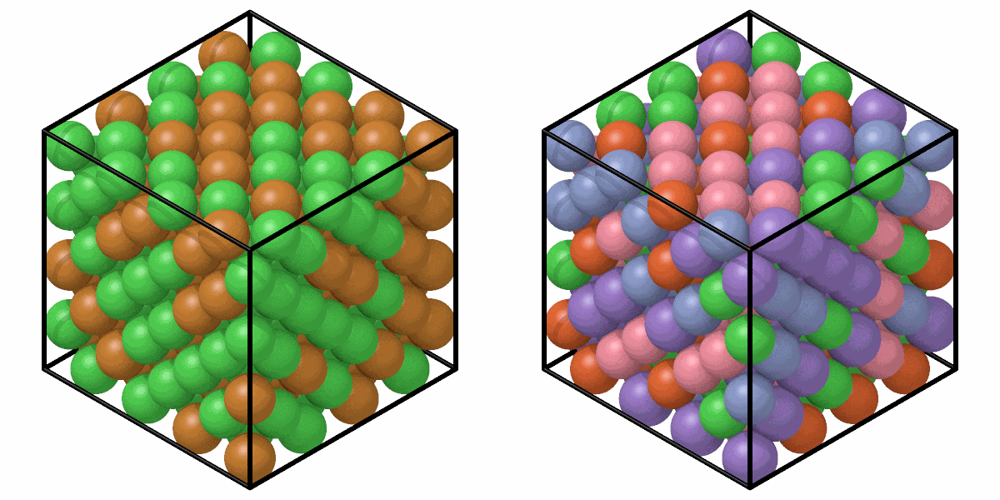

# Special quasirandom structures

`sqs_alloy` places elements in given fractions on the sites of a perfect
lattice so that the pairs of the nearest shells of neighbors are those of a
random alloy, the best that a small cell can do for a random alloy.

```python
from mdapy.build import build_crystal, sqs_alloy

sites = build_crystal("fcc", 3.6, repeat=(4, 4, 4))
cuni = sqs_alloy(sites, {"Cu": 1, "Ni": 1}, shells=3, seed=1)
cantor = sqs_alloy(sites, {"Co": 1, "Cr": 1, "Fe": 1, "Mn": 1, "Ni": 1}, seed=1)
```

```python
import numpy as np

from mdapy.visualization import render, write_png

left = render(cuni, width=600, height=600)
right = render(cantor, width=600, height=600)
write_png("images/sqs.png", np.hstack([left, right]))
```



*Left: equiatomic CuNi of 256 atoms whose pair correlations in the first three
shells come as close as the cell allows to those of the random alloy. Right:
the Cantor alloy on the same sites.*

## Parameters

`sqs_alloy(system, fractions, *, shells=3, weights=None, steps=100000, temperature=1.0, seed=None, progress=None, cancel=None)`

| Name | Type | Default | Meaning |
|---|---|---|---|
| `system` | `System` | | the sites, a perfect lattice such as from [`build_crystal`](crystals.md) |
| `fractions` | dict of str to float | | the fraction of each element; the counts are those of [`random_alloy`](alloys.md) |
| `shells` | int | 3 | the number of shells of neighbors made random, 1 to 10 |
| `weights` | sequence of float | all 1 | the weight of each shell in the deviation |
| `steps` | int | 100000 | the number of swaps tried |
| `temperature` | float | 1 | the starting temperature of the annealing, in units of the typical change of a swap; 0 keeps only improvements |
| `seed` | int or `numpy.random.Generator` | `None` | the starting alloy and the swaps |
| `progress`, `cancel` | | `None` | as for [every analysis](../analysis/overview.md#parameters) |

The shells are the distinct distances between sites, nearest first, so the
lattice must be perfect.

## Results

The system with a new `element` column, the best arrangement found.

## Errors

`sqs_alloy` raises `InvalidParameter` for a number of shells out of range,
weights that are not one per shell or negative, a negative number of steps
or temperature, and the errors of `random_alloy`; `Cancelled` when
cancelled.

## Definition

With $N^{(s)}_{ab}$ the ordered pairs of shell $s$ from an atom of element
$a$ to one of $b$, $P_s$ all pairs of shell $s$ and $x_a$ the fractions, the
deviation from a random alloy

$$
D = \sum_s w_s \sum_{a,b} \left( \frac{N^{(s)}_{ab}}{P_s} - x_a x_b \right)^2
$$

is zero when the Warren–Cowley parameters
$\alpha^{(s)}_{ab} = 1 - N^{(s)}_{ab} / (x_a x_b P_s)$ of every shell
vanish. Starting from a random alloy, pairs of atoms of different elements
swap places when the swap lowers $D$, or with the probability
$e^{-\Delta D / T}$ otherwise, while $T$ falls linearly to zero; the
arrangement with the lowest $D$ is returned.

!!! quote "Please cite"
    [Zunger et al. (1990)](../reference/references.md#zunger1990).
