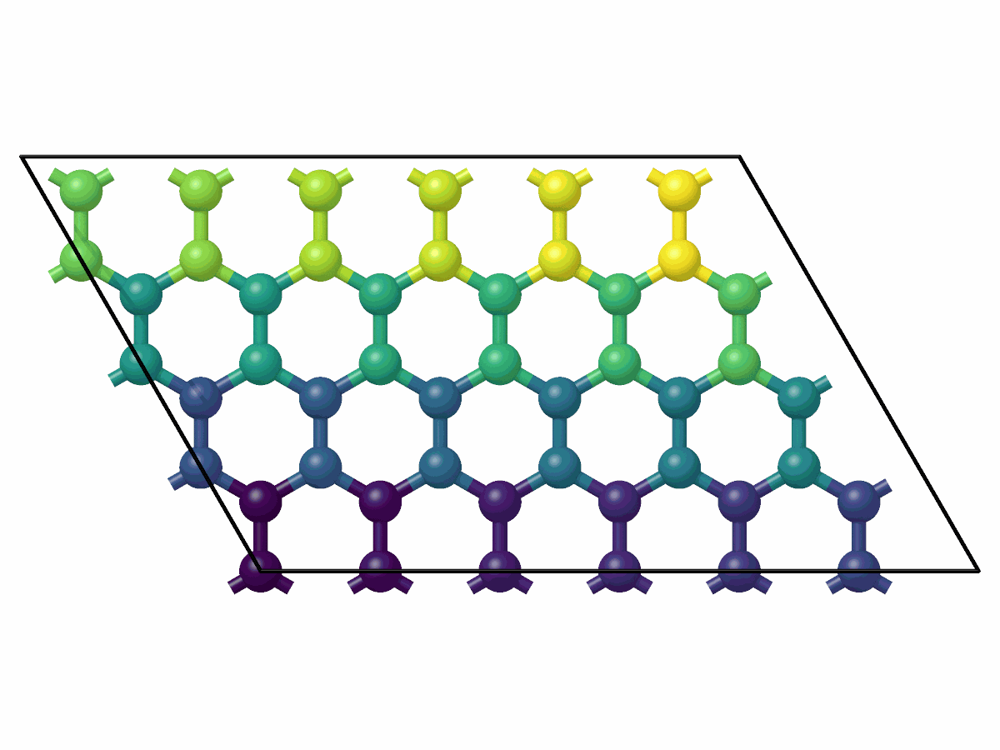

# Periodic copies and images

`mdapy.transform.replicate` places copies of a system side by side along its
periodic directions, as LAMMPS `replicate` does; `wrap` moves atoms into the
box and `unwrap` puts them at their unwrapped positions.

```python
import mdapy as mp
from mdapy.transform import replicate, unwrap, wrap

box = mp.Box([[4.0, 0, 0], [1.0, 4.0, 0], [0, 0, 4.0]])
system = mp.System([[0.5, 0.5, 0.5], [3.9, 2.0, 2.0]], box, elements="Cu")
system = system.with_columns(id=[1, 2], image=[[0, 0, 0], [-1, 0, 0]])

bigger = replicate(system, (2, 3, 1))  # 12 atoms, ids 1 to 12
bigger.box.matrix  # rows 2a, 3b and c
inside = wrap(system)  # fractional coordinates in [0, 1), image flags updated
moved = unwrap(system)  # the second atom at x = -0.1, image flags zero
```

The copies are numbered along **a** first. A cell of graphene, two atoms,
replicated 6 × 4 times, each copy colored by its number:

```python
import numpy as np

from mdapy.build import build_crystal
from mdapy.visualization import render

cell = build_crystal("graphene", 2.46, c=10.0, elements="C")
sheet = replicate(cell, (6, 4, 1))
copy = np.arange(len(sheet)) // len(cell)  # the copy of each atom
render(
    sheet,
    "images/replicate.png",
    color=copy,
    representation="ball_and_stick",
    view="top",
)
```



*Seen from above, copy 0 (dark violet) at the origin, the next copies along
**a** to its right, the rows of copies along **b** above; the last is
yellow.*

## Parameters

| Function | Name | Type | Meaning |
|---|---|---|---|
| `replicate(system, repeat)` | `repeat` | int or three int | copies along **a**, **b** and **c**, at least 1; above 1 only along periodic directions |
| `wrap(system)` | | | |
| `unwrap(system)` | | | needs an `image` column |

Each returns a new `System`.

## Results

`replicate` gives the copies in a box with lattice vectors
$n_a\mathbf a$, $n_b\mathbf b$ and $n_c\mathbf c$ and the same origin:

- Copy $(i, j, l)$ is number $k = i + n_a (j + n_b l)$, so the copy along
  **a** changes fastest; its atoms are rows $kN$ to $kN + N - 1$, in the
  order of the original.
- Its `id`s are those of the original plus $k$ times the largest `id`.
  `molecule` numbers above 0 are offset the same way; 0, no molecule, stays 0.
- Bonds, angles, dihedrals and impropers of copy $k$ join the atoms of copy
  $k$.
- With an `image` column, each atom is placed at its unwrapped position
  moved by $i\mathbf a + j\mathbf b + l\mathbf c$ and wrapped into the new
  box, which gives its new image flags, so a molecule whole in unwrapped
  positions is whole in every copy. Without one, the atoms are moved by
  $i\mathbf a + j\mathbf b + l\mathbf c$ and not wrapped.
- Other columns are copied. `energy` and `virial`, which describe the
  original system, are left out of `info`; the rest is kept.

`wrap` moves each atom by whole lattice vectors so that its fractional
coordinates along the periodic directions lie in $[0, 1)$; an `image` column
changes by the same vectors, so the unwrapped positions stay where they were.

`unwrap` puts each atom at its unwrapped position, its position plus its
image flags times the lattice vectors, and sets the image flags to zero.

Neither changes the topology.

## Errors

`replicate` raises
[`InvalidParameter`](../reference/api.md#mdapy.errors.InvalidParameter)
when `repeat` is not one or three positive integers, or is above 1 along a
direction that is not periodic. `unwrap` raises
[`MissingProperty`](../reference/api.md#mdapy.errors.MissingProperty)
without an `image` column.

## See also

- LAMMPS [replicate](https://docs.lammps.org/replicate.html).
