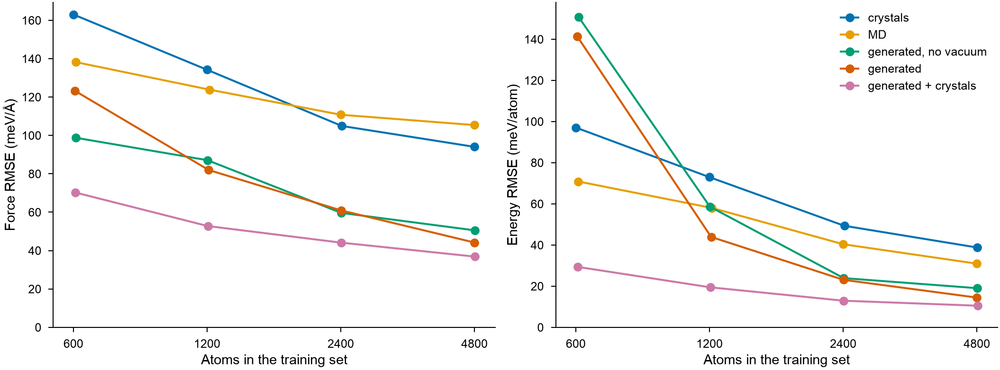

# Generated training sets for aluminium

How well does a machine-learned potential learn from
[generated structures](../user-guide/mlip/generation.md), against the usual
training sets of perturbed crystals and molecular dynamics, and how many
structures are enough? This page answers it for aluminium with a teacher
and its students. The universal potential
[MatterSim](https://github.com/microsoft/mattersim)
([Yang et al. 2024](../reference/references.md#yang2024)) labels every
structure in place of DFT; NEP models trained with
[torchnep](https://github.com/mushroomfire/torchnep)
([Wu et al. 2026](../reference/references.md#wu2026torchnep)) on each set are
compared with it on structures none of them was trained on: crystals,
defects, compressed and expanded solids, liquids, surfaces, grain
boundaries and a cluster, and in molecular dynamics of their own.

The page runs on one GPU with MatterSim and torchnep installed. It took 70
minutes on an NVIDIA H100: 40 for the generation, the dynamics and the
labels, 25 for the 120 trainings.

<!-- needs: mattersim -->
<!-- needs: torchnep -->

## The teacher

MatterSim, an ASE calculator, becomes an MDAPY one, which labels frames
with their energy, forces and virial and runs molecular dynamics:

```python
import numpy as np
from mattersim.forcefield import MatterSimCalculator
from mdapy.interop import from_ase_calculator

mattersim = MatterSimCalculator(load_path="MatterSim-v1.0.0-1M.pth", device="cuda")
teacher = from_ase_calculator(mattersim)


def labelled(frames):
    """The frames with the energy, forces and virial of the teacher."""
    out = []
    for frame in frames:
        found = teacher.compute(frame, ("energy", "forces", "virial"))
        out.append(
            frame.with_columns(forces=found.forces).with_info(
                energy=found.energy, virial=found.virial
            )
        )
    return out
```

[Molecular dynamics](../user-guide/simulation/dynamics.md) runs in MDAPY,
with the teacher or a student:

```python
from mdapy.errors import CalculationFailed
from mdapy.neighbor import NeighborList
from mdapy.simulation import MolecularDynamics


def md(system, calculator, temperature, steps, every, start=0, seed=1):
    """Langevin dynamics of 2 fs steps: a snapshot every `every` steps after
    the first `start`, up to one with two atoms closer than 1.5 Å."""
    with MolecularDynamics(system, calculator, timestep=0.002) as run:
        run.velocities(temperature, seed=seed)
        try:
            run.run(
                steps,
                ensemble="nvt",
                temperature=temperature,
                thermostat="langevin",
                seed=seed,
                thermo=steps,
                save_every=every,
            )
        except CalculationFailed:  # a model that fails: its snapshots so far
            pass
        frames = [f for f in run.frames if f.info["timestep"] > start]
    out = []
    for frame in frames:
        if len(NeighborList.build(frame, 1.5).j):
            break
        kept = frame.select("element", "positions")
        out.append(kept.with_info(timestep=None, time=None))
    return out
```

## Training sets

Five sets of up to 4800 atoms, each made three times with other seeds:

- **crystals**: fcc, bcc and hcp cells of 32 to 54 atoms at 0.85 to 1.15
  times the volume of the crystal, their atoms displaced and their boxes
  strained by [`perturb`](../user-guide/mlip/perturbation.md);
- **MD**: snapshots of molecular dynamics of 32 atoms with the teacher, from
  300 K in the crystal to 2500 K in the liquid;
- **generated, no vacuum**: `generate_structures` with periodic cells only;
- **generated**: `generate_structures` with its defaults, a fifth of the
  cells slabs or clusters;
- **generated + crystals**: two thirds of the atoms generated, one third
  crystals, and the frames within 0.5 eV/atom of the lowest energy per atom
  weighted three times in the training.

The generated structures span half to twice the volume per atom of the
crystal, 16.6 ų; each generation makes its default 1000 structures, some
7000 atoms, of which the sets take the first.

```python
from mdapy.build import build_crystal
from mdapy.mlip import generate_structures, perturb

VOLUME = (8.3, 33.2)
BUDGET = 4800
SEEDS = (0, 1, 2)
fcc = build_crystal("fcc", 4.05, elements="Al", repeat=(2, 2, 2))
bcc = build_crystal("bcc", 3.24, elements="Al", repeat=(3, 3, 3))
hcp = build_crystal("hcp", 2.86, elements="Al", repeat=(3, 2, 2))


def first(frames, atoms=BUDGET):
    """The first frames, up to the number of atoms."""
    out, count = [], 0
    for frame in frames:
        if count >= atoms:
            break
        out.append(frame)
        count += len(frame)
    return out


def scaled(system, factor):
    """The system with its volume times factor."""
    matrix = system.box.matrix * factor ** (1 / 3)
    return system.with_box(matrix, scale_positions=True)


def crystals(seed):
    rng = np.random.default_rng(seed)
    kinds = [(fcc, 0.1), (fcc, 0.25), (bcc, 0.15), (hcp, 0.15)]
    frames = []
    for k in range(160):
        crystal, displacement = kinds[k % 4]
        volume = np.exp(rng.uniform(np.log(0.85), np.log(1.15)))
        frames += perturb(
            scaled(crystal, volume), 1, displacement=displacement, strain=0.05, seed=rng
        )
    return first(frames)


def sampled_by_md(seed):
    """Snapshots every 60 fs of seven runs, taken from each in turn."""
    conditions = [(300, 1.0), (600, 1.0), (900, 0.95), (900, 1.05), (1200, 1.0)]
    conditions += [(1500, 1.1), (2500, 1.15)]
    runs = [
        md(scaled(fcc, v), teacher, t, 1060, 30, start=400, seed=100 * seed + k + 1)
        for k, (t, v) in enumerate(conditions)
    ]
    return first([run[i] for i in range(22) for run in runs])


def mixed(parts, shares):
    """The frames of the parts in turn, so that the atoms of each part keep
    its share in every first part of the set, until one runs out."""
    taken, atoms, out = [0] * len(parts), [0] * len(parts), []
    while sum(atoms) < BUDGET:
        k = min(range(len(parts)), key=lambda k: atoms[k] / shares[k])
        if taken[k] == len(parts[k]):
            break
        out.append(parts[k][taken[k]])
        taken[k] += 1
        atoms[k] += len(out[-1])
    return out


def training_sets(seed):
    generated = generate_structures("Al", volume=VOLUME, seed=seed).structures
    periodic = generate_structures("Al", volume=VOLUME, vacuum=0.0, seed=seed)
    periodic = periodic.structures
    return {
        "crystals": crystals(seed),
        "MD": sampled_by_md(seed),
        "generated, no vacuum": first(periodic),
        "generated": first(generated),
        "generated + crystals": mixed([generated, crystals(seed + 50)], [2, 1]),
    }
```

Each set is labelled and written as an extended XYZ file. The frames keep
their order, so that the first of them make the smaller sets:

```python
from pathlib import Path
from mdapy.io import write

Path("train").mkdir(exist_ok=True)
for seed in SEEDS:
    for name, frames in training_sets(seed).items():
        frames = labelled(frames)
        if name == "generated + crystals":
            energies = [f.info["energy"] / len(f) for f in frames]
            low = min(energies) + 0.5
            frames = [
                f.with_info(weight=3.0) if e < low else f
                for f, e in zip(frames, energies, strict=True)
            ]
        write(f"train/{name}_{seed}.xyz", frames)
        atoms = sum(len(f) for f in frames)
        print(f"{name:21s} seed {seed}: {len(frames):3d} frames, {atoms} atoms")
```

```text
crystals              seed 0: 135 frames, 4804 atoms
MD                    seed 0: 150 frames, 4800 atoms
generated, no vacuum  seed 0: 631 frames, 4800 atoms
generated             seed 0: 730 frames, 4809 atoms
generated + crystals  seed 0: 520 frames, 4820 atoms
crystals              seed 1: 135 frames, 4804 atoms
MD                    seed 1: 150 frames, 4800 atoms
generated, no vacuum  seed 1: 689 frames, 4804 atoms
generated             seed 1: 686 frames, 4800 atoms
generated + crystals  seed 1: 478 frames, 4807 atoms
crystals              seed 2: 135 frames, 4804 atoms
MD                    seed 2: 150 frames, 4800 atoms
generated, no vacuum  seed 2: 624 frames, 4814 atoms
generated             seed 2: 713 frames, 4800 atoms
generated + crystals  seed 2: 497 frames, 4822 atoms
```

*Every set holds 4800 atoms: the crystals in 135 frames, MD in 150, the
generated sets in 620 to 730 small cells of 7 to 8 atoms on average, the first of
the 1000 structures of each generation.*

## Test structures

Fifteen sets of structures that none of the training sets holds, in five
groups, labelled by the teacher:

```python
from mdapy import Box
from mdapy.build import add_interstitials, add_vacuum, build_polycrystal


def crystal(structure, a, repeat):
    return build_crystal(structure, a, elements="Al", repeat=repeat)


def shaken(system, count, displacement, seed):
    return perturb(system, count, displacement=displacement, strain=0.0, seed=seed)


fcc3 = crystal("fcc", 4.05, (3, 3, 3))
vacancy = fcc3.filter(np.arange(len(fcc3)) != 0)
interstitial = add_interstitials(fcc3, "Al", 1, min_distance=1.9, seed=2)
s100 = add_vacuum(crystal("fcc", 4.05, (3, 3, 4)), 12.0)
ORIENTATION_111 = [[1, -1, 0], [1, 1, -2], [1, 1, 1]]
s111 = build_crystal(
    "fcc", 4.05, elements="Al", orientation=ORIENTATION_111, repeat=(2, 1, 2)
)
s111 = add_vacuum(s111, 12.0)
grains = build_polycrystal(fcc, Box(np.eye(3) * 18.0), 3, min_distance=2.2, seed=1)
cluster = fcc
for axis in range(3):
    cluster = add_vacuum(cluster, 10.0, axis=axis)
# a solid-liquid interface: the upper half melted with the lower one held
# by the movable column, then all of it at 900 K
slab = scaled(crystal("fcc", 4.05, (3, 3, 8)), 1.06)
lower = slab["positions"][:, 2] < slab.box.matrix[2, 2] / 2
held = slab.with_columns(movable=np.repeat(~lower[:, None], 3, axis=1))
melted = md(held, teacher, 2200, 400, 400, seed=1003)[-1]

tests = {
    "MD 300 K": md(fcc3, teacher, 300, 800, 100, start=500, seed=1000),
    "bcc": shaken(crystal("bcc", 3.24, (3, 3, 3)), 4, 0.1, 4),
    "hcp": shaken(crystal("hcp", 2.86, (3, 2, 2)), 4, 0.1, 5),
    "vacancy": shaken(vacancy, 4, 0.08, 12),
    "fcc 0.8 V0": shaken(scaled(fcc3, 0.8), 4, 0.08, 7),
    "interstitial": shaken(interstitial, 4, 0.08, 13),
    "fcc 0.6 V0": shaken(scaled(fcc3, 0.6), 4, 0.07, 6),
    "fcc 1.3 V0": shaken(scaled(fcc3, 1.3), 4, 0.12, 8),
    "MD 900 K": md(scaled(fcc3, 1.03), teacher, 900, 800, 100, start=500, seed=1001),
    "liquid 1600 K": md(
        scaled(fcc3, 1.12), teacher, 1600, 1100, 100, start=800, seed=1002
    ),
    "surface (100)": shaken(s100, 3, 0.08, 9),
    "surface (111)": shaken(s111, 3, 0.08, 10),
    "grain boundaries": shaken(grains, 2, 0.05, 11),
    "solid-liquid": md(melted, teacher, 900, 120, 40, seed=1004),
    "cluster": shaken(cluster, 4, 0.1, 14),
}
tests = {name: labelled(frames) for name, frames in tests.items()}
GROUPS = {
    "equilibrium": ["MD 300 K", "bcc", "hcp", "vacancy", "fcc 0.8 V0"],
    "interstitial": ["interstitial"],
    "extreme": ["fcc 0.6 V0", "fcc 1.3 V0", "MD 900 K", "liquid 1600 K"],
    "interfaces": [
        "surface (100)",
        "surface (111)",
        "grain boundaries",
        "solid-liquid",
    ],
    "cluster": ["cluster"],
}
```

## Training

Each set and its first 600, 1200 and 2400 atoms train two NEP models each,
of other random seeds, with the same model and schedule; only the batch
follows the size of the frames, about 150 atoms in each. All the frames
train the models, none held out: the test structures below judge them. Six
trainings share the GPU at a time:

```python
import subprocess
import sys
from concurrent.futures import ThreadPoolExecutor
from mdapy.io import read_trajectory

NEP_IN = """type       1 Al
version    4
cutoff     6 4
n_max      4 4
basis_size 8 8
l_max      4 2 0
neuron     50
epoch      300
batch      {batch}
lr         0.01
stage2     1
"""
NAMES = ["crystals", "MD", "generated, no vacuum", "generated", "generated + crystals"]


def train(name, seed, budget, run):
    """A NEP model of the first frames of a training set up to the budget of
    atoms: its file, and the atoms it was trained on."""
    folder = Path("runs") / f"{name}_{seed}_{budget}_{run}"
    folder.mkdir(parents=True, exist_ok=True)
    frames = first(read_trajectory(f"train/{name}_{seed}.xyz"), budget)
    atoms = sum(len(f) for f in frames)
    write(folder / "train.xyz", frames)
    batch = max(1, round(150 * len(frames) / atoms))
    (folder / "nep.in").write_text(NEP_IN.format(batch=batch))
    code = (
        "from torchnep import train_nep; train_nep('nep.in', 'train.xyz', "
        f"device='cuda', run_seed={run})"
    )
    command = [sys.executable, "-c", code]
    subprocess.run(command, cwd=folder, check=True, capture_output=True)
    return folder / "nep_best.txt", atoms


jobs = [
    (name, seed, budget, run)
    for name in NAMES
    for seed in SEEDS
    for budget in (600, 1200, 2400, BUDGET)
    for run in (0, 1)
]
with ThreadPoolExecutor(6) as pool:
    models = dict(zip(jobs, pool.map(lambda job: train(*job), jobs), strict=True))
```

## Errors on the test structures

The root mean square errors of the forces and energies of the models of
the largest sets, the mean of the six of each set over the test sets of
each group:

```python
import polars as pl
from mdapy.calculators import NEP
from mdapy.mlip import predict

rows = []
for (name, seed, budget, run), (path, atoms) in models.items():
    nep = NEP(path)
    row = {"set": name, "budget": budget, "atoms": atoms}
    for test, frames in tests.items():
        rmse = predict(frames, nep).rmse()
        row[f"F {test}"] = 1000 * rmse["forces"]
        row[f"E {test}"] = 1000 * rmse["energy"]
    rows.append(row)
errors = pl.DataFrame(rows)

largest = errors.filter(pl.col("budget") == BUDGET)
print("forces (meV/Å) | energies (meV/atom)")
print(" " * 21 + "".join(f"{group:>14s}" for group in GROUPS))
for name in NAMES:
    part = largest.filter(pl.col("set") == name)
    cells = [
        f"{np.mean([part['F ' + t].mean() for t in members]):5.0f} |"
        f"{np.mean([part['E ' + t].mean() for t in members]):5.0f}"
        for members in GROUPS.values()
    ]
    print(f"{name:21s}" + "".join(f"{c:>14s}" for c in cells))
```

```text
forces (meV/Å) | energies (meV/atom)
                        equilibrium  interstitial       extreme    interfaces       cluster
crystals                  14 |    2    569 |   22     71 |   43     43 |   13    317 |  328
MD                        13 |    4    756 |   27     97 |   49     24 |    3    276 |  211
generated, no vacuum      30 |   14     40 |   17     46 |   13     47 |   12    198 |   98
generated                 29 |   15     35 |   18     48 |    7     48 |   16    100 |   34
generated + crystals      20 |   10     35 |   10     39 |    6     39 |   11    107 |   29
```

*The models of perturbed crystals and of MD are best near equilibrium, and
those of MD on surfaces too, where its liquid snapshots give atoms with few
neighbors; far from what they hold they fail: an interstitial atom (0.6 to
0.8 eV/Å), half the volume of the crystal and the cluster. Generated
structures cover all of these. Their slabs and clusters, the default, halve
the error of the cluster's forces and divide that of its energy by three;
flat surfaces gain nothing, (111) better and (100) worse. With a third of crystals, generated structures are
the best or close to it in every group but equilibrium and interfaces.*

The mean over the fifteen test sets, against the atoms of the training set:

```python
from mdapy.visualization import plot

curves = (
    errors.with_columns(
        F=pl.mean_horizontal(pl.col("^F .*$")),
        E=pl.mean_horizontal(pl.col("^E .*$")),
    )
    .group_by("set", "budget")
    .agg(pl.col("atoms", "F", "E").mean())
    .sort("budget")
)
with plot.style():
    fig, axes = plot.figure("double", ncols=2)
    for name in NAMES:
        part = curves.filter(pl.col("set") == name)
        axes[0].plot(part["atoms"], part["F"], marker="o", label=name)
        axes[1].plot(part["atoms"], part["E"], marker="o", label=name)
    axes[0].set_ylabel("Force RMSE (meV/Å)")
    axes[1].set_ylabel("Energy RMSE (meV/atom)")
    for ax in axes:
        ax.set_xscale("log", base=2)
        ax.set_xticks([600, 1200, 2400, 4800], ["600", "1200", "2400", "4800"])
        ax.set_xlabel("Atoms in the training set")
        ax.set_ylim(bottom=0)
    axes[1].legend()
    plot.save(fig, "images/aluminium-learning", formats=("png",))
```



*The mean errors over the fifteen test sets. Those of crystals and MD fall
slowly, as more of the same adds little, to about 100 meV/Å at 4800 atoms;
those of the generated sets faster, to 44 and 51. Generated
structures with crystals are best at every size, 37 meV/Å and 11 meV/atom at
4800 atoms, and still falling.*

## Properties

The lattice constant, elastic constants, vacancy formation energy, surface
energies and the energies of bcc and of compressed fcc against the crystal,
of the teacher, and the mean absolute difference of the models of the
largest sets from it:

```python
from mdapy.lattice_dynamics import elastic_constants
from mdapy.simulation import minimize, surface_energy, vacancy_formation_energy


def attempt(compute):
    """The value, or NaN where the calculation fails, as it may with a poor
    model."""
    try:
        return float(compute())
    except Exception:
        return np.nan


def properties(calculator):
    def energy(system):
        return calculator.compute(system, ("energy",)).energy / len(system)

    def relaxed(structure, a):
        start = build_crystal(structure, a, elements="Al")
        return minimize(start, calculator, cell="full", max_force=1e-3).system

    def fcc_cell(a, **options):
        return build_crystal("fcc", a, elements="Al", **options)

    def elastic(i, j):
        cell = fcc_cell(a, repeat=(2, 2, 2))
        return elastic_constants(cell, calculator, relax=False).constants[i, j]

    def vacancy():
        cell = fcc_cell(a, repeat=(3, 3, 3))
        return vacancy_formation_energy(cell, calculator, max_force=1e-3).energy

    def surface(**options):
        cell = fcc_cell(a, **options)
        return surface_energy(cell, calculator, max_force=1e-3).energy

    def lattice_constant():
        cell = relaxed("fcc", 4.05)
        return (4 * cell.box.volume / len(cell)) ** (1 / 3)

    a = attempt(lattice_constant)
    return {
        "a (Å)": a,
        "C11 (GPa)": attempt(lambda: elastic(0, 0)),
        "C12 (GPa)": attempt(lambda: elastic(0, 1)),
        "C44 (GPa)": attempt(lambda: elastic(3, 3)),
        "E_vac (eV)": attempt(vacancy),
        "γ100 (J/m²)": attempt(lambda: surface(repeat=(2, 2, 4))),
        "γ111 (J/m²)": attempt(
            lambda: surface(orientation=ORIENTATION_111, repeat=(2, 1, 3))
        ),
        "bcc (meV)": attempt(
            lambda: 1000 * (energy(relaxed("bcc", 3.24)) - energy(relaxed("fcc", 4.05)))
        ),
        "0.6 V0 (meV)": attempt(
            lambda: 1000 * (energy(scaled(fcc_cell(a), 0.6)) - energy(fcc_cell(a)))
        ),
    }


reference = properties(teacher)
found = pl.DataFrame(
    [
        {"set": name} | properties(NEP(path))
        for (name, seed, budget, run), (path, atoms) in models.items()
        if budget == BUDGET
    ]
)
print(f"{'':21s}" + "".join(f"{key:>13s}" for key in reference))
print(f"{'teacher':21s}" + "".join(f"{v:13.3f}" for v in reference.values()))
for name in NAMES:
    part = found.filter(pl.col("set") == name)
    cells = [
        np.nanmean(np.abs(part[key].to_numpy() - value))
        for key, value in reference.items()
    ]
    print(f"{name:21s}" + "".join(f"{c:13.3f}" for c in cells))
```

```text
                             a (Å)    C11 (GPa)    C12 (GPa)    C44 (GPa)   E_vac (eV)  γ100 (J/m²)  γ111 (J/m²)    bcc (meV) 0.6 V0 (meV)
teacher                      4.037      117.787       61.329       34.731        0.596        0.755        0.622       76.370     1582.912
crystals                     0.002        6.280        0.759        2.514        0.097        0.129        0.089        3.021      165.185
MD                           0.001        2.224        0.961        0.707        0.045        0.018        0.029        7.993      195.059
generated, no vacuum         0.028       13.319       13.497        2.352        0.044        0.007        0.013       22.446      181.363
generated                    0.010        6.509        8.799        4.226        0.041        0.036        0.050       31.695       65.631
generated + crystals         0.006        4.177        5.657        4.831        0.030        0.036        0.059       22.666       38.881
```

*Near equilibrium, the models of crystals and of MD give the lattice
constant within 0.002 Å, the elastic constants within 6 GPa and bcc
over fcc within 8 meV/atom; those of generated structures alone are off by
0.01 to 0.03 Å, up to 13 GPa and over 20 meV/atom. With a third of crystals,
generated structures come to 0.006 Å and 4 to 6 GPa, with the best vacancy
formation energy, and give the energy of fcc at 0.6 V0 within 39 meV/atom,
which crystals and MD miss by 165 and 195.*

## On their own

The real test of a model is the molecular dynamics it runs by itself: 108
atoms for 1000 steps of 2 fs in a liquid at 3000 K, at half the volume of
the crystal at 1500 K and at 1.6 times it at 600 K. The teacher computes the
five snapshots of each run; a run fails when two atoms come within 1.5 Å.

```python
RUNS = {"liquid 3000 K": (1.15, 3000), "0.5 V0 1500 K": (0.5, 1500)}
RUNS["1.6 V0 600 K"] = (1.6, 600)

rows = []
for (name, seed, budget, run), (path, atoms) in models.items():
    if budget != BUDGET:
        continue
    student = NEP(path)
    row = {"set": name}
    for label, (volume, temperature) in RUNS.items():
        start = scaled(fcc3, volume)
        frames = md(start, student, temperature, 1000, 200)
        row[f"failed {label}"] = len(frames) < 5
        row[f"F {label}"] = np.nan
        if frames:
            rmse = predict(labelled(frames), student).rmse()
            row[f"F {label}"] = 1000 * rmse["forces"]
    rows.append(row)
own = pl.DataFrame(rows)

print("forces (meV/Å) and the runs that failed")
print(" " * 21 + "".join(f"{label:>17s}" for label in RUNS))
for name in NAMES:
    part = own.filter(pl.col("set") == name)
    cells = [
        f"{np.nanmean(part['F ' + label].to_numpy()):5.0f}"
        f"  {part['failed ' + label].sum()}/{len(part)}"
        for label in RUNS
    ]
    print(f"{name:21s}" + "".join(f"{c:>17s}" for c in cells))
```

```text
forces (meV/Å) and the runs that failed
                         liquid 3000 K    0.5 V0 1500 K     1.6 V0 600 K
crystals                       93  0/6        1499  2/6         127  0/6
MD                             66  0/6        2156  6/6          80  0/6
generated, no vacuum           77  0/6          81  0/6          70  0/6
generated                      81  0/6         102  0/6          76  0/6
generated + crystals           73  0/6          84  0/6          74  0/6
```

*At half the volume of the crystal, the models of crystals and of MD fail:
two atoms come within 1.5 Å in 2 and in all 6 of their runs, and where they
still run their forces are off by 1.5 to 2.2 eV/Å. No model of a generated
set fails, and their errors stay below 0.11 eV/Å. MD is best in the liquid,
which it was trained on.*

## How many structures

Each generation made its default 1000 structures, some 7000 atoms, of which
the sets took 4800. The errors of the generated sets still fall at 4800
atoms, by 15 to 30 % in the last doubling, while those of crystals and MD
fall by 5 to 10 %: more of the same adds little, more generated structures add new
environments. For aluminium, some thousands of atoms of generated
structures, with a third as many of perturbed crystals for the details of
equilibrium, make a set that holds from compressed solids to liquids and
clusters, in cells small enough for DFT to compute many of them: with
k-points of a fixed density, a calculation costs less per atom the fewer
atoms it has. The entropy of a generation tells how much more structures
would add, and `extend` makes them where it ended; see
[Generated structures](../user-guide/mlip/generation.md#how-many-structures).

## See also

- [Generated structures](../user-guide/mlip/generation.md) and
  [perturbed structures](../user-guide/mlip/perturbation.md): the training
  sets.
- [Coverage of descriptor space](../user-guide/mlip/coverage.md): comparing
  sets without labels.
- [Training sets from VASP](../user-guide/mlip/vasp.md): labels from DFT.
- [A machine-learned potential for CrCoNi](crconi.md): checking a model
  against DFT and measurements.
