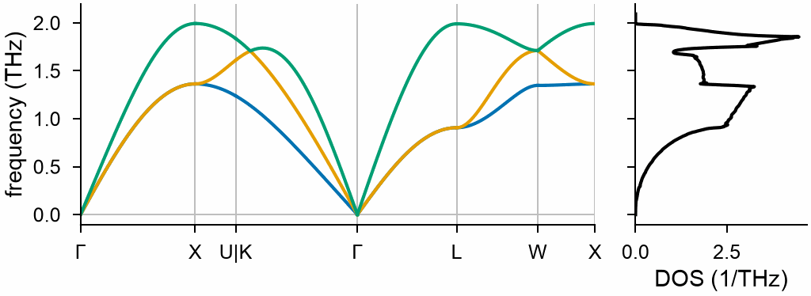
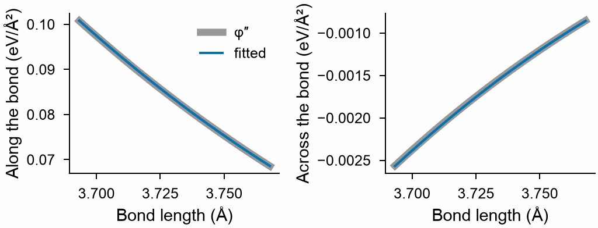
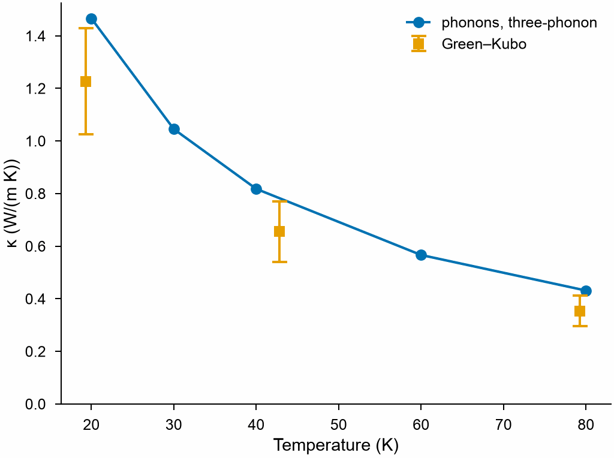

<!-- needs: lammps -->

# Lattice dynamics of solid argon

Solid argon is the crystal of the textbooks of lattice dynamics: atoms of one kind on an
fcc lattice, held together by the Lennard-Jones potential, light and soft enough that
their vibrations are large and strongly anharmonic. This page follows it from the forces
on a few displaced atoms to its thermal conductivity, with every tool of MDAPY for force
constants: the harmonic force constants and the phonons, the files of phonopy, the
thermal displacements and the Grüneisen parameters, springs along the bonds, the third
order force constants and the thermal conductivity of the phonons, and the conductivity
of molecular dynamics by the Green–Kubo relation. See
[Force constants](../user-guide/simulation/force-constants.md),
[Phonons](../user-guide/simulation/phonons.md),
[Bond stiffness](../user-guide/simulation/bond-stiffness.md),
[Thermal conductivity](../user-guide/simulation/thermal-conductivity.md) and
[Green–Kubo conductivity](../user-guide/simulation/green-kubo.md) for the functions
themselves.

## The crystal

The Lennard-Jones potential of argon, ε = 10.4 meV and σ = 3.405 Å, cut at 8.5 Å, in
LAMMPS; the cubic cell relaxed at zero pressure, and its primitive cell of one atom:

```python
import numpy as np
from mdapy.build import build_crystal
from mdapy.calculators import LAMMPS
from mdapy.lattice_dynamics import (
    bond_stiffness,
    displaced_supercells,
    force_constants,
    green_kubo,
    primitive_cell,
    thermal_conductivity,
)
from mdapy.simulation import minimize

EPSILON, SIGMA, CUTOFF = 0.0104, 3.405, 8.5
argon = LAMMPS(
    f"pair_style lj/cut {CUTOFF}\npair_coeff * * {EPSILON} {SIGMA}", elements=["Ar"]
)
crystal = minimize(
    build_crystal("fcc", 5.3, elements="Ar"), argon, cell="isotropic", max_stress=1e-6
).system
a = crystal.box.matrix[0, 0]  # 5.276 Å
cell = primitive_cell(crystal)


def with_forces(frames):
    """The frames with the forces of the potential."""
    return [f.with_columns(forces=argon.compute(f, ("forces",)).forces) for f in frames]
```

## Phonons

The force constants of the harmonic crystal come from the forces on one atom displaced
in a supercell of 5 × 5 × 5 primitive cells, wider than twice the cutoff: with the
symmetry of fcc, one supercell holds every free force constant.

```python
moved = displaced_supercells(cell, supercell=5)  # one supercell
harmonic = force_constants(cell, with_forces(moved))
harmonic.parameters  # 26 free force constants
phonons = harmonic.phonons()
bands = phonons.band_structure("fcc")
dos = phonons.dos(20)

harmonic.write("FORCE_CONSTANTS")  # for phonopy, its unit cell the primitive cell
```

```python
from mdapy.visualization import plot

with plot.style():
    fig, (left, right) = plot.figure(
        "single", ncols=2, sharey=True, width_ratios=[3, 1]
    )
    plot.band_structure(bands, ax=left)
    plot.phonon_dos(dos, ax=right)
    plot.save(fig, "images/argon-phonons", formats=("png",))
```



*The phonons of solid argon of the Lennard-Jones potential, up to 2 THz.*

## How the atoms move

The atoms of argon move far even at rest, by their zero point motion, and their mean
square displacement grows with the temperature; the Debye–Waller factor is
B = 8π² ⟨u²⟩:

```python
u = phonons.thermal_displacements([0.0, 20.0, 40.0, 80.0], mesh=20)
displacement = u[:, 0, 0, 0]  # 0.0109, 0.0139, 0.0216, 0.0395 Ų
debye_waller = 8 * np.pi**2 * displacement  # 0.86, 1.10, 1.70, 3.12 Ų
```

The mode Grüneisen parameters, from the phonons at volumes 1 % smaller and larger, tell
how much the vibrations soften as the crystal expands:


```python
def scaled(volume):
    """The cell scaled to a fraction of its volume."""
    s = volume ** (1 / 3)
    return cell.with_box(cell.box.matrix * s).with_columns(
        positions=cell["positions"] * s
    )


def phonons_at(volume):
    moved = displaced_supercells(scaled(volume), supercell=5)
    return force_constants(scaled(volume), with_forces(moved)).phonons()


q = np.stack(np.meshgrid(*[np.arange(8) / 8] * 3, indexing="ij"), -1).reshape(-1, 3)
gamma = phonons.gruneisen(q, smaller=phonons_at(0.99), larger=phonons_at(1.01))
frequencies = phonons.frequencies(q)
above = frequencies > 0.2
np.nanmean(gamma[above])  # 3.0
```

The parameters lie between 2.7 and 3.4 for the modes above 0.2 THz. The acoustic modes
nearest Γ, of the lowest frequencies, change little in absolute terms, and the
differences of the force constants of supercells of one size at three volumes are too
coarse for them; they are left out here.

## Springs along the bonds

A pair potential is a set of springs: along a bond of length r its stiffness is the
second derivative φ″(r), across it the first over the length, φ′(r)/r. Fitting springs
to the forces of the crystal at three sizes, one polynomial for each of the five shells
of neighbors within the cutoff, gives them back:

```python
data = []
for volume in (0.97, 1.0, 1.03):
    moved = displaced_supercells(
        scaled(volume), supercell=5, method="random", count=1, seed=2
    )
    data.append((scaled(volume), with_forces(moved)))
springs = bond_stiffness(data, cutoff=(4.5, 5.8, 6.9, 7.9, 8.6), degree=2)

r = np.linspace(*springs.lengths[0], 50)  # the nearest neighbors fitted
along, across = springs.stiffness("Ar", "Ar", r)
x = SIGMA / r
second = 4 * EPSILON * (156 * x**12 - 42 * x**6) / r**2
first = 4 * EPSILON * (-12 * x**12 + 6 * x**6) / r

with plot.style():
    fig, (left, right) = plot.figure("single", ncols=2)
    left.plot(r, second, color="0.6", lw=3, label="φ″")
    left.plot(r, along, label="fitted")
    left.set(xlabel="Bond length (Å)", ylabel="Along the bond (eV/Ų)")
    right.plot(r, first / r, color="0.6", lw=3)
    right.plot(r, across)
    right.set(xlabel="Bond length (Å)", ylabel="Across the bond (eV/Ų)")
    left.legend(frameon=False)
    plot.save(fig, "images/argon-springs", formats=("png",))
```



*The springs between nearest neighbors fitted to the forces, over the bond lengths of
the three sizes, on the derivatives of the Lennard-Jones potential: they agree to a few
parts in a thousand, the error of the anharmonic forces and of a parabola over the
lengths.*

## Thermal conductivity

Three-phonon scattering limits how far the phonons carry heat. Random displacements of
every atom by 0.03 Å, a pattern and its opposite, give the third order force constants
with the second; within 6.5 Å they cover the first three shells of neighbors:

```python
moved = displaced_supercells(
    cell, supercell=5, method="random", displacement=0.03, count=2, seed=1
)
anharmonic = force_constants(cell, with_forces(moved), cutoff_third=6.5)
anharmonic.parameters_third, anharmonic.error  # 85, 0.24 % of the forces left

temperatures = np.array([20.0, 30.0, 40.0, 60.0, 80.0])
rta = thermal_conductivity(anharmonic, temperatures, mesh=11)
rta.kappa[:, 0, 0]  # 1.47, 1.04, 0.82, 0.57, 0.43 W/(m K)
```

Molecular dynamics holds every order of anharmonicity, in a box of 256 atoms of the
same size, 400 ps at constant energy at each temperature:

```python
md = [
    green_kubo(
        build_crystal("fcc", a, elements="Ar", repeat=4),
        argon,
        temperature,
        timestep=0.004,
        equilibration=5000,
        production=100000,
        every=5,
        correlation=10.0,
    )
    for temperature in (20.0, 40.0, 80.0)
]

with plot.style():
    fig, ax = plot.figure("single")
    ax.plot(temperatures, rta.kappa[:, 0, 0], marker="o", label="phonons, three-phonon")
    ax.errorbar(
        [r.temperature for r in md],
        [np.trace(r.kappa) / 3 for r in md],
        yerr=[np.sqrt(np.trace(r.errors**2) / 3) / np.sqrt(3) for r in md],
        marker="s",
        ls="none",
        capsize=3,
        label="Green–Kubo",
    )
    ax.set(xlabel="Temperature (K)", ylabel="κ (W/(m K))", ylim=(0, None))
    ax.legend(frameon=False)
    plot.save(fig, "images/argon-conductivity", formats=("png",))
```



*The thermal conductivity of solid argon from the phonons with three-phonon scattering
and from molecular dynamics: both fall as 1/T. The phonons carry somewhat more: they
leave out the scattering of four phonons and more, which grows with the temperature;
their occupations are those of quantum oscillators, where the atoms of molecular
dynamics are classical; and a box of 256 atoms has no phonons longer than itself.*

The two calculations answer different questions and check each other: the phonons give
the conductivity mode by mode, its frequencies, velocities and lifetimes, and need only
a few static forces, which DFT can give; molecular dynamics holds the whole
anharmonicity of the potential at the price of long runs and of statistics, as the
error bars show.

## See also

- [phonopy](https://phonopy.github.io/phonopy/) reads the `FORCE_CONSTANTS` written above,
  with the primitive cell as its unit cell.
