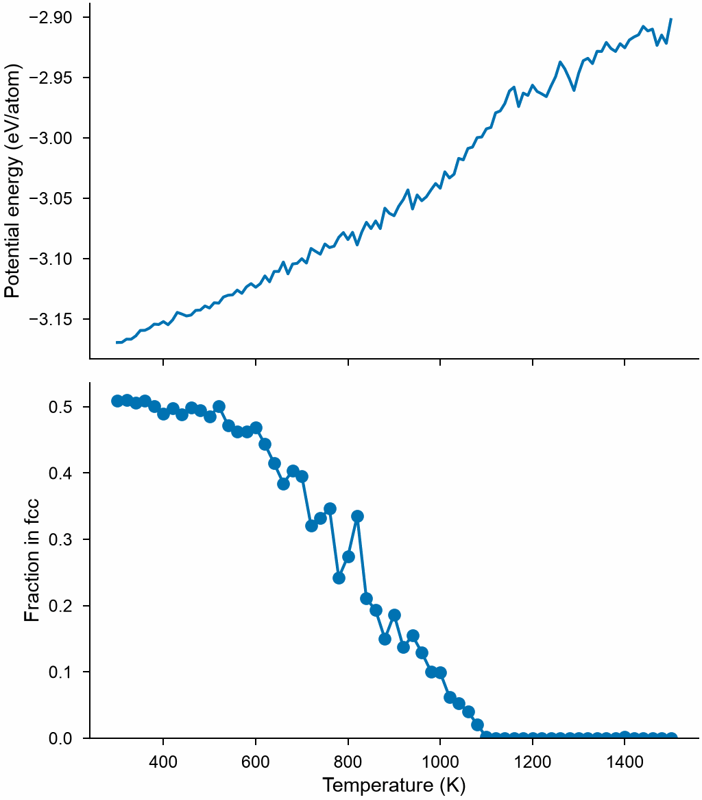
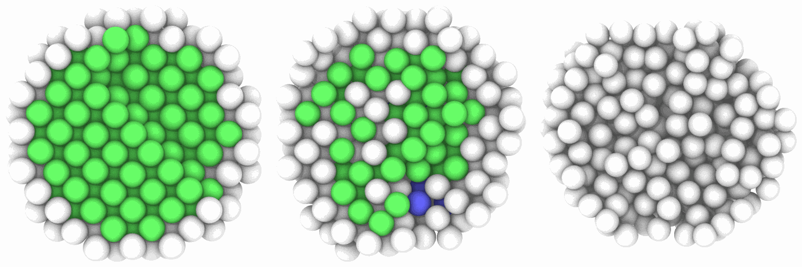

# A copper cluster melting

[`MolecularDynamics`](../user-guide/simulation/running.md) runs molecular dynamics in
MDAPY itself with any calculator but a LAMMPS one, with no LAMMPS installed. This page
heats a cluster of 627 copper atoms in vacuum until it melts, with the EAM potential of
Zhou et al. that MDAPY computes, writes the atoms to a file as the run goes, and follows
the energy and the crystal on the way.

## A cluster in vacuum

A sphere of radius 12 Å cut from a crystal, in a box of 60 Å that is periodic in no
direction, relaxed:

```python
import numpy as np
import mdapy as mp
from mdapy.build import build_crystal
from mdapy.calculators import EAM
from mdapy.simulation import MolecularDynamics, minimize

potential = EAM.zhou(["Cu"])
crystal = build_crystal("fcc", 3.615, elements="Cu", repeat=(8, 8, 8))
center = crystal.box.matrix.sum(axis=0) / 2
inside = np.linalg.norm(crystal["positions"] - center, axis=1) < 12.0
cluster = crystal.filter(inside).with_box(
    mp.Box(np.eye(3) * 60.0, origin=center - 30.0, pbc=False)
)
cluster = minimize(cluster, potential).system  # 627 atoms
```

## Heating, the frames written as the run goes

10 ps at 300 K, then from 300 to 1500 K in 120 ps, by Langevin dynamics, which holds
every atom at the temperature of the thermostat. `iterate` gives the atoms every 2 ps as
the run reaches them, and [`mdapy.io.write`](../basics/io.md) writes each to the file and
lets it go, so that no frame stays in memory:

```python
with MolecularDynamics(cluster, potential, timestep=0.002) as md:
    md.velocities(300, seed=1)
    md.run(5000, ensemble="nvt", temperature=300, thermostat="langevin", seed=2)
    frames = md.iterate(
        60000,
        save_every=1000,
        ensemble="nvt",
        temperature=(300, 1500),
        thermostat="langevin",
        seed=3,
        thermo=500,
    )
    mp.io.write("heating.xyz", frames)  # 61 frames
    thermo = md.thermo
```

The 65000 steps take about 25 s on four threads of an Apple M5. Each frame holds the
positions, the velocities and the images of the atoms, the box, and the step and the
time of the frame. A loop over `md.iterate(...)` would instead give each frame to an
analysis as it comes, without a file; [Frames in
files](../user-guide/simulation/records.md#frames-in-files) says more.

## The energy and the crystal

The potential energy from `thermo`, and the atoms that the
[common neighbor analysis](../user-guide/analysis/cna.md) finds in fcc in each frame of
the file, read back one at a time, against the temperature of the thermostat:

```python
import polars as pl
from mdapy.identify import CommonNeighborAnalysis
from mdapy.io import read_trajectory
from mdapy.visualization import plot


def heated(step):
    """The temperature of the thermostat at a step of the heating, in K."""
    return 300 + (np.asarray(step) - 5000) / 60000 * 1200


heating = thermo.filter(pl.col("step") >= 5000)
cna = CommonNeighborAnalysis()
steps, fcc = [], []
with read_trajectory("heating.xyz") as trajectory:
    for frame in trajectory:
        steps.append(frame.info["timestep"])
        fcc.append(cna.compute(frame).counts()["fcc"] / len(frame))

with plot.style():
    fig, (top, bottom) = plot.figure("single", 100, nrows=2, sharex=True)
    top.plot(heated(heating["step"]), heating["potential_energy"] / len(cluster))
    top.set_ylabel("Potential energy (eV/atom)")
    bottom.plot(heated(steps), fcc, marker="o")
    bottom.set(xlabel="Temperature (K)", ylabel="Fraction in fcc", ylim=(0, None))
    plot.save(fig, "images/cluster-melting", formats=("png",))
```



*About half the atoms of the cluster are at its surface, where the common neighbor
analysis finds no fcc. From about 600 K on, the crystal inside shrinks, and at 1100 K its
last atoms go: the cluster is liquid. The energy rises faster between about 1000 and
1250 K than below and above: the heat of melting, spread over that range.*

The cluster cut in half, its atoms colored by their structure, at 300, 900 and 1500 K:

```python
from mdapy.visualization import render, write_png

with read_trajectory("heating.xyz") as trajectory:
    pictures = []
    for frame in (trajectory[0], trajectory[30], trajectory[60]):
        front = frame["positions"][:, 2] < center[2]
        pictures.append(
            render(
                frame,
                atoms=front,
                color=cna.compute(frame),
                box=False,
                view="top",
                width=500,
                height=500,
            )
        )
write_png("images/cluster-melting-atoms.png", np.hstack(pictures))
```



*The lower half of the cluster seen from above at 300, 900 and 1500 K: fcc atoms in green,
bcc in blue, the others in white. At 900 K part of the crystal remains inside, at 1500 K
none.*
