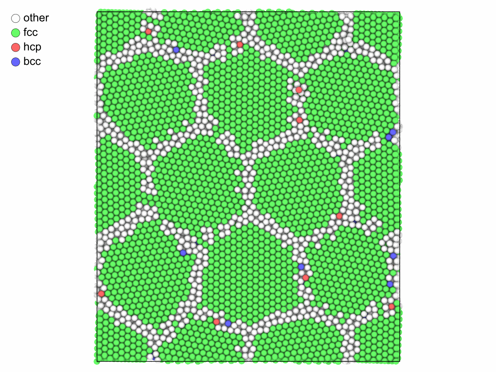
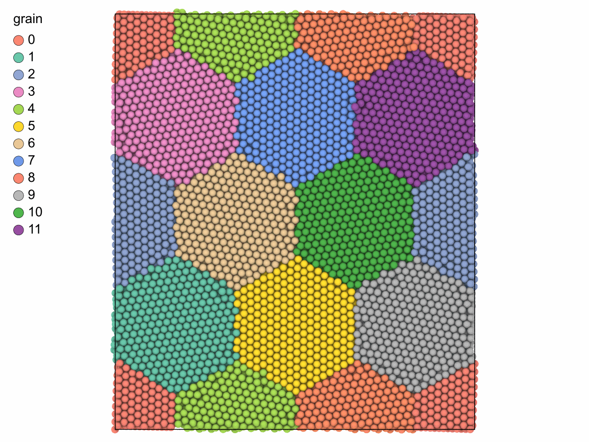

# Columnar grains on a hexagonal pattern

A columnar polycrystal has grains that all span one axis of the box, so
its boundaries are planes parallel to that axis: a quasi two-dimensional
polycrystal, thin and quick to simulate. With the seeds on a triangular
lattice, the grains are regular hexagons. This page builds such a
polycrystal of copper with its columns along [111], turns the grains so
that every boundary is of high angle, and relaxes it.

## The unit along the columns

The columns run along z, so the unit has z along [111]; about [111], fcc
looks the same after a turn of 60°.

```python
import numpy as np
import mdapy as mp
from mdapy.build import build_crystal, build_polycrystal

a = 3.615
unit = build_crystal(
    "fcc", a, elements="Cu", orientation=[(1, 1, -2), (-1, 1, 0), (1, 1, 1)]
)
unit.box.matrix[2, 2]  # 6.26 Å, three (111) planes
```

## Seeds on a triangular lattice

A rectangle of $d \times d\sqrt{3}$ holds two points of a triangular
lattice of spacing $d$. Repeat it 3 × 2 times for twelve grains 40 Å
across:

```python
d = 40.0
cells = (3, 2)
pair = np.array([[0.0, 0.0, 0.0], [d / 2, d * np.sqrt(3) / 2, 0.0]])
seeds = np.vstack(
    [
        pair + [i * d, j * d * np.sqrt(3), 0.0]
        for i in range(cells[0])
        for j in range(cells[1])
    ]
)
len(seeds)  # 12
```

## Turns about the column axis

Each grain turns about z by its own angle. About [111], fcc looks the same after 60°, so
two grains differ by at most 30°, and below about 15° their boundary is a row of separate
dislocations, which a relaxation can all but remove. Points of a triangular lattice can
take three families so that neighbors never share one: with families 20° apart, and a
little of its own for each grain, every boundary is of high angle.

```python
from mdapy.build import rotations_about

family = [
    (i - k) % 3 for i in range(cells[0]) for j in range(cells[1]) for k in range(2)
]
rng = np.random.default_rng(3)
angles = 20.0 * np.array(family) + rng.uniform(-2.0, 2.0, len(seeds))
rotations = rotations_about("z", angles)
```

The box is no longer than the unit along z, so the polycrystal is
columnar: the box takes the length of the unit there, and every grain spans
it.

```python
box = mp.Box([cells[0] * d, cells[1] * d * np.sqrt(3), 1.0])
columns = build_polycrystal(unit, box, seeds, orientations=rotations)
len(columns), columns.box.matrix[2, 2]  # 8524 atoms, 6.26 Å
```

## Relax

Relax the positions with the EAM potential of copper of Zhou et al.:

```python
from mdapy.calculators import EAM
from mdapy.simulation import minimize

result = minimize(columns, EAM.zhou(["Cu"]), max_force=0.05)
relaxed = result.system
result.converged  # True
```

## Every boundary is of high angle

Two grains meet where an atom of one has a neighbor in the other. Their
misorientation is the difference of their angles, modulo the 60° of the
[111] axis:

```python
from mdapy.neighbor import NeighborList

grain = relaxed.table["grain"].to_numpy()
nl = NeighborList.build(relaxed, 3.0)
across = grain[nl.i] < grain[nl.j]
pairs = np.stack([grain[nl.i][across], grain[nl.j][across]], axis=1)
pairs = np.unique(pairs, axis=0)  # each pair of grains that meet, once
turn = np.abs(angles[pairs[:, 0]] - angles[pairs[:, 1]]) % 60.0
misorientation = np.minimum(turn, 60.0 - turn)
len(pairs)  # 36: each grain meets six others
misorientation.min(), misorientation.max()  # 17.2 and 22.6 degrees
```

## A picture

Look down the columns, colored by structure and by grain:

```python
from mdapy.identify import CommonNeighborAnalysis
from mdapy.visualization import render

cna = CommonNeighborAnalysis().compute(relaxed)
cna.counts()  # mostly fcc; boundaries "other"
render(
    relaxed,
    "images/columns.png",
    color=cna,
    view="top",
    width=1200,
    height=900,
    legend=True,
)
render(
    relaxed,
    "images/grains.png",
    color="grain",
    colormap="labels",
    view="top",
    width=1200,
    height=900,
    legend=True,
)
```

| By structure: fcc green, others white | By grain |
|---|---|
|  |  |

Every boundary stays after the relaxation, as a continuous line of white atoms.
