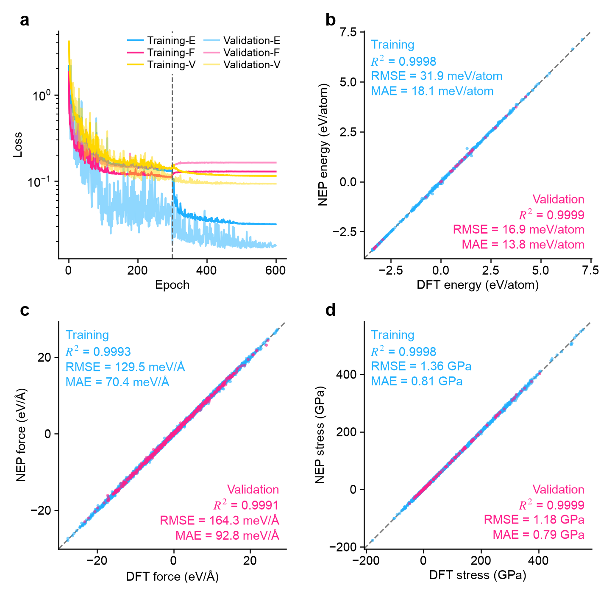
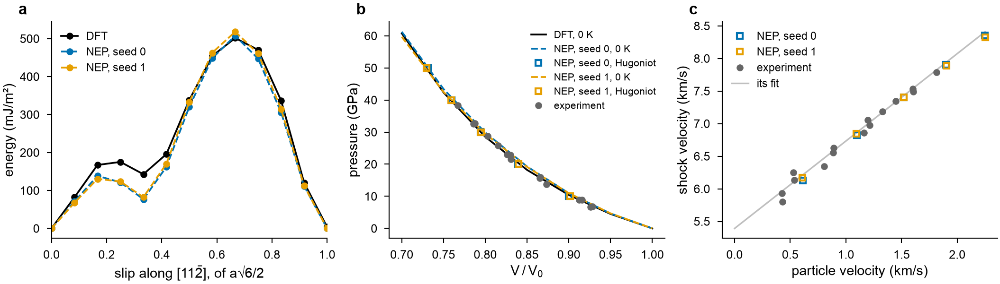

# A potential from MDAPY's DFT

A machine-learned potential is as good as its labels. This page makes the whole chain
in MDAPY: structures of aluminium generated as in
[Generated training sets for aluminium](aluminium-training.md), labelled by MDAPY's
[plane-wave DFT](../user-guide/potentials/dft.md) on the GPU, a NEP model trained on them
with [torchnep](https://github.com/mushroomfire/torchnep)
([Wu et al. 2026](../reference/references.md#wu2026torchnep)), and the model's properties
against those of the DFT itself: the equation of state, the elastic constants, the
vacancy, a surface and the phonons near the crystal; the stacking fault and the
compression to 70 % of the volume far from it, and the Hugoniot against experiment. The
elastic constants of aluminium need far more k-points than labels do; the last section
shows how many.

<!-- needs: torchnep -->

## The labels

The "generated + crystals" set of that page: two thirds of the atoms from
`generate_structures`, one third perturbed fcc, bcc and hcp crystals, 520 cells of 2 to
54 atoms and 4820 atoms in all. The generated cells lie far from the crystal, and the
perturbed crystals span volumes from 85 to 115 % with strains of 5 %; the equilibrium
itself, where the equation of state, the vacancy and the phonons are measured, takes
48 more cells of fcc near it: cells of 4 and of 32 atoms in turn, volumes from 90 to
110 %, strains up to 2 % and atoms displaced by 0.03 Å, 864 atoms; and 24 cells of hcp
alike, of 2 and of 16 atoms, 216 atoms, for the difference of the two packings that a
stacking fault is made of. For the test, 91 cells of 1201 atoms from another generation
and other crystals:

<!-- skip-test -->
```python
generated = generate_structures("Al", volume=(8.3, 33.2), seed=0).structures
write("train.xyz", mixed([generated, crystals(50, 4800)], [2, 1], 4800))
write("near.xyz", near(51, 48))
write("near-hcp.xyz", near(52, 24, "hcp"))
other = generate_structures("Al", volume=(8.3, 33.2), seed=7).structures
write("test.xyz", mixed([other, crystals(57, 1200)], [2, 1], 1200))
```

`crystals` and `mixed` are those of the page of generated training sets, `near` is

<!-- skip-test -->
```python
def near(seed, cells, kind="fcc"):
    rng = np.random.default_rng(seed)
    unit = (
        build_crystal("fcc", 4.04, elements="Al")
        if kind == "fcc"
        else build_crystal("hcp", 4.04 / np.sqrt(2), elements="Al")
    )
    frames = []
    for k in range(cells):
        crystal = unit if k % 2 == 0 else replicate(unit, (2, 2, 2))
        volume = rng.uniform(0.90, 1.10)
        frames += perturb(
            scaled(crystal, volume), 1, displacement=0.03, strain=0.02, seed=rng
        )
    return frames
```

and the whole script is [`dft_training.py`](dft-potential/dft_training.py).
The DFT takes the PBE pseudopotential of aluminium of
[PseudoDojo](http://www.pseudo-dojo.org) 0.4
([van Setten et al. 2018](../reference/references.md#vansetten2018)), 600 eV, a mesh of
at most 0.15 1/Å between k-points and the smearing of Marzari and Vanderbilt of 0.25 eV:

<!-- skip-test -->
```python
from mdapy.calculators import DFT
from mdapy.io import read_trajectory, write

dft = DFT(600.0, pseudopotentials={"Al": "Al.upf"}, kspacing=0.15,
          smearing="marzari-vanderbilt", sigma=0.25)  # fmt: skip
for name in ("train", "near", "near-hcp", "test"):
    frames = [dft.compute(f, ("energy", "forces", "virial")).attach(f)
              for f in read_trajectory(f"{name}.xyz")]  # fmt: skip
    write(f"{name}-dft.xyz", frames)
```

Each cell starts cold. The 611 cells took 6.3 GPU-hours on two A100 and two H100 GPUs,
37 s each on average: the small cells of many k-points take as long as the large ones of
few. Every one converged, in 5 to 35 steps of the self-consistent field, 7 in the median.
The 48 cells of fcc near the crystal took 41 minutes on two V100 GPUs, in 5 to 8 steps;
the 24 of hcp 1.8 hours on an RTX A2000, in 5 to 8 steps.

## The model

The energy of a plane-wave DFT counts the valence electrons against the cores of the
pseudopotential: −63.06 eV per atom in the crystal here, a number that belongs to the
pseudopotential, not to aluminium. The model learns the energies counted from that of
one isolated atom by the same DFT, with spin, in a box of 12 Å and at Γ alone:

<!-- skip-test -->
```python
import numpy as np

from mdapy import System

atom = System([[6.0, 6.0, 6.0]], np.eye(3) * 12.0, elements="Al")
e_atom = DFT(600.0, pseudopotentials={"Al": "Al.upf"}, kpoints=(1, 1, 1),
             smearing="marzari-vanderbilt", sigma=0.25, magmoms={"Al": 1.0}).compute(atom).energy  # fmt: skip
```

−59.64 eV. Counted from it the crystal has −3.43 eV per atom, its binding energy (the
cohesive energy of experiment is 3.39 eV), and the training cells lie between −3.43 and
7.08 eV per atom, numbers of the size a network starts from. Differences of energy, and
so every property below, are the same either way.

Of the 592 training cells, 196 lie within 2 eV per atom of the lowest: the crystals and
the generated cells close to them. The others are dimers and small clusters in vacuum,
near the free atom and 3 to 5 eV per atom above the crystal, and compressions to half
its volume, 5 to 10 eV above. The solid in molecular dynamics stays far below them: even
on the Hugoniot at 50 GPa it is 0.7 eV per atom above its minimum. Counted alike, those
cells lead the fit, and differences of tens of meV per atom near the crystal are lost:
hcp came out 1 to 19 meV per atom below fcc, against 30 above in the DFT, and the
stacking fault negative. Left out, they are never seen, and the model fails on every cell
of their kind: its energies over all the test cells were 0.6 to 1 eV per atom off.
Weighted, the cells within 2 eV per atom lead and the others stay in. The weight was
chosen on the intrinsic stacking fault (below; 143 mJ/m² in the DFT) of models trained
with weights of 5, 10, 20 and 50: 14, 57 to 77 (three seeds), 77 to 91 (three) and
79 mJ/m². It rises up to a weight of about 20 and no further. A tenth of the training
cells, held out, chooses the best epoch, and the test cells are not seen:

<!-- skip-test -->
```python
from pathlib import Path

from torchnep import train_nep

NEP_IN = """type       1 Al
version    4
cutoff     6 4
n_max      8 8
basis_size 8 8
l_max      4 2 0
neuron     50
epoch      600
batch      {batch}
lr         0.01
stage2     1
"""
frames = [f.with_info(energy=f.info["energy"] - len(f) * e_atom)
          for name in ("train", "near", "near-hcp")
          for f in read_trajectory(f"{name}-dft.xyz")]  # fmt: skip
lowest = min(f.info["energy"] / len(f) for f in frames)
frames = [f.with_info(weight=20.0) if f.info["energy"] / len(f) < lowest + 2.0 else f
          for f in frames]  # fmt: skip
Path("nep").mkdir(exist_ok=True)
write("nep/train.xyz", frames)
batch = round(150 * len(frames) / sum(len(f) for f in frames))
Path("nep/nep.in").write_text(NEP_IN.format(batch=batch))
train_nep(
    "nep/nep.in", "nep/train.xyz", output_dir="nep", device="cuda", valid_ratio=0.1
)
```

Two models, of the seeds 0 and 1, trained in 312 and 381 s on an RTX A2000. Their errors
on the 91 test cells and on the 25 of them within 2 eV per atom of the lowest:

| Model | Energy (meV/atom) | Forces (eV/Å) | Virial (meV/atom) | Energy, the 25 | Forces, the 25 |
|---|---:|---:|---:|---:|---:|
| seed 0 | 29 | 0.156 | 120 | 10.7 | 0.035 |
| seed 1 | 29 | 0.168 | 113 | 13.6 | 0.036 |

The test cells are generated ones, as the training cells: their energies lie 3.4 eV per
atom above the lowest in the median, up to 7.2, and their forces reach 24 eV/Å.

torchnep draws the training from the files it writes:

<!-- skip-test -->
```python
from torchnep.plot import NEPPlotter

NEPPlotter().dashboard("nep", out="training.png")
```



*The model of seed 0: the root mean square errors of the energy, the forces and the virial
against the epoch, of the training cells and of the tenth held out, the second stage from
the dashed line; and the energies, forces and stresses of the training cells (blue) and of
the tenth held out (red) against the DFT.*

## Properties

The same functions of `mdapy.properties`, the
[defect energies](../user-guide/properties/defect-energies.md) and the
[phonons](../user-guide/properties/phonons.md), take the DFT and the model alike:

<!-- skip-test -->
```python
from mdapy.build import build_crystal
from mdapy.calculators import NEP
from mdapy.properties.defects import surface_energy, vacancy_formation_energy
from mdapy.properties.phonons import phonons, primitive_cell
from mdapy.transform import replicate

for calculator in (dft, NEP("nep/nep_best.txt")):
    # a0 of the Birch-Murnaghan fit of seven volumes from 94 to 106 %, then at a0:
    crystal = build_crystal("fcc", a0, elements="Al")
    vacancy = vacancy_formation_energy(
        replicate(crystal, (3, 3, 3)), calculator, max_force=0.01
    )
    surface = surface_energy(crystal, calculator, axis=2, max_force=0.01)
    bands = phonons(primitive_cell(crystal), calculator, supercell=4).band_structure(
        "fcc"
    )
```

| | DFT | DFT, k-points twice as dense | NEP, seed 0 | NEP, seed 1 |
|---|---:|---:|---:|---:|
| a0 (Å) | 4.038 | 4.036 | 4.034 | 4.036 |
| B0 (GPa) | 78.4 | 77.5 | 78.9 | 80.1 |
| vacancy (eV) | 0.669 | 0.656 | 0.663 | 0.732 |
| (100) surface (J/m²) | 1.006 | 1.008 | 0.925 | 1.036 |
| X, TA and LA (THz) | 5.81, 9.61 | 5.84, 9.66 | 5.96, 9.38 | 5.83, 9.31 |
| L, TA and LA (THz) | 4.16, 9.61 | 4.18, 9.65 | 4.63, 9.70 | 4.40, 9.84 |

The figure, from the values these functions return (kept by
[`dft_training.py`](dft-potential/dft_training.py) in `properties-WHO.json`):

<!-- skip-test -->
```python
import json

import matplotlib.pyplot as plt
import numpy as np

who = {
    "dft": "DFT",
    "dft-fine": "DFT, k-points twice as dense",
    "nep_0": "NEP, seed 0",
    "nep_1": "NEP, seed 1",
}
style = {
    "dft": ("k", "-"),
    "dft-fine": ("0.55", ":"),
    "nep_0": ("C0", "--"),
    "nep_1": ("C1", "--"),
}
props = {k: json.loads(open(f"properties-{k}.json").read()) for k in who}  # fmt: skip
fig, (eos, bands) = plt.subplots(1, 2, figsize=(7, 2.6))
for k, p in props.items():
    color, line = style[k]
    v, e = np.asarray(p["volumes"]), np.asarray(p["energies"])  # ų and eV per atom
    eos.plot(v, 1e3 * (e - e.min()), line, marker="o", ms=3, c=color, label=who[k])
    x, y = np.asarray(p["phonon_distances"]), np.asarray(p["phonon_frequencies_THz"])
    for branch in range(y.shape[1]):
        bands.plot(
            x, y[:, branch], line, c=color, label=who[k] if branch == 0 else None
        )
eos.set(xlabel="volume per atom (ų)", ylabel="energy above the minimum (meV/atom)")
eos.legend()
ticks = props["dft"]["phonon_labels"]  # (distance, name) of the high-symmetry points
bands.set_xticks([d for d, _ in ticks], [name for _, name in ticks])
for d, _ in ticks:
    bands.axvline(d, c="0.85", lw=0.5, zorder=0)
bands.set(xlim=(0, ticks[-1][0]), ylim=(0, None), ylabel="frequency (THz)")
fig.savefig("properties.png", dpi=300)
```


*a: the equation of state, the energy per atom against the volume per atom from 94 to
106 %. b: the phonons along the high-symmetry path of fcc.*

- **The equation of state** of the models lies within 0.004 Å of the DFT in a0 and
  1.7 GPa in B0; the DFT with k-points twice as dense moves a0 by 0.002 Å and B0 by
  0.9 GPa: the labels are converged enough for it.
- **The vacancy** comes out 0.006 eV low and 0.06 eV high; **the (100) surface**
  0.08 J/m² low and 0.03 high.
- **The phonons** agree along the path within 0.22 and 0.19 THz in the root mean square;
  the largest differences, 0.5 to 0.6 THz, are the lowest branch at W, high in the model
  of seed 0, and the longitudinal one between Γ and X, low in that of seed 1.

## Far from the crystal

The generalized stacking fault, (111) planes slipped along [11̄2] in a slab of 12 layers,
each point relaxed normal to the planes; the cold crystal compressed to 70 % of its
volume; and the Hugoniot, the states a shock reaches from the crystal at 300 K, by
molecular dynamics of 2048 atoms with the [Hugoniostat](../user-guide/simulation/hugoniostat.md)
([Ravelo et al. 2004](../reference/references.md#ravelo2004)), its barostat alike along
every axis, 20 ps at each pressure and the last 10 averaged:

<!-- skip-test -->
```python
from mdapy.properties.defects import stacking_fault_energy
from mdapy.simulation import MolecularDynamics

layers = build_crystal("fcc", a0, elements="Al",
                       orientation=[(1, 1, -2), (-1, 1, 0), (1, 1, 1)], repeat=(1, 1, 4))  # fmt: skip
curve = stacking_fault_energy(
    layers, calculator, [a0 * np.sqrt(6) / 2, 0, 0], points=13, max_force=0.01
)
nep = NEP("nep/nep_best.txt")
crystal = build_crystal("fcc", a0, elements="Al", repeat=8)
with MolecularDynamics(crystal, nep, timestep=0.001) as md:
    md.velocities(600, seed=1)
    md.run(10000, ensemble="npt", temperature=300, pressure=0.0, barostat="iso")
    warm = md.system
    md.run(0)
    ambient = md.thermo[-1]
reference = (ambient["total_energy"][0], ambient["volume"][0], 0.0)
for pressure in (10.0, 20.0, 30.0, 40.0, 50.0):
    with MolecularDynamics(warm, nep, timestep=0.001) as md:
        md.run(20000, ensemble="nphug", pressure=pressure, barostat="iso",
               hugoniot=reference, thermostat_damping=0.1, barostat_damping=1.0)  # fmt: skip
        late = md.thermo.filter(md.thermo["time"] >= 10.0)
```



*a: the generalized stacking fault on (111) along [11̄2]. b: the pressure against the
volume, of the cold crystal and on the Hugoniot, with the measured Hugoniot of aluminium
1100 ([Marsh 1980](../reference/references.md#marsh1980)). c: the shock velocity
against the particle velocity, the measured ones with the linear fit of their table.*

- **The stacking fault** of the DFT has its unstable maximum at 175 mJ/m² and the
  intrinsic fault at 143; the models have 139 and 131, and 77 and 82, half the DFT's
  intrinsic fault. Its energy is that of hcp against fcc, 29.6 meV per atom above in the
  DFT and 17 and 18 in the models: near the crystal the models put fcc 2 to 6 meV per
  atom too high and hcp 8 to 11 too low, errors of the size of their errors there, and
  no cell of training holds a fault. The maximum of the slip, 502 mJ/m², they give
  within 16.
- **The cold compression** to 70 % of the volume takes 60.7 GPa in the DFT and 61.2 and
  59.7 in the models; at 80 %, 28.5 against 29.8 and 29.5.
- **The Hugoniot** of the models follows the measured one of aluminium 1100: from 10 to
  50 GPa their shock velocities lie 0.2 to 1.4 % below the linear fit of the
  measurements, and the shocked crystal reaches 1300 K at 50 GPa. The measurements go up
  to 1.8 km/s of particle velocity, about 33 GPa; at 40 and 50 GPa the models are
  compared with the fit continued. At 300 K the crystal of the models is 1.7 % less dense
  than the alloy (2.665 and 2.668 g/cm³ against 2.713).

## Elastic constants and k-points

The elastic constants are the curvature of the energy under small strains, and in a
metal the Fermi surface changes under them: they need a dense mesh, much denser than
the energies and the forces of the labels. With the labels' mesh, 11 × 11 × 11 on the
cubic cell, the DFT gives C11, C12 and C44 of 79, 78 and 28 GPa; with the mesh twice as
dense 103, 66 and 31. On meshes from 8 to 32 k-points along each axis of the cubic cell
of four atoms ([`kconv.py`](dft-potential/kconv.py)):


*The elastic constants of the DFT jump with the mesh up to about 20 k-points along each
axis and settle from 24, at 114, 58 and 33 GPa with 32, the two smearings alike.*

The phonons depend on the mesh far less: with k-points twice as dense they move by
0.5 % (the table above), where C11 moves by a quarter. A strain of 1 % shifts the energy
of the cell by a few meV, and as it moves bands across the Fermi level a coarse mesh
counts them in steps of the same size; a phonon comes from the forces of atoms
displaced by 0.01 Å in a supercell of 4 × 4 × 4 primitive cells, derivatives that vary
smoothly, on a mesh that the supercell makes denser. What does need dense meshes among
phonons are the Kohn anomalies of a metal, fine features of the dispersion where a
phonon spans the Fermi surface.

The smearing trades a bias of the energy against the mesh. A width σ spreads the
occupations of the bands over σ about the Fermi level, so that fewer k-points sample
the Fermi surface smoothly and the self-consistent field converges more easily; the
energy computed is then the free energy E − TS of an electronic temperature. With the
smearing of Marzari and Vanderbilt ("cold") or of Methfessel and Paxton the bias is of
high order in σ, and metals take 0.2 to 0.3 eV (VASP's advice for metals is ISMEAR = 1,
SIGMA = 0.2); a Gaussian biases at second order and takes 0.05 to 0.1 eV, Fermi–Dirac
is the physical electronic temperature. For labels the same σ throughout the set
matters most, and σ and the mesh are converged together: with a Gaussian or
Fermi–Dirac, −TS of about 1 meV per atom or less, or an extrapolation to σ → 0; with
cold smearing the bias is small even where −TS is not. Here MV of 0.25 eV gives the
same elastic constants as a Gaussian of 0.1 eV on the dense meshes.

The models give 117 and 118 GPa for C11, 59 and 61 for C12, and 32 and 35 for C44:
close to the converged DFT, which no label computed. That they agree is luck as much as
learning: the elastic constants of the labels' DFT are not those values. Quantum
ESPRESSO on the same cell, pseudopotential, mesh and Gaussian smearing gives C11 of
156.8 and 123.4 GPa with 16 and 24 k-points along each axis, where MDAPY gives 157.0 and
123.7: the jumps are aluminium's, not the code's.

## Running it

<!-- skip-test -->
```bash
python dft_training.py sets
python dft_training.py atom
python dft_training.py label train 0 4  # and 1 4, 2 4, 3 4: on four GPUs; then near, near-hcp and test
python dft_training.py train 0        # and 1
python dft_training.py errors
python dft_training.py properties dft  # and dft-fine, nep_0, nep_1
python dft_training.py hugoniot 0     # and 1
python kconv.py 8 12 16 20 24 28 32  # Gaussian 0.1 eV
SMEARING=marzari-vanderbilt SIGMA=0.25 python kconv.py 8 10 12 14 16 20 24 32
python figures.py . images
```

The scripts: [`dft_training.py`](dft-potential/dft_training.py),
[`kconv.py`](dft-potential/kconv.py) and [`figures.py`](dft-potential/figures.py).

The properties of the DFT took 34 minutes on an H100 with the labels' mesh and two hours
on an A100 with the mesh twice as dense, the vacancy of 107 atoms most of them, and its
stacking fault 4.4 hours on a V100; those of a model, a second, and its Hugoniot of five
points 27 minutes on the RTX A2000.

## See also

- [Plane-wave DFT](../user-guide/potentials/dft.md), its
  [verification](../user-guide/potentials/dft-verification.md) and its
  [speed](../performance/dft.md).
- [Generated training sets for aluminium](aluminium-training.md), the same structures
  labelled by MatterSim.

!!! quote "Please cite"
    The pseudopotentials: [van Setten et al. (2018)](../reference/references.md#vansetten2018);
    the model: [Fan et al. (2022)](../reference/references.md#fan2022) and
    [Wu et al. (2026)](../reference/references.md#wu2026torchnep).
