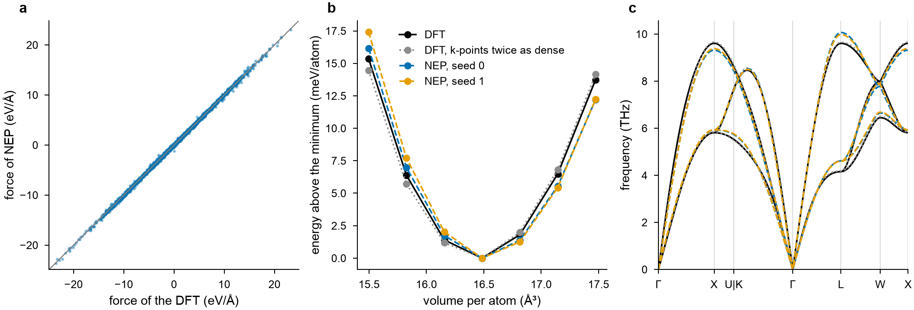
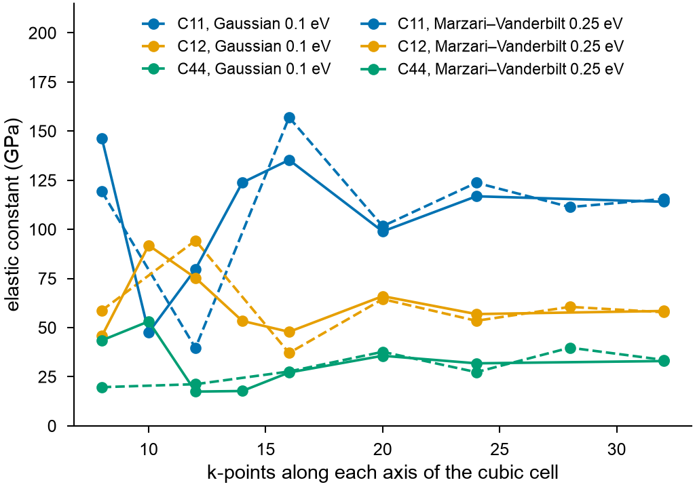

# A potential from MDAPY's DFT

A machine-learned potential is as good as its labels. This page makes the whole chain
in MDAPY: structures of aluminium generated as in
[Generated training sets for aluminium](aluminium-training.md), labelled by MDAPY's
[plane-wave DFT](../user-guide/potentials/dft.md) on the GPU, a NEP model trained on them
with [torchnep](https://github.com/mushroomfire/torchnep)
([Wu et al. 2026](../reference/references.md#wu2026torchnep)), and the model's properties
against those of the DFT itself: the equation of state, the vacancy, a surface and the
phonons. The elastic constants of aluminium need far more k-points than labels do; the
last section shows how many.

<!-- needs: torchnep -->

## The labels

The "generated + crystals" set of that page: two thirds of the atoms from
`generate_structures`, one third perturbed fcc, bcc and hcp crystals, 520 cells of 2 to
54 atoms and 4820 atoms in all; and for the test, 91 cells of 1201 atoms from another
generation and other crystals:

<!-- skip-test -->
```python
generated = generate_structures("Al", volume=(8.3, 33.2), seed=0).structures
write("train.xyz", mixed([generated, crystals(50, 4800)], [2, 1], 4800))
other = generate_structures("Al", volume=(8.3, 33.2), seed=7).structures
write("test.xyz", mixed([other, crystals(57, 1200)], [2, 1], 1200))
```

`crystals` and `mixed` are those of the page of generated training sets; the whole
script is [`dft_training.py`](dft-potential/dft_training.py).
The DFT takes the PBE pseudopotential of aluminium of
[PseudoDojo](http://www.pseudo-dojo.org) 0.4
([van Setten et al. 2018](../reference/references.md#vansetten2018)), 600 eV, a mesh of
at most 0.15 1/Å between k-points and the smearing of Marzari and Vanderbilt of 0.25 eV:

<!-- skip-test -->
```python
from mdapy.calculators import DFT
from mdapy.io import read_trajectory, write

dft = DFT(600.0, pseudopotentials={"Al": "Al.upf"}, kspacing=0.15,
          smearing="marzari-vanderbilt", sigma=0.25)  # fmt: skip
for name in ("train", "test"):
    frames = [dft.compute(f, ("energy", "forces", "virial")).attach(f)
              for f in read_trajectory(f"{name}.xyz")]  # fmt: skip
    write(f"{name}-dft.xyz", frames)
```

Each cell starts cold. The 611 cells took 6.3 GPU-hours on two A100 and two H100 GPUs,
37 s each on average: the small cells of many k-points take as long as the large ones of
few. Every one converged, in 5 to 35 steps of the self-consistent field, 7 in the median.

## The model

The cells within 0.5 eV per atom of the lowest count three times:

<!-- skip-test -->
```python
import subprocess
import sys
from pathlib import Path

NEP_IN = """type       1 Al
version    4
cutoff     6 4
n_max      4 4
basis_size 8 8
l_max      4 2 0
neuron     50
epoch      300
batch      {batch}
lr         0.01
stage2     1
"""
frames = list(read_trajectory("train-dft.xyz"))
energies = [f.info["energy"] / len(f) for f in frames]
low = min(energies) + 0.5
frames = [f.with_info(weight=3.0) if e < low else f for f, e in zip(frames, energies)]
Path("nep").mkdir(exist_ok=True)
write("nep/train.xyz", frames)
batch = round(150 * len(frames) / sum(len(f) for f in frames))
Path("nep/nep.in").write_text(NEP_IN.format(batch=batch))
code = "from torchnep import train_nep; train_nep('nep.in', 'train.xyz', device='cuda')"
subprocess.run([sys.executable, "-c", code], cwd="nep", check=True)
```

Two models, of the seeds 0 and 1, trained in 127 and 82 s on an A100. Their errors on the
91 test cells:

| Model | Energy (meV/atom) | Forces (eV/Å) | Virial (meV/atom) | Energy, the 13 cells within 0.5 eV/atom of the lowest |
|---|---:|---:|---:|---:|
| seed 0 | 35 | 0.166 | 124 | 15 |
| seed 1 | 37 | 0.164 | 126 | 17 |

The test cells are generated ones, as the training cells: their energies lie 3.4 eV per
atom above the lowest in the median, up to 7.2, and their forces reach 24 eV/Å. Near the
crystal the errors are smaller, as the properties below show.

## Properties

The same functions of `mdapy.properties`, the
[defect energies](../user-guide/properties/defect-energies.md) and the
[phonons](../user-guide/properties/phonons.md), take the DFT and the model alike:

<!-- skip-test -->
```python
from mdapy.build import build_crystal
from mdapy.calculators import NEP
from mdapy.properties.defects import surface_energy, vacancy_formation_energy
from mdapy.properties.phonons import phonons, primitive_cell
from mdapy.transform import replicate

for calculator in (dft, NEP("nep/nep_best.txt")):
    # a0 of the Birch-Murnaghan fit of seven volumes from 94 to 106 %, then at a0:
    crystal = build_crystal("fcc", a0, elements="Al")
    vacancy = vacancy_formation_energy(
        replicate(crystal, (3, 3, 3)), calculator, max_force=0.01
    )
    surface = surface_energy(crystal, calculator, axis=2, max_force=0.01)
    bands = phonons(primitive_cell(crystal), calculator, supercell=4).band_structure(
        "fcc"
    )
```

| | DFT | DFT, k-points twice as dense | NEP, seed 0 | NEP, seed 1 |
|---|---:|---:|---:|---:|
| a0 (Å) | 4.038 | 4.036 | 4.041 | 4.043 |
| B0 (GPa) | 78.4 | 77.5 | 75.5 | 78.6 |
| vacancy (eV) | 0.669 | 0.656 | 0.680 | 0.607 |
| (100) surface (J/m²) | 1.006 | 1.008 | 0.939 | 0.960 |
| X, TA and LA (THz) | 5.81, 9.61 | 5.84, 9.66 | 5.92, 9.31 | 5.93, 9.38 |
| L, TA and LA (THz) | 4.16, 9.61 | 4.18, 9.65 | 4.61, 10.07 | 4.60, 9.98 |



*a: the forces of the 91 test cells, NEP of seed 0 against the DFT. b: the equation of
state, the energy per atom against the volume per atom from 94 to 106 %. c: the phonons
along the high-symmetry path of fcc.*

- **The equation of state** of the models lies within 0.005 Å of the DFT in a0 and
  3 GPa in B0, and the DFT with k-points twice as dense moves a0 by 0.002 Å: the labels
  of the generated cells are converged enough for it.
- **The vacancy and the surface** come out within 0.07 eV and 0.07 J/m² of the DFT.
- **The phonons** agree along the whole path within 0.3 THz but near L, where both
  branches of the models are 0.4 to 0.5 THz high.

## Elastic constants and k-points

The elastic constants are the curvature of the energy under small strains, and in a
metal the Fermi surface changes under them: they need a dense mesh, much denser than
the energies and the forces of the labels. With the labels' mesh, 11 × 11 × 11 on the
cubic cell, the DFT gives C11, C12 and C44 of 79, 78 and 28 GPa; with the mesh twice as
dense 103, 66 and 31. On meshes from 8 to 32 k-points along each axis of the cubic cell
of four atoms ([`kconv.py`](dft-potential/kconv.py)):



*The elastic constants of the DFT jump with the mesh up to about 20 k-points along each
axis and settle from 24, at 114, 58 and 33 GPa with 32, the two smearings alike.*

The models give 114 and 118 GPa for C11, 56 and 60 for C12, and 38 and 39 for C44:
close to the converged DFT, which no label computed. That they agree is luck as much as
learning: the elastic constants of the labels' DFT are not those values. Quantum
ESPRESSO on the same cell, pseudopotential, mesh and Gaussian smearing gives C11 of
156.8 and 123.4 GPa with 16 and 24 k-points along each axis, where MDAPY gives 157.0 and
123.7: the jumps are aluminium's, not the code's.

## Running it

<!-- skip-test -->
```bash
python dft_training.py sets
python dft_training.py label 0 4      # and 1 4, 2 4, 3 4: on four GPUs
python dft_training.py train 0        # and 1
python dft_training.py errors
python dft_training.py properties dft  # and dft-fine, nep_0, nep_1
python kconv.py 8 12 16 20 24 28 32  # Gaussian 0.1 eV
SMEARING=marzari-vanderbilt SIGMA=0.25 python kconv.py 8 10 12 14 16 20 24 32
python figures.py . images
```

The scripts: [`dft_training.py`](dft-potential/dft_training.py),
[`kconv.py`](dft-potential/kconv.py) and [`figures.py`](dft-potential/figures.py).

The properties of the DFT took 34 minutes on an H100 with the labels' mesh and two hours
on an A100 with the mesh twice as dense, the vacancy of 107 atoms most of them; those of
a model, a second.

## See also

- [Plane-wave DFT](../user-guide/potentials/dft.md), its
  [verification](../user-guide/potentials/dft-verification.md) and its
  [speed](../performance/dft.md).
- [Generated training sets for aluminium](aluminium-training.md), the same structures
  labelled by MatterSim.

!!! quote "Please cite"
    The pseudopotentials: [van Setten et al. (2018)](../reference/references.md#vansetten2018);
    the model: [Fan et al. (2022)](../reference/references.md#fan2022) and
    [Wu et al. (2026)](../reference/references.md#wu2026torchnep).
