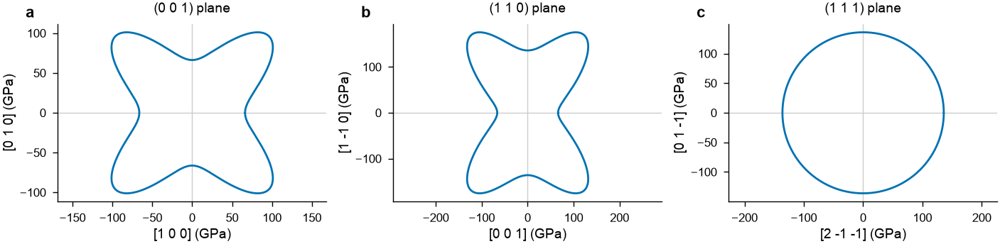
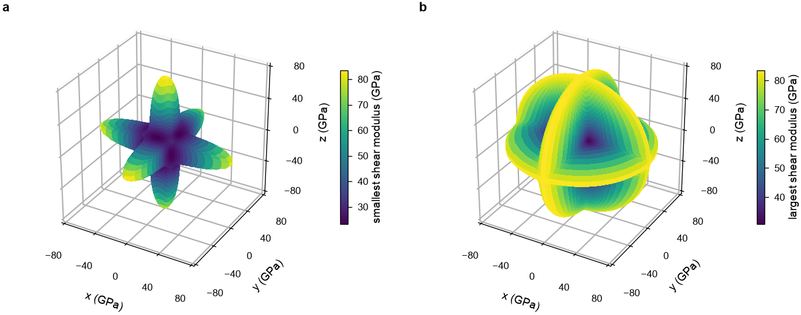
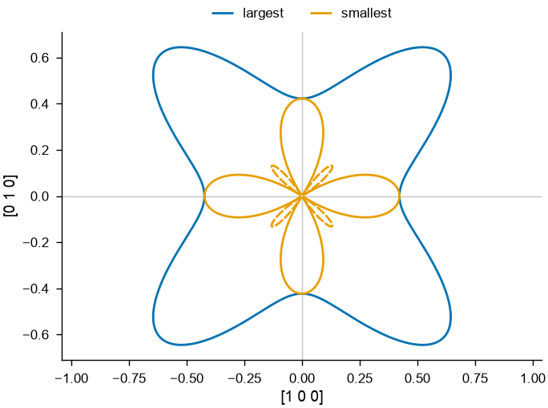
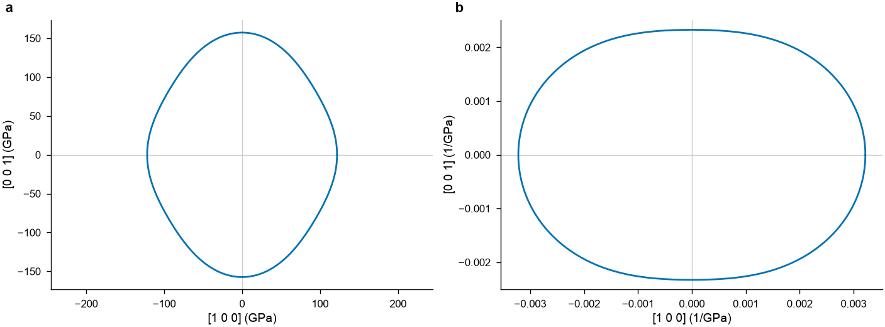

# Elastic anisotropy of copper and titanium

Elastic constants hold everything about how a crystal answers a small load, but a
6 × 6 matrix is hard to read. This page turns the constants of copper and of titanium
into the numbers and pictures that answer the usual questions: how stiff is the crystal
along a direction, what does a polycrystal of it do, which shear does a dislocation
feel, and does a stretch make it wider somewhere. See
[Elastic constants](../user-guide/simulation/elastic-constants.md) for the functions
themselves and their definitions, and [Plots](../user-guide/visualization/plots.md) for
the figures.

!!! note "Cite the model and the data"

    The NEP model for 16 metals and their alloys was trained with TorchNEP
    ([Wu et al. (2026)](../reference/references.md#wu2026torchnep)) on the
    data of [Song et al. (2024)](../reference/references.md#song2024). Cite
    both papers when you use it.

<!-- files: high-throughput -->

Download the model [`nep.txt`](high-throughput/nep.txt), a copy of
`UNEP16/n44/nep_torchnep_seed0.txt` in the
[TorchNEP_models repository](https://github.com/mushroomfire/TorchNEP_models),
into the working directory; [Screening alloys in many processes](high-throughput.md)
uses it too.

## The constants of copper

Relax the cubic crystal at zero stress, then compute its constants:

```python
import numpy as np
from mdapy.build import build_crystal
from mdapy.calculators import NEP
from mdapy.lattice_dynamics import elastic_constants
from mdapy.simulation import minimize

nep = NEP("nep.txt")


def relaxed(structure, a, element, repeat, **options):
    crystal = build_crystal(structure, a, elements=element, repeat=repeat, **options)
    return minimize(crystal, nep, cell="full", max_stress=1e-6).system


crystal = relaxed("fcc", 3.63, "Cu", (3, 3, 3))
copper = elastic_constants(crystal, nep)
print(f"a = {crystal.box.matrix[0, 0] / 3:.3f} Å")
print(np.round(copper.constants, 1))
c = copper.constants
print(f"Zener ratio {2 * c[3, 3] / (c[0, 0] - c[0, 1]):.2f}")
print(f"universal anisotropy {copper.universal_anisotropy():.2f}")
```

```text
a = 3.631 Å
[[173.9 127.4 127.4   0.    0.   -0. ]
 [127.4 173.9 127.4   0.    0.   -0. ]
 [127.4 127.4 173.9   0.    0.    0. ]
 [  0.    0.   -0.   83.5  -0.   -0. ]
 [  0.   -0.    0.    0.   83.5  -0. ]
 [  0.   -0.   -0.   -0.   -0.   83.5]]
Zener ratio 3.58
universal anisotropy 2.24
```

A cubic crystal has three independent constants. Its Zener ratio $2C_{44}/(C_{11} -
C_{12})$ is 1 when it is isotropic; copper's, above 3, is far from it. The universal
anisotropy index measures the same for any crystal: zero when isotropic, 2.24 here.

## A polycrystal

A polycrystal of grains in every orientation is isotropic: one bulk and one shear
modulus describe it, and from them its Young's modulus and Poisson ratio. Its moduli
lie between the Voigt bound, with the same strain in every grain, and the Reuss bound,
with the same stress; the Hill average, their mean, is the usual estimate:

```python
for average in ("voigt", "reuss", "hill"):
    print(
        f"{average:5s}  K {copper.bulk_modulus(average):5.1f} GPa"
        f"  G {copper.shear_modulus(average):4.1f} GPa"
        f"  E {copper.young_modulus(average=average):5.1f} GPa"
        f"  nu {copper.poisson_ratio(average=average):.3f}"
    )
```

```text
voigt  K 142.9 GPa  G 59.4 GPa  E 156.5 GPa  nu 0.317
reuss  K 142.9 GPa  G 41.0 GPa  E 112.4 GPa  nu 0.369
hill   K 142.9 GPa  G 50.2 GPa  E 134.9 GPa  nu 0.343
```

The bulk modulus has no spread: a cubic crystal shrinks alike in every direction under
pressure. The shear modulus spreads by more than a third between the bounds, as
copper's anisotropy lies in shear.

## Stiff and soft directions

The Young's modulus of a single crystal depends on the direction it is pulled along:

```python
for direction in ([1, 0, 0], [1, 1, 0], [1, 1, 1]):
    print(direction, f"{copper.young_modulus(direction):.1f} GPa")
```

```text
[1, 0, 0] 66.3 GPa
[1, 1, 0] 136.0 GPa
[1, 1, 1] 209.6 GPa
```

Copper is more than three times stiffer along ⟨111⟩ than along ⟨100⟩, and the
polycrystal, at 135 GPa, lies in between. The modulus along every direction is a
surface, drawn on [Elastic constants](../user-guide/simulation/elastic-constants.md#along-directions);
its sections in three planes are easier to read:

```python
from mdapy.visualization import plot

with plot.style():
    fig, axes = plot.figure("double", nrows=1, ncols=3)
    for ax, normal, name in zip(axes, [(0, 0, 1), (1, 1, 0), (1, 1, 1)], "abc"):
        plot.elastic_section(copper, normal=normal, ax=ax)
        ax.set_title(f"({' '.join(map(str, normal))}) plane")
        plot.panel_label(ax, name)
    fig.savefig("images/elastic-young-sections.png", dpi=200)
```



*The Young's modulus of copper along the directions of three planes, as far from the
center as its value. a: the cube face, softest along the cube axes. b: the (110) plane,
through ⟨100⟩, ⟨110⟩ and the stiffest ⟨111⟩. c: the (111) plane, where it is the same in
every direction, as for every cubic crystal.*

## Shear on the slip planes

A shear modulus takes two directions: the normal of the plane sheared and the direction
of the shear. Dislocations in copper glide on {111} planes along ⟨110⟩:

```python
slip = copper.shear_modulus(normal=[1, 1, 1], direction=[1, -1, 0])
cube = copper.shear_modulus(normal=[0, 0, 1], direction=[1, 0, 0])
soft = copper.shear_modulus(normal=[1, 1, 0], direction=[1, -1, 0])
print(f"{{111}}<110> {slip:.1f}  {{100}}<010> {cube:.1f}  {{110}}<1-10> {soft:.1f} GPa")
```

```text
{111}<110> 30.7  {100}<010> 83.5  {110}<1-10> 23.3 GPa
```

The shear of the cube faces is $C_{44}$, that of {110} along ⟨1-10⟩ is $(C_{11} -
C_{12})/2$, and the slip systems, at 30.7 GPa, are much softer than the polycrystal's
50.2 GPa. On a (111) plane the modulus is the same along every direction of the shear.
Across each direction $\mathbf n$, the shear modulus ranges between a smallest and a
largest value over the directions of the shear; `elastic_surface` draws either:

```python
with plot.style():
    fig, (left, right) = plot.figure(
        "double", nrows=1, ncols=2, subplot_kw={"projection": "3d"}
    )
    plot.elastic_surface(copper, "shear_modulus", ax=left, extreme="min")
    plot.elastic_surface(copper, "shear_modulus", ax=right, extreme="max")
    plot.panel_label(left, "a")
    plot.panel_label(right, "b")
    fig.savefig("images/elastic-shear.png", dpi=200)
```



*The shear modulus of copper on the plane normal to each direction: a, the smallest over
the directions of the shear, b, the largest. Both are $C_{44}$ across ⟨100⟩, and they meet
across ⟨111⟩, where the shear is the same in every direction.*

## A stretch that makes copper wider

The Poisson ratio also takes two directions: that of the stretch and that of the
contraction across it. Stretched along [110], copper narrows strongly along [001], and
grows along [1-10]:

```python
print(f"{copper.poisson_ratio([1, 1, 0], [0, 0, 1]):.3f}")
print(f"{copper.poisson_ratio([1, 1, 0], [1, -1, 0]):.3f}")
print(f"{copper.poisson_ratio([1, 0, 0], [0, 1, 0]):.3f}")
```

```text
0.868
-0.185
0.423
```

A negative Poisson ratio along some direction is common among cubic metals
([Baughman et al. (1998)](../reference/references.md#baughman1998)). Stretched along a
cube axis, copper narrows by 0.423 in every direction across it. Drawn for the
stretches in the cube face, the smallest ratio turns negative around ⟨110⟩, where its
curve is dashed:

```python
with plot.style():
    fig, ax = plot.figure()
    plot.elastic_section(copper, "poisson_ratio", ax=ax, extreme="max", label="largest")
    plot.elastic_section(
        copper, "poisson_ratio", ax=ax, extreme="min", label="smallest"
    )
    ax.legend(loc="lower center", bbox_to_anchor=(0.5, 1.0), ncols=2)
    fig.savefig("images/elastic-poisson.png", dpi=200)
```



*For each direction of stretch in the (001) plane, the largest and the smallest Poisson
ratio over the directions across it, as far from the center as their size; dashed where
negative.*

## Titanium

Hexagonal titanium has five independent constants. In the box that `build_crystal`
makes, its c axis lies along z:

```python
crystal = relaxed("hcp", 2.94, "Ti", (4, 4, 3), c=4.65)
titanium = elastic_constants(crystal, nep)
print(np.round(titanium.constants, 1))
print(np.round(titanium.young_modulus([[1, 0, 0], [0, 1, 0], [0, 0, 1]]), 1))
print(np.round(titanium.linear_compressibility([[1, 0, 0], [0, 0, 1]]), 5))
```

```text
[[171.1  81.7  80.1   0.    0.   -0. ]
 [ 81.7 171.1  80.1  -0.    0.   -0. ]
 [ 80.1  80.1 208.1  -0.    0.    0. ]
 [ -0.    0.    0.   47.7   0.    0. ]
 [ -0.    0.    0.   -0.   47.7  -0. ]
 [  0.    0.    0.    0.   -0.   44.7]]
[121.8 121.8 157.3]
[0.00322 0.00233]
```

$C_{66}$ is $(C_{11} - C_{12})/2$, and in the basal plane every direction is alike: the
Young's modulus is 121.8 GPa along x and along y, and along any direction between them.
Along the c axis it is 157.3 GPa, and under pressure the crystal shrinks some 28 % less
along c than across it. A plane through the c axis shows both:

```python
with plot.style():
    fig, (left, right) = plot.figure("double", nrows=1, ncols=2)
    plot.elastic_section(titanium, normal=(0, -1, 0), ax=left)
    plot.elastic_section(titanium, "linear_compressibility", (0, -1, 0), ax=right)
    plot.panel_label(left, "a")
    plot.panel_label(right, "b")
    fig.savefig("images/elastic-titanium.png", dpi=200)
```



*Titanium along the directions of the x-z plane, its c axis upward: a, the Young's
modulus; b, the linear compressibility.*

## A crystal in other axes

The constants, and every direction given to these functions, are in the axes of the
box. Build copper with [1-10], [11-2] and [111] along x, y and z, and its constants
change, as they are those of the turned crystal, but nothing physical does:

```python
turned = elastic_constants(
    relaxed(
        "fcc", 3.63, "Cu", (2, 1, 1), orientation=[(1, -1, 0), (1, 1, -2), (1, 1, 1)]
    ),
    nep,
)
print(np.round(turned.constants, 1))
print(f"{turned.young_modulus([0, 0, 1]):.1f} GPa along z")
print(f"universal anisotropy {turned.universal_anisotropy():.2f}")
```

```text
[[234.1 107.3  87.3 -28.4   0.   -0. ]
 [107.3 234.1  87.3  28.4   0.   -0. ]
 [ 87.3  87.3 254.2   0.    0.   -0. ]
 [-28.4  28.4  -0.   43.3  -0.    0. ]
 [ -0.    0.    0.    0.   43.3 -28.4]
 [  0.   -0.   -0.   -0.  -28.4  63.4]]
209.6 GPa along z
universal anisotropy 2.24
```

Along z, now [111], the Young's modulus is that of ⟨111⟩ above, and the anisotropy
index, which belongs to the crystal and not to its axes, is the same.
