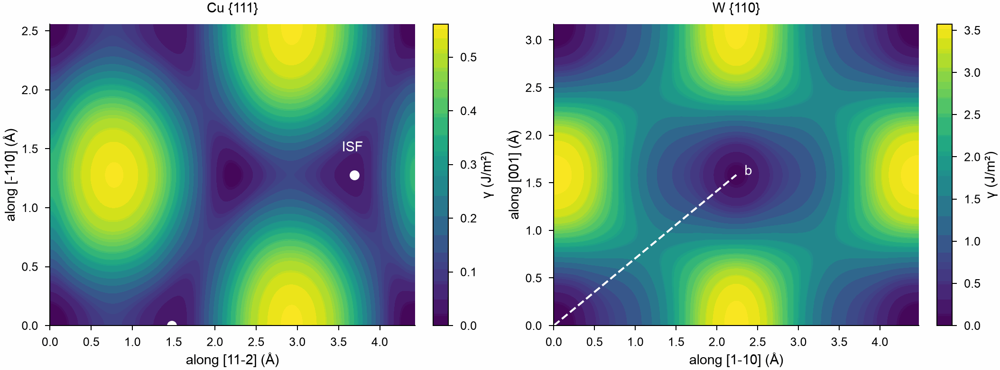

# Gamma surfaces

The [stacking fault energy](../user-guide/simulation/defect-energies.md) follows one slip
direction. The gamma surface gives the energy of every slip vector in the plane, as a map:
its valleys show how a dislocation dissociates and which paths slip takes. This page
computes it for copper on {111} and for tungsten on {110}, with the EAM potentials of Zhou
et al.

## The crystals

Each crystal has z normal to the plane and x and y along two directions of it, so the box
repeats the map along x and y. Free surfaces along z let the fault expand along its normal:
in a box periodic along z whose height stays fixed, the crystal is squeezed by the fault,
and the energy falls slowly with the number of layers.

```python
import numpy as np
import mdapy as mp
from mdapy.build import build_crystal
from mdapy.calculators import EAM
from mdapy.simulation import stacking_fault_energy


def slab(structure, a, element, orientation):
    crystal = build_crystal(
        structure, a, elements=element, orientation=orientation, repeat=(1, 1, 4)
    )
    return crystal.with_box(mp.Box(crystal.box.matrix, pbc=(True, True, False)))


copper = slab("fcc", 3.615, "Cu", [(1, 1, -2), (-1, 1, 0), (1, 1, 1)])
tungsten = slab("bcc", 3.165, "W", [(1, -1, 0), (0, 0, 1), (1, 1, 0)])
```

## The map

With two points, `stacking_fault_energy` gives the energy at the end of one slip vector:
the upper half of the crystal moved by it, and the atoms relaxed along the normal. A loop
over the vectors gives the map:

```python
def gamma_surface(crystal, potential, nx, ny):
    lx, ly = crystal.box.lengths[:2]
    x, y = np.linspace(0.0, lx, nx), np.linspace(0.0, ly, ny)
    energy = np.array(
        [
            [
                stacking_fault_energy(crystal, potential, [a, b, 0.0], points=2).energy[
                    1
                ]
                for a in x
            ]
            for b in y
        ]
    )
    return x, y, energy


fcc = gamma_surface(copper, EAM.zhou(["Cu"]), 37, 19)
bcc = gamma_surface(tungsten, EAM.zhou(["W"]), 25, 17)
```

## What it shows

```python
from mdapy.visualization import plot

lx, ly = copper.box.lengths[:2]
wx, wy = tungsten.box.lengths[:2]
with plot.style():
    fig, axes = plot.figure("double", ncols=2)
    for ax, (x, y, energy), title in zip(axes, (fcc, bcc), ("Cu {111}", "W {110}")):
        shown = ax.imshow(
            energy,
            origin="lower",
            extent=(0.0, x[-1], 0.0, y[-1]),
            cmap="viridis",
            interpolation="bicubic",
            aspect="auto",
        )
        ax.set_title(title)
        fig.colorbar(shown, ax=ax, label="γ (J/m²)")
    axes[0].set(xlabel="along [11-2] (Å)", ylabel="along [-110] (Å)")
    axes[1].set(xlabel="along [1-10] (Å)", ylabel="along [001] (Å)")
    # the two places of the intrinsic stacking fault in the cell
    axes[0].plot(
        [lx / 3, 5 * lx / 6], [0.0, ly / 2], "o", color="white", ms=4, clip_on=False
    )
    axes[0].annotate(
        "ISF", (5 * lx / 6, ly / 2), (5 * lx / 6 - 0.15, ly / 2 + 0.2), color="white"
    )
    # the Burgers vector a/2 <111>, across the middle of the cell
    axes[1].plot([0.0, wx / 2], [0.0, wy / 2], "--", color="white", lw=1)
    axes[1].annotate("b", (wx / 2, wy / 2), (wx / 2 + 0.1, wy / 2), color="white")
    plot.save(fig, "images/gamma-surface", formats=("png",))

fcc[2][0, 12], fcc[2][0, 6]  # 0.0225 and 0.111 J/m²: the fault, and the way to it
bcc[2][4, 6], bcc[2].max()  # 1.73 at the middle of b, and 3.57 J/m² atoms on atoms
```



*Left: copper on {111}. The deep valleys are the lattice vectors, and between them lie the
shallow minima of the intrinsic stacking fault at a/6 <11-2>, so a dislocation splits into
two partials. Right: tungsten on {110}. Along the Burgers vector a/2 <111> the energy rises
to one maximum at its middle, with no minimum on the way: no stable stacking fault, and no
splitting.*

Moving by a lattice vector brings the crystal back onto itself, so the energy is zero there,
and the map has the symmetry of the plane: on {111} the two sites of the fault have the same
energy, and each map is its own mirror image.
