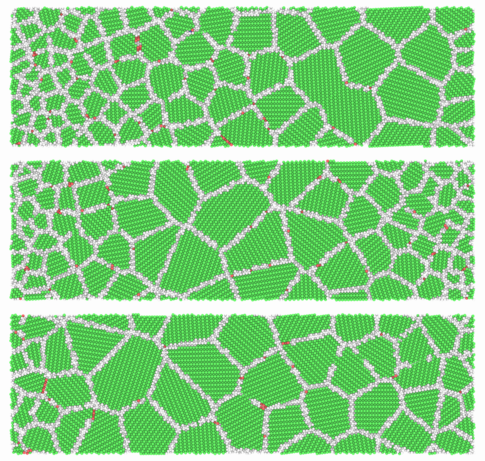
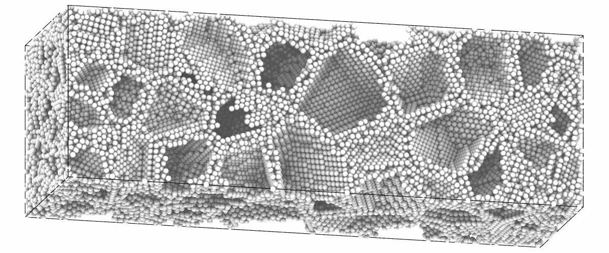

# A gradient polycrystal

In a gradient polycrystal the grain size changes along one direction, as in a metal whose
surface was deformed. [`gradient_seeds`](../user-guide/build/polycrystals.md#gradient-polycrystals)
gives seeds for [`build_polycrystal`](../user-guide/build/polycrystals.md) from a list of
grain sizes along a box vector, so one list holds any profile. This page builds three
profiles in columns of copper, where the grains are easy to see, and then one that fills a
box.

## Three profiles

Each pair of `sizes` is a position along the box vector, as a fraction from 0 to 1, and the
grain size there in Å, linear between them. A gradient from one side takes two pairs; three
pairs give fine grains on both sides and coarse ones in the middle, with a gradient of its
own on each side.

Columns along [110] have few pairs of grains that differ by a small angle, so nearly every
boundary shows:

```python
import numpy as np
import mdapy as mp
from mdapy.build import build_crystal, build_polycrystal, gradient_seeds
from mdapy.identify import CommonNeighborAnalysis
from mdapy.visualization import render, write_png

rows = build_crystal(
    "fcc", 3.615, elements="Cu", orientation=[(0, 0, 1), (1, -1, 0), (1, 1, 0)]
)
box = mp.Box([400.0, 120.0, 1.0])
profiles = {
    "one side": [(0, 15), (1, 60)],
    "both sides": [(0, 15), (0.5, 60), (1, 15)],
    "two gradients": [(0, 15), (0.25, 60), (1, 30)],
}
pictures = []
for sizes in profiles.values():
    seeds = gradient_seeds(box, sizes, axis="x", columns="z", seed=1)
    grains = build_polycrystal(rows, box, seeds, seed=1)
    cna = CommonNeighborAnalysis().compute(grains)
    pictures.append(
        render(grains, color=cna, view="top", box=False, width=1200, height=380)
    )
write_png("images/gradient-polycrystals.png", np.vstack(pictures))
```



*Columnar copper, the atoms of the grains green and those of the boundaries white. Top:
fine grains on the left growing to the right. Middle: fine grains on both sides and coarse
ones in the middle. Bottom: a steep gradient on the left and a gentle one on the right,
with grains of different sizes at the two ends.*

## In three dimensions

Without `columns` the seeds fill the box, and a grain size is the diameter of the sphere of
the same volume:

```python
copper = build_crystal("fcc", 3.615, elements="Cu")
box = mp.Box([80.0, 80.0, 240.0])
seeds = gradient_seeds(box, [(0, 20), (0.5, 50), (1, 20)], seed=1)
graded = build_polycrystal(copper, box, seeds, seed=1)
len(seeds), len(graded)  # 103 grains, 121823 atoms
cna = CommonNeighborAnalysis().compute(graded)
render(
    graded,
    "images/gradient-3d.png",
    atoms=cna.structure != 1,
    color="white",
    view=(0.25, -1.0, 0.25),
    up=(1.0, 0.0, 0.0),
    width=1200,
    height=500,
)
```



*The atoms of the grain boundaries alone, z to the right: dense at both ends, where the
grains are of 20 Å, and sparse in the middle, where they are of 50 Å.*

## Free surfaces

The box of a polycrystal is periodic, so across its ends the first grains meet the last:
that suits a profile with the same size at both ends, and otherwise makes a boundary
between fine and coarse grains. For free surfaces, open the box along the gradient:

```python
surfaces = graded.with_box(mp.Box(graded.box.matrix, pbc=(True, True, False)))
```
