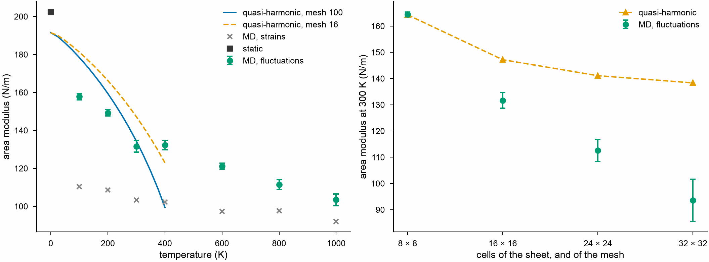

# Elastic constants of graphene

A sheet of graphene is stiff in its plane and soft across it. Its vibrations
across the plane, whose frequency is quadratic in the wave vector, ripple it at
any temperature, and the ripples soften it in its plane. This page computes the
elastic constants of graphene with the LCBOP potential of LAMMPS: static, from
the quasi-harmonic approximation, and from molecular dynamics from 100 to
1000 K. It then shows how they depend on the size of the sheet. See
[Sheets](../user-guide/properties/sheets.md),
[Quasi-harmonic approximation](../user-guide/properties/quasi-harmonic.md) and
[Elastic constants from molecular dynamics](../user-guide/properties/md-elastic.md)
for the functions themselves.

Copy the potential
[`C.lcbop`](https://github.com/lammps/lammps/blob/develop/potentials/C.lcbop)
of LAMMPS into the working directory.

## At 0 K

<!-- skip-test -->
```python
import numpy as np
import mdapy
from mdapy.build import build_crystal
from mdapy.calculators import LAMMPS
from mdapy.properties.elastic import elastic_constants
from mdapy.simulation import minimize

potential = LAMMPS("pair_style lcbop\npair_coeff * * C.lcbop C", elements=["C"])
crystal = build_crystal("graphene", 2.46, c=20.0, elements="C")
sheet = crystal.with_box(mdapy.Box(crystal.box.matrix, pbc=(True, True, False)))
sheet = minimize(sheet, potential, cell="full", max_stress=1e-3).system


def hexagonal(c):
    """C11, averaged over xx and yy, C12 and C66 of a sheet, in N/m."""
    return np.mean(np.diag(c)[:2]), c[0, 1], c[2, 2]


static = elastic_constants(sheet, potential)
print("C11 %.1f, C12 %.1f, C66 %.1f N/m" % hexagonal(static.constants))
print(f"area modulus {static.area_modulus():.1f} N/m")
```

```text
C11 331.2, C12 73.4, C66 128.9 N/m
area modulus 202.3 N/m
```

The area modulus is the tension per unit of relative change of the area:
$(C_{11} + C_{12})/2$ for a hexagonal sheet.

## The quasi-harmonic approximation

[`quasi_harmonic`](../user-guide/properties/quasi-harmonic.md) finds the area
of the sheet at each temperature from the free energy of its vibrations, and
the area modulus there. It takes a few seconds:

<!-- skip-test -->
```python
from mdapy.properties.thermodynamics import quasi_harmonic

temperatures = np.arange(0, 401, 25.0)
qha = quasi_harmonic(
    sheet, potential, temperatures, volumes=np.linspace(1.0, 1.025, 6), mesh=100
)
for t, area, modulus in zip(temperatures[::4], qha.area[::4], qha.area_modulus[::4]):
    print(f"{t:3.0f} K: area {area:.4f} Ų per atom, area modulus {modulus:.1f} N/m")
```

```text
  0 K: area 2.6408 Ų per atom, area modulus 191.4 N/m
100 K: area 2.6390 Ų per atom, area modulus 178.4 N/m
200 K: area 2.6352 Ų per atom, area modulus 159.4 N/m
300 K: area 2.6301 Ų per atom, area modulus 134.3 N/m
400 K: area 2.6229 Ų per atom, area modulus 99.4 N/m
```

The vibrations at zero point stretch the sheet by 0.8 % from its static area,
2.619 Ų per atom, which softens it to 191 N/m at 0 K. On heating, the
vibrations across the sheet shrink it and soften it fast. Near 400 K its area
approaches the static one, under which these vibrations have imaginary
frequencies, and the approximation ends there, as
[Sheets](../user-guide/properties/sheets.md#quasi-harmonic-approximation)
explains.

## From molecular dynamics

[`md_elastic_constants`](../user-guide/properties/md-elastic.md) takes all the
anharmonic vibrations. For a sheet it uses by default the fluctuations of the
stress at the mean area of the sheet. Here it runs on 16 × 16 cells, 512 atoms,
with a time step of 0.5 fs: 500 ps at zero pressure for the mean area, then
500 ps at that area for the fluctuations, at each temperature:

<!-- skip-test -->
```python
from mdapy.properties.elastic import md_elastic_constants
from mdapy.transform import replicate

big = replicate(sheet, (16, 16, 1))
hot = [100, 200, 300, 400, 600, 800, 1000]
md = [
    md_elastic_constants(
        big, potential, t, timestep=0.0005, equilibration=20000, production=1000000
    )
    for t in hot
]
for t, result in zip(hot, md):
    print(
        "%4d K: C11 %.1f, C12 %.1f, C66 %.1f N/m" % (t, *hexagonal(result.constants)),
        f"area modulus {result.area_modulus():.1f} N/m",
    )
```

```text
 100 K: C11 273.6, C12 42.0, C66 114.6 N/m area modulus 157.8 N/m
 200 K: C11 261.8, C12 37.1, C66 118.1 N/m area modulus 149.3 N/m
 300 K: C11 242.3, C12 22.7, C66 108.0 N/m area modulus 131.6 N/m
 400 K: C11 238.8, C12 25.9, C66 106.3 N/m area modulus 132.2 N/m
 600 K: C11 228.7, C12 13.7, C66 107.4 N/m area modulus 121.1 N/m
 800 K: C11 214.7, C12 9.1, C66 100.6 N/m area modulus 111.5 N/m
1000 K: C11 197.0, C12 10.2, C66 93.8 N/m area modulus 103.5 N/m
```

Each temperature took 9 to 12 minutes on 16 processes of a node of the Triton
cluster of Aalto University (Intel Xeon Gold 6248), with LAMMPS built with MPI;
see [LAMMPS on many processes with MPI](mpi.md). The standard errors are 3 to
10 N/m for C11, 2 to 4 N/m for C12 and 1 to 5 N/m for C66: the vibrations
across the sheet change slowly, and the fluctuations need long runs.

## Why not strains

`method="strain"` takes the mean stress under strains of +1 % and −1 %. A
strain that compresses a sheet wrinkles it: the sheet bends out of its plane
rather than shorten, and resists less than under a stretch. On the same 512
atoms at 100 K, 1 % of stretch along x raises the tension by 3.0 N/m, and 1 %
of compression lowers it by 1.5 N/m. The heights of the atoms spread by 0.16 Å
under the stretch, 0.22 Å at rest and 0.65 Å under the compression. The strains
average the two responses: at 100 K they give C11 217 N/m along x and 176 N/m
along y, which the symmetry of graphene makes equal, against 274 N/m for both
from the fluctuations. `md_elastic_constants` therefore takes the fluctuations
for a sheet unless `method="strain"` is given.

## Why the two differ

The vibrations across the sheet are soft: their frequency falls as the square
of the wave vector, so the longest of them, as long as the sheet, move the
most, and they ripple the sheet. Stretching a rippled sheet first flattens its
ripples, which costs little. The sheet is therefore softer in its plane than a
flat one, and the more so the larger it is, as longer ripples fit in it.

The quasi-harmonic approximation takes the vibrations as harmonic at each area:
it sees that they stiffen as the sheet is stretched, which softens the sheet as
it heats, but not that ripples of different wavelengths change one another.
Molecular dynamics takes both, and the second grows with the size of the
sheet. To compare them on the same vibrations, give the approximation a `mesh`
of as many cells as the sheet of molecular dynamics, here at 300 K:

<!-- skip-test -->
```python
cells = [8, 16, 24, 32]
by_size = [
    md_elastic_constants(
        replicate(sheet, (n, n, 1)), potential, 300.0, timestep=0.0005,
        equilibration=20000, production=1000000,
    )
    for n in cells
]  # fmt: skip
by_mesh = [
    quasi_harmonic(
        sheet, potential, [300.0], volumes=np.linspace(1.0, 1.025, 6), mesh=n
    ).area_modulus[0]
    for n in cells
]
```

| Sheet | Atoms | Area modulus, molecular dynamics | Area modulus, quasi-harmonic |
|---|---:|---:|---:|
| 8 × 8 | 128 | 164.5 ± 0.8 N/m | 164.3 N/m |
| 16 × 16 | 512 | 131.6 ± 3.0 N/m | 147.2 N/m |
| 24 × 24 | 1152 | 112.6 ± 4.2 N/m | 141.1 N/m |
| 32 × 32 | 2048 | 93.6 ± 8.0 N/m | 138.3 N/m |

On 8 × 8 cells the two agree, and at 100 K as well: 182.1 ± 0.6 N/m by
molecular dynamics, 185.4 N/m by the approximation. On larger sheets molecular
dynamics goes on softening, while the approximation levels off, at 134 N/m for
a mesh of 100. The gap of 23 N/m between the two at 100 K on 16 × 16 cells, in
the figure, therefore comes from the size of the sheet, not from the classical
atoms of molecular dynamics. A crystal has no such vibrations, and there the
two agree within 5 % up to 1000 K, as for
[CrCoNi](crconi.md#from-molecular-dynamics). The constants of a free sheet
from molecular dynamics are those of its size.

<!-- skip-test -->
```python
from mdapy.visualization import plot

strained = [
    md_elastic_constants(
        big, potential, t, timestep=0.0005, equilibration=20000, production=200000,
        method="strain",
    )
    for t in hot
]  # fmt: skip
small = quasi_harmonic(
    sheet, potential, temperatures, volumes=np.linspace(1.0, 1.025, 6), mesh=16
)


def spread(result):
    """The standard error of the area modulus, the errors taken as independent."""
    e = result.errors
    return np.sqrt(e[0, 0] ** 2 + e[1, 1] ** 2 + 4 * e[0, 1] ** 2) / 4


with plot.style():
    fig, (left, right) = plot.figure("double", ncols=2)
    left.plot(temperatures, qha.area_modulus, label="quasi-harmonic, mesh 100")
    left.plot(temperatures, small.area_modulus, "--", label="quasi-harmonic, mesh 16")
    left.errorbar(hot, [r.area_modulus() for r in md], [spread(r) for r in md],
                  fmt="o", capsize=2, label="MD, fluctuations")  # fmt: skip
    left.plot(hot, [r.area_modulus() for r in strained], "x", color="0.5",
              label="MD, strains")  # fmt: skip
    left.plot(0, static.area_modulus(), "s", color="0.2", label="static")
    left.set_xlabel("temperature (K)")
    left.set_ylabel("area modulus (N/m)")
    left.legend()
    right.plot(cells, by_mesh, "--", marker="^", color="C1", label="quasi-harmonic")
    right.errorbar(cells, [r.area_modulus() for r in by_size],
                   [spread(r) for r in by_size], fmt="o", color="C2", capsize=2,
                   label="MD, fluctuations")  # fmt: skip
    right.set_xticks(cells, [f"{n} × {n}" for n in cells])
    right.set_xlabel("cells of the sheet, and of the mesh")
    right.set_ylabel("area modulus at 300 K (N/m)")
    right.legend()
    plot.save(fig, "images/graphene-elastic", formats=("png",))
```



*The area modulus of graphene with LCBOP. Left, against the temperature: the
lines are the quasi-harmonic approximation, on a mesh of 100 cells and on one
of 16, as many as the sheet of molecular dynamics; the points are molecular
dynamics on 16 × 16 cells, by the fluctuations of the stress, with their
standard errors, and, in gray, by strains, which the wrinkling of the
compressed sheet makes too soft. Right, at 300 K against the size of the sheet:
the two agree on the smallest sheet and part as it grows.*

## What to keep in mind

- **Molecular dynamics is classical.** The quasi-harmonic approximation
  includes the vibrations at zero point, which stretch the sheet and soften it
  by 5 % at 0 K. On 8 × 8 cells at 100 K the two still differ by only 2 %.
- **The quasi-harmonic approximation ends near 400 K** for LCBOP, where the
  sheet shrinks to its static area. A tension, through `pressure`, keeps it
  stretched.
- **Fluctuations need long runs on a sheet.** A million steps of 0.5 fs give
  errors of a few N/m on 512 atoms, and the errors grow with the size of the
  sheet.
- **The size is part of the result.** Give the number of cells with the
  constants of a free sheet.
