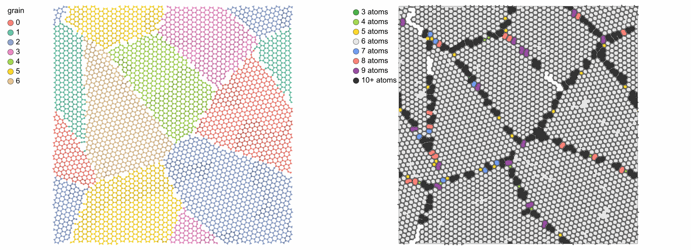

<!-- needs: lammps -->

# A polycrystal of graphene

Two-dimensional grains are a columnar polycrystal one layer thick. This page builds seven
grains of graphene with [`build_polycrystal`](../user-guide/build/polycrystals.md), lets the
atoms at the boundaries settle with a potential, and finds the boundaries from the rings of
the sheet.

## The grains

The unit needs an orthogonal box, such as graphene with x and y along two directions of the
plane and vacuum along z. The box of the polycrystal is no longer than the unit along z, so
every grain spans it and turns about it. A `min_distance` of 1.2 Å removes atoms much closer
than a bond across the boundaries:

```python
import numpy as np
import mdapy as mp
from mdapy.build import build_crystal, build_polycrystal

sheet = build_crystal(
    "graphene",
    2.46,
    c=10.0,
    elements="C",
    orientation=[(1, -1, 0, 0), (1, 1, -2, 0), (0, 0, 0, 1)],
)
flakes = build_polycrystal(
    sheet, mp.Box([120.0, 120.0, 1.0]), 7, min_distance=1.2, seed=4
)
flakes.box.lengths  # 120, 120 and 10 Å
```

A unit with two kinds of atoms, such as boron nitride with `elements=["B", "N"]`, goes the
same way.

## The boundaries settle

Minimizing and a short run at 300 K, here with the Tersoff parameters of carbon of
[Lindsay and Broido (2010)](../reference/references.md#lindsay2010), bond the atoms at the
boundaries where they can reach each other. The box follows the sheet with `barostat="xy"`:

```python
from pathlib import Path
from mdapy.calculators import LAMMPS
from mdapy.simulation import MolecularDynamics, minimize

Path("C.tersoff").write_text(
    "C C C 3.0 1.0 0.0 3.8049e4 4.3484 -0.930 0.72751 1.5724e-7 "
    "2.2119 430.0 1.95 0.15 3.4879 1393.6\n"
)
carbon = LAMMPS("pair_style tersoff\npair_coeff * * C.tersoff C", ["C"])
minimized = minimize(flakes, carbon, max_force=0.05, max_steps=2000).system
with MolecularDynamics(minimized, carbon, timestep=0.0005) as md:
    md.velocities(600, seed=1)
    md.run(6000, ensemble="npt", temperature=300.0, pressure=0.0, barostat="xy")
    settled = md.system
```

## The rings show the boundaries

[Ring statistics](../user-guide/analysis/rings.md) finds hexagons inside the grains and other
rings along their boundaries. A ring larger than `max_size`, here 20, is not found and stays
white:

```python
from mdapy.analysis import RingStatistics
from mdapy.visualization import render, write_png

rings = RingStatistics(20, cutoff=1.8).compute(settled)
rings.counts[6], rings.counts.sum()  # 2412 of 2564 are hexagons
mesh, ring = rings.polygons(settled)
colors = {
    3: (0.30, 0.69, 0.29),
    4: (0.65, 0.85, 0.33),
    5: (1.00, 0.85, 0.18),
    6: (0.90, 0.90, 0.90),
    7: (0.45, 0.62, 0.94),
    8: (0.97, 0.51, 0.47),
    9: (0.60, 0.31, 0.64),
    10: (0.20, 0.20, 0.20),  # the larger rings too
}
sizes = np.minimum(rings.sizes, 10)
top = {"view": "top", "box": False, "width": 1100, "height": 800, "bonds": 1.8}
by_grain = render(
    settled,
    color="grain",
    colormap="labels",
    representation="ball_and_stick",
    legend=True,
    **top,
)
by_ring = render(
    settled,
    radius=0.3,
    style="flat",
    mesh=mesh,
    mesh_color=np.array([colors[size] for size in sizes[ring]]),
    legend={
        f"{size}{'+' if size == 10 else ''} atoms": colors[size]
        for size in np.unique(sizes)
    },
    **top,
)
write_png("images/graphene-polycrystal.png", np.hstack([by_grain, by_ring]))
```



*Seven grains of graphene, turned about the normal of the sheet, after 3 ps at 300 K. Left:
the grains stay whole. Right: the rings up to 20 atoms, those of 10 or more in one color.
Pentagons, heptagons and larger rings form where the boundaries closed, and the large rings
are the holes left in them.*

The elastic constants and phonons of a perfect sheet are on [Sheets](../user-guide/simulation/sheets.md).
