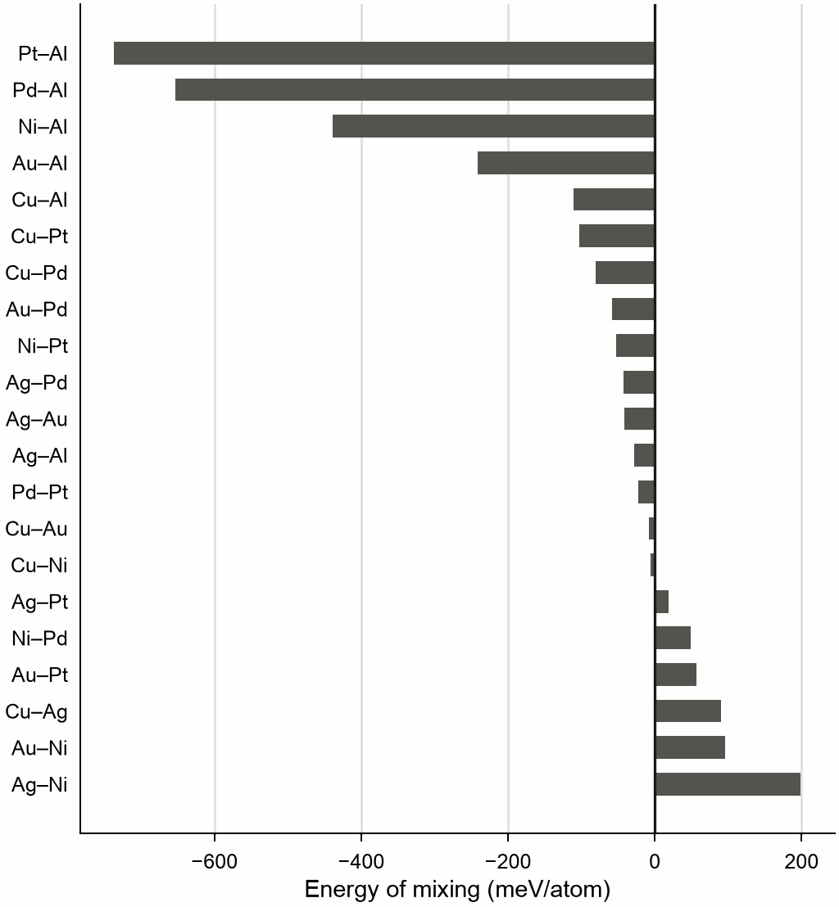
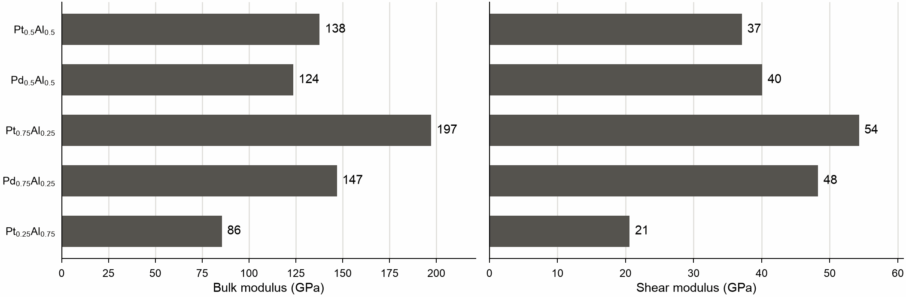

# Screening alloys in many processes

Some questions need no large system, but many small ones: hundreds of
alloys, each relaxed by itself. Working this way is called high-throughput
computing. A program makes the structures and computes them all, nobody looks
at each one, every result goes into a table, and the costly calculations are
spent only on the few candidates that pass a cheap test first.

This page screens the binary alloys of seven fcc metals: it relaxes 189 random
alloys, compares their energies with the pure metals, and computes elastic
constants of the five with the lowest energy of mixing.

!!! note "Cite the model and the data"

    The NEP model for 16 metals and their alloys was trained with TorchNEP
    ([Wu et al. (2026)](../reference/references.md#wu2026torchnep)) on the
    data of [Song et al. (2024)](../reference/references.md#song2024). Cite
    both papers when you use it.

<!-- files: high-throughput -->

Download the model [`nep.txt`](high-throughput/nep.txt), a copy of
`UNEP16/n44/nep_torchnep_seed0.txt` in the
[TorchNEP_models repository](https://github.com/mushroomfire/TorchNEP_models),
into the working directory.

## The script

Save this as `screen.py` and run it with `python screen.py`. Each structure is
one job, each process computes one job at a time on one core, and each result
is one row of `results.csv`:

<!-- script: screen.py -->
```python
import os

# one thread for each library in each process, before they are imported
os.environ["MDAPY_NUM_THREADS"] = "1"
os.environ["POLARS_MAX_THREADS"] = "1"
os.environ["OPENBLAS_NUM_THREADS"] = "1"
os.environ["OMP_NUM_THREADS"] = "1"

import csv
import itertools
import multiprocessing
from concurrent.futures import ProcessPoolExecutor, as_completed
from pathlib import Path
from mdapy.build import build_crystal, random_alloy
from mdapy.calculators import NEP
from mdapy.errors import MdapyError
from mdapy.simulation import minimize

POTENTIAL = NEP("nep.txt")  # each process reads it once, when it starts
LATTICE = {
    "Cu": 3.61,
    "Ag": 4.09,
    "Au": 4.08,
    "Ni": 3.52,
    "Pd": 3.89,
    "Pt": 3.92,
    "Al": 4.05,
}
FIELDS = ["a", "b", "x", "seed", "energy", "lattice", "error"]
RESULTS = Path("results.csv")


def relax(job):
    """One alloy relaxed at zero pressure: a job in, a row of the table out."""
    a, b, x, seed = job
    row = dict(zip(FIELDS, job))
    fractions = {a: x, b: 1 - x} if a != b else {a: 1.0}
    guess = sum(LATTICE[element] * part for element, part in fractions.items())
    sites = build_crystal("fcc", guess, repeat=(3, 3, 3))
    system = random_alloy(sites, fractions, seed=seed)
    try:
        result = minimize(
            system, POTENTIAL, cell="isotropic", max_stress=1e-4, max_force=1e-3
        )
    except MdapyError as error:
        return {**row, "error": str(error)}
    if not result.converged:
        return {**row, "error": "did not converge"}
    row["energy"] = result.energy / len(system)
    row["lattice"] = result.system.box.matrix[0, 0] / 3
    return row


if __name__ == "__main__":
    pure = [(element, element, 1.0, 1) for element in LATTICE]
    alloys = [
        (a, b, x, seed)
        for a, b in itertools.combinations(LATTICE, 2)
        for x in (0.25, 0.5, 0.75)
        for seed in (1, 2, 3)
    ]
    finished = set()
    if RESULTS.exists():
        with RESULTS.open(newline="") as file:
            for row in csv.DictReader(file):
                finished.add((row["a"], row["b"], float(row["x"]), int(row["seed"])))
    jobs = [job for job in pure + alloys if job not in finished]

    processes = int(os.environ.get("SLURM_CPUS_PER_TASK", os.cpu_count()))
    context = multiprocessing.get_context("spawn")
    with (
        RESULTS.open("a", newline="") as file,
        ProcessPoolExecutor(processes, mp_context=context) as pool,
    ):
        table = csv.DictWriter(file, FIELDS)
        if not finished:
            table.writeheader()
        for future in as_completed([pool.submit(relax, job) for job in jobs]):
            table.writerow(future.result())
            file.flush()
```

The 196 relaxations take about 9 s on the ten cores of an Apple M5. Three things
in it matter more than they seem to:

- **A failed job gives a row, not an end.** A structure that MDAPY refuses or
  that does not converge writes its reason in `error`, and the others go on.
- **Each row is written as soon as it is ready.** Run the script again after
  it was stopped, by a time limit or by a crash, and it computes only what is
  missing. A job that kills its process, which no error of MDAPY does, ends the
  run with `BrokenProcessPool`, and would do so again until it is taken out.
- **The jobs are small.** A job holds four numbers and strings, not a system,
  so little has to travel between processes. Systems can be
  [pickled](../basics/changing.md#other-processes) when a job has to carry one.

## One thread in each process

MDAPY uses all the CPUs by default, and every process would start as many
threads: ten processes on ten cores make a hundred threads, which take the
cores from each other. For 100 relaxations of 108 atoms with this model:

| Processes | Threads of MDAPY | Threads of polars | Apple M5, 10 cores | Intel i5-12600K, 16 threads |
|---|---|---|---|---|
| 1 | 1 | 1 | 22.6 s | 45.1 s |
| 1 | all | all | 7.5 s | 11.3 s |
| 10 | all | all | **25.6 s** | **38.9 s** |
| 10 | 1 | all | 4.4 s | 5.8 s |
| 10 | 1 | 1 | 4.4 s | 5.7 s |

The energies are the same in every row and on both machines, down to the
5 decimals compared. Without a limit the ten processes gain little or nothing
over a single thread, and are six to seven times slower than they could be. The
threads of MDAPY do the harm: after each piece of work they keep checking for more for a moment,
[as they should in one process](../basics/parallelism.md#working-with-pytorch-and-lammps),
and in many processes they check while others wait for the core. Those of polars
cost no time here, as they sleep in such small jobs, but they are still threads:
limit them too, because a cluster may count them.

Other libraries in a job have their own settings: `OPENBLAS_NUM_THREADS` and
`OMP_NUM_THREADS` for NumPy's linear algebra and `torch.set_num_threads(1)` for a
PyTorch model, called at the start of the job.

Set the environment at the very top of the script, as above: polars reads
its variable only when it is first imported, and MDAPY reads its own at import.

Use one process for each logical CPU, as the script does, also where they share
a core: on the i5, 200 relaxations ran 8 times faster in 10 processes than in
one, and 10 times faster in 16. A process holds about 100 MB here.

## Start the processes with spawn

On Linux before Python 3.14, a `ProcessPoolExecutor` starts its processes with
fork unless told otherwise. This is a limit of polars: a forked process inherits
the state of its threads, but not the threads, so once the parent has used them, as
`build_crystal` does, a worker that needs them waits forever, without a message.
MDAPY warns in every forked process. `spawn` starts
each process afresh, on every system, and costs an import of a fraction of a
second. Each process then imports the script itself, so everything that runs the
jobs goes under `if __name__ == "__main__":`, and what every process needs, like
the model, stays at the top. See [Parallelism](../basics/parallelism.md#many-processes).

## When many processes pay

Processes pay for small systems, because each job is too short for threads to
share it well. For larger ones the difference goes away: 10 relaxations of 4000
atoms took 16.0 s in ten processes and 16.1 s in one process with all its threads
on the M5, and 21.4 s and 19.6 s on the i5. From some thousands of atoms on, one
process using all its threads is as fast and much simpler.

## Reading the results

The table is an ordinary file. The energy of mixing compares an alloy with the
pure metals, and the three seeds tell how much the random arrangement matters:

```python
import polars as pl

results = pl.read_csv("results.csv").filter(pl.col("error").is_null())
pure = results.filter(pl.col("a") == pl.col("b")).select("a", energy_a="energy")
x = pl.col("x")
mixing = pl.col("energy") - x * pl.col("energy_a") - (1 - x) * pl.col("energy_b")
alloys = (
    results.filter(pl.col("a") != pl.col("b"))
    .join(pure, on="a")
    .join(pure.rename({"a": "b", "energy_a": "energy_b"}), on="b")
    .with_columns(mixing=1000 * mixing)
    .group_by("a", "b", "x")
    .agg(
        mixing=pl.col("mixing").mean(),
        spread=pl.col("mixing").std(),
        lattice=pl.col("lattice").mean(),
    )
    .sort("mixing")
)
shown = alloys.head(5).with_columns(pl.col("mixing", "spread").round(1))
print(shown.with_columns(pl.col("lattice").round(3)))
```

```text
shape: (5, 6)
┌─────┬─────┬──────┬────────┬────────┬─────────┐
│ a   ┆ b   ┆ x    ┆ mixing ┆ spread ┆ lattice │
│ --- ┆ --- ┆ ---  ┆ ---    ┆ ---    ┆ ---     │
│ str ┆ str ┆ f64  ┆ f64    ┆ f64    ┆ f64     │
╞═════╪═════╪══════╪════════╪════════╪═════════╡
│ Pt  ┆ Al  ┆ 0.5  ┆ -736.5 ┆ 8.9    ┆ 3.941   │
│ Pd  ┆ Al  ┆ 0.5  ┆ -653.1 ┆ 6.9    ┆ 3.925   │
│ Pt  ┆ Al  ┆ 0.75 ┆ -544.6 ┆ 3.5    ┆ 3.941   │
│ Pd  ┆ Al  ┆ 0.75 ┆ -530.2 ┆ 5.8    ┆ 3.921   │
│ Pt  ┆ Al  ┆ 0.25 ┆ -470.0 ┆ 5.6    ┆ 3.987   │
└─────┴─────┴──────┴────────┴────────┴─────────┘
```

The energies are in meV per atom, the lattice constants in Å. These are random
alloys on fcc sites, not the ordered compounds such elements form: a large
negative energy tells that they bind strongly, not which phase appears. The alloys
of equal parts show the whole screen in one figure:

```python
from mdapy.visualization import plot

equal = alloys.filter(pl.col("x") == 0.5).sort("mixing", descending=True)
names = [f"{a}–{b}" for a, b in equal.select("a", "b").iter_rows()]
with plot.style():
    fig, ax = plot.figure("single", 95.0)
    ax.barh(names, equal["mixing"], color="#55534e", height=0.62)
    ax.axvline(0.0, color="#1c1b19", linewidth=0.8)
    ax.set_xlabel("Energy of mixing (meV/atom)")
    ax.tick_params(axis="y", length=0)
    ax.grid(axis="x", color="#deddd9", linewidth=0.6)
    ax.set_axisbelow(True)
    plot.save(fig, "images/high_throughput", formats=("png",))
```



*The energy of mixing of the fcc alloys of equal parts, each the mean of three
random arrangements of 108 atoms.*

## The costly step for the few

The first step cost a fraction of a second for each alloy, so it could look at
all of them. Elastic constants cost more and answer a narrower question, so
only the five best get them. These are few enough to run one after another in
this process, on all its threads:

```python
from mdapy.build import build_crystal, random_alloy
from mdapy.calculators import NEP
from mdapy.lattice_dynamics import elastic_constants
from mdapy.simulation import minimize

potential = NEP("nep.txt")
rows = []
for a, b, x, lattice in alloys.head(5).select("a", "b", "x", "lattice").iter_rows():
    sites = build_crystal("fcc", lattice, repeat=(3, 3, 3))
    system = random_alloy(sites, {a: x, b: 1 - x}, seed=1)
    relaxed = minimize(system, potential, cell="full", max_stress=1e-4).system
    elastic = elastic_constants(relaxed, potential)
    rows.append(
        {
            "a": a,
            "b": b,
            "x": x,
            "bulk": round(elastic.bulk_modulus(), 1),
            "shear": round(elastic.shear_modulus("voigt"), 1),
        }
    )
print(pl.DataFrame(rows))
```

```text
shape: (5, 5)
┌─────┬─────┬──────┬───────┬───────┐
│ a   ┆ b   ┆ x    ┆ bulk  ┆ shear │
│ --- ┆ --- ┆ ---  ┆ ---   ┆ ---   │
│ str ┆ str ┆ f64  ┆ f64   ┆ f64   │
╞═════╪═════╪══════╪═══════╪═══════╡
│ Pt  ┆ Al  ┆ 0.5  ┆ 137.7 ┆ 37.1  │
│ Pd  ┆ Al  ┆ 0.5  ┆ 123.6 ┆ 40.1  │
│ Pt  ┆ Al  ┆ 0.75 ┆ 197.3 ┆ 54.3  │
│ Pd  ┆ Al  ┆ 0.75 ┆ 146.9 ┆ 48.3  │
│ Pt  ┆ Al  ┆ 0.25 ┆ 85.5  ┆ 20.6  │
└─────┴─────┴──────┴───────┴───────┘
```

The moduli are in GPa, and side by side they separate the candidates:

```python
moduli = pl.DataFrame(rows)
names = [
    f"{a}$_{{{x:g}}}${b}$_{{{1 - x:g}}}$"
    for a, b, x in moduli.select("a", "b", "x").iter_rows()
]
with plot.style():
    fig, axes = plot.figure("double", 60.0, ncols=2, sharey=True)
    for ax, column, label in zip(
        axes, ("bulk", "shear"), ("Bulk modulus (GPa)", "Shear modulus (GPa)")
    ):
        bars = ax.barh(names, moduli[column], color="#55534e", height=0.62)
        ax.bar_label(bars, fmt="%.0f", padding=3)
        ax.set_xlabel(label)
        ax.margins(x=0.12)
        ax.tick_params(axis="y", length=0)
        ax.grid(axis="x", color="#deddd9", linewidth=0.6)
        ax.set_axisbelow(True)
    axes[0].invert_yaxis()
    plot.save(fig, "images/high_throughput_elastic", formats=("png",))
```



*The bulk and shear moduli of the five alloys with the lowest energy of mixing, in the order
of the table: each a random arrangement of 108 atoms, relaxed.*

A real screen goes on like this, step by step: each one costs more than the last and looks
at fewer candidates, and the last of them may be a first-principles calculation.

## On a cluster

A job asks for the cores, and the script reads their number:

```bash
#!/bin/bash
#SBATCH --cpus-per-task=32
#SBATCH --time=01:00:00
python screen.py
```

A job that hits its time limit loses nothing but the structures in progress:
submit it again and it goes on from `results.csv`. For work beyond one node, or
for a record of how each number was made, workflow managers such as
[AiiDA](https://www.aiida.net) and [jobflow](https://github.com/materialsproject/jobflow)
run functions like `relax` as their jobs.
