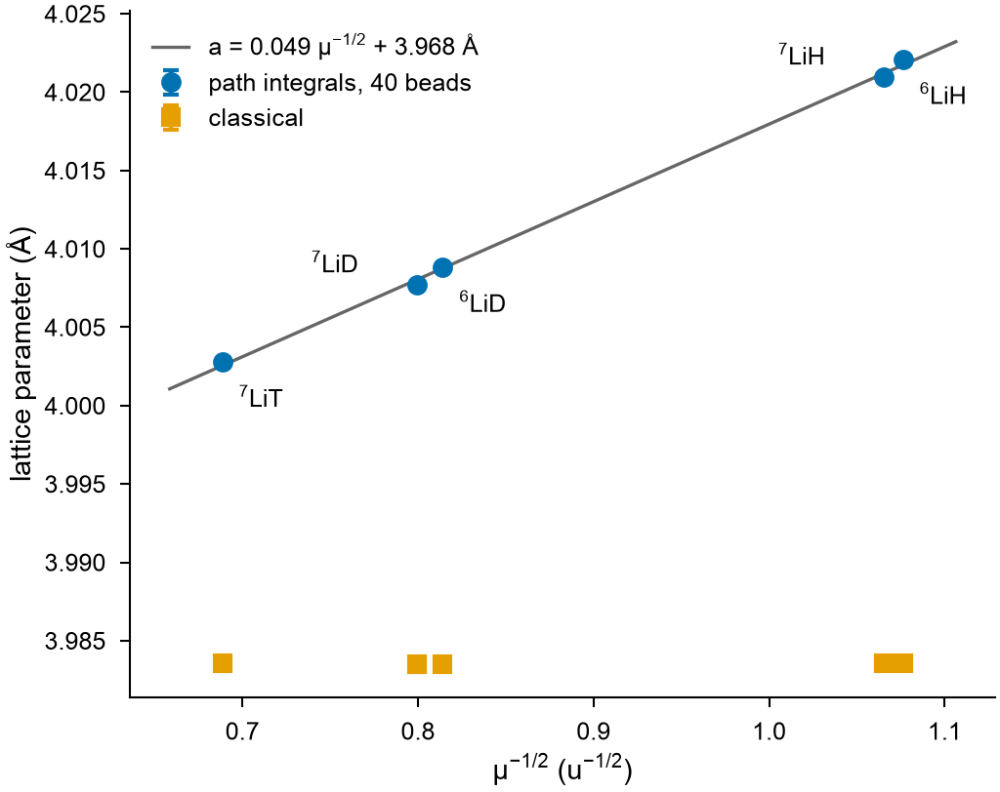

# Isotopes of lithium hydride

Light nuclei are quantum particles: even at absolute zero they move about their sites,
and this zero-point motion pushes the atoms of a crystal apart. The lighter the
isotope, the more it moves, and the larger the crystal. In lithium hydride, of the
lightest atoms, the lattice parameter measured at room temperature over five isotopic
compositions follows a = A μ^−1/2 + B, μ the reduced mass of the lithium and hydrogen
atoms in atomic mass units, with A ≈ 0.054 Å
([Anderson et al. 1970](../reference/references.md#anderson1970)): 0.02 Å from ⁶LiH to
⁷LiT. Classical molecular
dynamics, whose atoms are points, cannot see it: the masses of the atoms do not enter
the equilibrium of a classical crystal. [Path integrals](../user-guide/simulation/pimd.md)
can.

This page repeats the study of [Ying et al. (2025)](../reference/references.md#ying2025)
in MDAPY: the five compositions ⁶LiH, ⁷LiH, ⁶LiD, ⁷LiD and ⁷LiT at 298.15 K and zero
pressure, with 40 beads, and classically.

!!! note "The model"
    A NEP model of LiH trained by [torchnep](https://github.com/mushroomfire/torchnep)
    ([Wu et al. 2026](../reference/references.md#wu2026torchnep)) on the training set of
    Ying et al., labelled by DFT with the LDA, from the
    [TorchNEP models](https://github.com/mushroomfire/TorchNEP_models); the page
    downloads it. The LDA makes the lattice of LiH about 1.5 % smaller than measured,
    which leaves its isotope effect alone.

## One composition

The rock-salt crystal of 6 × 6 × 6 cubic cells, 1728 atoms, gets the masses of its
isotopes in a `mass` column; `beads=40` makes each atom a ring polymer of 40 beads.
Langevin thermostats on the normal modes of the rings (PILE) and the isotropic barostat
of Bussi, Zykova-Timan and Parrinello on their centroids hold 298.15 K and zero
pressure for 50 ps, of which the last 25 give the lattice parameter:

<!-- skip-test -->
```python
import urllib.request

import numpy as np
from mdapy.build import build_crystal
from mdapy.calculators import NEP
from mdapy.simulation import MolecularDynamics

URL = "https://raw.githubusercontent.com/mushroomfire/TorchNEP_models/main/LiH/nep_torchnep.txt"
urllib.request.urlretrieve(URL, "lih.txt")
gpu = NEP("lih.txt", device="cuda")

MASSES = {"6Li": 6.0151223, "7Li": 7.0160034, "1H": 1.00782503, "2H": 2.01410178,
          "3H": 3.01604928}  # fmt: skip


def lattice(lithium, hydrogen, beads, seed=1):
    """The lattice parameter (Å) of the rock salt of two isotopes at 298.15 K
    and zero pressure, and its standard error from ten blocks."""
    crystal = build_crystal("rocksalt", 4.02, elements=["Li", "H"], repeat=(6, 6, 6))
    lithium_sites = np.asarray(crystal["element"]) == "Li"
    mass = np.where(lithium_sites, MASSES[lithium], MASSES[hydrogen])
    crystal = crystal.with_columns(mass=mass)
    with MolecularDynamics(crystal, gpu, timestep=0.001, beads=beads) as md:
        md.velocities(298.15, seed=seed)
        md.run(50000, ensemble="npt", thermostat="langevin", temperature=298.15,
               thermostat_damping=0.1, pressure=0.0, barostat="iso",
               barostat_damping=1.0, seed=seed, thermo=50)  # fmt: skip
        thermo = md.thermo
    late = thermo.filter(thermo["step"] > 25000)
    a = (late["volume"].to_numpy() / 6**3) ** (1 / 3)
    blocks = np.array([b.mean() for b in np.array_split(a, 10)])
    return a.mean(), blocks.std(ddof=1) / np.sqrt(10)


lattice("7Li", "1H", 40)
```

A run of 40 beads takes about four hours on a V100 GPU, a classical one four minutes.

## The isotope effect

<!-- skip-test -->
```python
from mdapy.visualization import plot

pairs = [("6Li", "1H"), ("7Li", "1H"), ("6Li", "2H"), ("7Li", "2H"), ("7Li", "3H")]
quantum = [lattice(li, h, 40) for li, h in pairs]
classical = [lattice(li, h, 1) for li, h in pairs]
mu = np.array([MASSES[li] * MASSES[h] / (MASSES[li] + MASSES[h]) for li, h in pairs])
x = mu**-0.5
a = np.array([q[0] for q in quantum])
error = np.array([q[1] for q in quantum])
A, B = np.polyfit(x, a, 1, w=1 / error)

with plot.style():
    fig, ax = plot.figure("single", 70)
    ax.errorbar(x, a, error, fmt="o", ms=4, capsize=2, label="path integrals, 40 beads")
    ax.errorbar(x, [c[0] for c in classical], [c[1] for c in classical], fmt="s", ms=4,
                capsize=2, label="classical")  # fmt: skip
    line = np.linspace(x.min() - 0.03, x.max() + 0.03, 10)
    ax.plot(
        line,
        A * line + B,
        "-",
        lw=0.8,
        c="0.4",
        label=f"a = {A:.3f} μ$^{{-1/2}}$ + {B:.3f} Å",
    )
    ax.set(xlabel="μ$^{-1/2}$ (u$^{-1/2}$)", ylabel="lattice parameter (Å)")
    ax.legend(fontsize=6)
    plot.save(fig, "images/lih-isotopes", formats=("png",))
```

The lattice parameter, the mean over the last 25 ps and its standard error, and the
kinetic energy of the nuclei by the centroid-virial estimator:

| Composition | μ (u) | a, 40 beads (Å) | a, classical (Å) | Kinetic energy per atom, 40 beads (meV) |
|---|---:|---:|---:|---:|
| ⁶LiH | 0.8632 | 4.0221 ± 0.0001 | 3.9836 ± 0.0001 | 66.2 |
| ⁷LiH | 0.8812 | 4.0210 ± 0.0001 | 3.9835 ± 0.0001 | 65.5 |
| ⁶LiD | 1.5089 | 4.0088 ± 0.0001 | 3.9835 ± 0.0001 | 56.5 |
| ⁷LiD | 1.5649 | 4.0077 ± 0.0001 | 3.9835 ± 0.0001 | 55.8 |
| ⁷LiT | 2.1093 | 4.0028 ± 0.0001 | 3.9835 ± 0.0001 | 52.0 |



*The lattice parameter of the five compositions at 298.15 K and zero pressure. Classical
nuclei give 3.9835 Å for all five; with path integrals, the lighter the nuclei the
larger the crystal, on a straight line in μ^−1/2.*

- **The slope** A = 0.0495 ± 0.0004 Å, against 0.051 of Ying et al., with 8000 atoms and
  their own NEP of the same data, and 0.054 measured by Anderson et al.
- **The zero-point expansion**, the difference from the classical crystal, is 0.019 Å
  for ⁷LiT and 0.039 Å for ⁶LiH, 0.5 to 1 %. The kinetic energy of the nuclei, 52 to
  66 meV per atom, is 1.4 to 1.7 times the classical 3/2 k_B T = 38.5 meV.
- **The lattice parameter** itself, 4.021 Å for ⁷LiH, is 1.5 % below the measured
  4.08 Å: the LDA of the training set, as Ying et al. note; the slope agrees with the
  measured one all the same.

## See also

- [Path integrals](../user-guide/simulation/pimd.md), their thermostats, barostat and
  estimators.
- [Molecular dynamics on the GPU](../user-guide/simulation/gpu.md).

!!! quote "Please cite"
    The study and its training set: [Ying et al. (2025)](../reference/references.md#ying2025);
    the model: [Wu et al. (2026)](../reference/references.md#wu2026torchnep); the
    measurements: [Anderson et al. (1970)](../reference/references.md#anderson1970).
