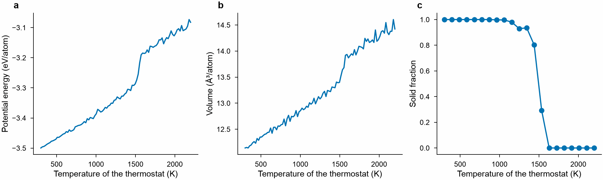
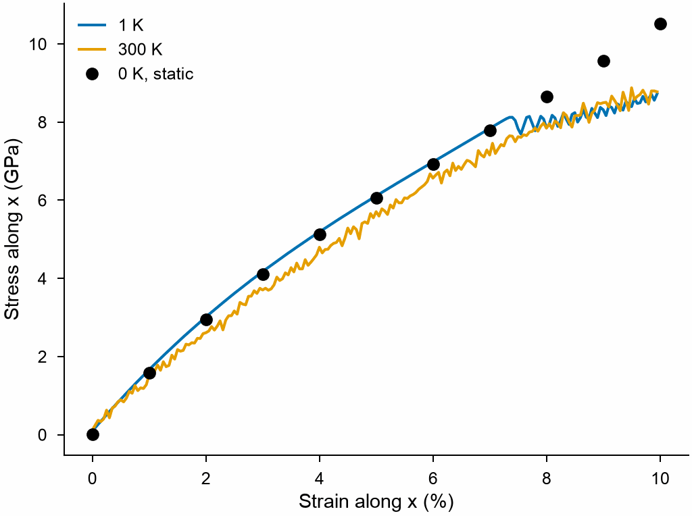

# Molecular dynamics through LAMMPS

[`MolecularDynamics`](../user-guide/simulation/dynamics.md) runs molecular dynamics in
LAMMPS from Python: the atoms come from a `System`, LAMMPS moves them, and MDAPY
keeps the thermodynamic state and the atoms along the way, which its analyses read
as they are. This page heats copper until it melts and stretches it at two
temperatures, then says what the interface is not made for, and how to run LAMMPS
on several threads or a GPU with Kokkos.

It needs the Python module of LAMMPS, built with the styles of the potential, as the
[LAMMPS documentation](https://docs.lammps.org/Python_install.html) describes. The
potential is a [LAMMPS calculator](../user-guide/simulation/lammps.md): any
interaction that LAMMPS computes in metal units. Here, the EAM potential of Zhou et
al. for copper, which MDAPY writes as a file for LAMMPS:

<!-- skip-test -->
```python
import numpy as np
from mdapy.build import build_crystal
from mdapy.calculators import EAM, LAMMPS
from mdapy.simulation import MolecularDynamics

EAM.zhou(["Cu"]).write("Cu_zhou.eam.alloy")
potential = LAMMPS(
    "pair_style eam/alloy\npair_coeff * * Cu_zhou.eam.alloy Cu", elements=["Cu"]
)
crystal = build_crystal("fcc", 3.615, elements="Cu", repeat=(6, 6, 6))
```

## Heating until it melts

Start at 300 K and zero pressure for 10 ps, then heat from 300 to 2200 K in 100 ps,
keeping the atoms every 5 ps. The 55000 steps of 864 atoms take about half a minute:

<!-- skip-test -->
```python
with MolecularDynamics(crystal, potential, timestep=0.002) as md:
    md.velocities(300, seed=1)
    md.run(5000, ensemble="npt", temperature=300, pressure=0.0)
    md.run(
        50000,
        ensemble="npt",
        temperature=(300, 2200),
        pressure=0.0,
        thermo=500,
        save_every=2500,
    )
    thermo, frames = md.thermo, md.frames
```

`thermo` is a polars table of the state every 500 steps; `frames` are the atoms
every 2500 steps, each a `System`. The order of the atoms by the
[bonds of q6](../user-guide/analysis/steinhardt.md) tells the solid
from the liquid:

<!-- skip-test -->
```python
from mdapy.analysis import SteinhardtParameters
from mdapy.visualization import plot


def thermostat(time):
    """The temperature of the thermostat at a time in ps."""
    return 300 + (2200 - 300) * (time - 10) / 100


q6 = SteinhardtParameters([6], num_neighbors=12, solid=True)
solid = [q6.compute(frame).solid.mean() for frame in frames]
heated = thermo.filter(thermo["time"] >= 10)
n = len(crystal)

with plot.style():
    fig, (a, b, c) = plot.figure("double", 55, nrows=1, ncols=3, sharex=True)
    a.plot(thermostat(heated["time"]), heated["potential_energy"] / n)
    a.set_ylabel("Potential energy (eV/atom)")
    b.plot(thermostat(heated["time"]), heated["volume"] / n)
    b.set_ylabel("Volume (ų/atom)")
    c.plot([thermostat(f.info["time"]) for f in frames], solid, marker="o")
    c.set_ylabel("Solid fraction")
    for ax, label in zip((a, b, c), "abc"):
        ax.set_xlabel("Temperature of the thermostat (K)")
        plot.panel_label(ax, label)
    plot.save(fig, "images/md-melting", formats=("png",))
```



*a, b: the energy and the volume rise steadily with temperature, and jump where the
crystal melts. c: the atoms in solid surroundings, by their bonds of q6.*

The crystal melts at about 1550 K. Without a surface to start from, a crystal melts only
well above its melting point, and heated at 19 K/ps it has little time to do so; the
temperature at which the solid and the liquid coexist is the melting point, which
[`melting_point`](../user-guide/simulation/melting-point.md) finds from a box that
holds both.

## Stretching at constant temperature

`command` runs any LAMMPS command. A fix added before `run` takes part in it, beside
the thermostat of `run`: here `fix deform` stretches the box along x by 0.1 % per ps,
to 10 %, at 1 K and at 300 K, after the box has relaxed at zero pressure:

<!-- skip-test -->
```python
curves = {}
for temperature in (1.0, 300.0):
    with MolecularDynamics(crystal, potential, timestep=0.002) as md:
        md.velocities(2 * temperature, seed=1)
        md.run(
            10000,
            ensemble="npt",
            temperature=temperature,
            pressure=0.0,
            barostat="aniso",
        )
        start = len(md.thermo)
        md.command("fix pull all deform 1 x erate 0.001 remap x")
        md.run(50000, ensemble="nvt", temperature=temperature, thermo=250)
        md.command("unfix pull")
        stretched = md.thermo[start:]
    volume = stretched["volume"].to_numpy()
    stress = np.stack(stretched["stress"].to_numpy())
    curves[temperature] = (volume / volume[0] - 1, stress[:, 0])
```

The same strains without heat: the stress of the strained crystal, as the potential
gives it.

<!-- skip-test -->
```python
import mdapy

strains = np.linspace(0, 0.1, 11)
static = []
for strain in strains:
    matrix = crystal.box.matrix * [[1 + strain], [1], [1]]
    strained = crystal.with_box(mdapy.Box(matrix), scale_positions=True)
    static.append(potential.compute(strained, ("energy", "virial")).stress[0, 0])

with plot.style():
    fig, ax = plot.figure("single")
    for temperature, (strain, stress) in curves.items():
        ax.plot(strain * 100, stress, label=f"{temperature:.0f} K")
    ax.plot(strains * 100, static, "o", color="black", label="0 K, static")
    ax.set_xlabel("Strain along x (%)")
    ax.set_ylabel("Stress along x (GPa)")
    ax.legend()
    plot.save(fig, "images/md-stretch", formats=("png",))
```



*At 1 K the run follows the stress of the static crystal up to some 7 % strain, where
the crystal gives way and its stress stops rising; the static crystal, held perfect,
goes on. At 300 K the crystal is softer. The curves bend from the start: the
stiffness of copper, 168.5 GPa at zero strain for this potential, falls as it is
stretched.*

The box keeps its size along y and z, so this is uniaxial strain. A uniaxial stress,
with y and z free under zero pressure, needs a barostat on y and z beside the
deformation, which `run` cannot give (see below).

## What it does

| Task | How |
|---|---|
| Hold a temperature, a pressure, or both | `run(steps, ensemble="nvt", temperature=300)`, `"npt"` with `pressure=0.0`, `"nph"`, or `"nve"` |
| Heat, cool, compress | a pair, `temperature=(300, 2200)` or `pressure=(0, 10)`, changes from the first value to the second along the run |
| Let the box change shape | `barostat="aniso"` along each axis, `"tri"` in any way, `"xy"` in the plane of a [sheet](../user-guide/simulation/sheets.md) |
| Keep the atoms for analysis | `save_every=` gives `frames`, each a `System` for any analysis of MDAPY |
| Go on from the end | `md.system` holds the atoms, with velocities and images, for [`minimize`](../user-guide/simulation/minimize.md), an analysis or a file |
| Add a fix or a compute of LAMMPS | `md.command(...)` before `run`, and `unfix` after: `deform`, `setforce` to hold some atoms, `langevin` with `ensemble="nve"`, `velocity` to push atoms |
| Read what LAMMPS holds | `md.lammps`, the LAMMPS instance, such as `md.lammps.get_thermo("pe")` or `extract_compute` |

Several functions of MDAPY run their molecular dynamics this way:
[elastic constants](../user-guide/simulation/md-elastic.md),
[free energies](../user-guide/simulation/free-energy.md),
[melting points](../user-guide/simulation/melting-point.md),
[pressure–temperature diagrams](../user-guide/simulation/pressure-temperature.md),
[phonons at a temperature](../user-guide/simulation/thermal-phonons.md) and
[stacking faults at a temperature](../user-guide/simulation/stacking-fault-temperature.md).

## What it is not made for

| Not for | Because | Instead |
|---|---|---|
| Charges, bonds and molecules: ReaxFF with charge equilibration, water, polymers | LAMMPS holds the atoms as `atom_style atomic`: positions, velocities and types | an input script of LAMMPS; read its dump files with [`mdapy.io.read_trajectory`](../basics/trajectory.md) |
| Units other than metal | the units of MDAPY are those of metal: Å, eV, ps | a potential for metal units |
| Many nodes, with MPI | MDAPY runs LAMMPS in its own process | Kokkos on the threads of one node or a GPU (below); for more, `mpirun` with an input script, and MDAPY on its dump files |
| An integrator of one's own, such as a barostat on y and z while x is stretched | each `run` adds its thermostat or barostat, and a second one would move the atoms twice | the fixes and `md.command("run 10000")`: `thermo` and `frames` record only `run`, and `md.system` reads the atoms after |
| Many frames of a large system | `frames` stay in memory | `md.command("dump ...")`, read with `mdapy.io.read_trajectory` |

## Several threads and GPUs with Kokkos

LAMMPS built with the [KOKKOS package](https://docs.lammps.org/Speed_kokkos.html)
runs its styles on the threads of a processor or on a GPU. The `cmdargs` of the
calculator switch it on; `-sf kk` takes the Kokkos version of each style, here
`eam/alloy/kk`:

<!-- skip-test -->
```python
threads = LAMMPS(
    "pair_style eam/alloy\npair_coeff * * Cu_zhou.eam.alloy Cu",
    elements=["Cu"],
    cmdargs=["-k", "on", "t", "4", "-sf", "kk"],
)
```

| Where | `cmdargs` | LAMMPS built with |
|---|---|---|
| 4 threads | `["-k", "on", "t", "4", "-sf", "kk"]` | KOKKOS with the Threads or OpenMP backend |
| 1 GPU | `["-k", "on", "g", "1", "-sf", "kk", "-pk", "kokkos", "newton", "on", "neigh", "half"]` | KOKKOS with CUDA, HIP or SYCL |

The rest stays as it was: `MolecularDynamics(crystal, threads)`, and the same results
but for rounding. A style without a Kokkos version runs as before, on one thread;
LAMMPS says which runs where in its log, which `"-log", "md.log"` in `cmdargs` keeps:
`KOKKOS mode ... is enabled` and `pair eam/alloy/kk`. Kokkos starts once in a
process, so the settings of the first instance with Kokkos hold for the others, and
MDAPY shuts it down when Python exits. The
[example of CrCoNi](crconi.md#from-molecular-dynamics) runs its molecular dynamics
on a GPU in this way, with `pair_style nep/kk`.
