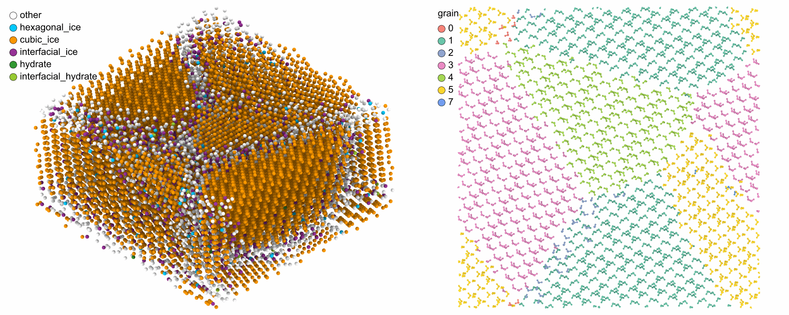

# A molecular polycrystal

A crystal of molecules must not be cut at its grain boundaries. With a `molecule` column in
its unit, [`build_polycrystal`](../user-guide/build/polycrystals.md) keeps each molecule whole:
a molecule belongs to the grain that holds its center, and of molecules too close to each
other whole ones are removed. This page builds a polycrystal of ice and checks it.

## The unit

MDAPY has no builder for molecular crystals, so the unit comes from a file or from a few lines
of code. Here it is cubic ice: the oxygen atoms on a diamond lattice, each with two hydrogen
atoms along two of its four bonds, so that each bond holds one hydrogen. The `molecule` column
says which atoms belong together, and the topology holds their bonds and angles:

```python
import numpy as np
import mdapy as mp
from mdapy.build import build_crystal, build_polycrystal

oxygen = build_crystal("diamond", 6.35, elements="O")
centers = oxygen["positions"]
odd = np.rint(4 * oxygen.box.to_fractional(centers)).astype(int)[:, 0] % 2 == 1
bonds = np.array([[1, 1, 1], [1, -1, -1], [-1, 1, -1], [-1, -1, 1]]) / np.sqrt(3)
given = np.where(odd[:, None, None], -bonds[[2, 3]], bonds[[0, 1]])
count = len(centers)
atoms = np.stack(
    [centers, centers + 0.96 * given[:, 0], centers + 0.96 * given[:, 1]], axis=1
).reshape(-1, 3)
first = 3 * np.arange(count)[:, None]
unit = (
    mp.System(atoms, oxygen.box, elements=["O", "H", "H"] * count)
    .with_columns(molecule=np.repeat(np.arange(1, count + 1), 3))
    .with_topology(
        mp.Topology(
            bonds=np.vstack([first + [0, 1], first + [0, 2]]),
            angles=first + [1, 0, 2],
        )
    )
)
```

A file without molecules gets them from [`ChemicalSpecies`](../user-guide/analysis/species.md):
`unit.with_columns(ChemicalSpecies().compute(unit))`.

## The polycrystal

The call is the same as for atoms. No two atoms of different molecules stay closer than
`min_distance`. Its default is 0.7 times the nearest distance between molecules in the unit,
here 1.25 Å. At 1.78 Å, just under the 1.79 Å of a hydrogen bond in the crystal, no two
molecules are left within the reach of a chemical bond:

```python
ice = build_polycrystal(unit, mp.Box(100.0), 8, min_distance=1.78, seed=3)
ice["molecule"].max(), len(ice)  # 29805 molecules, 89415 atoms
```

## Are the molecules whole?

[`ChemicalSpecies`](../user-guide/analysis/species.md) finds the molecules from the distances
alone, without the `molecule` column:

```python
from mdapy.analysis import ChemicalSpecies

ChemicalSpecies().compute(ice).counts()  # H2O 29805, and nothing else
```

The bonds and the angles follow the molecules, and the `image` column tells how to put together
those that the box wraps, so `mdapy.io.write("ice.data", ice)` makes a data file for LAMMPS.

## Which ice?

[CHILL+](../user-guide/analysis/chill-plus.md) looks at the oxygen atoms alone: cubic ice inside
the grains, and other structures at the boundaries.

```python
from mdapy.identify import ChillPlus
from mdapy.visualization import render, write_png

water = ice.filter(element="O")
chill = ChillPlus(cutoff=3.5).compute(water)
chill.counts()  # {'other': 6196, 'cubic_ice': 20883, 'interfacial_ice': 2291, ...}
```

```python
half = water["positions.z"] < 50.0
structures = render(
    water,
    atoms=half,
    color=chill,
    width=950,
    height=700,
    box=False,
    legend=True,
)
# a slab of whole molecules, chosen by their oxygen atoms
middle = (water["positions.z"] > 48.0) & (water["positions.z"] < 54.0)
slab = np.isin(ice["molecule"], water["molecule"][middle])
molecules = render(
    ice,
    atoms=slab,
    color="grain",
    colormap="labels",
    representation="ball_and_stick",
    bonds="topology",
    view="top",
    box=False,
    width=800,
    height=700,
    legend=True,
)
write_png("images/molecular-polycrystal.png", np.hstack([structures, molecules]))
```



*Left: the oxygen atoms of the lower half of the box, by the structure CHILL+ finds. Right: a
slab of whole molecules, by grain, with the bonds of the topology.*

At the boundaries the hydrogen bonds do not follow the rules of ice, so relax the polycrystal
with a potential for water before computing anything that depends on them.
