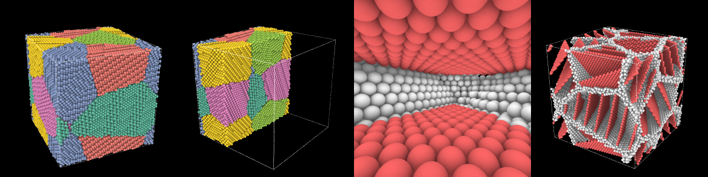

# A movie that flies through a crystal

A picture from [`render`](../user-guide/visualization/rendering.md) is a NumPy array, and
everything about it may change from one picture to the next. A movie is therefore a
loop. This one tells a polycrystal of nanotwinned copper in order: the plain metal, its
grains, a slice through them, the structure of each atom. Then a plane sweeps the fcc
atoms away, the camera flies in and along the channel between two twin planes, comes
out at the side, and turns around what is left while the crystal comes back.

<video controls loop muted playsinline preload="metadata" style="width: 100%">
  <source src="../images/movie.mp4" type="video/mp4">
</video>

*From the middle on: fcc atoms in green, twin planes (hcp) in red and grain boundaries
in white, from [common neighbor analysis](../user-guide/analysis/cna.md).*

## The crystal

Six grains of twin lamellae, six planes thick, in a box of 100 Å, and the structure
of each atom:

```python
import numpy as np

import mdapy as mp
from mdapy.build import build_crystal, build_polycrystal, twin_lamellae
from mdapy.identify import CommonNeighborAnalysis

layers = build_crystal(
    "fcc", 3.615, elements="Cu", orientation=[(1, 1, -2), (-1, 1, 0), (1, 1, 1)]
)
grains = build_polycrystal(twin_lamellae(layers, 6), mp.Box(100.0), 6, seed=4)
structures = CommonNeighborAnalysis().compute(grains)
print(len(grains))
```

```text
82001
```

Keep the system small for the size of the movie, so that each atom covers many
pixels: here about 15, seen from outside. Atoms of a few pixels are not only blurred.
Through a perspective camera the rows of atoms at different depths interfere with
each other, and large rings of light and dark sweep over the crystal as the camera
turns.

## The channel

The camera flies between two twin planes. The twin atom nearest the middle of the box
tells the grain and the plane: of the atoms around it the direction of least spread
is the normal, and of the atoms of the plane the direction of most spread is the way
with the longest flight. The next plane is six atomic planes further.

```python
positions = grains["positions"]
middle = np.full(3, 50.0)
crystal = structures.structure == 1
twins = structures.structure == 2

nearest = np.flatnonzero(twins)[
    np.linalg.norm(positions[twins] - middle, axis=1).argmin()
]
grain = twins & (np.asarray(grains["grain"]) == grains["grain"][nearest])
around_it = grain & (np.linalg.norm(positions - positions[nearest], axis=1) < 10.0)
center = positions[around_it].mean(axis=0)
normal = np.linalg.svd(positions[around_it] - center)[2][2]
plane = grain & (np.abs((positions - center) @ normal) < 1.0)
plane_center = positions[plane].mean(axis=0)
ahead = np.linalg.svd(positions[plane] - plane_center)[2][0]
normal = normal if normal[2] > 0 else -normal  # up in the picture
ahead = ahead if ahead[2] < 0 else -ahead  # in from above

gap = 6 * 3.615 / np.sqrt(3)
next_plane = np.abs((positions[grain] - center) @ normal - gap) < 1.0
channel = plane_center + normal * gap / 2 * (1 if next_plane.any() else -1)
reach = (positions[plane] - plane_center) @ ahead
```

## The path of the camera

The camera is a table: at each time where it is, what it looks at, which way is up
and how wide it sees. It widens on the way in, to 78°, and narrows on the way out.
`spline` draws a smooth curve through the table. In the first seconds the camera
circles slowly until it faces the channel, so that the way in is nearly straight.
After the flight it goes nearly all the way around, back to where the movie started,
so that the movie loops without a seam.

```python
SECONDS = 21.5
ORBIT = 16.5  # the seconds when the last turn starts
UP = np.array([0.0, 0.0, 1.0])


def ease(t):
    t = np.clip(t, 0.0, 1.0)
    return t * t * (3 - 2 * t)


def on_circle(angle, distance=345.0):
    """The point at this angle of a circle around the box, looking at the middle."""
    look = np.array([np.cos(angle), np.sin(angle), -0.42])
    return middle - look / np.linalg.norm(look) * distance


def spline(times, values, t):
    """A smooth curve through the values at the times, at the time t."""
    times, values = np.asarray(times), np.asarray(values, dtype=float)
    k = np.clip(np.searchsorted(times, t, side="right") - 1, 0, len(times) - 2)

    def slope(i):
        a, b = max(i - 1, 0), min(i + 1, len(times) - 1)
        return (values[b] - values[a]) / (times[b] - times[a])

    h = times[k + 1] - times[k]
    s = (t - times[k]) / h
    return (
        (2 * s**3 - 3 * s**2 + 1) * values[k]
        + (s**3 - 2 * s**2 + s) * h * slope(k)
        + (-2 * s**3 + 3 * s**2) * values[k + 1]
        + (s**3 - s**2) * h * slope(k + 1)
    )


side = np.cross(normal, ahead) / np.linalg.norm(np.cross(normal, ahead))
side = side if side @ (middle - channel) < 0 else -side  # away from the middle
stop = channel + ahead * reach.max() * 0.45
leave = stop + side * 60 + UP * 12
outside = middle + (leave - middle) / np.linalg.norm(leave - middle) * 210
leaving = np.arctan2(*(middle - outside)[1::-1])
first, last = leaving - 0.35, leaving - 0.35 + 2 * np.pi
into = channel + ahead * reach.min() * 0.35

before = channel - ahead * 150
facing = np.arctan2(*(middle - before)[1::-1])
turning = (facing - first + np.pi) % (2 * np.pi) - np.pi  # the short way round


def early(part, distance=345.0):
    """On the circle, this part of the way to facing the channel."""
    return on_circle(first + turning * part, distance)


# seconds, the eye, what it looks at, up, the vertical angle of view in degrees
TABLE = [
    (0.0, early(0.0), middle, UP, 30),
    (2.0, early(0.2), middle, UP, 30),
    (4.4, early(0.5), middle, UP, 30),
    (6.4, early(0.8, 335.0), middle, UP, 30),
    (7.6, early(1.0, 280.0), 0.7 * middle + 0.3 * channel, UP, 31),
    (8.6, before, channel, 0.6 * normal + 0.4 * UP, 38),
    (9.6, channel + ahead * (reach.min() - 14), channel, normal, 68),
    (11.1, into, into + ahead * 30, normal, 78),
    (12.8, stop, stop + ahead * 30, normal, 78),
    (
        14.0,
        stop + side * 22 - ahead * 4,
        0.75 * (stop + ahead * 14) + 0.25 * middle,
        normal,
        70,
    ),
    (14.9, leave, middle, UP, 55),
    (15.7, outside, middle, UP, 40),
    (ORBIT, on_circle(leaving), middle, UP, 30),
]


def camera(seconds):
    if seconds >= ORBIT:
        angle = leaving + (last - leaving) * ease((seconds - ORBIT) / (SECONDS - ORBIT))
        return on_circle(angle), middle, UP, 30.0
    times = [row[0] for row in TABLE]
    return [spline(times, [row[i] for row in TABLE], seconds) for i in (1, 2, 3, 4)]
```

## One frame

Everything that changes goes into a function of the number of the frame:

- `colors` go from those of the elements to one color for each grain, then to those of
  the structures, and back to the elements at the end. Colors are plain arrays from
  [`atom_colors`](../user-guide/visualization/colors.md), so that one fades into the other;
- `sliced` holds the atoms in front of a plane that comes in and goes back. Its normal is
  55° from the camera, not toward it: seen from the side, with the box still around
  them, the atoms are plainly cut, while a cut facing the camera only looks like another
  face of the crystal;
- `gone` holds the fcc atoms behind a plane that sweeps through and later back;
- atoms the camera comes near shrink with `radius` until they vanish, so that none
  fills the picture and then is suddenly gone;
- `focus` and `span` place the eye, as far back from the focus as shows the span there
  at this angle of view, here 20 Å;
- the edges of the box go while the camera is near them, where they would be thick
  bars.

Inside, the light is the hard part. `matte` shades an atom by how much of the sky it
sees, and from a channel between planes it sees none: with `ao_distance` at its default,
without limit, everything inside is black. Near the atoms the shading therefore shrinks
to the atoms next to each one, and the shadows go. Do this slowly, here over 5 seconds on
either side of the flight, with the distance on a logarithmic scale, as it acts unevenly:
in less than a second the crystal visibly lights up on the way in.

```python
from mdapy.visualization import (
    atom_colors,
    atom_radii,
    color_by_type,
    render,
    write_png,
)

copper = atom_colors(grains)
by_grain = atom_colors(color_by_type(grains, "grain"))
by_structure = atom_colors(grains, structures)
radii = atom_radii(grains)

FRAMES = round(30 * SECONDS)
sweep = np.array([1.0, 0.6, 0.35]) / np.linalg.norm([1.0, 0.6, 0.35])
along = (positions - middle) @ sweep
furthest = 1.02 * np.abs(along).max()

toward = np.arctan2(*(early(0.5) - middle)[1::-1]) + np.radians(55.0)
depth = (positions - middle) @ np.array([np.cos(toward), np.sin(toward), 0.0])
front = 1.02 * depth.max()


def frame(k, **options):
    seconds = k / 30
    eye, target, up, fov = camera(seconds)
    look = (target - eye) / np.linalg.norm(target - eye)

    colors = copper + ease((seconds - 1.6) / 0.7) * (by_grain - copper)
    colors = colors + ease((seconds - 5.6) / 0.6) * (by_structure - colors)
    colors = colors + ease((seconds - 20.8) / 0.7) * (copper - colors)

    cut = ease((seconds - 3.1) / 1.0) - ease((seconds - 4.7) / 0.9)
    sliced = depth > front - cut * (front + 8.0)

    wipe = ease((seconds - 6.1) / 2.6) - ease((seconds - 17.2) / 3.0)
    gone = crystal & (along < (2 * wipe - 1) * furthest)

    distance = np.linalg.norm(positions - eye, axis=1)
    deep = float(1 - ease((seconds - 5.5) / 5.0) + ease((seconds - 13.0) / 5.0))
    return render(
        grains,
        atoms=~(sliced | gone | (distance < 2.5)),
        color=colors,
        radius=radii * ease((distance - 2.5) / 5.0),
        style="matte",
        ao_distance=6.0 * (100.0 / 6.0) ** deep,
        shadow_strength=deep,
        view=look,
        up=up,
        perspective=True,
        fov=float(fov),
        focus=eye + look * 20.0,
        span=2 * 20.0 * np.tan(np.radians(float(fov)) / 2),
        background="black",
        box=bool(np.abs(eye - middle).max() > 100),
        box_color="white",
        device="auto",
        **options,
    )


pictures = [frame(k, width=300, height=300) for k in (75, 120, 345, 500)]
write_png("images/movie_frames.png", np.hstack(pictures))
```



*The grains, the slice, the channel and the last turn: the frames 75, 120, 345 and 500. Try
a few frames like this, small, before the whole movie, and look at them in order. Every
twentieth frame takes seconds.*

## The whole movie

[`write_movie`](../user-guide/visualization/movies.md) takes the pictures one by one from a
generator and gives them to [FFmpeg](https://ffmpeg.org), which must be installed:

<!-- skip-test -->
```python
from mdapy.visualization import write_movie

pictures = (frame(k, width=1080, height=1080) for k in range(FRAMES))
write_movie("movie.mp4", pictures, fps=30)
```

`device="auto"` draws them on the GPU when there is one, which matters here: the 645
frames take about 3 minutes on an NVIDIA RTX A2000, and about 34 minutes on the
processor, an Intel Core i5-12600K.

To work on the story, draw `style="fast"` instead and leave out the two settings of
the shading: the whole movie then takes about a minute.

## Other movies

The same loop makes other movies with a line or two:

- a trajectory: read `frames = mp.read_trajectory("run.dump")` and draw `frames[k]`
  in each picture, so that the camera moves while the atoms do;
- another look: a [style or its settings](../user-guide/visualization/rendering.md), such as
  `aperture` for a depth of field;
- another subject: any `color` and `atoms`, such as the
  [dislocations](../user-guide/analysis/dislocations.md) of a system with `dislocations=`.
