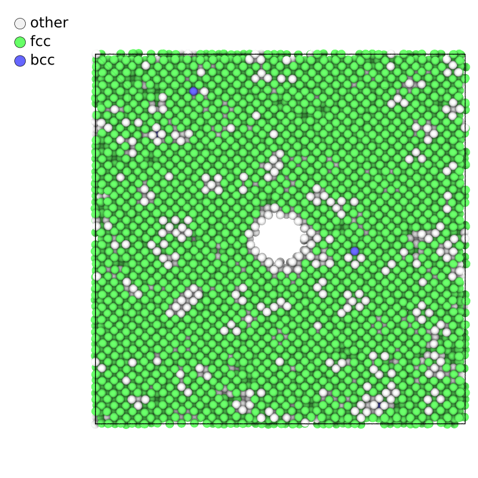

# LAMMPS on many processes with MPI

LAMMPS runs a large system on many processes with MPI: each owns a part of the
box and its atoms. A script that drives LAMMPS through MDAPY runs this way too.
`mpirun` starts the same script in every process, and every LAMMPS call made
through MDAPY, the [LAMMPS calculator](../user-guide/simulation/lammps.md) and
[`MolecularDynamics`](../user-guide/simulation/dynamics.md), runs on all of
them together: LAMMPS splits the atoms among the processes, and the results
come back whole to each. One script then builds a structure and runs it, and
LAMMPS writes the frames as it goes; a second script analyses them afterwards,
with every core.

This page heats a copper crystal with a void on many processes, and finds how
much of it stays fcc.

## What it needs

LAMMPS built with MPI as a shared library, its Python module installed in the
Python that runs MDAPY, and [mpi4py](https://mpi4py.readthedocs.io), built
with the same MPI:

```bash
cmake -S lammps/cmake -B build -D BUILD_MPI=yes -D BUILD_SHARED_LIBS=yes -D PKG_MANYBODY=yes
cmake --build build -j 8
cmake --build build --target install-python  # into the Python that runs MDAPY
pip install mpi4py
```

A LAMMPS from pip or conda may have been built without MPI: then every
process runs a LAMMPS of its own, each with the whole system.
`lammps().has_mpi_support` tells. The
[LAMMPS manual](https://docs.lammps.org/Python_install.html) has the other
ways to build it.

## Building and running

Save this as `void.py`, with the potential
[`Cu_mishin1.eam.alloy`](https://github.com/lammps/lammps/blob/develop/potentials/Cu_mishin1.eam.alloy)
of LAMMPS in the same folder:

<!-- skip-test -->
```python
from mpi4py import MPI  # first, so that MPI starts before LAMMPS

from mdapy.build import build_crystal
from mdapy.calculators import LAMMPS
from mdapy.simulation import MolecularDynamics

comm = MPI.COMM_WORLD
main = comm.rank == 0  # the main process, of rank 0

# 1. Building, on the main process alone; the others receive its system.
system = None
if main:
    crystal = build_crystal("fcc", 3.615, elements="Cu", repeat=(30, 30, 30))
    x, y, z = crystal.box.matrix.sum(axis=0) / 2  # the middle of the box
    void = (
        f"(positions.x - {x})**2 + (positions.y - {y})**2 + (positions.z - {z})**2 < 64"
    )
    system = crystal.filter(f"~({void})")  # a void of 8 Å radius
    print(f"{len(system)} atoms on {comm.size} processes", flush=True)
system = comm.bcast(system, root=0)

# 2. LAMMPS, on every process together: the same calls in the same order.
potential = LAMMPS(
    "pair_style eam/alloy\npair_coeff * * Cu_mishin1.eam.alloy Cu", elements=["Cu"]
)
with MolecularDynamics(system, potential, timestep=0.002) as md:
    md.velocities(1800.0, seed=1)
    # LAMMPS writes a frame every 1000 steps as it runs, and keeps none
    md.command(
        "dump frames all custom 1000 void.*.lammpstrj id element x y z\n"
        "dump_modify frames element Cu time yes"
    )
    md.run(5000, ensemble="npt", temperature=900.0, pressure=0.0, thermo=500)
    md.command("undump frames")
    thermo = md.thermo

# 3. The thermodynamic state, written by the main process.
if main:
    columns = ["time", "temperature", "potential_energy", "pressure", "volume"]
    thermo.select(columns).write_csv("thermo.csv")
```

The script has three parts, by where they run:

1. **Building, on the main process.** The other processes wait at
   `comm.bcast`, which gives them the system of the main process: a `System`
   travels between processes as any Python object does.
2. **LAMMPS, on every process.** Each process makes the calculator and the
   `MolecularDynamics`, and makes the same calls in the same order: each is one
   step of one LAMMPS that spans the processes. The dump writes a frame every
   1000 steps, from step 0, with its time: the main process takes the atoms of
   one process at a time and writes them, and no frame stays in memory.
3. **The thermodynamic state, from the main process.** Every process holds
   the same `thermo`; the main process alone writes it.

Run it on 8 processes with

```bash
MDAPY_NUM_THREADS=1 mpirun -np 8 python void.py
```

On a cluster with Slurm, `srun` starts the processes, with the plugin of
MPI that the cluster names, often PMIx:

```bash
MDAPY_NUM_THREADS=1 srun -n 16 --mpi=pmix python void.py
```

It writes the frames `void.0.lammpstrj` to `void.5000.lammpstrj`, 21 MB in
all, and `thermo.csv`.

## Analysing

Save this as `analyse.py` in the same folder, and run it with
`python analyse.py`, one process with every core:

<!-- skip-test -->
```python
from mdapy.identify import CommonNeighborAnalysis
from mdapy.io import read_trajectory
from mdapy.visualization import render

cna = CommonNeighborAnalysis()
with read_trajectory("void.*.lammpstrj") as trajectory:
    for frame in trajectory:  # one frame in memory at a time
        fcc = cna.compute(frame).counts()["fcc"] / len(frame)
        print(f"{frame.info['time']:5.1f} ps: {fcc:.1%} fcc")
    last = trajectory[-1]

# a slice of 8 Å through the void, from above
middle = last.box.origin + last.box.matrix.sum(axis=0) / 2
slab = abs(last["positions.z"] - middle[2]) < 4
render(
    last,
    "void.png",
    atoms=slab,
    color=cna.compute(last),
    legend=True,
    view="top",
    width=800,
    height=800,
)
```

For the frames of 16 processes it prints

```text
  0.0 ps: 99.8% fcc
  2.0 ps: 85.7% fcc
  4.0 ps: 85.9% fcc
  6.0 ps: 86.0% fcc
  8.0 ps: 85.9% fcc
 10.0 ps: 85.7% fcc
```

and draws the slice of the last frame:



*The void, 8 Å in radius, after 10 ps at 900 K: most atoms stay fcc, and
the vibrations make the rest, scattered through the crystal, "other".*

The atoms of a dump come in the order LAMMPS holds them, each with its `id`,
which counting structures does not need;
[Frames in files](../user-guide/simulation/dynamics.md#frames-in-files) says
how they match the atoms of the system.

## How long it takes

On a node of the Triton cluster of Aalto University (Intel Xeon Gold 6248,
shared with other jobs), LAMMPS stable_30Sep2026 built with Open MPI 4.1.6,
`void.py`:

| Processes | Time | Faster by |
|---:|---:|---:|
| 1 | 952 s | |
| 4 | 283 s | 3.4 |
| 16 | 87 s | 11.0 |

and `analyse.py` with 16 threads, 5 to 8 s with the picture. The parts of fcc
atoms are the same on every number of processes.

## Why two scripts

Building, running and analysing could be one script under `mpirun`, the
analysis on the main process after the run. With more atoms, more frames or a
longer analysis, that costs memory and cores:

- **Frames kept in memory fill every process.** The frames of `save_every`
  come whole to every process, as LAMMPS gathers the atoms of all the
  processes into each, and stay to the end of the script: about 60 bytes per
  atom and frame, on each process. A hundred frames of a million atoms would
  take 6 GB on each, 100 GB on 16 processes. On 4 processes, 40 frames of
  108 000 atoms kept by `save_every` took 280 MB more on each process;
  written by the dump, less than 25 MB, whatever their number.
- **The other processes would wait.** Every process started by `mpirun` is
  held to the end of the script, and only LAMMPS uses them all: an analysis
  on the main process, such as a dislocation analysis of every frame, leaves
  the rest idle. In a script of its own it takes every core as threads of
  MDAPY, or one frame per process as in
  [Screening alloys in many processes](high-throughput.md). A large structure,
  such as a polycrystal, is likewise better built in a script of its own and
  written as a LAMMPS data file, which `void.py` then reads with
  `mdapy.io.read` on the main process.
- **Every process holds the whole system.** `comm.bcast` sends it to each, and
  MDAPY gives LAMMPS all the atoms from each process, of which each keeps its
  own. For tens of millions of atoms, run LAMMPS on an input of its own, which
  reads a data file in pieces on the main process, each process keeping the
  atoms of each piece that are its own.

## What to keep in mind

- **Every line runs on every process** unless it is under `if main`: building
  and analysing there would be repeated on each process, each with the whole
  system, for the same result.
- **Every LAMMPS call runs on every process**, never under `if main`: the
  calculator's `compute`, `MolecularDynamics` and its `run` and `command`, and
  what calls them, such as `minimize` with the LAMMPS calculator. A call made
  by one process alone waits forever for the others.
- **The processes need the same inputs.** Send them what the main process
  made with `comm.bcast`, and give every random choice a seed.
- **Files and messages come from the main process**; otherwise every process
  writes the same file at once.
- **`MDAPY_NUM_THREADS=1`** under `mpirun`: the processes already take the
  cores, and threads of MDAPY in each would compete for them. The analysis,
  in a script of its own, takes every core as threads.
- **The trajectory depends on the number of processes**, by rounding: the
  processes sum the forces in another order, and molecular dynamics makes the
  difference grow, as in LAMMPS alone. Averages, such as the temperature or
  the part of fcc atoms, agree.
- **`minimize` gains less.** It moves the atoms in MDAPY, which takes every
  force on every process at each step: on 8 processes, 1.6 times faster for
  108 000 atoms against 7.2 times for molecular dynamics. For large systems,
  the minimizer of LAMMPS runs on the processes alone:
  `md.command("minimize 0 1e-6 1000 10000")`.
- **A small system gains little** from many processes, as each holds few
  atoms. One process with the threads of LAMMPS, such as
  `cmdargs=["-k", "on", "t", "8", "-sf", "kk"]` with Kokkos, does as well.
