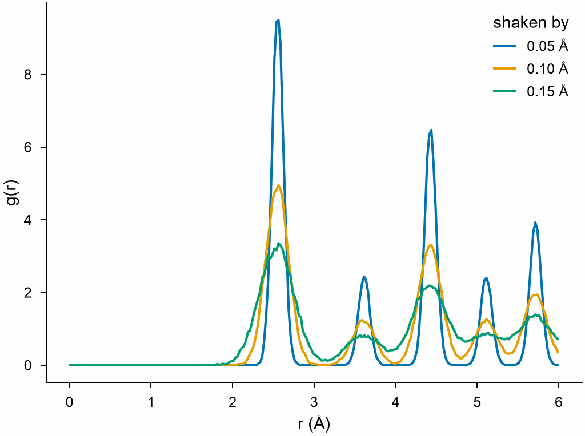
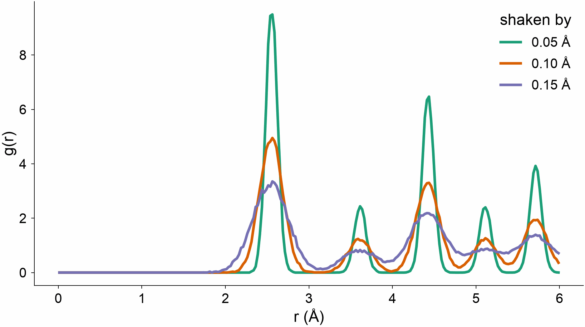
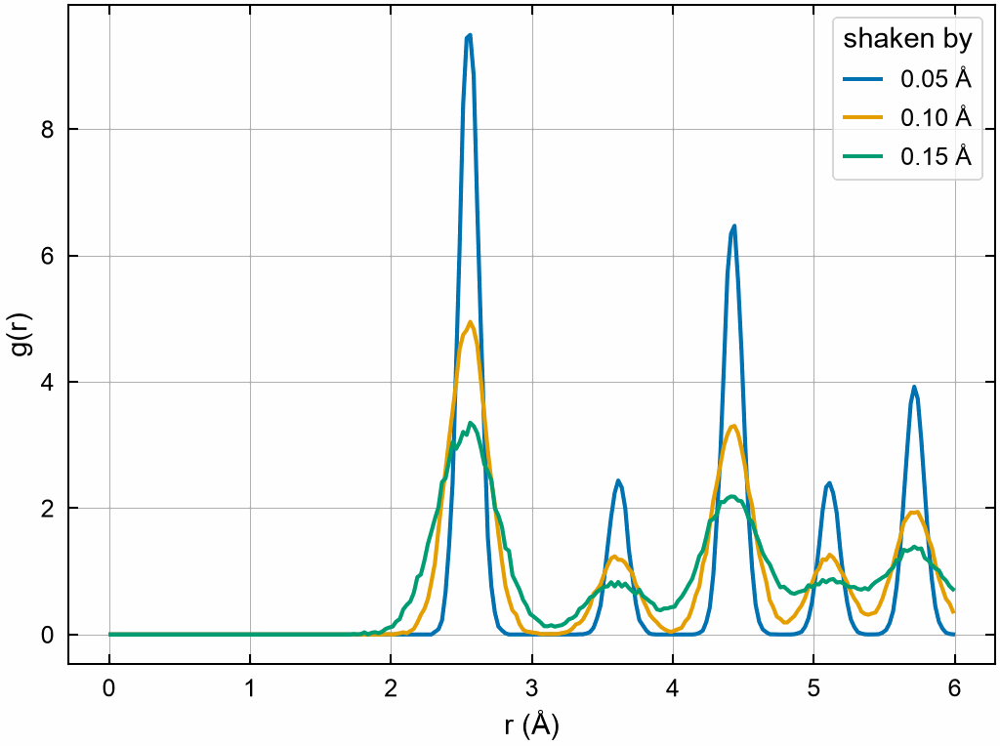
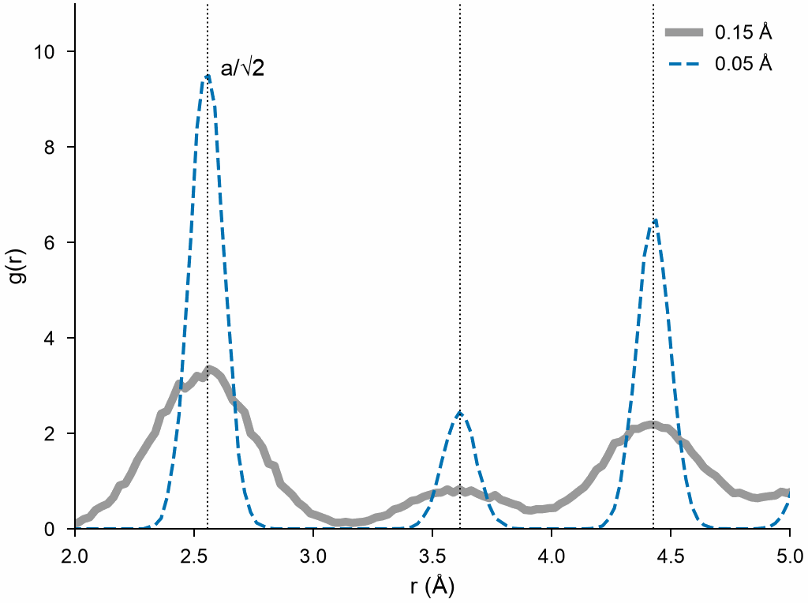
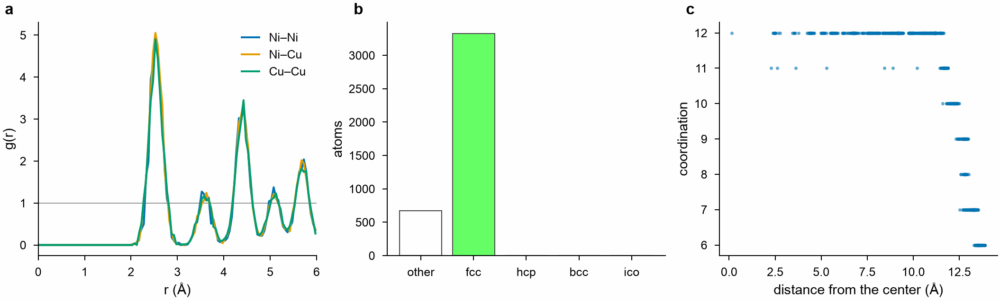

# Figures with MDAPY

`mdapy.visualization.plot` turns the results of MDAPY into figures for papers and
talks: a style, figures of the width of a journal's column, plots of common results,
and saving to PDF, SVG and PNG. This page draws its figures with `plot` and the
axes it returns, and changes their look, from the size of the text to the colors
of the lines, without importing matplotlib. See [Plots](../user-guide/visualization/plots.md)
for every function.

## The data

The radial distribution function of copper, its atoms shaken by 0.05, 0.10 and
0.15 Å from their sites, as by heat:

```python
import numpy as np
from mdapy.analysis import RadialDistributionFunction
from mdapy.build import build_crystal

crystal = build_crystal("fcc", 3.615, elements="Cu", repeat=(10, 10, 10))
rng = np.random.default_rng(1)
shakes = (0.05, 0.10, 0.15)
rdfs = []
for shake in shakes:
    shaken = crystal.with_columns(
        positions=crystal["positions"] + rng.normal(0, shake, (len(crystal), 3))
    )
    rdfs.append(RadialDistributionFunction(cutoff=6.0, bins=240).compute(shaken))
```

## A first figure

`plot.style()` holds the style while the figure is made, `plot.figure` gives a
figure one column of a journal wide (88 mm) and its axes, and the methods of the
axes draw on it:

```python
from mdapy.visualization import plot

with plot.style():
    fig, ax = plot.figure("single")
    for shake, rdf in zip(shakes, rdfs):
        ax.plot(rdf.r, rdf.g, label=f"{shake:.2f} Å")
    ax.set_xlabel("r (Å)")
    ax.set_ylabel("g(r)")
    ax.legend(title="shaken by")
    plot.save(fig, "images/plotting-first", formats=("png",))
```



*The style of a journal: text of 7 points, lines of 1 point, no top and right
lines, and the colors of Okabe and Ito, which readers with color blindness tell
apart.*

`plot.figure` takes `"single"` (88 mm), `"double"` (180 mm) or a width in mm, and a
height in mm, by default 3/4 of the width. Each line takes the next color by itself.

## The look of a figure

The options of `style` change the size of the text, the width of the lines and
the colors the lines take in turn. For a slide, larger text and thicker lines on
a wider figure:

```python
with plot.style(font_size=12, line_width=2.0, colors=["#1b9e77", "#d95f02", "#7570b3"]):
    fig, ax = plot.figure(160, 90)
    for shake, rdf in zip(shakes, rdfs):
        ax.plot(rdf.r, rdf.g, label=f"{shake:.2f} Å")
    ax.set_xlabel("r (Å)")
    ax.set_ylabel("g(r)")
    ax.legend(title="shaken by")
    plot.save(fig, "images/plotting-slide", formats=("png",))
```



*A figure 160 mm by 90 mm, text of 12 points, lines of 2 points, three colors of
one's own.*

| Option | Default | Changes |
|---|---|---|
| `font_size` | 7 | the text in points: labels and titles at this size, tick labels and legends at 6/7 of it |
| `line_width` | 1 | the width of the lines of data in points; the axes keep their thin lines |
| `colors` | `plot.COLORS` | the colors that lines and points take in turn: one color, such as `"black"`, or several, as names (`"tab:red"`), hexadecimal (`"#d95f02"`) or shades of gray (`"0.5"`) |
| `settings` | | any other setting, by matplotlib's name for it |

`plot.COLORS` holds the eight colors of the default, so `colors=plot.COLORS[3:]`
starts from the fourth.

## Anything else by its name

Every other part of the look has a setting in matplotlib, and `settings` takes them
by name. Ticks inside on all four sides, a grid and a frame around the legend:

```python
with plot.style(
    settings={
        "xtick.direction": "in",
        "ytick.direction": "in",
        "xtick.top": True,
        "ytick.right": True,
        "axes.spines.top": True,
        "axes.spines.right": True,
        "axes.grid": True,
        "grid.linewidth": 0.3,
        "legend.frameon": True,
    }
):
    fig, ax = plot.figure("single")
    for shake, rdf in zip(shakes, rdfs):
        ax.plot(rdf.r, rdf.g, label=f"{shake:.2f} Å")
    ax.set_xlabel("r (Å)")
    ax.set_ylabel("g(r)")
    ax.legend(title="shaken by")
    plot.save(fig, "images/plotting-settings", formats=("png",))
```



*Settings take precedence over the other options of `style`.*

Settings that are often changed:

| Setting | Example | Does |
|---|---|---|
| `font.family` | `"serif"` | the typeface: `"sans-serif"` (the default, Arial or Helvetica), `"serif"` |
| `xtick.direction`, `ytick.direction` | `"in"` | ticks inside the axes |
| `xtick.top`, `ytick.right` | `True` | ticks on the top and right sides too |
| `axes.spines.top`, `axes.spines.right` | `True` | the top and right lines of the frame |
| `axes.linewidth` | `0.8` | the width of the frame in points |
| `axes.grid` | `True` | a grid |
| `lines.markersize` | `5` | the size of markers in points |
| `legend.frameon` | `True` | a frame around the legend |
| `savefig.dpi` | `300` | the resolution of saved pictures, such as PNG |

The [list of matplotlib](https://matplotlib.org/stable/users/explain/customizing.html)
names them all; an unknown name or value raises `InvalidParameter` with
matplotlib's message.

## One line differently

A style sets every line; the options of one call set one line. The methods of the
axes set the rest of the figure:

```python
fit = rdfs[2]
with plot.style():
    fig, ax = plot.figure("single")
    ax.plot(fit.r, fit.g, color="0.6", linewidth=2.5, label="0.15 Å")
    ax.plot(rdfs[0].r, rdfs[0].g, linestyle="--", label="0.05 Å")
    peaks = [3.615 / np.sqrt(2), 3.615, 3.615 * np.sqrt(1.5)]
    for d in peaks:
        ax.axvline(d, color="black", linewidth=0.5, linestyle=":")
    ax.annotate("a/√2", (peaks[0], 9.5), xytext=(4, 0), textcoords="offset points")
    ax.set_xlim(2.0, 5.0)
    ax.set_ylim(0, 11)
    ax.set_xlabel("r (Å)")
    ax.set_ylabel("g(r)")
    ax.legend(loc="upper right")
    plot.save(fig, "images/plotting-lines", formats=("png",))
```



*The first three shells of fcc, at a/√2, a and a√(3/2).*

| To change | Call |
|---|---|
| color, width, dash, markers of one line | `ax.plot(x, y, color="0.6", linewidth=2.5, linestyle="--", marker="o")` |
| points | `ax.scatter(x, y, s=10)` |
| the range of an axis | `ax.set_xlim(2, 5)`, `ax.set_ylim(0, 11)` |
| a logarithmic axis | `ax.set_yscale("log")` |
| labels and title | `ax.set_xlabel("r (Å)")`, `ax.set_title("Copper")` |
| the place and columns of the legend | `ax.legend(loc="upper right", ncols=2)` |
| a line across | `ax.axhline(1.0)`, `ax.axvline(2.556)` |
| a note | `ax.annotate("a/√2", (2.556, 9.5))`, `ax.text(x, y, "text")` |
| a band | `ax.fill_between(x, low, high, alpha=0.3)` |
| tick positions | `ax.set_xticks([2, 3, 4, 5])` |

## Several panels

`plot.figure` gives several panels with `nrows` and `ncols`, and the plots of MDAPY
draw on any of them: here the partial radial distribution functions of a CuNi
alloy, the structures of the shaken copper by common neighbor analysis, and the
number of neighbors of the atoms of a nanoparticle against their distance from its
center.

```python
from mdapy.analysis import CoordinationNumber
from mdapy.build import random_alloy
from mdapy.identify import CommonNeighborAnalysis


def shake(system, amount):
    moved = system["positions"] + rng.normal(0, amount, (len(system), 3))
    return system.with_columns(positions=moved)


alloy = random_alloy(
    build_crystal("fcc", 3.6, repeat=(6, 6, 6)), {"Cu": 1, "Ni": 1}, seed=1
)
partial = RadialDistributionFunction(cutoff=6.0, bins=120).compute(shake(alloy, 0.1))
structures = CommonNeighborAnalysis().compute(shaken)
center = crystal.box.matrix.sum(axis=0) / 2
distance = np.linalg.norm(crystal["positions"] - center, axis=1)
particle = shake(crystal.filter(distance < 14), 0.1)
particle = particle.with_columns(
    **CoordinationNumber(cutoff=3.0).compute(particle).columns(),
    distance=np.linalg.norm(particle["positions"] - center, axis=1),
)

with plot.style():
    fig, (left, middle, right) = plot.figure("double", 55, nrows=1, ncols=3)
    plot.rdf(partial, ax=left, partial=True)
    plot.structure_counts(structures, ax=middle)
    plot.scatter(particle, "distance", "coordination", ax=right)
    right.set_xlabel("distance from the center (Å)")
    for ax, label in zip((left, middle, right), "abc"):
        plot.panel_label(ax, label)
    plot.save(fig, "images/plotting-panels", formats=("png",))
```



*a: the partial functions of CuNi. b: the shaken copper is fcc but for the atoms
shaken most. c: 12 neighbors inside the nanoparticle, fewer at its surface.*

`sharex=True` or `sharey=True` in `plot.figure` gives the panels one axis, and
`plot.panel_label` a bold letter at the top left of each. Each plot of MDAPY sets its
labels and returns its axes, so a line of one's own can go on top, as in the
other figures.

## Saving

`plot.save(fig, "figure")` writes `figure.pdf`, `figure.svg` and `figure.png`: PDF
and SVG keep the text as text, which Illustrator or Inkscape can change, and the
fonts embedded as TrueType, as journals ask; PNG has 300 dots per inch. `formats`
chooses some of them, and `fig.savefig("figure.tiff", dpi=600)` writes any other
format.

In a notebook a figure shows when its `with plot.style():` ends, as the style
holds only inside it: make the figure, change it and save it inside the `with`.
