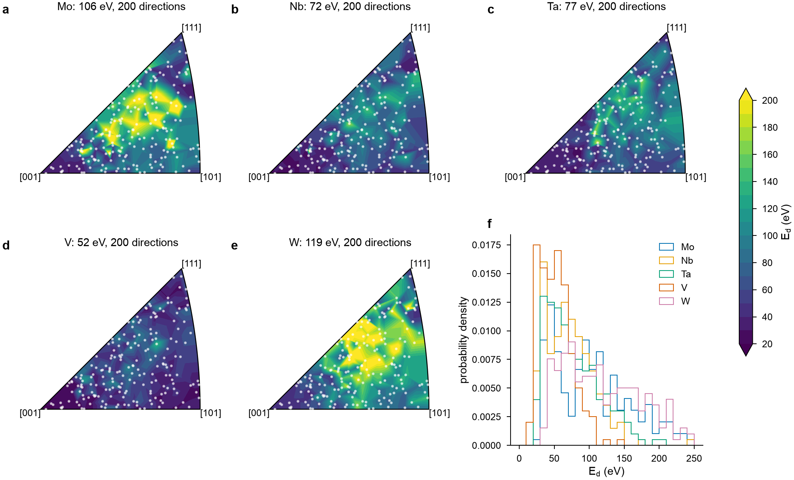
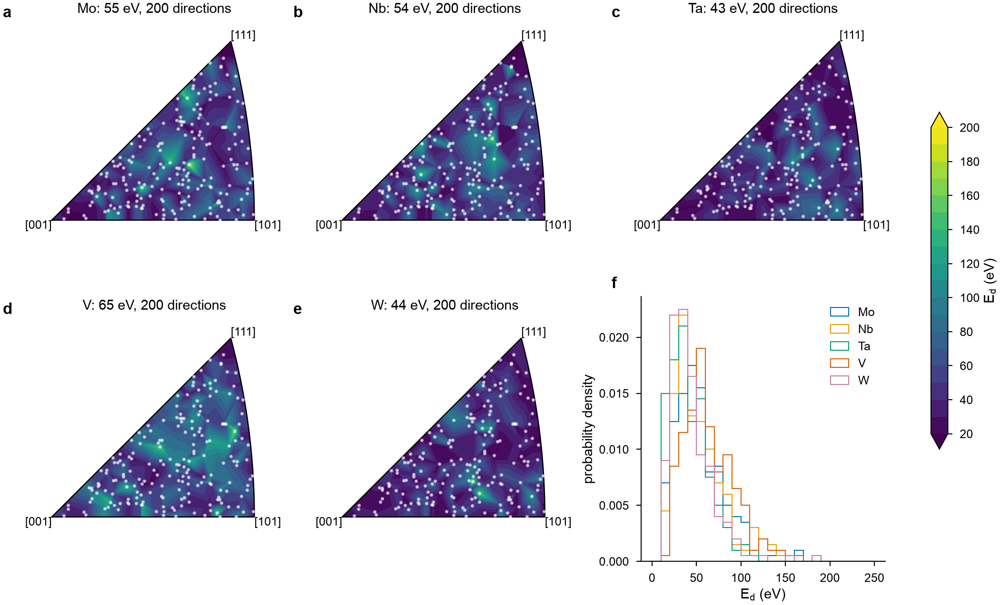
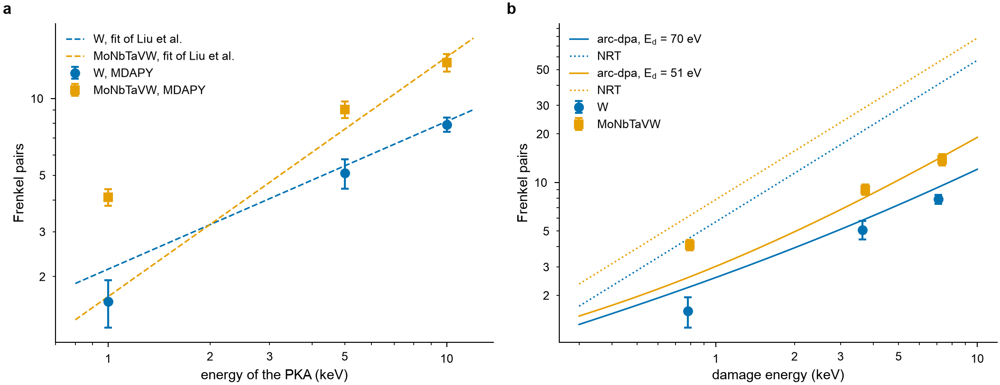

# Radiation damage in tungsten and MoNbTaVW

A neutron that hits a crystal knocks an atom out of its place, the primary knock-on
atom (PKA). Below some tens of eV the atom falls back; above the threshold displacement
energy it leaves a vacancy and an interstitial behind, a Frenkel pair. At kiloelectronvolts
it knocks others out in turn, a cascade that melts a small region for a few picoseconds
and leaves a few of its defects as it cools. Tungsten is the armour of fusion reactors;
the equiatomic MoNbTaVW alloy, a high-entropy alloy of the same bcc lattice, is a
candidate that may stand radiation better.

This page follows [Liu et al. (2025)](../reference/references.md#liu2025) with their
machine-learned potential: the threshold displacement energies of the five pure metals
and of each element in the alloy over all directions, their Figures 3 and 4, and the
Frenkel pairs that cascades of 1 to 50 keV leave in tungsten and of 1 to 30 keV in the
alloy, against the NRT and arc-dpa models.

!!! note "The model"
    Liu et al. trained a NEP model of Mo, Nb, Ta, V and W on DFT, with a ZBL repulsion at
    short range for the close collisions of cascades. It is published under the AGPL-3.0 in
    [GPUMD-Wizard](https://github.com/Jonsnow-willow/GPUMD-Wizard), from where the
    scripts here download it; MDAPY does not ship it. The molecular dynamics run in
    MDAPY with the NEP on a [GPU](../user-guide/simulation/gpu.md), `device="cuda"`.

## The crystal at 300 K

<!-- skip-test -->
```python
import urllib.request

import numpy as np
from mdapy.build import build_crystal
from mdapy.calculators import NEP
from mdapy.simulation import MolecularDynamics

URL = ("https://raw.githubusercontent.com/Jonsnow-willow/GPUMD-Wizard/main/tutorials/"
       "Calculatiing_Material_Properties/MoNbTaVW/potentials/nep.txt")  # fmt: skip
urllib.request.urlretrieve(URL, "nep_monbtavw.txt")
gpu = NEP("nep_monbtavw.txt", device="cuda")


def relaxed(cells, alloy=True, seed=0):
    """The random equiatomic alloy (or tungsten) of the bcc cells given, 10 ps at
    300 K and zero pressure; its mean lattice constant."""
    crystal = build_crystal("bcc", 3.18, elements="W", repeat=cells)
    if alloy:
        kinds = np.resize(np.array(["Mo", "Nb", "Ta", "V", "W"]), len(crystal))
        np.random.default_rng(seed).shuffle(kinds)
        crystal = crystal.with_columns(element=kinds)
    with MolecularDynamics(crystal, gpu, timestep=0.001) as md:
        md.velocities(600, seed=seed + 1)  # half of it goes into the potential energy
        md.run(10000, ensemble="npt", temperature=300, pressure=0.0)  # 10 ps
        warm = md.system
    return warm, (warm.box.volume / np.prod(cells)) ** (1 / 3)


warm, a = relaxed((12, 13, 14))  # 4368 atoms
```

## The knock-on atom

A few lines give one atom an energy along a direction, and pick an atom of an element
near the center of the box:

<!-- skip-test -->
```python
from mdapy import units
from mdapy.elements import atomic_masses


def knock_on(system, energy, direction, atom):
    """The system with one atom given a kinetic energy in eV along a direction."""
    mass = atomic_masses([system["element"][atom]])[0]
    unit = np.asarray(direction, dtype=float) / np.linalg.norm(direction)
    speed = np.sqrt(2 * energy / (mass * units.AMU_A2_PER_PS2_TO_EV))  # Å/ps
    velocities = system["velocities"].copy()
    velocities[atom] = speed * unit
    return system.with_columns(velocities=velocities)


def central(system, element, count=400):
    """The atoms of an element among the count nearest the center of the box."""
    center = system.box.origin + system.box.matrix.sum(axis=0) / 2
    near = np.argsort(np.linalg.norm(system["positions"] - center, axis=1))[:count]
    return near[np.asarray(system["element"])[near] == element]
```

## Threshold displacement energies

The threshold displacement energy E_d of a direction is the least energy of a PKA along
it that leaves a stable Frenkel pair. It changes much with the direction: along the
close-packed rows a PKA pushes its neighbor on and a chain of replacements carries the
interstitial away from the vacancy, while other directions have to break through a wall
of atoms. The protocol of Liu et al.:

- the crystal above, 12 × 13 × 14 bcc cells, at 300 K;
- a PKA among the atoms nearest the center, in the alloy of the element studied, along a
  random direction;
- 6 ps at constant energy, the atoms within a lattice constant of the faces of the box
  kept at 300 K by a [`Langevin`](../user-guide/simulation/controls.md) bath, the time
  step [adapting](../user-guide/simulation/adaptive-timestep.md) to the fastest atom, no
  electronic stopping;
- a pair is stable when the [Wigner–Seitz analysis](../user-guide/analysis/wigner-seitz.md)
  against the perfect crystal still finds a vacancy at the end; E_d is 1 eV below the
  least energy that leaves one.

Liu et al. raise the energy in steps of 2 eV. To save runs, the energy here climbs from
20 eV in steps of 10 eV, and the last step is searched again in steps of 2 eV:

<!-- skip-test -->
```python
from mdapy.analysis import WignerSeitz
from mdapy.simulation.controls import AdaptiveTimestep, Langevin

perfect = build_crystal("bcc", a, elements="W", repeat=(12, 13, 14))
sites = WignerSeitz(perfect.with_columns(element=np.asarray(warm["element"])))
L = warm.box.lengths
inside = warm.box.to_fractional(warm["positions"]) * L
border = ~((inside > a) & (inside < L - a)).all(axis=1)


def stays(energy, atom, direction, seed):
    """Whether a PKA of energy eV leaves a Frenkel pair after 6 ps."""
    controls = [
        AdaptiveTimestep(0.015),
        Langevin(border, 300.0, damping=0.1, seed=seed),
    ]
    shot = knock_on(warm, energy, direction, atom)
    with MolecularDynamics(shot, gpu, timestep=0.001) as md:
        for frame in md.iterate(
            10_000_000, ensemble="nve", save_every=500, controls=controls
        ):
            if frame.info["time"] >= 6.0:
                break
        last = md.system
    return sites.compute(last).vacancy_count > 0


def threshold(atom, direction, seed):
    """E_d of a direction: 10 eV steps from 20 eV, the last one again by 2 eV."""
    low, energy = None, 20.0
    while not stays(energy, atom, direction, seed):
        low, energy = energy, energy + 10.0
    if low is not None:
        for e in (low + 2.0, low + 4.0, low + 6.0, low + 8.0):
            if stays(e, atom, direction, seed):
                return e - 1.0
    return energy - 1.0
```

A run of 6 ps of 4368 atoms takes about 20 s on a V100; a direction takes 10 to 40 runs.
The 2000 directions of this page took 18098 runs, 47 GPU-hours with eight runs sharing
each GPU.

### The pure metals

The maps, from the directions and thresholds that `tde.py` keeps: each direction and its
47 images under the cubic point group, projected stereographically, interpolated
linearly between them and cut to the standard triangle:

<!-- skip-test -->
```python
from itertools import permutations, product

import matplotlib.tri as mtri
from matplotlib.patches import Polygon

from mdapy.visualization import plot


def images(v):
    """The 48 images of the directions v (n, 3) under the cubic point group,
    with the index of the direction of each."""
    out = [
        v[:, p] * s for p in permutations(range(3)) for s in product((1, -1), repeat=3)
    ]
    return np.vstack(out), np.tile(np.arange(len(v)), 48)


def project(v):
    """Stereographic projection from -z of unit vectors with z > 0."""
    return v[:, 0] / (1 + v[:, 2]), v[:, 1] / (1 + v[:, 2])


def triangle():
    """The outline [001]-[101]-[111]: y = 0, the arc x = z, back along x = y."""
    t = np.linspace(0, 1, 60)
    arc = np.stack([np.ones_like(t), t, np.ones_like(t)], axis=1)
    x, y = project(arc / np.linalg.norm(arc, axis=1)[:, None])
    return np.vstack([[[0.0, 0.0]], np.stack([x, y], axis=1), [[0.0, 0.0]]])


def draw_map(ax, v, e, levels):
    w, index = images(v / np.linalg.norm(v, axis=1)[:, None])
    up = w[:, 2] > 0.2
    x, y = project(w[up])
    near = (x > -0.15) & (x < 0.65) & (y > -0.15) & (y < 0.55)
    fill = ax.tricontourf(mtri.Triangulation(x[near], y[near]), e[index[up]][near],
                          levels=levels, cmap="viridis", extend="both")  # fmt: skip
    outline = triangle()
    fill.set_clip_path(Polygon(outline, closed=True, transform=ax.transData))
    ax.plot(outline[:, 0], outline[:, 1], c="k", lw=0.6)
    a = np.sort(np.abs(v), axis=1)  # the directions computed, in the triangle
    x, y = project(
        np.stack([a[:, 1], a[:, 0], a[:, 2]], axis=1)
        / np.linalg.norm(a, axis=1)[:, None]
    )
    ax.plot(x, y, ".", ms=1.5, c="w", alpha=0.6)
    for name, xy, ha, va in [("[001]", (0, 0), "right", "top"), ("[101]", (0.4142, 0), "left", "top"),
                             ("[111]", (0.366, 0.366), "left", "bottom")]:  # fmt: skip
        ax.annotate(name, xy, ha=ha, va=va, fontsize=6)
    ax.set(xlim=(-0.04, 0.46), ylim=(-0.04, 0.40), aspect="equal")
    ax.set_axis_off()
    return fill


# thresholds[element]: (directions (n, 3), E_d (n,)) of the runs of tde.py
with plot.style():
    fig, axes = plot.figure("double", 110, nrows=2, ncols=3)
    for ax, element, label in zip(axes.ravel(), ["Mo", "Nb", "Ta", "V", "W"], "abcde"):
        v, e = thresholds[element]
        fill = draw_map(ax, v, e, np.linspace(20, 200, 19))
        ax.set_title(f"{element}: {e.mean():.0f} eV, {len(e)} directions", fontsize=7)
        plot.panel_label(ax, label)
    fig.colorbar(fill, ax=axes.ravel()[:5].tolist(), shrink=0.6, label="$E_d$ (eV)")
    for element, (v, e) in thresholds.items():
        axes[1, 2].hist(
            e, bins=np.arange(0, 260, 10), density=True, histtype="step", label=element
        )
    axes[1, 2].set(xlabel="$E_d$ (eV)", ylabel="probability density")
    axes[1, 2].legend()
    plot.panel_label(axes[1, 2], "f")
    plot.save(fig, "images/radiation-tde-metals", formats=("png",))
```



*Figure 3 of Liu et al.: E_d of each direction computed, reduced to the standard
triangle [001]–[101]–[111] by the symmetry of the cubic crystal and drawn in
stereographic projection, interpolated linearly between the directions (white dots); f,
the distributions.*

The thresholds of each metal, the mean with its standard error, against the means of
Table 2 of Liu et al.:

| PKA | Directions | Mean E_d (eV) | Median | Least | Most | Liu et al. |
|---|---:|---:|---:|---:|---:|---:|
| Mo | 200 | 106 ± 4 | 99 | 29 | 301 | 99 |
| Nb | 200 | 72 ± 2 | 69 | 25 | 241 | 70 |
| Ta | 200 | 77 ± 3 | 69 | 27 | 205 | 77 |
| V | 200 | 52 ± 2 | 51 | 19 | 141 | 54 |
| W | 200 | 119 ± 4 | 110 | 39 | 251 | 109 |

- **The order** is that of Liu et al.: tungsten and molybdenum hold their atoms the
  hardest, vanadium the least. The means of niobium, tantalum and vanadium are theirs
  within the error; those of tungsten and molybdenum lie 10 and 7 eV above, about two
  standard errors.
- **The maps** have the pattern of the bcc metals: the lowest thresholds near ⟨100⟩ and
  ⟨111⟩, the rows of atoms along which a chain of replacements carries the interstitial
  away from its vacancy, the highest inside the triangle towards ⟨110⟩, where the PKA
  meets a wall of neighbors. Tungsten and molybdenum have the widest such region,
  vanadium hardly any.
- **The search** is the reason for the higher means of tungsten and molybdenum: at 300 K
  each run is a draw, and near the threshold a pair stays in some runs and not in
  others. Climbing by 2 eV from the start tries every energy below the threshold; the
  steps of 10 eV here skip most of them, and the chance to catch a pair below it. The
  metals whose thresholds are the highest and the most spread lose the most.

### The alloy



*Figure 4 of Liu et al.: E_d of the PKAs of each element in the random equiatomic
alloy.*

The thresholds of the PKAs of each element in the alloy, against the values Liu et al.
give in their text:

| PKA | Directions | Mean E_d (eV) | Median | Least | Most | Liu et al. |
|---|---:|---:|---:|---:|---:|---:|
| Mo | 200 | 55 ± 2 | 49 | 19 | 181 | 54 |
| Nb | 200 | 54 ± 2 | 47 | 19 | 159 | 53 |
| Ta | 200 | 43 ± 2 | 37 | 19 | 111 | 45 |
| V | 200 | 65 ± 2 | 59 | 19 | 161 | 58 |
| W | 200 | 44 ± 2 | 39 | 19 | 183 | 45 |

- **Every element but vanadium** is displaced more easily in the alloy than in its own
  metal: tungsten at 44 eV against 119, tantalum at 43 against 77. Over the five, 52 eV,
  against 51 eV in Table 2 of Liu et al.
- **The maps lose the pattern** of the pure metals: the random neighbors break the rows
  that carry replacements in a crystal of one element, and the walls with them, so that
  the thresholds are low and alike in every direction.
- **Vanadium**, the lightest of the five, is the exception, 65 eV against 52 in vanadium
  and 58 in Liu et al.: it passes less of its energy to heavier neighbors.
- 7 % of the directions of the alloy show 19 eV: the search starts at 20 eV, so 19
  stands for a threshold of 20 eV or less, and the means are a little high for it.

## Cascades

The protocol of Liu et al., for 1, 2, 5, 10, 20 and 30 keV, and 50 keV in tungsten:

- 50 × 50 × 50 bcc cells, 250 000 atoms, 16 nm wide, up to 10 keV, and 100 × 100 × 100,
  2 000 000 atoms, 32 nm wide, from 20 keV on, relaxed for 10 ps at 300 K and zero
  pressure; the alloy relaxed once for each size, its runs differing by their PKA;
- a PKA near the center along a ⟨135⟩ direction, its order and signs varied from run to
  run, away from the open channels of the lattice; in the alloy each element in turn;
- 50 ps at constant energy, the atoms within 3 lattice constants of the faces at 300 K;
- electronic stopping as a friction on the atoms above 10 eV, of Lindhard and Scharff
  ([1961](../reference/references.md#lindhard1961)) for each element in the alloy by
  Bragg's rule ([electronic stopping](../user-guide/simulation/electronic-stopping.md));
- an adaptive time step of at most 0.015 Å and 1 fs;
- the Frenkel pairs by Wigner–Seitz every picosecond, and at the end the clusters of
  defects: vacancies within 1.2 a of each other (between the second and third
  neighbors), interstitials within 1.55 a (between the third and fourth).

<!-- skip-test -->
```python
from mdapy.analysis import ClusterAnalysis
from mdapy.elements import atomic_numbers
from mdapy.simulation.controls import ElectronicStopping


def stopping(system, elements, energy):
    """The electronic stopping power (eV/Å) of each element against its energy, of
    Lindhard and Scharff in the target by Bragg's rule."""
    e2, bohr, v0 = 14.399645, 0.529177, 21876.9  # eV Å, Å, Å/ps
    density = len(system) / system.box.volume
    names = np.asarray(system["element"])
    fractions = {el: float(np.mean(names == el)) for el in elements}
    grid = np.geomspace(1.0, 2.0 * energy, 200)
    table = {}
    for el in elements:
        z1, m1 = atomic_numbers([el])[0], atomic_masses([el])[0]
        k = sum(c * 8 * np.pi * e2 * bohr * z1 ** (7 / 6) * atomic_numbers([t])[0]
                / (z1 ** (2 / 3) + atomic_numbers([t])[0] ** (2 / 3)) ** 1.5
                for t, c in fractions.items())  # fmt: skip
        speeds = np.sqrt(2 * grid / (m1 * units.AMU_A2_PER_PS2_TO_EV))
        table[el] = (grid, density * k * speeds / v0)
    return table


big, a = relaxed((50, 50, 50))  # 250 000 atoms
perfect = build_crystal("bcc", a, elements="W", repeat=(50, 50, 50))
sites = WignerSeitz(perfect.with_columns(element=np.asarray(big["element"])))
pka = int(central(big, "Ta", 200)[0])  # a PKA of tantalum, 5 keV along [1 3 5]
shot = knock_on(big, 5000.0, (1, 3, 5), pka)
L = shot.box.lengths
inside = shot.box.to_fractional(shot["positions"]) * L
core = ((inside > 3 * a) & (inside < L - 3 * a)).all(axis=1)
controls = [
    AdaptiveTimestep(0.015),
    Langevin(~core, 300.0, damping=0.1, seed=1),
    ElectronicStopping(
        stopping(shot, ["Mo", "Nb", "Ta", "V", "W"], 5000.0), min_energy=10.0
    ),
]
pairs = []
with MolecularDynamics(shot, gpu, timestep=0.001) as md:
    for frame in md.iterate(
        10_000_000, ensemble="nve", save_every=1000, controls=controls
    ):
        pairs.append(sites.compute(frame).vacancy_count)  # about every picosecond
        if frame.info["time"] >= 50.0:
            break
    damage = 5000.0 - md.thermo["electronic_loss"][-1]  # the damage energy, eV
```

A cascade of 5 keV takes about 19 minutes on one GPU, the relaxation of the crystal
included; one of 50 keV in 2 million atoms about 7 hours.

### The Frenkel pairs against the energy

The NRT model ([Norgett, Robinson and Torrens 1975](../reference/references.md#norgett1975))
counts 0.8 T_d / (2 E_d) pairs for a damage energy T_d, the energy of the PKA less what
the electrons take. Most of the atoms a cascade knocks out fall back as it cools, and the
arc-dpa model of [Nordlund et al. (2018)](../reference/references.md#nordlund2018) scales
it by ξ = (1 − c) (2 E_d / 0.8)^−b T_d^b + c: for tungsten E_d = 70 eV, b = −0.56 and
c = 0.12 of Nordlund et al.; for the alloy b = −0.73 and c = 0.21 of Liu et al., with
E_d = 51 eV, the mean threshold displacement energy of the alloy in their Table 2. The
paper does not say which E_d its fit takes; with this one the model follows their
cascades from 5 keV on, while the effective threshold of 108 eV that they also give for
alloys puts it a factor of two below them.

The figure, from the runs of `cascade.py` gathered by energy into `rows`, one for each
material and energy with the energy of the PKA, the mean damage energy and the mean
Frenkel pairs with their standard error:

<!-- skip-test -->
```python
from matplotlib.ticker import FuncFormatter

# arc-dpa: E_d (eV), b and c; the power laws N = a E^b of Liu et al., E in keV,
# for tungsten in two parts that cross at 29 keV
ARC = {"W": (70.0, -0.56, 0.12), "HEA": (51.0, -0.73, 0.21)}
POWER = {"W": [(2.14, 0.58), (0.16, 1.35)], "HEA": [(1.67, 0.94)]}


def nrt(t, e_d):
    return np.where(t < e_d, 0.0, np.where(t < 2 * e_d / 0.8, 1.0, 0.8 * t / (2 * e_d)))


def arc_dpa(t, e_d, b, c):
    xi = (1 - c) / (2 * e_d / 0.8) ** b * t**b + c
    return np.where(t < 2 * e_d / 0.8, nrt(t, e_d), nrt(t, e_d) * xi)


with plot.style():
    fig, (left, right) = plot.figure("double", 70, nrows=1, ncols=2)
    for material, marker, name in [("W", "o", "W"), ("HEA", "s", "MoNbTaVW")]:
        mine = [r for r in rows if r["material"] == material]
        e = np.array([r["energy"] for r in mine]) / 1e3  # keV
        t = np.array([r["damage"] for r in mine])  # eV
        n, err = (
            np.array([r["pairs"] for r in mine]),
            np.array([r["error"] for r in mine]),
        )
        line = left.errorbar(
            e, n, err, fmt=marker, ms=4, capsize=2, label=f"{name}, MDAPY"
        )[0]
        grid = np.geomspace(0.8, 1.2 * e.max(), 80)
        fit = np.max([a * grid**b for a, b in POWER[material]], axis=0)
        left.plot(
            grid,
            fit,
            "--",
            c=line.get_color(),
            lw=0.8,
            label=f"{name}, fit of Liu et al.",
        )
        right.errorbar(
            t / 1e3, n, err, fmt=marker, ms=4, capsize=2, c=line.get_color(), label=name
        )
        g = np.geomspace(300, 1.2 * t.max(), 80)
        e_d, b, c = ARC[material]
        right.plot(g / 1e3, arc_dpa(g, e_d, b, c), "-", c=line.get_color(), lw=0.8,
                   label=f"arc-dpa, $E_d$ = {e_d:.0f} eV")  # fmt: skip
        right.plot(g / 1e3, nrt(g, e_d), ":", c=line.get_color(), lw=0.8, label="NRT")
    left.set(
        xscale="log",
        yscale="log",
        xlabel="energy of the PKA (keV)",
        ylabel="Frenkel pairs",
    )
    right.set(
        xscale="log", yscale="log", xlabel="damage energy (keV)", ylabel="Frenkel pairs"
    )
    # plain numbers on the logarithmic axes, the first digits 1, 2, 3 and 5
    plain = FuncFormatter(lambda x, _: f"{x:g}" if f"{x:g}"[0] in "1235" else "")
    for ax in (left, right):
        for axis in (ax.xaxis, ax.yaxis):
            axis.set_major_formatter(plain)
            axis.set_minor_formatter(plain)
    left.legend(fontsize=6)
    right.legend(fontsize=6)
    plot.panel_label(left, "a")
    plot.panel_label(right, "b")
    plot.save(fig, "images/radiation-cascades", formats=("png",))
```



*a: the Frenkel pairs left after 50 ps, the mean and its standard error over the runs,
against the energy of the PKA, with the power laws Liu et al. fitted to their cascades of
1 to 150 keV. b: against the damage energy, with the NRT and arc-dpa models.*

The runs of each energy, their mean damage energy, the Frenkel pairs left after 50 ps
(the mean and its standard error), the most at the peak of the cascade, and the shares
of the vacancies and of the interstitials in clusters of two or more:

| Material | E_PKA (keV) | Runs | T_d (keV) | Frenkel pairs | Peak | Vacancies in clusters | Interstitials in clusters |
|---|---:|---:|---:|---:|---:|---:|---:|
| MoNbTaVW | 1 | 20 | 0.79 | 4.1 ± 0.3 | 41 | 34 % | 14 % |
| MoNbTaVW | 2 | 20 | 1.53 | 5.0 ± 0.4 | 105 | 22 % | 10 % |
| MoNbTaVW | 5 | 20 | 3.73 | 9.1 ± 0.7 | 406 | 36 % | 13 % |
| MoNbTaVW | 10 | 20 | 7.35 | 13.8 ± 1.1 | 1128 | 45 % | 18 % |
| MoNbTaVW | 20 | 5 | 13.66 | 31.6 ± 2.1 | 2994 | 38 % | 15 % |
| MoNbTaVW | 30 | 5 | 20.97 | 38.0 ± 5.7 | 7962 | 38 % | 25 % |
| W | 1 | 10 | 0.78 | 1.6 ± 0.3 | 9 | 8 % | 27 % |
| W | 2 | 10 | 1.51 | 2.2 ± 0.2 | 44 | 13 % | 10 % |
| W | 5 | 10 | 3.63 | 5.1 ± 0.7 | 135 | 13 % | 57 % |
| W | 10 | 10 | 7.09 | 7.9 ± 0.5 | 403 | 10 % | 54 % |
| W | 20 | 6 | 13.57 | 14.8 ± 1.4 | 1601 | 17 % | 69 % |
| W | 30 | 6 | 20.79 | 18.7 ± 2.2 | 3689 | 10 % | 56 % |
| W | 50 | 6 | 33.25 | 29.8 ± 1.9 | 5842 | 11 % | 70 % |

- **Tungsten** follows the two parts of the power law of Liu et al. within two standard
  errors from 5 keV on, and reaches its steeper part at 50 keV: 29.8 pairs against its
  31.5, from 18.7 at 30 keV. At 1 and 2 keV it keeps fewer, 1.6 and 2.2 against 2.1 and
  3.2. arc-dpa, whose parameters Nordlund et al. fitted to other potentials, lies 3 to
  18 % above from 5 keV on and 40 to 50 % above at 1 and 2 keV. Of the hundreds to
  thousands of pairs at the peak (135 at 5 keV, 5800 at 50 keV), all but 5 to 30
  recombine as the cascade cools.
- **The alloy** keeps more Frenkel pairs than tungsten at every energy, 1.7 to 2.6 times
  as many, as Liu et al. find over 1 to 150 keV; its peak is two to five times that of
  tungsten. From 5 keV on the pairs lie within about two standard errors of Liu et al.'s
  power law (31.6 ± 2.1 against 27.9 at 20 keV, 38.0 ± 5.7 against 40.9 at 30 keV); at
  1 and 2 keV there are 4.1 and 5.0 where their law, a fit from 1 to 150 keV, gives 1.7
  and 3.2: near the threshold, where the alloy's thresholds, half those of tungsten,
  count most.
- **The defects** cluster differently: in tungsten 55 to 70 % of the interstitials sit in
  clusters from 5 keV on, and 10 to 17 % of the vacancies; in the alloy 22 to 45 % of the
  vacancies and 10 to 25 % of the interstitials. Liu et al. find the same: fewer
  clustered interstitials in the alloy, under a quarter, and more clustered vacancies.
- The damage energies, from the stopping of Lindhard and Scharff, are 0.78, 3.6 and
  7.1 keV at 1, 5 and 10 keV in tungsten (Liu et al., from SRIM: 0.77, 3.9 and 7.7) and 0.79, 3.7 and
  7.4 keV in the alloy (0.84, 4.2 and 8.4).

## Running it

The four scripts that made this page run the protocols above on one GPU each:

- [`tde.py`](radiation/tde.py) `MATERIAL ELEMENT COUNT SEED out.json`, the threshold
  displacement energies of `COUNT` random directions;
- [`cascade.py`](radiation/cascade.py) `MATERIAL ENERGY RUN out.json [SIZE] [PS]`, one
  cascade in SIZE × SIZE × SIZE cells (50 by default) for PS picoseconds (50);
- [`tde_figures.py`](radiation/tde_figures.py) and
  [`cascade_figures.py`](radiation/cascade_figures.py), the figures and the tables from
  their results.

The thresholds of this page took about 47 GPU-hours, the 148 cascades about 245: 20 to
40 minutes each up to 10 keV, 6 to 8 hours each from 20 keV on, on V100, A100, H100 and
H200 GPUs of the Triton cluster of Aalto University.

## See also

- [Wigner–Seitz analysis](../user-guide/analysis/wigner-seitz.md) and
  [clusters](../user-guide/analysis/clusters.md).
- [Molecular dynamics](../user-guide/simulation/running.md),
  [adaptive time step](../user-guide/simulation/adaptive-timestep.md),
  [groups and controls](../user-guide/simulation/controls.md) and
  [on the GPU](../user-guide/simulation/gpu.md).

!!! quote "Please cite"
    The potential and the protocols: [Liu et al. (2025)](../reference/references.md#liu2025);
    arc-dpa: [Nordlund et al. (2018)](../reference/references.md#nordlund2018).
