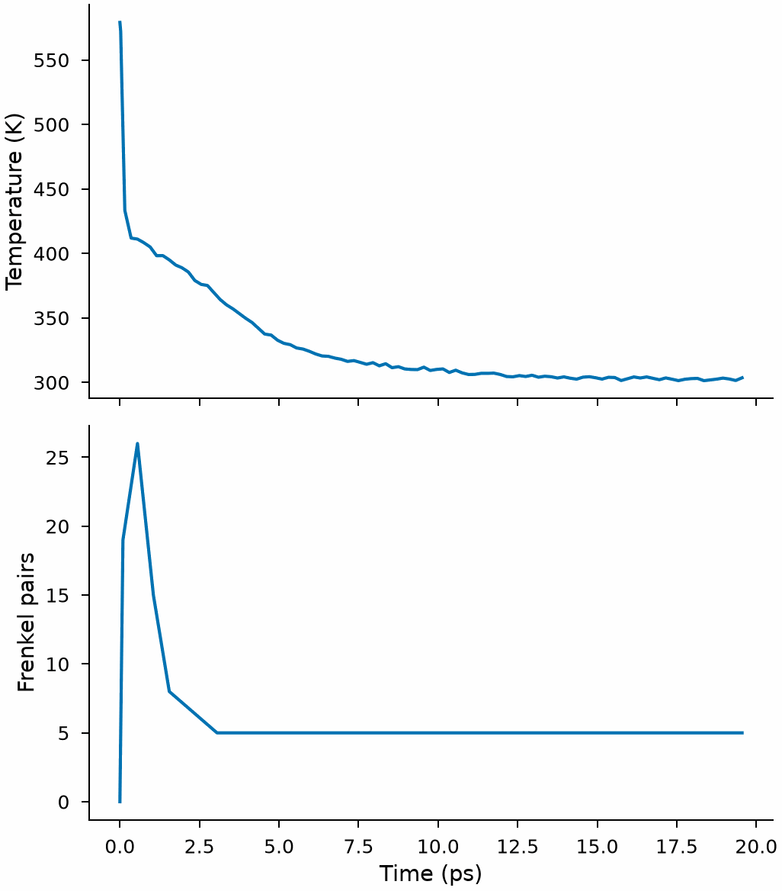
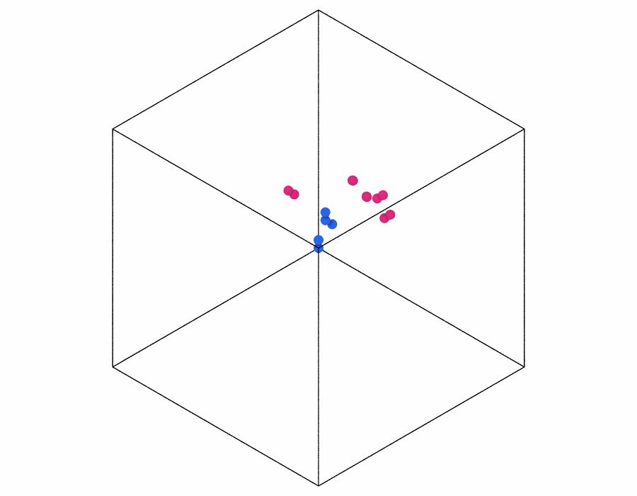

# A collision cascade in tungsten

A neutron or an ion that hits a crystal knocks an atom out of its place: the
primary knock-on atom (PKA). Moving with kiloelectronvolts, it knocks others
out in turn, a cascade that melts a small region for a few picoseconds and
leaves vacancies and interstitials behind as it cools. This example starts one
with 2 keV in tungsten and counts the defects with the
[Wigner–Seitz analysis](../user-guide/analysis/wigner-seitz.md).

!!! note "The model"
    The NEP model for 16 metals of the [high-throughput example](high-throughput.md),
    [`nep.txt`](high-throughput/nep.txt), has a ZBL repulsion at short range, from 1 to
    2 Å: atoms that meet at the speeds of a cascade come much closer than in a crystal,
    where only such a repulsion describes them. A potential without one lets them
    pass through each other. The molecular dynamics run in LAMMPS with the NEP of
    KOKKOS, `pair_style nep/kk`, on a GPU, as in the
    [example of CrCoNi](crconi.md#from-molecular-dynamics).

<!-- files: high-throughput -->

## The crystal at 300 K

<!-- skip-test -->
```python
import numpy as np
from mdapy import units
from mdapy.build import build_crystal
from mdapy.calculators import LAMMPS
from mdapy.simulation import MolecularDynamics, minimize
from mdapy.transform import replicate

gpu = LAMMPS(
    "pair_style nep/kk\npair_coeff * * nep.txt W",
    ["W"],
    cmdargs=["-k", "on", "g", "1", "-sf", "kk", "-pk", "kokkos", "newton", "on", "neigh", "half"],
)  # fmt: skip
cell = minimize(build_crystal("bcc", 3.17, elements="W"), gpu, cell="full").system
crystal = replicate(cell, (30, 30, 30))  # 54000 atoms, 9.5 nm wide

with MolecularDynamics(crystal, gpu, timestep=0.002) as md:
    md.velocities(600, seed=1)  # half of it goes into the potential energy
    md.run(2500, ensemble="nvt", temperature=300)  # 5 ps
    warm = md.system
```

## The knock-on atom

A few lines give one atom an energy along a direction, by default the atom nearest
the center of the box. A direction of high indices, such as [1 3 5], keeps it away
from the open channels of the lattice, along which it would travel far without
collisions.

<!-- skip-test -->
```python
from mdapy.elements import atomic_masses


def knock_on(system, energy, direction, atom=None):
    """The system with one atom given a kinetic energy in eV along a direction;
    by default the atom nearest the center of the box. The index of the atom too."""
    if atom is None:
        center = system.box.origin + system.box.matrix.sum(axis=0) / 2
        atom = int(np.argmin(np.linalg.norm(system["positions"] - center, axis=1)))
    if "mass" in system.table.columns:
        mass = system["mass"][atom]
    else:
        mass = atomic_masses([system["element"][atom]])[0]
    unit = np.asarray(direction, dtype=float) / np.linalg.norm(direction)
    speed = np.sqrt(2 * energy / (mass * units.AMU_A2_PER_PS2_TO_EV))  # Å/ps
    velocities = system["velocities"].copy()
    velocities[atom] = speed * unit
    return system.with_columns(velocities=velocities), atom


start, pka = knock_on(warm, 2000.0, (1, 3, 5))
np.linalg.norm(start["velocities"][pka])  # Å/ps, 458
```

## The cascade

The time step adapts to the fastest atom, `fix dt/reset` of LAMMPS: no atom moves
more than 0.05 Å in a step, up to steps of 1 fs once the cascade has cooled. The atoms
within 1 nm of the faces of the box keep 300 K and carry the heat of the cascade
away, as the crystal around it would:

<!-- skip-test -->
```python
L = start.box.lengths
with MolecularDynamics(start, gpu, timestep=0.001) as md:
    md.command(
        "fix adapt all dt/reset 1 NULL 0.001 0.05 units box\n"
        f"region core block 10 {L[0] - 10} 10 {L[1] - 10} 10 {L[2] - 10}\n"
        "group core region core\n"
        "group border subtract all core\n"
        "fix cool border langevin 300 300 0.1 7"
    )
    md.run(20000, ensemble="nve", thermo=200, save_every=500)
    thermo, frames = md.thermo, md.frames
frames[-1].info["time"]  # ps, about 15
```

## The defects

The [Wigner–Seitz analysis](../user-guide/analysis/wigner-seitz.md) against the
perfect crystal counts the vacancies of each frame, as many as the interstitials:

<!-- skip-test -->
```python
from mdapy.analysis import WignerSeitz
from mdapy.visualization import plot

sites = WignerSeitz(crystal)
results = [sites.compute(frame) for frame in frames]
time = np.array([frame.info["time"] for frame in frames])
pairs = np.array([r.vacancy_count for r in results])

with plot.style():
    fig, (top, bottom) = plot.figure("single", 100, nrows=2, sharex=True)
    top.plot(thermo["time"], thermo["temperature"])
    top.set_ylabel("Temperature (K)")
    bottom.plot(time, pairs)
    bottom.set_ylabel("Frenkel pairs")
    bottom.set_xlabel("Time (ps)")
    plot.save(fig, "images/radiation-cascade", formats=("png",))
pairs.max(), pairs[-1]  # at the peak of the cascade and at the end
```



*A cascade of 2 keV in 54000 atoms of tungsten: the temperature of the whole box rises
by tens of kelvin as the energy of the PKA spreads, and most of the atoms knocked out
of their places in the first picosecond fall back into vacancies.*

The vacancies and the interstitials at the end:

<!-- skip-test -->
```python
from mdapy.transform import combine
from mdapy.visualization import render

last = frames[-1].with_columns(results[-1])
interstitials = last.filter(last["occupancy"] > 1)  # the atoms on doubly occupied sites
vacancies = crystal.gather(results[-1].vacancies)  # the empty sites
defects = combine(vacancies, interstitials)
blue, red = (0.15, 0.39, 0.92), (0.86, 0.15, 0.47)
colors = np.where(np.arange(len(defects))[:, None] < len(vacancies), blue, red)
render(defects, "images/radiation-cascade-defects.png", color=colors, width=900, height=700)
```



*The vacancies in blue and the atoms of the interstitials in red, left about the center
of the box, where the cascade began.*

## See also

- [Wigner–Seitz analysis](../user-guide/analysis/wigner-seitz.md).
- [Molecular dynamics](../user-guide/simulation/dynamics.md).
- LAMMPS [`fix dt/reset`](https://docs.lammps.org/fix_dt_reset.html) and
  [`fix langevin`](https://docs.lammps.org/fix_langevin.html).
