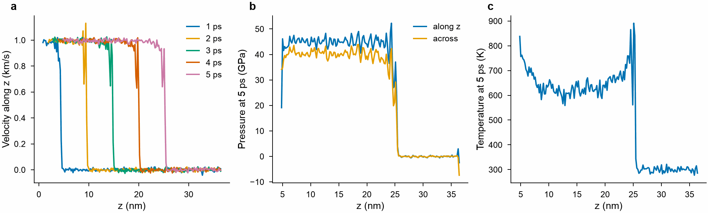
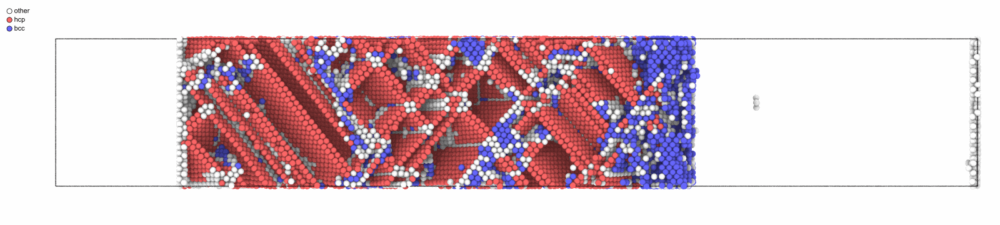

# A shock wave in copper

A piston driven into a crystal sends a shock wave ahead of it: a front, a few
atomic planes thick, that takes the matter from rest to the velocity of the
piston and compresses it in one step. Strong enough, the shock makes the crystal
flow behind it. This example drives one into copper along [001] with a moving
[wall](../user-guide/molecular-dynamics/walls.md), follows it with the
[spatial binning of moving atoms](../user-guide/analysis/spatial-binning.md#moving-atoms),
and finds the stacking faults that it leaves with the
[common neighbor analysis](../user-guide/analysis/cna.md). The molecular dynamics
run in MDAPY on a [GPU](../user-guide/molecular-dynamics/gpu.md): 102400 atoms, 10 ps at 300 K
and 5 ps of the shock, took 15 s on one V100.

## The crystal

Copper at 300 K and no pressure, 36 nm long along z, then opened along z: its bottom
and top are free surfaces.

<!-- skip-test -->
```python
import mdapy
from mdapy.build import build_crystal
from mdapy.calculators import EAM
from mdapy.simulation import MolecularDynamics

copper = EAM.zhou(["Cu"], device="cuda")
crystal = build_crystal(
    "fcc", 3.615, elements="Cu", repeat=(16, 16, 100)
)  # 102400 atoms
with MolecularDynamics(crystal, copper, timestep=0.002) as md:
    md.velocities(600, seed=1)
    md.run(5000, ensemble="npt", temperature=300, pressure=0.0, barostat="aniso")
    warm = md.system

box = mdapy.Box(warm.box.matrix, origin=warm.box.origin, pbc=(True, True, False))
warm = warm.with_box(box)
```

## The piston

A wall 1 Å below the crystal moves up at 10 Å/ps, 1 km/s, for 5 ps. Every 0.5 ps the
virials of each atom come from the potential, and slabs of 1.8 Å give the velocity of
their center of mass, their temperature about it, and their stress:

<!-- skip-test -->
```python
from mdapy.analysis import SpatialBinning
from mdapy.simulation.controls import Wall

piston = Wall(position=float(warm["positions.z"].min()) - 1.0, velocity=10.0)
profiles = []
with MolecularDynamics(warm, copper, timestep=0.001) as md:
    for frame in md.iterate(5000, save_every=500, controls=piston):
        frame = copper.compute(frame, ("atomic_virials",)).attach(frame)
        velocity = SpatialBinning("velocities", 200, reduction="mass_mean").compute(
            frame
        )
        temperature = SpatialBinning("velocities", 200, reduction="temperature")
        stress = SpatialBinning("atomic_virials", 200, reduction="stress")
        temperature, stress = temperature.compute(frame), stress.compute(frame)
        profiles.append(
            {
                "time": frame.info["time"],
                "z": temperature.centers[0],
                "velocity": velocity.values[:, 2],
                "temperature": temperature.values,
                "stress": stress.values,
                "counts": temperature.counts,
            }
        )
        last = frame
```

## The profiles

<!-- skip-test -->
```python
from mdapy.visualization import plot

with plot.style():
    fig, (a, b, c) = plot.figure("double", 55, nrows=1, ncols=3)
    for p in profiles[2::2]:
        a.plot(p["z"] / 10, p["velocity"] / 10, label=f"{p['time']:g} ps")
    a.set(xlabel="z (nm)", ylabel="Velocity along z (km/s)")
    a.legend()
    p = profiles[-1]
    shocked = p["counts"] > 0  # the slabs the piston has not passed
    z, s = p["z"][shocked] / 10, p["stress"][shocked]
    b.plot(z, -s[:, 2, 2], label="along z")
    b.plot(z, -0.5 * (s[:, 0, 0] + s[:, 1, 1]), label="across")
    b.set(xlabel="z (nm)", ylabel="Pressure at 5 ps (GPa)")
    b.legend()
    c.plot(z, p["temperature"][shocked])
    c.set(xlabel="z (nm)", ylabel="Temperature at 5 ps (K)")
    for ax, label in zip((a, b, c), "abc"):
        plot.panel_label(ax, label)
    plot.save(fig, "images/shock-profiles", formats=("png",))
```



*a: The front runs ahead of the piston at 5.2 km/s, and the copper behind it moves
with the piston at 1.0 km/s. b: Behind the front the pressure along z is 45 GPa, the
density of the copper at rest times the shock velocity times the particle velocity;
across, it is 40 GPa: a shear stress of 2.4 GPa, about half the 4.5 GPa that the crystal
held, still elastic, at 30 GPa on its [Hugoniot](../user-guide/molecular-dynamics/hugoniostat.md). c: The shocked copper
is at about 640 K, hotter near the piston, where the shock started; at the front the
slabs hold atoms of both sides, whose spread of velocities counts as heat.*

## The faults behind the front

<!-- skip-test -->
```python
from mdapy.identify import CommonNeighborAnalysis
from mdapy.visualization import render

structures = CommonNeighborAnalysis().compute(last)
structures.counts()  # {'other': 11119, 'fcc': 66156, 'hcp': 17403, 'bcc': 7722, 'ico': 0}
render(
    last,
    "images/shock-structures.png",
    atoms=structures.structure != 1,  # all but fcc
    color=structures,
    view="front",
    up=(-1.0, 0.0, 0.0),
    width=1600,
    height=360,
    legend=True,
)
```



*At 5 ps, z from left to right: the 5 nm the piston has swept, the shocked copper up
to the front at 25 nm, and the copper at rest, fcc and not shown, up to its free
surface. Behind the front stacking faults cross on the {111} planes, two layers of hcp
atoms each, bounded by partial dislocations; just behind the front the lattice, still
compressed along z alone, is distorted towards bcc, and so the common neighbor analysis
calls it.*

## See also

- [Walls](../user-guide/molecular-dynamics/walls.md), [Hugoniostat](../user-guide/molecular-dynamics/hugoniostat.md)
  and [Multiscale shock technique](../user-guide/molecular-dynamics/msst.md).
- [Spatial binning](../user-guide/analysis/spatial-binning.md) and
  [Common neighbor analysis](../user-guide/analysis/cna.md).
