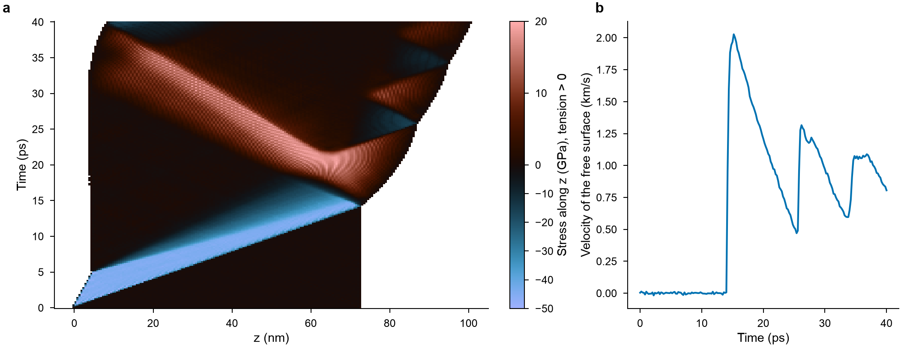
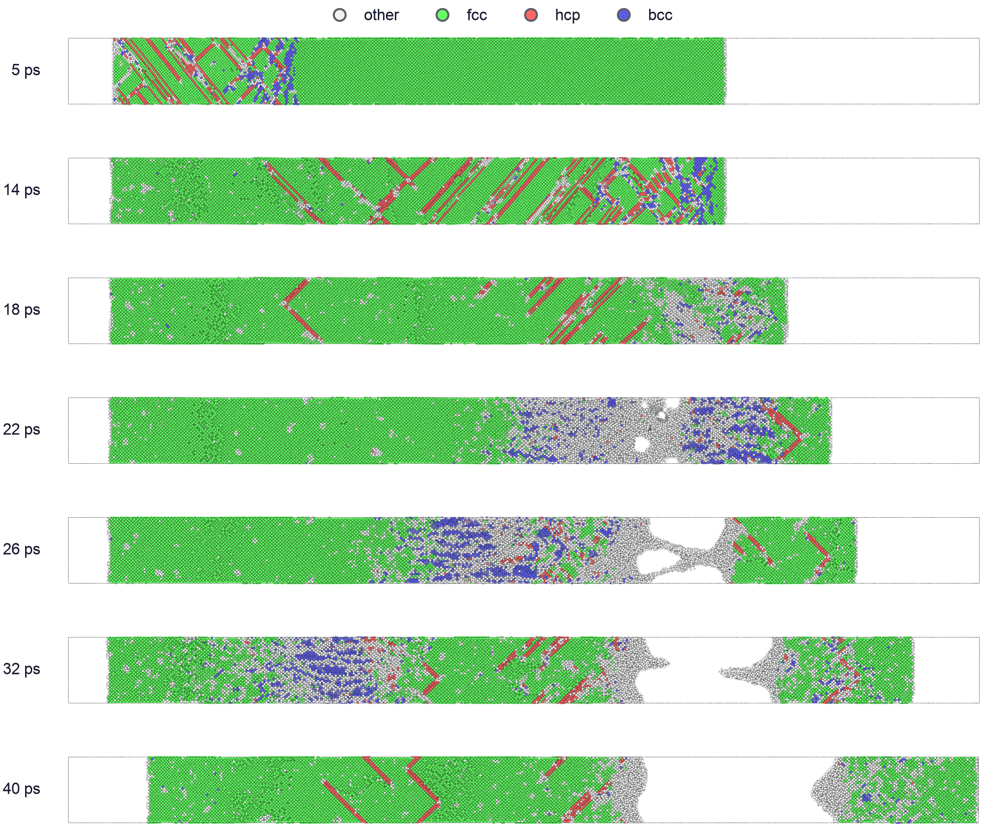

# Shock and spall in copper

A piston driven into a crystal sends a shock wave ahead of it: a front, a few atomic
planes thick, that takes the matter from rest to the velocity of the piston and
compresses it in one step. When the piston stops, a release wave follows the shock;
when the shock reaches the free surface, it comes back as another. Where the two
releases meet, the copper is pulled apart: it spalls. This example drives copper along
[001] with a moving [wall](../user-guide/simulation/walls.md) for 5 ps and
takes the wall away. It follows the waves with the
[spatial binning of moving atoms](../user-guide/analysis/spatial-binning.md#moving-atoms)
in [fixed slabs](../user-guide/analysis/spatial-binning.md#fixed-bins), the velocity of
the free surface as an experiment measures it, and the voids that open with the
[common neighbor analysis](../user-guide/analysis/cna.md). The molecular dynamics run
in MDAPY on a [GPU](../user-guide/simulation/gpu.md): 320000 atoms, 40 ps of
shock, release and spall took 4 minutes on one V100.

## The crystal

Copper at 300 K and no pressure, 73 nm long along z, then opened along z: its bottom
and top are free surfaces.

<!-- skip-test -->
```python
import mdapy
from mdapy.build import build_crystal
from mdapy.calculators import EAM
from mdapy.simulation import MolecularDynamics

copper = EAM.zhou(["Cu"], device="cuda")
crystal = build_crystal(
    "fcc", 3.615, elements="Cu", repeat=(20, 20, 200)
)  # 320000 atoms
with MolecularDynamics(crystal, copper, timestep=0.002) as md:
    md.velocities(600, seed=1)
    md.run(5000, ensemble="npt", temperature=300, pressure=0.0, barostat="aniso")
    warm = md.system

box = mdapy.Box(warm.box.matrix, origin=warm.box.origin, pbc=(True, True, False))
warm = warm.with_box(box)
```

## The piston and its release

A wall 1 Å below the crystal moves up at 10 Å/ps, 1 km/s, for 5 ps; the next run has
no wall. Every 0.2 ps the virials of each atom come from the potential, and slabs of
5 Å give the stress along z and the velocity of their center of mass. The slabs are
fixed, from 1 nm below the crystal to 40 nm beyond it, as the box grows with the atoms
that fly off. The last planes of the free surface give its velocity, and a few frames
are kept for pictures. The free surface is the atoms within 3 Å of it at the start, its
last two planes, the same atoms all along: its velocity is theirs, wherever they go,
while the slabs stay where they are and the atoms pass through them.

<!-- skip-test -->
```python
from mdapy.analysis import SpatialBinning
from mdapy.simulation.controls import Wall

z = warm["positions.z"]
surface = z > z.max() - 3.0  # the last planes of the free surface
bounds = [(-100.0, float(warm.box.matrix[2, 2]) + 400.0)]
slabs = int((bounds[0][1] - bounds[0][0]) / 5.0)
stress = SpatialBinning("atomic_virials", slabs, reduction="stress", bounds=bounds)
velocity = SpatialBinning("velocities", slabs, reduction="mass_mean", bounds=bounds)

records, kept = [], {}


def record(frame, start):
    t = round(frame.info["time"] - start, 3)
    frame = copper.compute(frame, ("atomic_virials",)).attach(frame)
    records.append(
        {
            "time": t,
            "stress": stress.compute(frame).values[:, 2, 2],
            "velocity": velocity.compute(frame).values[:, 2],
            "surface": frame["velocities"][surface, 2].mean(),
        }
    )
    if t in (5, 14, 18, 22, 26, 32, 40):
        kept[t] = frame


piston = Wall(position=float(z.min()) - 1.0, velocity=10.0)
with MolecularDynamics(warm, copper, timestep=0.001) as md:
    start = md.system.info["time"]
    for frame in md.iterate(5000, save_every=200, controls=piston):
        record(frame, start)
    for frame in md.iterate(35000, save_every=200):  # no piston
        record(frame, start)
z = stress.compute(kept[40]).centers[0]  # the slabs, from (0, 0, 0)
```

## The waves

The stress along z in every slab against time, the wave diagram of the run, and the
velocity of the free surface:

<!-- skip-test -->
```python
import numpy as np
from mdapy.visualization import plot

time = np.array([r["time"] for r in records])
waves = np.array([r["stress"] for r in records])  # GPa, tension > 0
with plot.style():
    fig, (a, b) = plot.figure("double", 70, ncols=2, width_ratios=(1.6, 1))
    mesh = a.pcolormesh(
        z / 10, time, waves, cmap="RdBu_r", vmin=-50, vmax=50, shading="nearest"
    )
    fig.colorbar(mesh, ax=a, label="Stress along z (GPa), tension > 0")
    a.set(xlabel="z (nm)", ylabel="Time (ps)", xlim=(-5, 105))
    b.plot(time, [r["surface"] / 10 for r in records])
    b.set(xlabel="Time (ps)", ylabel="Velocity of the free surface (km/s)")
    for ax, label in zip((a, b), "ab"):
        plot.panel_label(ax, label)
    plot.save(fig, "images/shock-spall-wave", formats=("png",))
```



*a: The piston drives a shock of 51 GPa (blue) at 5.2 km/s. At 5 ps it stops, and a
release follows the shock and wears it down. At 14 ps the shock reaches the free
surface at 73 nm and comes back as a release. The two releases meet near 66 nm at
20 ps, where they pull the copper by 19.5 GPa (red): it spalls there, and the layer
beyond, the scab, rings between its two new surfaces. b: The free surface jumps to
2.0 km/s, twice the velocity of the piston, as the shock reflects there; it slows as
the release behind the shock arrives, down to 0.47 km/s, and speeds up again at
25.5 ps, when the compression that the spall sends back reaches it: the pull-back
signal by which experiments measure the strength of spall.*

## The spall

A slice 1.2 nm thick across x of each kept frame, its atoms colored by their structure,
all in the box at 40 ps:

<!-- skip-test -->
```python
from matplotlib.lines import Line2D

from mdapy.identify import CommonNeighborAnalysis
from mdapy.visualization import render

cna = CommonNeighborAnalysis()
box = kept[40].box
with plot.style():
    fig, axes = plot.figure("double", 150, nrows=len(kept))
    for ax, (t, frame) in zip(axes, sorted(kept.items())):
        x = frame["positions.x"]
        middle = np.abs(x - 0.5 * (x.min() + x.max())) < 6.0
        structures = cna.compute(frame)
        picture = render(
            frame.with_box(box),
            atoms=middle,
            color=structures,
            view=(1.0, 0.0, 0.0),
            up=(0.0, 1.0, 0.0),
            width=2000,
            height=170,
        )
        ax.imshow(picture)
        ax.set_axis_off()
        ax.text(
            -0.01, 0.5, f"{t:g} ps", transform=ax.transAxes, ha="right", va="center"
        )
    handles = [
        Line2D([], [], marker="o", linestyle="", markerfacecolor=color, label=name)
        for name, color in zip(structures.names[:4], structures.colors[:4])
    ]
    fig.legend(handles=handles, loc="upper center", ncols=4, frameon=False)
    plot.save(fig, "images/shock-spall-frames", formats=("png",))
```



*z from left to right. At 5 ps stacking faults cross behind the front on the {111}
planes, two layers of hcp atoms each, and just behind it the lattice, compressed along
z alone, is distorted towards bcc. At 14 ps the shock has crossed the whole crystal. At
18 ps the two releases meet near 66 nm and the copper there loses its order under
tension. At 22 ps voids open in it; at 26 ps they grow and join, and at 32 ps a thin
neck of disordered copper still holds the two parts. At 40 ps the scab has torn off and
flies away from the rest; the box has grown with it. Behind the spall, where the
waves crossed, patches of the copper are distorted towards bcc.*

## See also

- [Walls](../user-guide/simulation/walls.md), [Hugoniostat](../user-guide/simulation/hugoniostat.md)
  and [Multiscale shock technique](../user-guide/simulation/msst.md).
- [Spatial binning](../user-guide/analysis/spatial-binning.md) and
  [Common neighbor analysis](../user-guide/analysis/cna.md).
