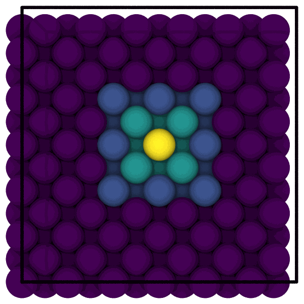

# Expanding a selection

`mdapy.neighbor.expand_selection` grows a selection of atoms by their
neighbors: the atoms within a cutoff of a selected atom, the nearest
neighbors of each selected atom, or the atoms bonded to one, as many times
as asked, as OVITO's expand selection modifier does.

```python
import numpy as np

from mdapy.build import build_crystal
from mdapy.neighbor import expand_selection

crystal = build_crystal("fcc", 3.615, elements="Cu", repeat=(6, 6, 6))
center = [int(np.argmin(np.linalg.norm(crystal["positions"] - 10.8, axis=1)))]
first = expand_selection(crystal, center, cutoff=3.0)  # the atom and its 12 neighbors
second = expand_selection(crystal, center, cutoff=3.0, iterations=2)  # 55 atoms
nearest = expand_selection(crystal, center, num_neighbors=12)  # the same 13
upper = expand_selection(crystal, crystal["positions"][:, 2] > 15, cutoff=3.0)  # a mask
```

The two shells about an atom in the middle, cut open:

```python
from mdapy.visualization import render

shell = np.where(second, np.where(first, 1.0, 0.5), 0.0)
shell[center] = 2.0
render(
    crystal.filter(crystal["positions"][:, 2] < 10.9),
    "images/expand-selection.png",
    color=shell[crystal["positions"][:, 2] < 10.9],
    colormap="viridis",
    view="top",
    width=600,
    height=600,
)
```



*The lower half of the crystal seen from above: the atom in the middle
(yellow), its 12 nearest neighbors, the atoms the second step adds, and the
rest (dark violet).*

## Parameters

`expand_selection(system, atoms, *, cutoff=None, num_neighbors=None, bonds=False, iterations=1)`

| Name | Type | Default | Unit | Meaning |
|---|---|---|---|---|
| `system` | `System` | | | the atoms and the box |
| `atoms` | (N,) bool or indices | | | the atoms selected |
| `cutoff` | float | | Å | add the atoms closer than this to a selected atom |
| `num_neighbors` | int | | | add the `num_neighbors` nearest neighbors of each selected atom |
| `bonds` | bool | `False` | | add the atoms bonded to a selected atom, by the bonds of the [topology](topology.md) |
| `iterations` | int | 1 | | how many times the selection grows, each time by the neighbors of every atom selected so far; 0 leaves it as it is |

Give exactly one of `cutoff`, `num_neighbors` and `bonds`. Neighbors are
found through the periodic boundaries, with the
[neighbor lists](neighbor.md) of mdapy.

## Results

A boolean mask of one value per atom: the atoms selected and those added.
With `num_neighbors`, an atom joins when it is one of the nearest neighbors
of a selected atom, not the other way around, as in OVITO. The selection
stops growing early once a step adds nothing.

## Errors

`expand_selection` raises
[`InvalidParameter`](../reference/api.md#mdapy.errors.InvalidParameter)
when not exactly one of `cutoff`, `num_neighbors` and `bonds` is given, when
`iterations` is not an integer or is negative, when `atoms` is not a mask
or indices of the system, and as
[`NeighborList.build`](neighbor.md#building) for the cutoff and the number
of neighbors;
[`MissingProperty`](../reference/api.md#mdapy.errors.MissingProperty) with
`bonds` when the system has no bonds.

## See also

- OVITO's [expand selection](https://www.ovito.org/manual/reference/pipelines/modifiers/expand_selection.html).
- [Selecting and ordering atoms](selecting.md).
