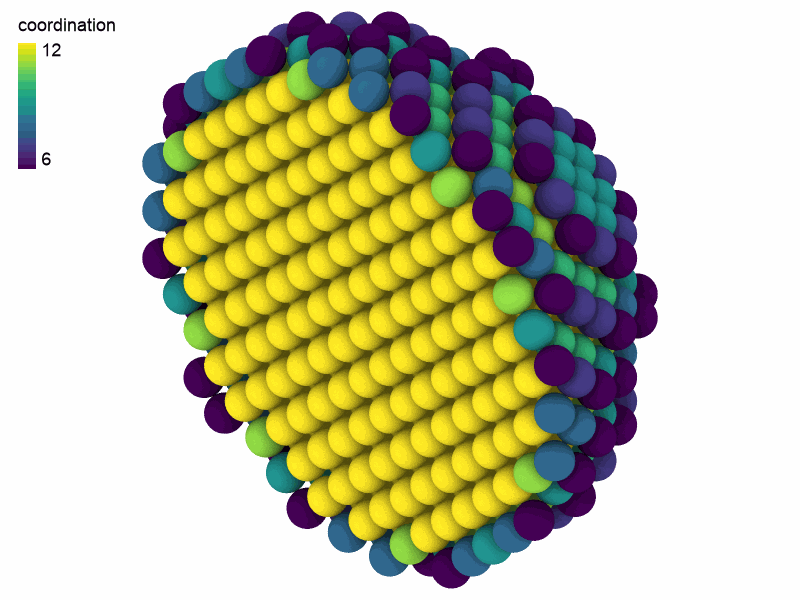
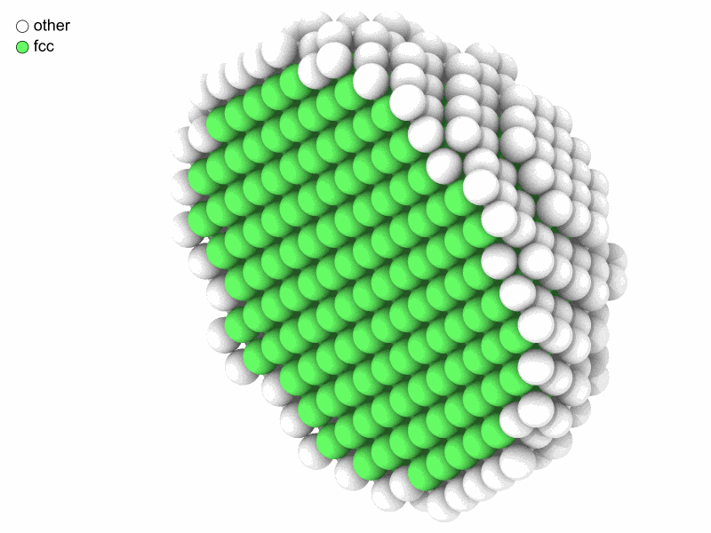

# 2. Asking the atoms questions

Here is the third idea: **every analysis is used the same way.** Learn it once
and you can use all of them. This lesson asks of a copper nanoparticle: how many
of its atoms are on the surface, and which are still in the crystal?

## A nanoparticle

Cut a sphere out of a crystal. A new column holds the distance from the center,
and `filter` keeps the atoms within 18 Å:

```python
import numpy as np
from mdapy.build import build_crystal

crystal = build_crystal("fcc", 3.615, elements="Cu", repeat=(12, 12, 12))
center = crystal["positions"].mean(axis=0)
crystal = crystal.with_columns(
    distance=np.linalg.norm(crystal["positions"] - center, axis=1)
)
particle = crystal.filter("distance < 18")
print(particle)
```

```text
System: 2112 atoms (Cu2112)
  box:      43.38 × 43.38 × 43.38 Å, orthogonal, periodic x y z
  columns:  positions (3), element, distance
```

The box is still periodic, but it is 7 Å wider than the particle, more than any
cutoff below, so the particle does not meet its own images.

## The pattern

Count the neighbors of each atom:

```python
from mdapy.analysis import CoordinationNumber

analysis = CoordinationNumber(cutoff=3.0)  # 1. the parameters
result = analysis.compute(particle)  # 2. the computation
particle = particle.with_columns(result)  # 3. the answer, as a column
print(particle)
```

```text
System: 2112 atoms (Cu2112)
  box:      43.38 × 43.38 × 43.38 Å, orthogonal, periodic x y z
  columns:  positions (3), element, distance, coordination, coordination_Cu
```

These three steps are the same for every analysis in MDAPY. A wrong parameter
fails at step 1, before anything is computed. The new column is like any other,
so everything from the last lesson works on it:

```python
surface = particle.filter("coordination < 12")
print(f"{len(surface)} of {len(particle)} atoms are on the surface")
print(particle.table.group_by("coordination").len().sort("coordination"))
```

```text
724 of 2112 atoms are on the surface
shape: (7, 2)
┌──────────────┬──────┐
│ coordination ┆ len  │
│ ---          ┆ ---  │
│ i64          ┆ u32  │
╞══════════════╪══════╡
│ 6            ┆ 168  │
│ 7            ┆ 108  │
│ 8            ┆ 84   │
│ 9            ┆ 172  │
│ 10           ┆ 72   │
│ 11           ┆ 120  │
│ 12           ┆ 1388 │
└──────────────┴──────┘
```

A column can color a picture, by its name:

```python
from mdapy.visualization import render

render(
    particle,
    "images/coordination.png",
    atoms=particle["positions.x"] < center[0],
    color="coordination",
    box=False,
    width=800,
    height=600,
)
```



*Inside, every atom has 12 neighbors. The surface has fewer, and fewest at the
edges and corners.*

## Another question, the same pattern

Which atoms are in the crystal? Common neighbor analysis looks at how the
neighbors of each atom are bonded:

```python
from mdapy.identify import CommonNeighborAnalysis

structures = CommonNeighborAnalysis().compute(particle)
print(structures.counts())
particle = particle.with_columns(structures)
```

```text
{'other': 724, 'fcc': 1388, 'hcp': 0, 'bcc': 0, 'ico': 0}
```

The result of a structure analysis also knows its colors, so it can be passed
to `render` directly:

```python
render(
    particle,
    "images/structures.png",
    atoms=particle["positions.x"] < center[0],
    color=structures,
    box=False,
    width=800,
    height=600,
)
```



*Green for fcc atoms, white for the rest: the surface, as common neighbor
analysis needs a full shell of neighbors.*

## Try it

1. Replace `CommonNeighborAnalysis()` with `PolyhedralTemplateMatching()`, also
   from `mdapy.identify`. Does it find the same fcc atoms?
2. Add the column of `CentroSymmetryParameter(12)` to the particle, and color by
   `"csp"`.

??? note "An answer"

    ```python
    from mdapy.identify import CentroSymmetryParameter, PolyhedralTemplateMatching

    print(PolyhedralTemplateMatching().compute(particle).counts())
    centro = particle.with_columns(CentroSymmetryParameter(12).compute(particle))
    render(centro, "images/csp.png", color="csp")
    ```

Next: [from numbers to figures](figures.md). All the analyses are listed in the
[overview of analyses](../../user-guide/analysis/overview.md).
