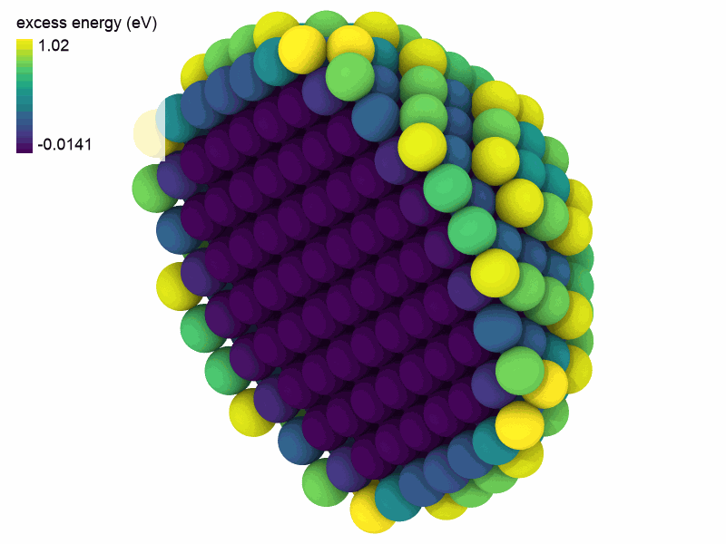

# 4. Energies and relaxation

So far the atoms stayed where they were put. With an interatomic potential they
have an energy and forces, and can relax. This lesson computes a real number, the
energy it takes to form a vacancy in copper, in a few lines.

## A potential

A calculator takes a system and computes what you ask of it. `EAM.zhou` makes
the embedded atom potential of Zhou et al., with no file to download:

```python
import numpy as np

from mdapy.build import build_crystal
from mdapy.calculators import EAM

potential = EAM.zhou(["Cu"])
crystal = build_crystal("fcc", 3.615, elements="Cu", repeat=(5, 5, 5))

result = potential.compute(crystal, ("energy", "forces", "virial"))
print(f"{result.energy / len(crystal):.3f} eV per atom")
print(f"largest force {np.abs(result.forces).max():.1e} eV/Å")
```

```text
-3.540 eV per atom
largest force 8.3e-15 eV/Å
```

A perfect crystal has no forces, as every atom is pulled alike from all sides.

## Take out one atom

`gather` picks atoms by index, so all the indices but the first remove one atom.
The atoms around the hole now feel a force:

```python
vacancy = crystal.gather(np.arange(1, len(crystal)))
forces = potential.compute(vacancy, ("forces",)).forces
print(f"largest force {np.abs(forces).max():.3f} eV/Å")
```

```text
largest force 0.251 eV/Å
```

## Relax it

`minimize` moves the atoms until the forces vanish. It returns the relaxed
system, its energy, and whether it converged:

```python
from mdapy.simulation import minimize

relaxed = minimize(vacancy, potential)
print(relaxed.converged, relaxed.steps)
print(f"largest force {relaxed.max_force:.5f} eV/Å")
```

```text
True 67
largest force 0.00080 eV/Å
```

## The energy of a vacancy

Forming a vacancy moves one atom from inside the crystal to its surface, so it
costs the energy of the relaxed system less that of N − 1 atoms of the perfect
crystal:

```python
perfect = result.energy / len(crystal)
formation = relaxed.energy - (len(crystal) - 1) * perfect
print(f"{formation:.3f} eV")
```

```text
1.273 eV
```

Experiments give about 1.28 eV. A system this size has converged, as the
[tutorial on defect energies](../../examples/defect-energies.md) shows.

## Energy per atom

The relaxed system has new columns, as anything that computes per-atom values
does. Here is the energy of each atom against that of the crystal, in a
nanoparticle:

```python
from mdapy.visualization import render

large = build_crystal("fcc", 3.615, elements="Cu", repeat=(10, 10, 10))
center = large["positions"].mean(axis=0)
particle = large.filter(np.linalg.norm(large["positions"] - center, axis=1) < 14)
relaxed = minimize(particle, potential)
particle = relaxed.system.with_columns(
    excess=relaxed.system["atomic_energies"] - perfect
)
print(particle)

render(
    particle,
    "images/excess.png",
    atoms=particle["positions.x"] < center[0],
    color="excess",
    box=False,
    width=800,
    height=600,
)
```

```text
System: 952 atoms (Cu952)
  box:      36.15 × 36.15 × 36.15 Å, orthogonal, periodic x y z
  columns:  positions (3), element, forces (3), atomic_energies, atomic_virials (3),
            excess
  info:     energy = -3099.06, virial (3, 3), stress (3, 3)
```



*The atoms of the surface are bound less strongly, most of all at the corners.
This is why a small particle melts below the bulk, as the next lesson shows.*

## Try it

1. Compute the formation energy in a smaller crystal, `repeat=(3, 3, 3)`. How
   far is it from 1.273 eV?
2. Use `minimize(vacancy, potential, cell="full")`, which also relaxes the box.
   What changes?

??? note "An answer"

    ```python
    small = build_crystal("fcc", 3.615, elements="Cu", repeat=(3, 3, 3))
    hole = minimize(small.gather(np.arange(1, len(small))), potential)
    print(hole.energy - (len(small) - 1) * perfect)  # 1.279 eV: 6 meV more
    ```

Next: [a nanoparticle melts](trajectories.md). See also
[Calculators](../../user-guide/simulation/calculators.md),
[Energy minimization](../../user-guide/simulation/minimize.md) and
[Defect energies](../../user-guide/simulation/defect-energies.md).
