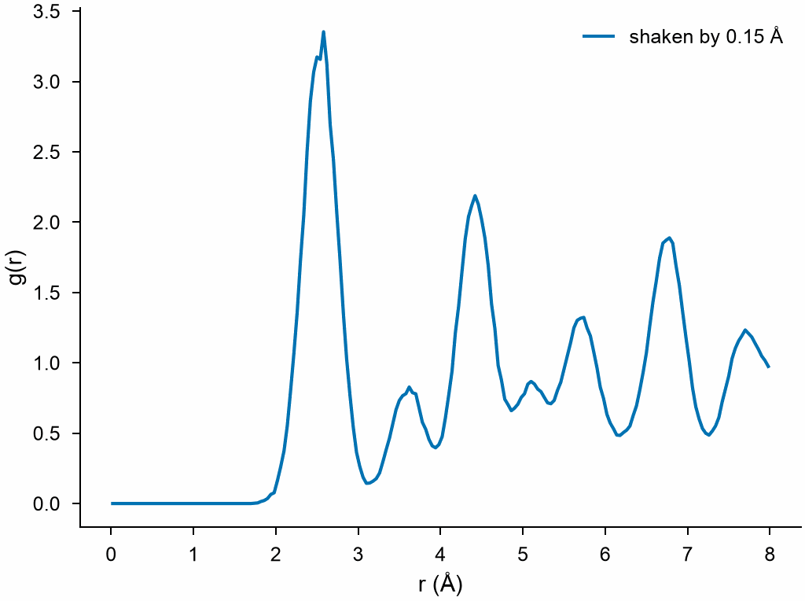
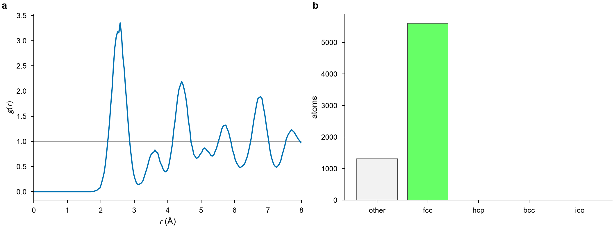
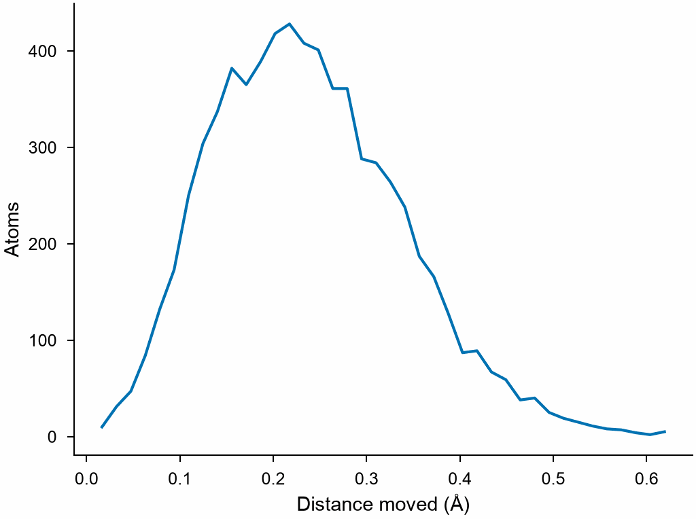

# 3. From numbers to figures

Some analyses give one value per atom, as in the last lesson. Others describe
the whole system. Their results are plain NumPy arrays, ready for a figure. This
lesson shows how heat looks in the radial distribution function of copper.

## A crystal and a shaken crystal

Atoms at a finite temperature move about their sites. Random displacements give
a rough picture of that. Remember that `with_columns` also replaces columns,
the positions too:

```python
import numpy as np
from mdapy.build import build_crystal

crystal = build_crystal("fcc", 3.615, elements="Cu", repeat=(12, 12, 12))
rng = np.random.default_rng(1)
shaken = crystal.with_columns(
    positions=crystal["positions"] + rng.normal(0, 0.15, (len(crystal), 3))
)
```

## A result of the whole system

The pattern is the one you know: parameters, then `compute`. There is no column
to add, as there is one curve for all the atoms:

```python
from mdapy.analysis import RadialDistributionFunction

analysis = RadialDistributionFunction(cutoff=8.0, bins=200)
cold = analysis.compute(crystal)
hot = analysis.compute(shaken)
print(cold.r.shape, cold.g.shape)
print(f"first peak at {hot.r[hot.g.argmax()]:.2f} Å")
```

```text
(200,) (200,)
first peak at 2.58 Å
```

The first peak sits close to the nearest-neighbor distance of fcc, a/√2 = 2.556 Å.

## A figure

`hot.r` and `hot.g` are NumPy arrays, so any plotting library will do.
`mdapy.visualization.plot` sets matplotlib up for journals, and `plot.save`
writes the file:

```python
from mdapy.visualization import plot

with plot.style():
    fig, ax = plot.figure("single")
    ax.plot(hot.r, hot.g, label="shaken by 0.15 Å")
    ax.set_xlabel("r (Å)")
    ax.set_ylabel("g(r)")
    ax.legend()
    plot.save(fig, "images/rdf", formats=("png",))
```



*Peaks at the distances between sites of fcc, broadened by the displacements.*

## The ready-made plots

Common results have a plot of their own, with the labels set. A figure can have
several panels:

```python
from mdapy.identify import CommonNeighborAnalysis

structures = CommonNeighborAnalysis().compute(shaken)

with plot.style():
    fig, (left, right) = plot.figure("double", nrows=1, ncols=2)
    plot.rdf(hot, ax=left)
    plot.structure_counts(structures, ax=right)
    plot.panel_label(left, "a")
    plot.panel_label(right, "b")
    plot.save(fig, "images/panels", formats=("png",))
```



*a: g(r) of the shaken crystal. b: its atoms by structure.*

## Values of the atoms

`Histogram` gives the distribution of a column. Here, the distance of each atom
from its site, computed with the arrays of the two systems:

```python
from mdapy.analysis import Histogram

moved = shaken.with_columns(
    moved=np.linalg.norm(shaken["positions"] - crystal["positions"], axis=1)
)
histogram = Histogram("moved", bins=40).compute(moved)

with plot.style():
    fig, ax = plot.figure("single")
    ax.plot(histogram.center, histogram.counts)
    ax.set_xlabel("Distance moved (Å)")
    ax.set_ylabel("Atoms")
    plot.save(fig, "images/moved", formats=("png",))
```



*The distribution of the length of a three-dimensional Gaussian step.*

## Try it

1. Shake the crystal by 0.3 Å and draw both curves in one figure. What happens
   to the height of the first peak?
2. Save the curve to a text file with `np.savetxt("rdf.txt", np.c_[hot.r, hot.g])`.

??? note "An answer"

    ```python
    harder = crystal.with_columns(
        positions=crystal["positions"] + rng.normal(0, 0.3, (len(crystal), 3))
    )
    hotter = analysis.compute(harder)
    with plot.style():
        fig, ax = plot.figure("single")
        ax.plot(hot.r, hot.g, label="0.15 Å")
        ax.plot(hotter.r, hotter.g, label="0.3 Å")
        ax.legend()
        plot.save(fig, "images/two", formats=("png",))
    ```

    The peak drops to about half and widens by about twice: its area, the
    number of neighbors, stays.

Next: [energies and relaxation](energy.md). [Figures with MDAPY](../../examples/plotting.md)
shows how to change the size of the text, the lines and the colors. See also
[Plots](../../user-guide/visualization/plots.md),
[Radial distribution function](../../user-guide/analysis/rdf.md) and
[Histograms](../../user-guide/analysis/histogram.md).
