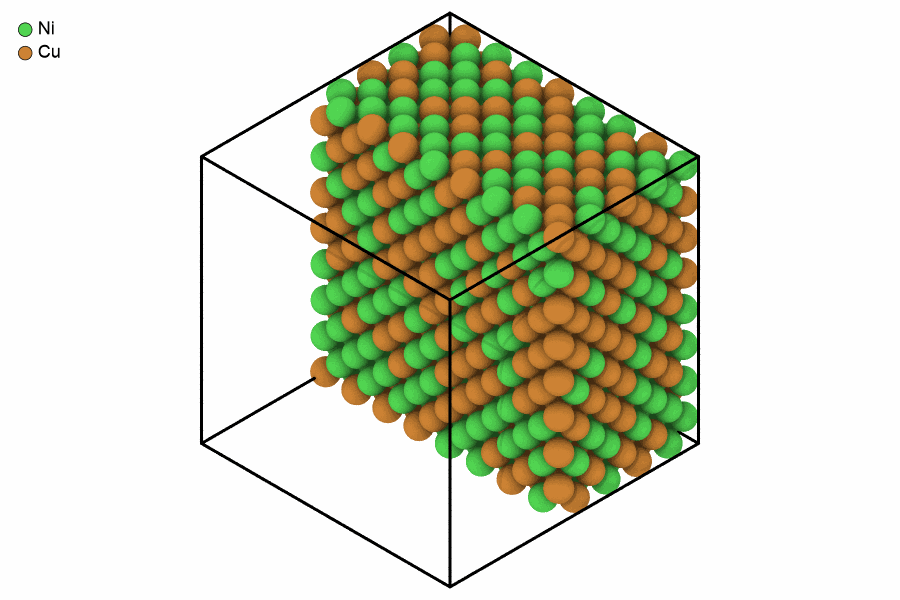

# 1. A crystal is a table

Six short lessons teach the Python side of MDAPY. Each runs on its own, needs
no input files, and ends with something to try. Three ideas carry you through
all of them, and this lesson teaches the first two:

1. **A system is a table of atoms and a box.**
2. **A system never changes.** Every change makes a new one.
3. **Every analysis is used the same way** ([lesson 2](analyses.md)).

## Build something and print it

```python
from mdapy.build import build_crystal

crystal = build_crystal("fcc", 3.615, elements="Cu", repeat=(8, 8, 8))
print(crystal)
```

```text
System: 2048 atoms (Cu2048)
  box:      28.92 × 28.92 × 28.92 Å, orthogonal, periodic x y z
  columns:  positions (3), element
```

This is the first thing to do with any system: printing it tells you the
atoms, the box and the columns you have.

## Read a column by its name

Everything about the atoms is a column, and every column is read the same
way. You get a NumPy array, one row per atom:

```python
crystal["positions"]  # (2048, 3), in Å
crystal["positions.z"]  # one component, (2048,)
crystal["element"]  # ['Cu', 'Cu', ...]
crystal["positions.x**2 + positions.y**2"]  # an expression over the columns
crystal.box.volume  # in ų
```

## Change it: you get a new system

Give some atoms another element with `with_columns`. The arrays can be any
NumPy array with one value per atom:

```python
import numpy as np

rng = np.random.default_rng(0)
alloy = crystal.with_columns(element=rng.choice(["Cu", "Ni"], len(crystal)))
print(alloy)
```

```text
System: 2048 atoms (Ni1066 Cu982)
  box:      28.92 × 28.92 × 28.92 Å, orthogonal, periodic x y z
  columns:  positions (3), element
```

`crystal` is still pure copper. Since nothing changes behind your back, you
can keep the systems of every step and compare them.

## Select atoms

`filter` keeps the atoms that meet a condition, written as you would say it:

```python
top = alloy.filter("positions.z > 20")
nickel = alloy.filter(element="Ni")
top_nickel = alloy.filter("positions.z > 20", element="Ni")
print(len(top), len(nickel), len(top_nickel))
```

```text
512 1066 263
```

## The table is a polars DataFrame

For anything else, `system.table` is a [polars](https://pola.rs) DataFrame:

```python
print(alloy.table.group_by("element").len().sort("element"))
```

```text
shape: (2, 2)
┌─────────┬──────┐
│ element ┆ len  │
│ ---     ┆ ---  │
│ enum    ┆ u32  │
╞═════════╪══════╡
│ Ni      ┆ 1066 │
│ Cu      ┆ 982  │
└─────────┴──────┘
```

## Look at it, and save it

`render` draws a system. `atoms` chooses which atoms to show, so a mask of the
atoms with small x cuts the crystal open:

```python
from mdapy.visualization import render

render(
    alloy,
    "images/alloy.png",
    atoms=alloy["positions.x"] < 15,
    width=900,
    height=600,
    legend=True,
)
```



*Copper and nickel at random on an fcc lattice, the half with x below 15 Å.*

`mdapy.io.write` and `mdapy.io.read` take any common format, chosen by the name of the
file:

```python
from mdapy.io import read, write

write("alloy.xyz", alloy)
back = read("alloy.xyz")
print(len(back))
```

```text
2048
```

## Try it

1. Build bcc tantalum with a lattice constant of 3.303 Å.
2. Add a column `layer` with the integer part of z divided by 3.303, and color
   the picture by it with `color="layer"`.

??? note "An answer"

    ```python
    tantalum = build_crystal("bcc", 3.303, elements="Ta", repeat=(10, 10, 10))
    layered = tantalum.with_columns(layer=(tantalum["positions.z"] // 3.303).astype(int))
    render(layered, "images/layers.png", color="layer")
    ```

Next: [asking the atoms questions](analyses.md). The reference pages for this
lesson are [Systems](../../basics/system.md), [Changing a system](../../basics/changing.md),
[Selecting and ordering atoms](../../basics/selecting.md) and
[Rendering](../../user-guide/visualization/rendering.md).
