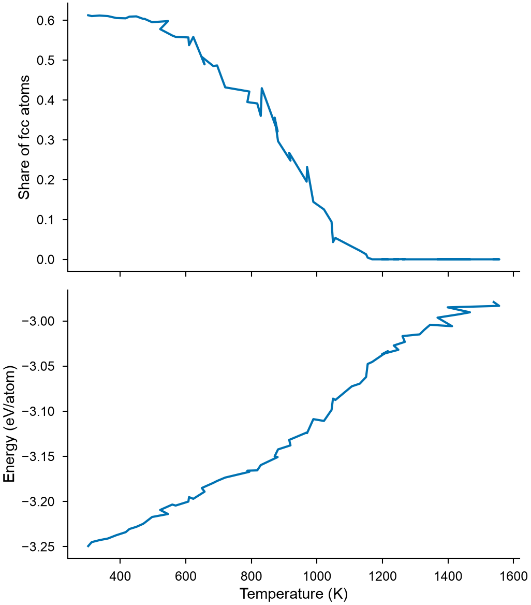
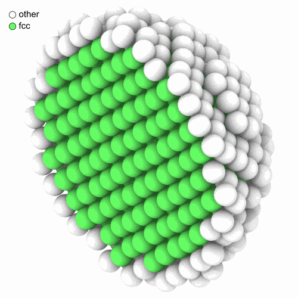
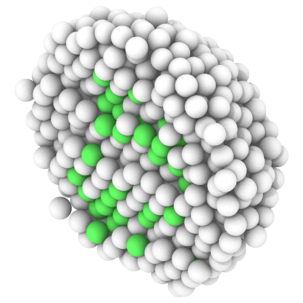
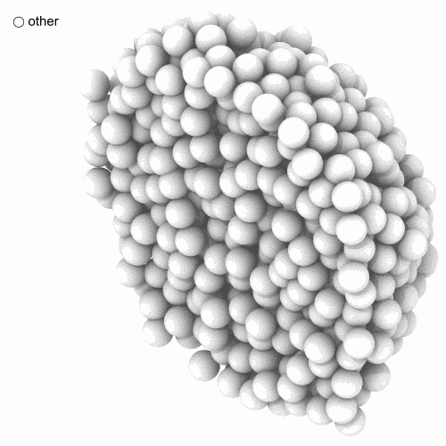

<!-- needs: lammps -->

# 5. A nanoparticle melts

Everything so far has been one configuration. Over time you get a trajectory,
a sequence of systems. This lesson heats a copper nanoparticle until it melts
and watches it happen. The molecular dynamics runs in
[LAMMPS](https://www.lammps.org), through its Python module; about half a minute
on a laptop.

## Set up

The particle sits in the middle of a box that is not periodic. MDAPY writes the
potential file, so there is nothing to download:

```python
import numpy as np
import mdapy as mp
from mdapy.build import build_crystal
from mdapy.calculators import EAM, LAMMPS

crystal = build_crystal("fcc", 3.615, elements="Cu", repeat=(12, 12, 12))
center = crystal["positions"].mean(axis=0)
inside = crystal.filter(np.linalg.norm(crystal["positions"] - center, axis=1) < 16)
particle = mp.System(
    inside["positions"] - center + 60.0, mp.Box(120.0, pbc=False), elements="Cu"
)

EAM.zhou(["Cu"]).write("Cu.eam.alloy")
potential = LAMMPS(
    "pair_style eam/alloy\npair_coeff * * Cu.eam.alloy Cu", elements=["Cu"]
)
print(len(particle))
```

```text
1436
```

## Heat it

Give the atoms velocities, let them settle at 300 K, then raise the temperature
to 1500 K over 60 ps. `frames=500` keeps the atoms every 500 steps:

```python
from mdapy.simulation import MolecularDynamics

with MolecularDynamics(particle, potential, timestep=0.002) as md:
    md.velocities(600, seed=1)
    md.run(2500, ensemble="nvt", temperature=300)
    md.run(30000, ensemble="nvt", temperature=(300, 1500), frames=500)
    frames, thermo = md.frames, md.thermo
print(len(frames), frames[0])
```

```text
61 System: 1436 atoms (Cu1436)
  box:      31.05 × 31.09 × 31.08 Å at (44.5, 44.42, 44.4), orthogonal, not periodic
  columns:  element, positions (3), velocities (3), image (3)
  info:     timestep = 2500, time = 5
```

`frames` is a tuple of ordinary systems, so all you learned applies to each. A
trajectory analysis takes the whole sequence. `thermo` is a polars table of the
temperature, the energies and so on along the run.

## One number per frame

`TimeSeries` gives one number per frame, here from a function of your own. A
function of a frame can use anything from the last lessons:

```python
from mdapy.analysis import TimeSeries
from mdapy.identify import CommonNeighborAnalysis


def fcc_fraction(frame):
    """The share of the atoms still in an fcc crystal."""
    return CommonNeighborAnalysis().compute(frame).counts()["fcc"] / len(frame)


series = TimeSeries(fcc_fraction).compute(frames)
temperature = np.interp(series.timestep, thermo["step"], thermo["temperature"])
energy = np.interp(series.timestep, thermo["step"], thermo["potential_energy"])
```

## The melting curve

```python
from mdapy.visualization import plot

with plot.style():
    fig, (top, bottom) = plot.figure("single", 100, nrows=2, sharex=True)
    top.plot(temperature, series.values)
    top.set_ylabel("Share of fcc atoms")
    bottom.plot(temperature, energy / len(particle))
    bottom.set_ylabel("Energy (eV/atom)")
    bottom.set_xlabel("Temperature (K)")
    plot.save(fig, "images/melting", formats=("png",))
```



*By about 1100 K no fcc atoms remain, and on the way there the energy rises
faster: the heat of melting. Bulk copper melts at 1358 K. A particle of 3 nm
melts sooner, as its many surface atoms are bound less strongly.*

## Look at it

Pick three frames: the start, the middle and the end. Coloring by structure shows
the surface melting first, while a crystal remains inside:

```python
from mdapy.visualization import render

for name, frame in (("start", frames[0]), ("middle", frames[35]), ("end", frames[-1])):
    half = frame["positions.x"] < frame["positions.x"].mean()
    render(
        frame,
        f"images/melt-{name}.png",
        atoms=half,
        color=CommonNeighborAnalysis().compute(frame),
        box=False,
        width=500,
        height=500,
    )
```

{ width="32%" }
{ width="32%" }
{ width="32%" }

*Cut in half, at about 300 K, 1000 K and 1500 K.*

## Keep it in a file, and read it back

`mdapy.io.write` takes the whole sequence, and `read_trajectory` opens it without
reading the frames. A frame is read when you use it, so a trajectory of many
gigabytes opens at once:

```python
from mdapy.io import read_trajectory, write

write("melt.xyz", frames)

with read_trajectory("melt.xyz") as trajectory:
    print(len(trajectory))
    every_tenth = trajectory[::10]  # nothing is read yet
    again = TimeSeries(fcc_fraction).compute(every_tenth)
    print(np.round(again.values, 2))
```

```text
61
[0.61 0.6  0.49 0.3  0.03 0.   0.  ]
```

## Try it

1. Compute the [Lindemann index](../../user-guide/analysis/lindemann.md) over the last 20
   frames and over the first 20: `LindemannIndex().compute(frames[-20:])`.
2. Make the particle larger, with a radius of 25 Å. Does it melt later?

??? note "An answer"

    ```python
    from mdapy.analysis import LindemannIndex

    print(LindemannIndex().compute(frames[:20]).index)  # solid: 0.014
    print(LindemannIndex().compute(frames[-20:]).index)  # liquid: 0.127
    ```

Next: [your own files](your-files.md). See also
[Molecular dynamics](../../user-guide/simulation/dynamics.md),
[Trajectories](../../basics/trajectory.md) and
[Time series](../../user-guide/analysis/time-series.md).
