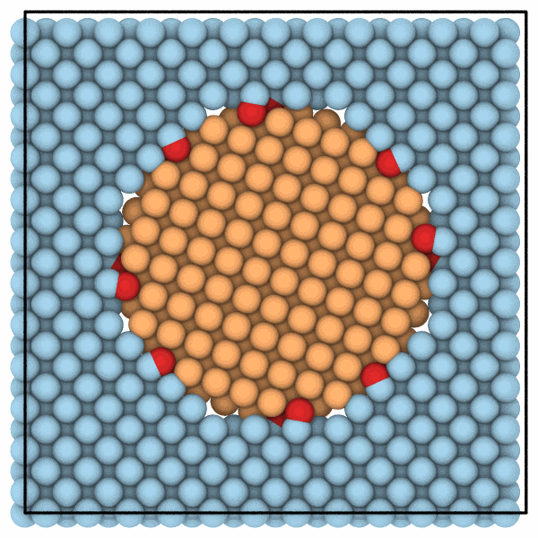

# Overlapping atoms

`mdapy.neighbor.find_overlapping` selects the atoms closer than a distance
to another atom, as OVITO's find overlapping particles modifier does: by
default the atom of the higher index of each such pair, so that deleting the
selection leaves no pair that close, or all of them with `keep_one=False`.
It finds the atoms that clash where structures are put together.

```python
import numpy as np

from mdapy.build import build_crystal
from mdapy.neighbor import find_overlapping
from mdapy.transform import affine, combine

crystal = build_crystal("fcc", 3.615, elements="Cu", repeat=(12, 12, 1))
center = crystal.box.matrix.sum(axis=0) / 2
inside = np.linalg.norm((crystal["positions"] - center)[:, :2], axis=1) < 14
c, s = np.cos(np.radians(25)), np.sin(np.radians(25))
rotation = np.array([[c, -s, 0], [s, c, 0], [0, 0, 1]])
grain = affine(crystal.filter(inside), rotation, center - rotation @ center, box=False)
merged = combine(crystal.filter(~inside), grain)  # the grain turned by 25°

too_close = find_overlapping(merged, 2.0)  # 16 atoms of the grain
every = find_overlapping(merged, 2.0, keep_one=False)  # 36, of both
cleaned = merged.filter(~too_close)  # no two atoms closer than 2 Å
```

The atoms of the grain that `find_overlapping` selects:

```python
from mdapy.visualization import assign_color, render

grain_atoms = np.arange(len(merged)) >= len(merged) - len(grain)
shown = assign_color(merged, "#9ecae1")
shown = assign_color(shown, "#fdae6b", atoms=grain_atoms)
shown = assign_color(shown, "#d62728", atoms=too_close)
render(shown, "images/overlapping.png", view="top", width=600, height=600)
```



*Copper seen along z: the crystal (blue), the grain turned by 25° in it
(orange), and the atoms of the grain closer than 2 Å to an atom of the
crystal (red).*

## Parameters

`find_overlapping(system, distance, *, keep_one=True, atoms=None)`

| Name | Type | Default | Unit | Meaning |
|---|---|---|---|---|
| `system` | `System` | | | the atoms and the box |
| `distance` | float | | Å | two atoms closer than this overlap |
| `keep_one` | bool | `True` | | select only the atom of the higher index of each pair that overlaps; `False` selects both |
| `atoms` | (N,) bool or indices | all | | the atoms considered; the others neither overlap nor are selected |

Distances are measured through the periodic boundaries, with the
[neighbor lists](neighbor.md) of mdapy; atoms on top of each other overlap.

## Results

A boolean mask of one value per atom. With `keep_one`, deleting the atoms
selected leaves no pair closer than `distance`, and of each group of atoms
that all overlap one another, as the copies of an atom, one is kept: that of
the lowest index. Along a chain of atoms each closer than `distance` to the
next only, every atom but the first is selected. OVITO keeps an atom of each
group picked at random, so the atoms it selects can differ from these, their
number in each group not.

## Errors

[`InvalidParameter`](../reference/api.md#mdapy.errors.InvalidParameter)
when `atoms` is not a mask or indices of the system, and as
[`NeighborList.build`](neighbor.md#building) for the distance.

## See also

- OVITO's [find overlapping particles](https://docs.ovito.org/reference/pipelines/modifiers/find_overlapping_particles.html).
- [Expanding a selection](expand-selection.md), [selecting atoms](selecting.md#masks).
