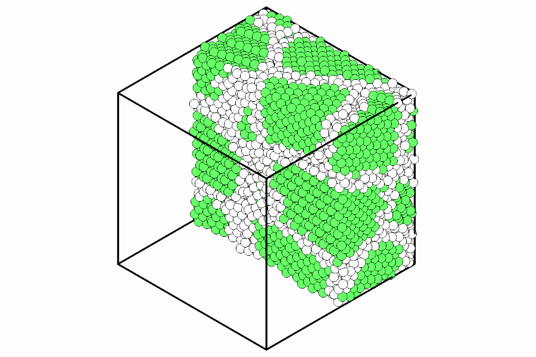

# Quick tour

This page builds a small copper crystal, writes and reads it, finds its
neighbors, computes its energy with a potential, relaxes it and writes the
result. Every block runs as shown, in order.

## A system

A `System` holds the atoms, as a table of columns, and the simulation box.

```python
import numpy as np

import mdapy as mp

a = 3.615  # Å
cells = np.stack(np.meshgrid(*[np.arange(3)] * 3, indexing="ij"), -1).reshape(-1, 1, 3)
basis = np.array([[0, 0, 0], [0.5, 0.5, 0], [0.5, 0, 0.5], [0, 0.5, 0.5]])
positions = ((cells + basis) * a).reshape(-1, 3)
system = mp.System(positions, mp.Box(3 * a), elements="Cu")
len(system), system.box.volume  # 108 atoms, Å^3
```

See [Systems and topology](system.md) and [Simulation box](box.md).

## Files

```python
mp.write("copper.xyz", system)
back = mp.read("copper.xyz")
np.abs(back["positions"] - system["positions"]).max()  # 0.0
```

See [Reading and writing files](io.md) and, for a whole trajectory,
[Trajectories](trajectory.md).

## Neighbors

```python
nl = mp.NeighborList.build(system, 3.0)
nl.counts  # 12 neighbors for every atom of fcc
nl.distances.min()  # a / sqrt(2)
```

See [Neighbor lists](neighbor.md).

## Energy and forces

```python
from mdapy.calculators import EAM

potential = EAM.zhou(["Cu"])
result = potential.compute(system, ("energy", "forces", "virial"))
result.energy / len(system)  # eV per atom
result.stress(system)  # (3, 3) GPa
```

See [Calculators](../simulation/calculators.md) and [EAM](../simulation/eam.md).

## Relaxation

The atoms are displaced at random, then the positions and the box relax to
the nearest minimum of the energy.

```python
from mdapy.simulation import minimize

rng = np.random.default_rng(0)
rattled = system.with_columns(
    positions=system["positions"] + rng.normal(scale=0.05, size=(108, 3))
)
relaxed = minimize(rattled, potential, cell="full")
relaxed.converged, relaxed.energy, relaxed.stress
mp.write("relaxed.xyz", relaxed.system)  # with forces, energy and stress
```

See [Energy minimization](../simulation/minimize.md).

## Analysis and pictures

A polycrystal, its grain boundaries found by common neighbor analysis and
drawn by the ray tracer:

```python
from mdapy.build import build_crystal, build_polycrystal
from mdapy.identify import CommonNeighborAnalysis
from mdapy.visualization import render

grains = build_polycrystal(
    build_crystal("fcc", a, elements="Cu"), mp.Box(60.0), 6, seed=4
)
structures = CommonNeighborAnalysis().compute(grains)
structures.counts()  # fcc, and other at the boundaries
render(
    grains,
    "images/quick-tour.png",
    atoms=grains["positions"][:, 0] < 30,  # the half at x < 30 Å
    color=structures,
    style="flat",
    width=900,
    height=600,
)
```



*Six grains of copper cut in half: fcc atoms green, grain boundaries white,
in the flat style.*

See [Building structures](../build/polycrystals.md), [Common neighbor
analysis](../analysis/cna.md) and [Rendering](../visualization/rendering.md).
