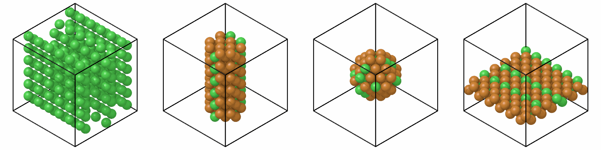

# Selecting and ordering atoms

Three methods make a system of some of the atoms of another, or of all of
them in another order:

| Method | Keeps | Order |
|---|---|---|
| `filter(*conditions, **equal)` | the atoms that meet every condition | as they were |
| `gather(atoms)` | the atoms of the given indices | as given |
| `sort(*by, descending=False)` | every atom | by the values of columns |

The names and their meaning are those of polars: `filter` keeps rows by a
condition, `gather` takes rows by index, `sort` orders them. `where` gives
the atoms of the conditions of `filter` as a [mask](#masks).

```python
import numpy as np
import polars as pl

import mdapy as mp
from mdapy.build import build_crystal

crystal = build_crystal("fcc", 3.615, elements="Cu", repeat=(6, 6, 6))
crystal = crystal.with_columns(
    element=np.where(np.arange(len(crystal)) % 4 == 0, "Ni", "Cu"),
    id=np.arange(len(crystal), 0, -1),
)

nickel = crystal.filter(element="Ni")
upper = crystal.filter("positions.z > 10")
core = crystal.filter("(positions.x - 10.8)**2 + (positions.y - 10.8)**2 < 25")
first_ten = crystal.gather(np.arange(10))
by_id = crystal.sort("id")
```

Each returns a new system with the same box and global information; the
system it was made from does not change. Bonds, angles and other
[topology](topology.md) terms follow their atoms: they are renumbered, and a
term loses its place when one of its atoms is left out.

## filter

`filter` keeps the atoms that meet every condition given, in their order.
A condition is one of:

| Condition | Example |
|---|---|
| a condition written as a Python expression over the columns | `"positions.z > 10 and element == 'Cu'"` |
| a column and the value it must equal, as a keyword | `element="Ni"`, `type=2` |
| a polars expression | `pl.col("charge") > 0` |
| a boolean NumPy array of one value per atom | `system["positions"][:, 2] > 10` |

Several conditions must all hold:

```python
upper_nickel = crystal.filter("positions.z > 10", element="Ni")
same = crystal.filter("positions.z > 10 and element == 'Ni'")
assert len(upper_nickel) == len(same)
```

Without a condition, `filter` keeps every atom. An atom whose value is
missing, such as a null in a column read from a file, does not meet a
condition.

### Conditions as text

A condition written as text is a Python expression in which the names are
columns. It is read with Python's own parser and turned into a polars
expression, so it is as fast as polars, and nothing in it is run as Python
code.

Text is needed because a condition such as `positions.z > 10` cannot be
written directly in Python: Python would compute `"z" > 10` before mdapy
sees it.

**Columns** are written by their names, `charge`, `type`, `element`.
A name that is not a Python name, such as one with a space, a bracket or a
leading digit, goes in backticks (the key left of 1), as in pandas:
`` `Shear Strain` > 0.1 ``. This is rarely needed: the columns of mdapy are
Python names, columns from OVITO become names in lowercase with
underscores, and LAMMPS columns such as `c_stress[1]` … `c_stress[6]` become
one array column `c_stress`. Outside an expression no backticks are needed:
`system["Shear Strain"]` reads the column as it is.

**Components** of array columns are written `column.component`, by name or
by index from 0:

| Components | Names | Example |
|---|---|---|
| 3 | `x`, `y`, `z` | `positions.z`, `velocities.x`, `forces.y`, `image.z` |
| 4 | `x`, `y`, `z`, `w` | `orientation.w` |
| 9 | `xx`, `xy`, `xz`, `yx`, `yy`, `yz`, `zx`, `zy`, `zz`, a 3 × 3 tensor by rows | `atomic_virials.xy` |
| any number | `0`, `1`, … | `positions.2`, `group.1` |

Columns of 6 components have no names, only indices: their order depends on
where they come from (LAMMPS writes per-atom stresses as xx, yy, zz, xy, xz,
yz; the Voigt order is xx, yy, zz, yz, xz, xy). mdapy itself keeps
per-atom tensors as 9 components.

**Values**: numbers, `True` and `False`, and text in quotes, `'Cu'` or
`"Cu"`. Elements compare as their symbols.

**Operators and functions**:

| Kind | Written | Example |
|---|---|---|
| comparisons | `==`, `!=`, `<`, `<=`, `>`, `>=`; chained as in Python | `0 < positions.z < 10` |
| logic | `and`, `or`, `not` | `type == 1 or not charge > 0` |
| membership | `in`, `not in` a list | `element in ['Cu', 'Ni']` |
| arithmetic | `+`, `-`, `*`, `/`, `//`, `%`, `**` (power) | `positions.x**2 + positions.y**2 < 25` |
| functions | `abs`, `sqrt`, `exp`, `log`, `log10`, `sin`, `cos`, `tan`, `arcsin`, `arccos`, `arctan`, `floor`, `ceil`, `round` | `abs(velocities.z) > 2` |

`&`, `|` and `~` also mean and, or and not, as in pandas, but they bind
tighter than comparisons, so each comparison needs parentheses:
`(type == 1) | (charge > 0)`.

The same expressions give values: `system["positions.x**2 + positions.y**2"]`
is the value of each atom, see
[Values by name](system.md#values-by-name).

More examples:

```python
sphere = crystal.filter(
    "sqrt((positions.x - 10.8)**2 + (positions.y - 10.8)**2 + (positions.z - 10.8)**2) < 6"
)
slab = crystal.filter("4 <= positions.z < 8")
fast = crystal.with_columns(
    velocities=np.random.default_rng(0).normal(0, 1, (len(crystal), 3))
).filter("velocities.x**2 + velocities.y**2 + velocities.z**2 > 4")
corners = crystal.filter("floor(positions.x / 3.615) % 2 == 0", element="Cu")
```

Four of these selections, each in the box of the whole crystal:

```python
from mdapy.visualization import render, write_png

size = {"width": 400, "height": 400}
pictures = [render(part, **size) for part in (nickel, core, sphere, slab)]
write_png("images/selecting.png", np.hstack(pictures))
```



*From the left: the nickel atoms, every fourth atom of the crystal; the
cylinder `core` of radius 5 Å along z; the `sphere` of radius 6 Å; the
`slab` between z = 4 and 8 Å.*

### Masks and polars expressions

A boolean mask computed with NumPy serves when a condition needs more than
one atom at a time, such as distances to other atoms:

```python
center = crystal["positions"].mean(axis=0)
distance = np.linalg.norm(crystal["positions"] - center, axis=1)
middle = crystal.filter(distance < 5.0)
```

A polars expression reaches everything polars does, for example the
components of a vector with `arr.get`:

```python
upper = crystal.filter(pl.col("positions").arr.get(2) > 10)
```

## Masks

`where` takes the same conditions as `filter` and gives the atoms that meet
them as a boolean mask, without making a new system. A mask is how analyses,
`render` and `reduce` take some of the atoms (their `atoms` argument), and
masks combine with `&`, `|` and `~`:

```python
nickel_mask = crystal.where(element="Ni")  # (N,) bool
upper_mask = crystal.where("positions.z > 10")
both = nickel_mask & upper_mask
others = ~both
assert (crystal.filter(both)["positions"] == crystal["positions"][both]).all()
```

`where()` without conditions is true for every atom.

## gather

`gather` takes the atoms of the given indices, in that order. Indices count
from 0; negative ones count from the end; each atom may be given once.

```python
last = crystal.gather([-1])
order = np.random.default_rng(1).permutation(len(crystal))
shuffled = crystal.gather(order)
back = shuffled.gather(np.argsort(order))  # the original order again
assert back.table.equals(crystal.table)
```

A boolean mask belongs to `filter`, which `gather` reminds when given one.

## sort

`sort` orders all atoms by the values of columns:

| Name | Type | Default | Meaning |
|---|---|---|---|
| `*by` | column names, `column.component`, or polars expressions | | the keys: atoms equal in the first are ordered by the second, and so on |
| `descending` | bool or one bool per key | `False` | sort from the largest |

```python
by_id = crystal.sort("id")
by_height = crystal.sort("positions.z")
layers = crystal.sort("positions.z", "positions.x", descending=[True, False])
by_element = crystal.sort("element")  # by atomic number: Ni (28) first, then Cu (29)
```

Atoms with equal keys keep their order, so sorting is repeatable. Elements
sort by atomic number, not alphabetically.

## After selecting or reordering

A per-atom result of an analysis, and a [neighbor list](neighbor.md), hold
one entry per atom in the order of the system they were computed for.

Attach a result with `with_columns` before selecting or reordering, and it
follows its atoms:

```python
from mdapy.identify import CommonNeighborAnalysis

structure = CommonNeighborAnalysis().compute(crystal)
labelled = crystal.with_columns(structure).sort("id")
labelled.table["structure"]  # in the new order
```

A neighbor list fits only the atoms it was built for. After `filter`,
`gather` or `sort`, `nl.fits(new)` is false and an analysis given that list
raises `InvalidParameter`; build a new list for the new system. Analyses
that are not given a list find the neighbors themselves and are not
affected.

```python
nl = mp.NeighborList.build(crystal, 3.0)
nl.fits(crystal)  # True
nl.fits(crystal.sort("id"))  # False: the atoms are in another order
```

## Errors

The three methods raise
[`InvalidParameter`](../reference/api.md#mdapy.errors.InvalidParameter)
with what went wrong:

| Cause | Message |
|---|---|
| an unknown column | `no column 'charge'; the columns are positions, element, id` |
| an array column without a component | `positions has 3 components; write one of positions.0, positions.1, positions.2, positions.x, positions.y, positions.z` |
| an unknown component | `stress has no component 'xx'; write one of stress.0, …` |
| text that is not a Python expression | `cannot read the condition 'type >': invalid syntax` |
| something conditions do not support | `Subscript is not supported in the condition 'positions[0] > 0'` |
| a condition that does not give true or false | `'type + 1' does not give true or false for each atom` |
| a mask of the wrong length or type | `a mask must hold 864 booleans, got int64 of shape (864,)` |
| indices out of range, repeated, or not integers | `atom index out of range for 864 atoms`, `atom indices must not repeat` |
| `sort` without a key | `give a column to sort by` |
