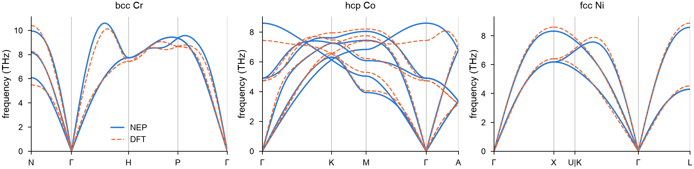
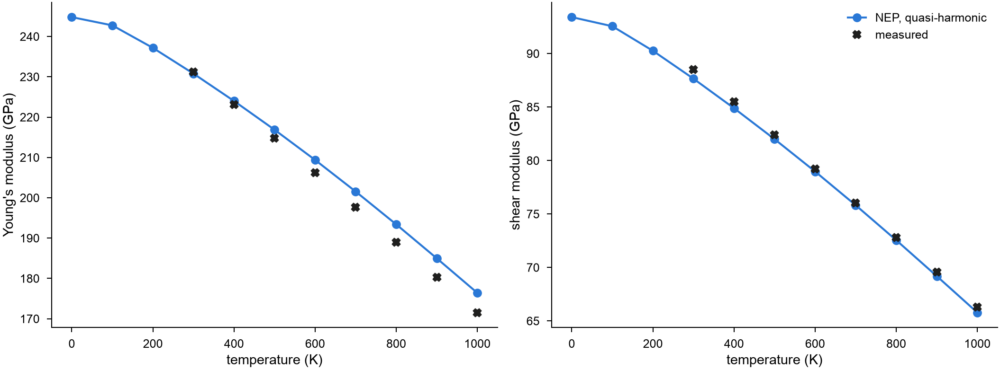

# A machine-learned potential for CrCoNi

A machine-learned potential is checked against the first-principles
calculations it learned from, and against measurements. This page takes the
NEP model for CrCoNi alloys of
[Wu et al. (2026)](../../reference/references.md#wu2026) and computes the
phonon dispersions of bcc Cr, hcp Co and fcc Ni, drawn over the DFT
dispersions (VASP and phonopy) of the same paper, and the elastic constants
of the CrCoNi alloy from 0 to 1000 K, against measured ones. See
[Phonons](../../simulation/phonons.md),
[Quasi-harmonic approximation](../../simulation/quasi-harmonic.md) and
[Elastic constants at finite temperature](../../simulation/thermal-elastic.md)
for the functions themselves.

!!! note "Cite the model and the data"

    The NEP model and the DFT dispersions come from
    [Wu et al. (2026)](../../reference/references.md#wu2026). Cite that
    paper when you use them.

<!-- files: crconi -->

Download the model [`nep.txt`](crconi/nep.txt) (a copy of the one in the
[NEP-CrCoNi repository](https://github.com/mushroomfire/NEP-CrCoNi), which
also holds the training data) and the DFT dispersions
[`Cr.band.dat`](crconi/Cr.band.dat), [`Co.band.dat`](crconi/Co.band.dat) and
[`Ni.band.dat`](crconi/Ni.band.dat), and [`SQS.xyz`](crconi/SQS.xyz), a
special quasirandom structure of equiatomic CrCoNi with 108 atoms, into the
working directory.

## Phonons of Cr, Co and Ni

### The crystals

Relax the conventional cell of each metal at zero pressure with the model,
and reduce it to its primitive cell:

```python
import numpy as np

from mdapy.build import build_crystal
from mdapy.calculators import NEP
from mdapy.lattice_dynamics import phonons, primitive_cell
from mdapy.simulation import minimize

nep = NEP("nep.txt")


def relaxed(element, structure, a):
    """The conventional cell of a metal, relaxed at zero pressure."""
    start = build_crystal(structure, a, elements=element)
    return minimize(start, nep, cell="full", max_force=1e-6, max_stress=1e-5).system


conventional = {
    "Cr": relaxed("Cr", "bcc", 2.84),
    "Co": relaxed("Co", "hcp", 2.49),
    "Ni": relaxed("Ni", "fcc", 3.52),
}
primitive = {element: primitive_cell(cell) for element, cell in conventional.items()}
for element, cell in conventional.items():
    print(element, np.round(np.linalg.norm(cell.box.matrix, axis=1), 4))
```

```text
Cr [2.843 2.843 2.843]
Co [2.494  2.494  4.0174]
Ni [3.5164 3.5164 3.5164]
```

### Phonons

The force constants come from displacements of the atoms in a supercell,
by default the most nearly cubic one at least twice the cutoff of the
model across:

```python
results = {element: phonons(cell, nep) for element, cell in primitive.items()}
for element, result in results.items():
    print(element, result)
```

```text
Cr Phonons(1 atom, supercell of 250 cells)
Co Phonons(2 atoms, supercell of 90 cells)
Ni Phonons(1 atom, supercell of 256 cells)
```

### Along the paths of the DFT calculations

The DFT dispersions follow the paths below. Their special points are given
in units of the reciprocal vectors of the conventional cells; a matrix takes
them to those of the primitive cells. The DFT path of Ni goes from U to K,
two equivalent points of the Brillouin zone, as a line of its own; here the
path breaks at U and starts again at K.

```python
paths = {
    "Cr": [[("N", [0.5, 0.5, 0]), ("Γ", [0, 0, 0]), ("H", [0, 1, 0]),
            ("P", [0.5, 0.5, 0.5]), ("Γ", [0, 0, 0])]],
    "Co": [[("Γ", [0, 0, 0]), ("K", [1 / 3, 1 / 3, 0]), ("M", [0.5, 0, 0]),
            ("Γ", [0, 0, 0]), ("A", [0, 0, 0.5])]],
    "Ni": [[("Γ", [0, 0, 0]), ("X", [0, 1, 0]), ("U", [0.25, 1, 0.25])],
           [("K", [0.75, 0.75, 0]), ("Γ", [0, 0, 0]), ("L", [0.5, 0.5, 0.5])]],
}  # fmt: skip

sections, bands = {}, {}
for element, path in paths.items():
    to_primitive = primitive[element].box.matrix @ np.linalg.inv(
        conventional[element].box.matrix
    )
    sections[element] = [[(name, to_primitive @ q) for name, q in s] for s in path]
    bands[element] = results[element].band_structure(sections[element], points=101)
```

### Against DFT

`read_band_structure` reads the band.dat files of phonopy. Each line
between two special points has 101 wave vectors in both, so the
frequencies compare point by point; the DFT lines are stretched onto the
lines of the model, whose lattice constants differ a little.

```python
from mdapy.lattice_dynamics import read_band_structure

dft = {element: read_band_structure(f"{element}.band.dat") for element in paths}


def lines(bands):
    """The distances and frequencies of each line between two special points."""
    n = len(bands.distances) // 101
    return list(zip(np.split(bands.distances, n), np.split(bands.frequencies, n)))


on_path = {}
for element in paths:
    theirs = lines(dft[element])
    if element == "Ni":
        del theirs[2]  # the line from U to K
    on_path[element] = [
        (np.interp(d, d[[0, -1]], x[[0, -1]]), frequencies)
        for (x, _), (d, frequencies) in zip(lines(bands[element]), theirs)
    ]
    difference = np.concatenate(
        [f - g for (_, f), (_, g) in zip(lines(bands[element]), on_path[element])]
    )
    print(f"{element}: {np.sqrt(np.mean(difference**2)):.2f} THz root mean square")
```

```text
Cr: 0.36 THz root mean square
Co: 0.34 THz root mean square
Ni: 0.17 THz root mean square
```

```python
from mdapy.visualization import plot

with plot.style():
    fig, axes = plot.figure("double", ncols=3)
    for ax, element, title in zip(axes, paths, ("bcc Cr", "hcp Co", "fcc Ni")):
        plot.band_structure(bands[element], ax=ax, color="#2a78d6")
        for x, frequencies in on_path[element]:
            ax.plot(x, frequencies, color="#eb6834", lw=0.8, ls="--")
        ax.set_title(title)
        ax.set_ylim(0, None)
    axes[0].plot([], [], color="#2a78d6", label="NEP")
    axes[0].plot([], [], color="#eb6834", lw=0.8, ls="--", label="DFT")
    axes[0].legend(frameon=False)
    plot.save(fig, "crconi-phonons", formats=("png",))
```



### Converged with the supercell?

Force constants beyond the supercell are left out. Check the dispersion of
Ni in a supercell of 6 × 6 × 6 conventional cells, given as a matrix of
primitive cells:

```python
matrix = 6 * conventional["Ni"].box.matrix @ np.linalg.inv(primitive["Ni"].box.matrix)
larger = phonons(primitive["Ni"], nep, supercell=np.rint(matrix).astype(int))
again = larger.band_structure(sections["Ni"], points=101)
change = np.abs(again.frequencies - bands["Ni"].frequencies).max()
print(larger, f"{change:.3f} THz")
```

```text
Phonons(1 atom, supercell of 864 cells) 0.018 THz
```

The default supercell is converged to some hundredths of a THz, well below
the differences from DFT; the largest of those, the highest optical branch
of Co at Γ, is the model's own.

## Elastic constants of CrCoNi

### At 0 K

Relax the special quasirandom structure at zero pressure, and compute its
elastic constants from the stress under small strains, the atoms relaxed
under each. The cell is cubic on average; average the constants over the
three equivalent directions:

```python
import mdapy
from mdapy.lattice_dynamics import ElasticResult, elastic_constants

start = mdapy.read("SQS.xyz")
sqs = minimize(
    start, nep, cell="full", max_force=1e-6, max_stress=1e-5, max_steps=20000
).system


def cubic(c):
    """C11, C12 and C44 averaged over the equivalent directions."""
    return (
        np.mean(np.diag(c)[:3]),
        np.mean(c[[0, 0, 1], [1, 2, 2]]),
        np.mean(np.diag(c)[3:]),
    )


static = elastic_constants(sqs, nep, max_force=1e-6)
print("C11 %.1f, C12 %.1f, C44 %.1f GPa" % cubic(static.constants))
```

```text
C11 288.6, C12 183.7, C44 143.8 GPa
```

### From 0 to 1000 K

The [quasi-harmonic approximation](../../simulation/quasi-harmonic.md)
gives the volume of the crystal at each temperature from the free energy
of its vibrations, and
[`thermal_elastic_constants`](../../simulation/thermal-elastic.md) the
elastic constants there, from the second derivatives of the static energy
and of the free energy of the vibrations under strain. The structure, 10.6 Å
across, is taken as its own supercell to keep this affordable; it takes
about 10 minutes on ten cores.

<!-- skip-test -->
```python
from mdapy.lattice_dynamics import quasi_harmonic, thermal_elastic_constants

temperatures = np.arange(0, 1001, 100.0)
qha = quasi_harmonic(sqs, nep, temperatures, supercell=1, mesh=4)
thermal = thermal_elastic_constants(qha, nep, supercell=1, mesh=4)
print("0 K: C11 %.1f, C12 %.1f, C44 %.1f GPa" % cubic(thermal.isothermal[0]))
print(
    f"{qha.volume[0] * len(sqs) / sqs.box.volume - 1:.2%} larger than the static cell"
)
```

```text
0 K: C11 283.2, C12 181.1, C44 140.1 GPa
0.52% larger than the static cell
```

At 0 K the two methods differ by 2 to 3 % on the same structure: the
vibrations of the atoms at zero point expand the crystal by 0.5 %, which
softens it, while the strains of `elastic_constants` act on the static
crystal. At the same volume, the second derivatives of the energy and the
stresses under strain give the same constants to 0.1 GPa.

### Against measurements

Measurements of the elastic moduli by resonant ultrasound are adiabatic,
too fast for heat to flow; take the adiabatic constants and their
Voigt–Reuss–Hill averages, and compare them with the fits of
[Laplanche et al. (2018)](../../reference/references.md#laplanche2018) to
their measurements of CrCoNi:

<!-- skip-test -->
```python
moduli = [ElasticResult(c) for c in thermal.adiabatic]
bulk = np.array([m.bulk_modulus() for m in moduli])
shear = np.array([m.shear_modulus() for m in moduli])
young = 9 * bulk * shear / (3 * bulk + shear)

measured = np.arange(300, 1001, 100.0)
einstein = 1 / (np.exp(362 / measured) - 1)
young_measured, shear_measured = 244.9 - 32 * einstein, 93.6 - 11.9 * einstein
for t in (300, 600, 900):
    k, m = np.flatnonzero(temperatures == t)[0], np.flatnonzero(measured == t)[0]
    print(
        f"{t} K: E {young[k]:.1f} ({young_measured[m]:.1f}),"
        f" G {shear[k]:.1f} ({shear_measured[m]:.1f}) GPa"
    )

with plot.style():
    fig, axes = plot.figure("double", ncols=2)
    for ax, model, fit, name in zip(
        axes,
        (young, shear),
        (young_measured, shear_measured),
        ("Young's modulus (GPa)", "shear modulus (GPa)"),
    ):
        ax.plot(temperatures, model, "-o", color="#2a78d6", label="NEP, quasi-harmonic")
        ax.plot(measured, fit, "X", color="#1f1f1e", label="measured")
        ax.set_xlabel("temperature (K)")
        ax.set_ylabel(name)
    axes[1].legend(frameon=False)
    plot.save(fig, "crconi-moduli", formats=("png",))
```

```text
300 K: E 230.8 (231.2), G 87.7 (88.5) GPa
600 K: E 209.4 (206.3), G 79.0 (79.2) GPa
900 K: E 185.0 (180.3), G 69.2 (69.6) GPa
```



The shear modulus follows the measurements to 1 GPa from 300 to 1000 K;
Young's modulus departs from them as the temperature rises, by 3 % at
900 K.
