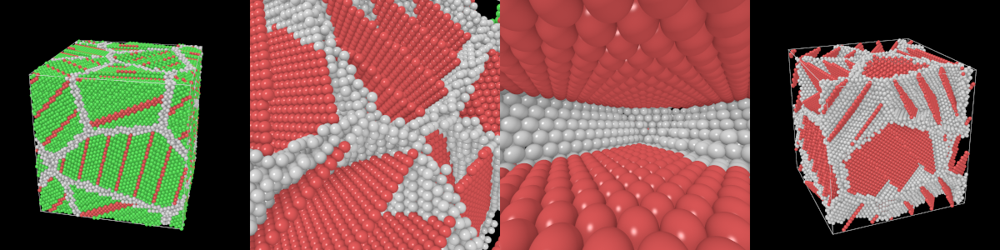

# A movie that flies through a crystal

A picture from [`render`](../../visualization/rendering.md) is a NumPy array, and
everything about it may change from one picture to the next. A movie is therefore a
loop. In this one a plane sweeps through a polycrystal of nanotwinned copper and takes
the fcc atoms away, the camera flies in and along the channel between two twin planes,
comes out at the side, and turns around what is left while the crystal comes back.

<video controls loop muted playsinline preload="metadata" style="width: 100%">
  <source src="../images/movie.mp4" type="video/mp4">
</video>

*Fcc atoms in green, twin planes (hcp) in red and grain boundaries in white, from
[common neighbor analysis](../../analysis/cna.md).*

## The crystal

Six grains of twin lamellae, six planes thick, in a box of 100 Å, and the structure
of each atom:

```python
import numpy as np

import mdapy as mp
from mdapy.build import build_crystal, build_polycrystal, twin_lamellae
from mdapy.identify import CommonNeighborAnalysis

layers = build_crystal(
    "fcc", 3.615, elements="Cu", orientation=[(1, 1, -2), (-1, 1, 0), (1, 1, 1)]
)
grains = build_polycrystal(twin_lamellae(layers, 6), mp.Box(100.0), 6, seed=4)
structures = CommonNeighborAnalysis().compute(grains)
print(len(grains))
```

```text
82001
```

Keep the system small for the size of the movie, so that each atom covers many
pixels: here about 15, seen from outside. Atoms of a few pixels are not only blurred.
Through a perspective camera the rows of atoms at different depths interfere with
each other, and large rings of light and dark sweep over the crystal as the camera
turns.

## The channel

The camera flies between two twin planes. The twin atom nearest the middle of the box
tells the grain and the plane: of the atoms around it the direction of least spread
is the normal, and of the atoms of the plane the direction of most spread is the way
with the longest flight. The next plane is six atomic planes further.

```python
positions = grains["positions"]
middle = np.full(3, 50.0)
crystal = structures.structure == 1
twins = structures.structure == 2

nearest = np.flatnonzero(twins)[
    np.linalg.norm(positions[twins] - middle, axis=1).argmin()
]
grain = twins & (np.asarray(grains["grain"]) == grains["grain"][nearest])
around_it = grain & (np.linalg.norm(positions - positions[nearest], axis=1) < 10.0)
center = positions[around_it].mean(axis=0)
normal = np.linalg.svd(positions[around_it] - center)[2][2]
plane = grain & (np.abs((positions - center) @ normal) < 1.0)
plane_center = positions[plane].mean(axis=0)
ahead = np.linalg.svd(positions[plane] - plane_center)[2][0]
normal = normal if normal[2] > 0 else -normal  # up in the picture
ahead = ahead if ahead[2] < 0 else -ahead  # in from above

gap = 6 * 3.615 / np.sqrt(3)
next_plane = np.abs((positions[grain] - center) @ normal - gap) < 1.0
channel = plane_center + normal * gap / 2 * (1 if next_plane.any() else -1)
reach = (positions[plane] - plane_center) @ ahead
```

## The path of the camera

The camera is a table: at each time where it is, what it looks at, which way is up
and how wide it sees. It widens on the way in, to 78°, and narrows on the way out.
`spline` draws a smooth curve through the table. After the flight the camera goes
nearly all the way around on a circle, from where it left to where the movie started,
so that the movie loops without a seam.

```python
SECONDS = 18
UP = np.array([0.0, 0.0, 1.0])


def ease(t):
    t = np.clip(t, 0.0, 1.0)
    return t * t * (3 - 2 * t)


def on_circle(angle):
    """The point at this angle of a circle around the box, looking at the middle."""
    look = np.array([np.cos(angle), np.sin(angle), -0.42])
    return middle - look / np.linalg.norm(look) * 345.0


def spline(times, values, t):
    """A smooth curve through the values at the times, at the time t."""
    times, values = np.asarray(times), np.asarray(values, dtype=float)
    k = np.clip(np.searchsorted(times, t, side="right") - 1, 0, len(times) - 2)

    def slope(i):
        a, b = max(i - 1, 0), min(i + 1, len(times) - 1)
        return (values[b] - values[a]) / (times[b] - times[a])

    h = times[k + 1] - times[k]
    s = (t - times[k]) / h
    return (
        (2 * s**3 - 3 * s**2 + 1) * values[k]
        + (s**3 - 2 * s**2 + s) * h * slope(k)
        + (-2 * s**3 + 3 * s**2) * values[k + 1]
        + (s**3 - s**2) * h * slope(k + 1)
    )


side = np.cross(normal, ahead) / np.linalg.norm(np.cross(normal, ahead))
side = side if side @ (middle - channel) < 0 else -side  # away from the middle
stop = channel + ahead * reach.max() * 0.45
leave = stop + side * 60 + UP * 12
outside = middle + (leave - middle) / np.linalg.norm(leave - middle) * 210
leaving = np.arctan2(*(middle - outside)[1::-1])
first, last = leaving - 0.35, leaving - 0.35 + 2 * np.pi
start = on_circle(first)
into = channel + ahead * reach.min() * 0.35

# seconds, the eye, what it looks at, up, the vertical angle of view in degrees
TABLE = [
    (0.0, start, middle, UP, 30),
    (1.5, middle + (start - middle) * 0.9, middle, UP, 30),
    (3.0, channel - ahead * 150, channel, 0.6 * normal + 0.4 * UP, 38),
    (4.2, channel + ahead * (reach.min() - 14), channel, normal, 68),
    (6.0, into, into + ahead * 30, normal, 78),
    (8.0, stop, stop + ahead * 30, normal, 78),
    (
        9.0,
        stop + side * 22 - ahead * 4,
        0.75 * (stop + ahead * 14) + 0.25 * middle,
        normal,
        70,
    ),
    (10.0, leave, middle, UP, 55),
    (11.0, outside, middle, UP, 40),
    (12.0, on_circle(leaving), middle, UP, 30),
]


def camera(seconds):
    if seconds >= 12.0:
        angle = leaving + (last - leaving) * ease((seconds - 12.0) / 6.0)
        return on_circle(angle), middle, UP, 30.0
    times = [row[0] for row in TABLE]
    return [spline(times, [row[i] for row in TABLE], seconds) for i in (1, 2, 3, 4)]
```

## One frame

Everything that changes goes into a function of the number of the frame:

- `gone` holds the fcc atoms behind the plane that sweeps through and back, `wipe` telling
  how far it has gone;
- `close` holds the atoms the camera would hit: hidden, they do not fill the picture;
- `focus` and `span` place the eye, as far back from the focus as shows the span there
  at this angle of view, here 20 Å;
- the edges of the box go while the camera is near them, where they would be thick
  bars.

Inside, the light is the hard part. `shiny` lets light bounce, and no light comes down
a channel between planes: it would be black. `bounces=0` lights each atom directly, and
`ao_distance` keeps the shading of occlusion to the atoms next to it.

```python
from mdapy.visualization import render, write_png

FRAMES = 30 * SECONDS
sweep = np.array([1.0, 0.6, 0.35]) / np.linalg.norm([1.0, 0.6, 0.35])
along = (positions - middle) @ sweep
furthest = 1.02 * np.abs(along).max()


def frame(k, **options):
    seconds = k / 30
    eye, target, up, fov = camera(seconds)
    look = (target - eye) / np.linalg.norm(target - eye)
    wipe = ease((seconds - 0.5) / 3.0) - ease((seconds - 13.5) / 3.5)
    gone = crystal & (along < (2 * wipe - 1) * furthest)
    close = np.linalg.norm(positions - eye, axis=1) < 3.6
    return render(
        grains,
        atoms=~(gone | close),
        color=structures,
        style="shiny",
        bounces=0,
        ambient=0.45,
        base_light=0.05,
        ao_distance=6.0,
        shadows=False,
        view=look,
        up=up,
        perspective=True,
        fov=float(fov),
        focus=eye + look * 20.0,
        span=2 * 20.0 * np.tan(np.radians(float(fov)) / 2),
        background="black",
        box=bool(np.abs(eye - middle).max() > 100),
        box_color="white",
        device="auto",
        **options,
    )


pictures = [frame(k, width=300, height=300) for k in (0, 90, 180, 396)]
write_png("images/movie_frames.png", np.hstack(pictures))
```



*The frames 0, 90, 180 and 396. Try a few frames like this, small, before the whole
movie, and look at them in order: at every sixteenth frame it takes seconds.*

## The whole movie

[`write_movie`](../../visualization/movies.md) takes the pictures one by one from a
generator and gives them to [FFmpeg](https://ffmpeg.org), which must be installed:

<!-- skip-test -->
```python
from mdapy.visualization import write_movie

pictures = (frame(k, width=1080, height=1080) for k in range(FRAMES))
write_movie("movie.mp4", pictures, fps=30)
```

`device="auto"` draws them on the GPU when there is one, which matters here: the 540
frames take 15 minutes on an NVIDIA RTX A2000, and about 3 hours on the processor, an
Intel Core i5-12600K.

## Other movies

The same loop makes other movies with a line or two:

- a trajectory: read `frames = mp.read_trajectory("run.dump")` and draw `frames[k]`
  in each picture, so that the camera moves while the atoms do;
- another look: a [style or its settings](../../visualization/rendering.md), such as
  `aperture` for a depth of field;
- another subject: any `color` and `atoms`, such as the
  [dislocations](../../analysis/dislocations.md) of a system with `dislocations=`.
