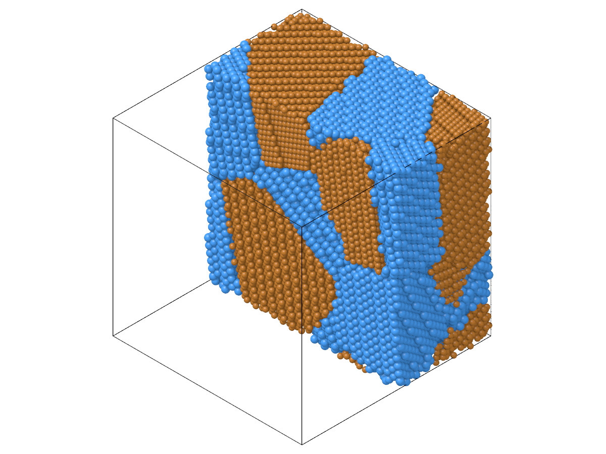

# A polycrystal of fcc and bcc grains

`build_polycrystal` fills every grain with the same crystal. For grains of
two phases, build the polycrystal twice with the same seeds and
orientations, once from each crystal: both then have the same grains, and
each grain can be taken from either. This page builds a nanocomposite of
copper (fcc) and tantalum (bcc) grains, removes the atoms that come too
close where the phases meet, and checks each grain with common neighbor
analysis.

## The same grains twice

```python
import numpy as np
import polars as pl

import mdapy
from mdapy.build import build_crystal, build_polycrystal, random_rotations

box = mdapy.Box(100.0)
grains = 8
seeds = np.random.default_rng(7).random((grains, 3)) * 100.0
rotations = random_rotations(grains, seed=8)

copper = build_crystal("fcc", 3.615, elements="Cu")
tantalum = build_crystal("bcc", 3.303, elements="Ta")
fcc = build_polycrystal(copper, box, seeds, orientations=rotations)
bcc = build_polycrystal(tantalum, box, seeds, orientations=rotations)
```

Both have a `grain` column, numbered as the seeds. Take grains 0 to 3
from the copper polycrystal and the others from the tantalum one, and join
the two tables:

```python
in_copper = [0, 1, 2, 3]
table = pl.concat(
    [
        fcc.table.filter(pl.col("grain").is_in(in_copper)),
        bcc.table.filter(~pl.col("grain").is_in(in_copper)),
    ]
)
composite = mdapy.System(table=table, box=fcc.box)
```

## Atoms too close

Inside one polycrystal, `build_polycrystal` already removed the atoms of
neighboring grains that came too close. Where a copper grain meets a
tantalum grain the two crystals were built separately, so atoms of the two
can overlap. Of each pair closer than 0.7 times the nearest distance of
copper, remove the later atom, as `build_polycrystal` does:

```python
from mdapy.neighbor import NeighborList

close = NeighborList.build(composite, 0.7 * 3.615 / np.sqrt(2))
later = np.unique(np.maximum(close.i, close.j))
composite = composite.select(np.setdiff1d(np.arange(len(composite)), later))
len(later), len(composite)  # 638 atoms removed, 66 672 left
```

## The structure of each grain

Common neighbor analysis tells fcc from bcc. Attach the result as a column
and count the structures in each grain with polars:

```python
from mdapy.identify import CommonNeighborAnalysis

cna = CommonNeighborAnalysis().compute(composite)
labelled = composite.with_columns(cna)
counts = (
    labelled.table.group_by("grain", "element")
    .agg(
        atoms=pl.len(),
        fcc=(pl.col("structure") == 1).mean(),
        bcc=(pl.col("structure") == 3).mean(),
    )
    .sort("grain")
)
print(counts)
```

The copper grains come out about 70 % fcc and the tantalum grains about
70 % bcc; the rest are atoms at the boundaries, whose neighbors fit
neither structure.

## A picture

Color the atoms by structure and cut the box in half to see inside:

```python
from mdapy.visualization import render

front = composite.positions[:, 0] < 50.0
render(composite, "composite.png", atoms=front, color=cna, width=1200, height=900)
render(composite, "elements.png", atoms=front, width=1200, height=900)
```

| By structure: fcc green, bcc blue, others white | By element |
|---|---|
|  |  |

Before a simulation, relax the composite with a potential made for both
elements (see [Energy minimization](../../simulation/minimize.md)): the
boundaries between the phases rearrange, and how much depends strongly on
the potential.
