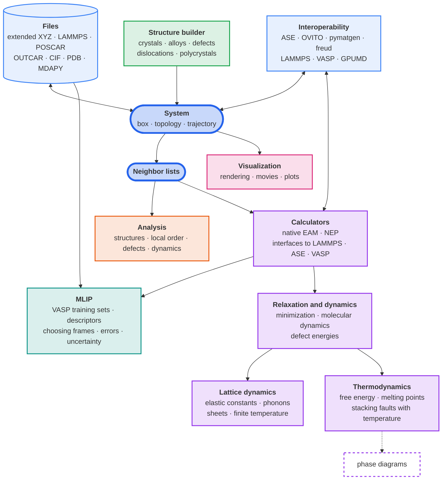

# { width="420" } { width="420" } { .logo }

**MDAPY**, short for *Molecular Dynamics Analysis in Python*, builds, analyzes,
simulates and visualizes atomistic systems.

!!! note "MDAPY 2.0 is a complete rewrite"
    It is not compatible with MDAPY 1.x. It brings many more features, and we recommend
    upgrading. The code of 1.x stays on the branch [`1.x`](https://github.com/mushroomfire/mdapy/tree/1.x).

If you like MDAPY, please give it a ⭐ [star](https://github.com/mushroomfire/mdapy).

## 💡 Why MDAPY

- **Light.** [NumPy](https://numpy.org) and [polars](https://pola.rs) are its only
  requirements. Packages such as [matplotlib](https://matplotlib.org) or
  [ASE](https://wiki.fysik.dtu.dk/ase/) are optional, and it carries no other
  third-party code.
- **Robust.** Tests cover more than 99 % of the code and compare each feature with analytic
  results and with mature software. Results are the same for any number of threads, and damaged files or
  impossible inputs give a clear error, not a crash.
- **Fast.** The heavy parts run in C++, on a parallel engine of MDAPY's own. See the
  [benchmarks](about/performance/comparison.md).
- **Predictable.** Names say what the code does: `minimize`, `elastic_constants`,
  `CommonNeighborAnalysis`. A `System` never changes in place, every analysis has the form
  `compute(system)` and returns NumPy arrays, each concept has one name
  ([Glossary](reference/glossary.md)), and one unit system, Å, eV, ps, amu, K, and GPa for
  stress, runs through everything ([Units and conventions](reference/units.md)).
- **Integrated.** One package and one `System`, from the first structure to the last
  picture. It converts systems to and from [ASE](https://wiki.fysik.dtu.dk/ase/),
  [OVITO](https://www.ovito.org), [pymatgen](https://pymatgen.org) and
  [freud](https://freud.readthedocs.io), reads and writes the files of
  [LAMMPS](https://www.lammps.org), [VASP](https://www.vasp.at) and
  [GPUMD](https://gpumd.org), takes any ASE calculator or LAMMPS interaction as a
  calculator ([Interoperability](user-guide/interop/ase.md)), shares a process with
  [PyTorch](https://pytorch.org) ([Parallelism](basics/parallelism.md)), and
  works as one step of
  [high-throughput calculations](examples/high-throughput.md).
- **Documented.** Every feature has its own page on how to use it and, for analyses, what
  it computes and which papers it follows, and
  [lessons](getting-started/learn/table.md) lead from the first structure on.

## 🧰 What it does

Structures come from files or are built, live in a `System`, and its neighbors feed the
analyses and the calculators. Dashed parts are planned.



<div class="grid cards" markdown>

-   :material-rocket-launch-outline:{ .lg .middle } **Getting started**

    ---

    Install MDAPY, take the quick tour and learn it in six short lessons.

    [Installation](getting-started/installation.md) ·
    [Quick tour](getting-started/quick-tour.md)

    Learn MDAPY in six short lessons: [a crystal is a table](getting-started/learn/table.md) ·
    [asking the atoms questions](getting-started/learn/analyses.md) ·
    [from numbers to figures](getting-started/learn/figures.md) ·
    [energies and relaxation](getting-started/learn/energy.md) ·
    [a nanoparticle melts](getting-started/learn/trajectories.md) ·
    [your own files](getting-started/learn/your-files.md) ·
    [cheat sheet](getting-started/learn/cheat-sheet.md)

-   :material-atom:{ .lg .middle } **Basics**

    ---

    Systems, files, trajectories and neighbor lists: what every user needs.

    System: [Systems](basics/system.md) ·
    [selecting and ordering atoms](basics/selecting.md) ·
    [expanding a selection](basics/expand-selection.md) ·
    [overlapping atoms](basics/overlapping.md) ·
    [changing a system](basics/changing.md) ·
    [topology](basics/topology.md) ·
    [simulation box](basics/box.md)

    [Reading and writing files](basics/io.md) ·
    [Trajectories](basics/trajectory.md) ·
    [Neighbor lists](basics/neighbor.md) ·
    [Parallelism](basics/parallelism.md)

-   :material-flask-outline:{ .lg .middle } **Examples**

    ---

    Whole calculations from start to end.

    [fcc and bcc grains](examples/two-phase-polycrystal.md) ·
    [columnar grains](examples/columnar-polycrystal.md) ·
    [defect energies of copper](examples/defect-energies.md) ·
    [screening alloys in many processes](examples/high-throughput.md) ·
    [a movie that flies through a crystal](examples/movie.md) ·
    [sharing neighbor lists](examples/neighbor-lists.md)

-   :material-cube-outline:{ .lg .middle } **Structure builder**

    ---

    Build crystals, alloys, defects, dislocations and polycrystals, and transform them.

    [Crystals](user-guide/build/crystals.md) · [random alloys](user-guide/build/alloys.md) ·
    [SQS](user-guide/build/sqs.md) · [point defects and faults](user-guide/build/defects.md) ·
    [surfaces and slip systems](user-guide/build/slip-systems.md) ·
    [dislocations](user-guide/build/dislocations.md) ·
    [polycrystals](user-guide/build/polycrystals.md) ·
    [graphene on grain boundaries](user-guide/build/graphene.md) ·
    [periodic copies and images](user-guide/build/transform.md) ·
    [slices](user-guide/build/slice.md) ·
    [affine transformation](user-guide/build/affine.md)

-   :material-chart-bell-curve-cumulative:{ .lg .middle } **Analysis**

    ---

    Identify structures and measure order, defects and dynamics.

    [Overview](user-guide/analysis/overview.md)

    Structure identification: [common neighbor analysis](user-guide/analysis/cna.md) ·
    [Ackland–Jones](user-guide/analysis/ackland-jones.md) ·
    [polyhedral template matching](user-guide/analysis/ptm.md) ·
    [planar faults](user-guide/analysis/planar-faults.md) ·
    [grain segmentation](user-guide/analysis/grain-segmentation.md) ·
    [diamond](user-guide/analysis/diamond.md) · [CHILL+](user-guide/analysis/chill-plus.md) ·
    [centro-symmetry](user-guide/analysis/csp.md) ·
    [common neighbor parameter](user-guide/analysis/cnp.md) ·
    [space group](user-guide/analysis/space-group.md)

    Local order and distributions: [radial distribution](user-guide/analysis/rdf.md) ·
    [coordination](user-guide/analysis/coordination.md) ·
    [structure factor](user-guide/analysis/structure-factor.md) ·
    [bond angles](user-guide/analysis/bond-angles.md) ·
    [Warren–Cowley](user-guide/analysis/warren-cowley.md) ·
    [Steinhardt](user-guide/analysis/steinhardt.md) ·
    [entropy fingerprint](user-guide/analysis/entropy.md) ·
    [Voronoi](user-guide/analysis/voronoi.md) ·
    [spatial binning](user-guide/analysis/spatial-binning.md)

    Defects and deformation: [clusters](user-guide/analysis/clusters.md) ·
    [surface mesh](user-guide/analysis/surface-mesh.md) ·
    [dislocations](user-guide/analysis/dislocations.md) (experimental) ·
    [chemical species](user-guide/analysis/species.md) ·
    [Wigner–Seitz](user-guide/analysis/wigner-seitz.md) ·
    [atomic displacement](user-guide/analysis/displacement.md) ·
    [atomic strain](user-guide/analysis/atomic-strain.md)

    Dynamics: [mean squared displacement](user-guide/analysis/msd.md) ·
    [Lindemann index](user-guide/analysis/lindemann.md) ·
    [Time averages](user-guide/analysis/time-average.md) ·
    [Trajectory lines](user-guide/analysis/trajectory-lines.md) ·
    [atomic temperature](user-guide/analysis/temperature.md)

-   :mdapy-simulation:{ .lg .middle } **Simulation**

    ---

    Energies and forces from potentials, minimization, lattice dynamics and free
    energies.

    Calculators: [the interface](user-guide/simulation/calculators.md) ·
    [EAM](user-guide/simulation/eam.md) · [NEP](user-guide/simulation/nep.md) ·
    [LAMMPS](user-guide/simulation/lammps.md) · [VASP](user-guide/simulation/vasp.md)

    Minimization and dynamics: [energy minimization](user-guide/simulation/minimize.md) ·
    [molecular dynamics](user-guide/simulation/dynamics.md) ·
    [defect energies](user-guide/simulation/defect-energies.md)

    Thermodynamics: [free energy](user-guide/simulation/free-energy.md) ·
    [melting point](user-guide/simulation/melting-point.md) ·
    [stacking faults at finite temperature](user-guide/simulation/stacking-fault-temperature.md)

    Lattice dynamics: [elastic constants](user-guide/simulation/elastic-constants.md) ·
    [phonons](user-guide/simulation/phonons.md) ·
    [at finite temperature](user-guide/simulation/thermal-phonons.md) ·
    [quasi-harmonic approximation](user-guide/simulation/quasi-harmonic.md) ·
    [elastic constants at finite temperature](user-guide/simulation/thermal-elastic.md) ·
    [from molecular dynamics](user-guide/simulation/md-elastic.md) ·
    [sheets](user-guide/simulation/sheets.md)

-   :material-sine-wave:{ .lg .middle } **MLIP**

    ---

    Training data for machine-learned potentials.

    [Training sets from VASP](user-guide/mlip/vasp.md) · [SOAP descriptors](user-guide/mlip/soap.md) ·
    [choosing frames](user-guide/mlip/selection.md) · [errors of a model](user-guide/mlip/errors.md) ·
    [uncertainty and novelty](user-guide/mlip/uncertainty.md) · [checking frames](user-guide/mlip/checks.md) ·
    [perturbed structures](user-guide/mlip/perturbation.md)

-   :material-palette-outline:{ .lg .middle } **Visualization**

    ---

    Images of systems, colored by any property, and plots of results.

    [Rendering](user-guide/visualization/rendering.md) · [movies](user-guide/visualization/movies.md) ·
    [coloring atoms](user-guide/visualization/colors.md) ·
    [coordination polyhedra](user-guide/visualization/polyhedra.md) · [plots](user-guide/visualization/plots.md)

-   :material-puzzle-outline:{ .lg .middle } **Interoperability**

    ---

    Systems and calculators shared with other packages, and the files of
    simulation programs.

    Packages: [ASE](user-guide/interop/ase.md) ·
    [ASE calculators](user-guide/interop/ase-calculators.md) ·
    [OVITO](user-guide/interop/ovito.md) · [pymatgen](user-guide/interop/pymatgen.md) ·
    [freud](user-guide/interop/freud.md)

    Programs: [LAMMPS](user-guide/interop/lammps.md) · [VASP](user-guide/interop/vasp.md) ·
    [GPUMD](user-guide/interop/gpumd.md)

-   :material-speedometer:{ .lg .middle } **Performance**

    ---

    Timings of MDAPY and of other programs, from thousands to millions of
    atoms.

    [Analyses: OVITO and freud](about/performance/comparison.md) ·
    [reading and writing files: OVITO and ASE](about/performance/files.md) ·
    [building structures: Atomsk](about/performance/builders.md)

-   :material-book-open-variant:{ .lg .middle } **Reference**

    ---

    File formats, units, the glossary, the papers and the Python API.

    [CIF](reference/formats/cif.md) ·
    [Extended XYZ](reference/formats/extxyz.md) ·
    [LAMMPS data](reference/formats/lammps-data.md) ·
    [LAMMPS dump](reference/formats/lammps-dump.md) ·
    [PDB](reference/formats/pdb.md) ·
    [VASP OUTCAR](reference/formats/outcar.md) ·
    [VASP POSCAR](reference/formats/poscar.md) ·
    [MDAPY files](reference/formats/mdapy.md)

    [Units and conventions](reference/units.md) ·
    [Elements](reference/elements.md) · [Glossary](reference/glossary.md) ·
    [References](reference/references.md) · [Python API](reference/api/index.md)

</div>

## 📦 Install

```bash
pip install mdapy
```

[Installation](getting-started/installation.md) describes the other ways to install it, what
those need, and the optional packages.

## 🧪 Tests

More than 99 % of the code is tested. [Contributing](about/contributing.md) says how to
run the tests and what a complete run needs.

## 📖 Citing MDAPY

If MDAPY contributes to a publication, please cite
[Wu and Shao (2023)](reference/references.md#wu2023), and the papers that
the pages of the features you use ask to cite.

See the [release notes](about/release-notes.md) for what each
development version contains.
