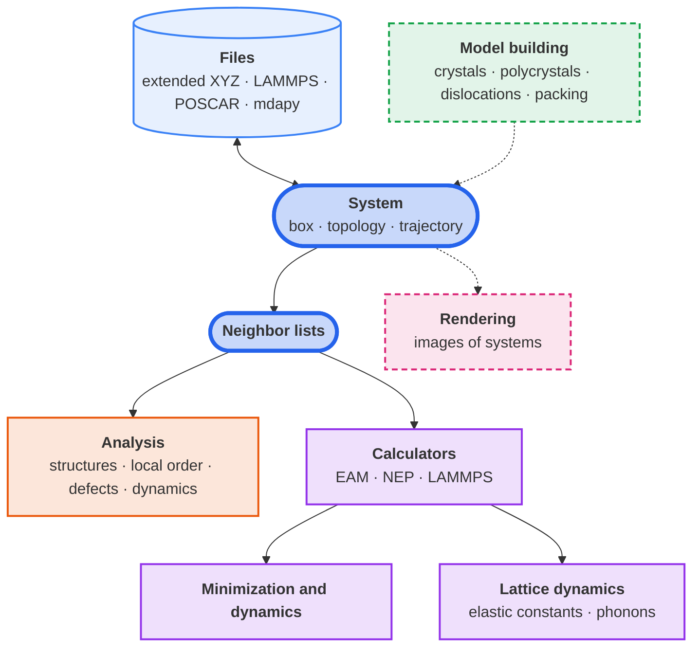

# mdapy

mdapy is a Python package for analysing and modelling atomistic simulations:
reading and writing structures and trajectories, neighbor search, structure
identification, property analysis, structure building, and energy
minimization with interatomic potentials.

!!! warning "mdapy 2.0 is under development"
    This site documents mdapy 2.0, a complete rewrite on the `v2` branch that is
    not compatible with mdapy 1.x. Features are added one at a time, each with
    its own tests and documentation page. For the stable release use
    [mdapy 1.0.8](https://pypi.org/project/mdapy/1.0.8/).

## What mdapy does

Structures come from files or are built, live in a `System`, and its
neighbors feed the analyses and the calculators. Dashed parts are planned.

-   :material-rocket-launch-outline:{ .lg .middle } **Getting started**

    ---

    Install mdapy, take the quick tour and learn the basics.

    [Installation](getting-started/installation.md) ·
    [Quick tour](getting-started/quick-tour.md)

    [Systems and topology](getting-started/system.md) ·
    [Simulation box](getting-started/box.md) ·
    [Reading and writing files](getting-started/io.md) ·
    [Trajectories](getting-started/trajectory.md) ·
    [Neighbor lists](getting-started/neighbor.md) ·
    [Parallelism](getting-started/parallelism.md)

-   :material-chart-bell-curve-cumulative:{ .lg .middle } **Analysis**

    ---

    Identify structures and measure order, defects and dynamics.

    [Overview](analysis/overview.md)

    Structure identification: [CNA, CSP, diamond and CHILL+](analysis/structure.md)

    Local order and distributions:
    [radial distribution, coordination and structure factor](analysis/distribution.md) ·
    [bond-orientational order](analysis/steinhardt.md) ·
    [entropy fingerprint](analysis/entropy.md) ·
    [clusters, bond angles and short-range order](analysis/bonds.md)

    Defects and deformation: [point defects](analysis/defects.md) ·
    [atomic strain](analysis/strain.md)

    Dynamics: [atomic temperature](analysis/temperature.md)

-   :material-cube-outline:{ .lg .middle } **Model building**

    ---

    Build crystals, polycrystals, dislocations and packed molecules.

    Planned.

-   :material-atom-variant:{ .lg .middle } **Simulation**

    ---

    Energies and forces from potentials, minimization and lattice dynamics.

    Calculators: [the interface](simulation/calculators.md) ·
    [EAM](simulation/eam.md) · [NEP](simulation/nep.md) ·
    [LAMMPS](simulation/lammps.md)

    Minimization and dynamics: [energy minimization](simulation/minimize.md)

    Lattice dynamics: [elastic constants](simulation/elastic-constants.md)

-   :material-palette-outline:{ .lg .middle } **Rendering**

    ---

    Images of systems, colored by any property.

    Planned.

-   :material-book-open-variant:{ .lg .middle } **Reference**

    ---

    File formats, units, the glossary, the papers and the Python API.

    [Extended XYZ](reference/formats/extxyz.md) ·
    [LAMMPS data](reference/formats/lammps-data.md) ·
    [LAMMPS dump](reference/formats/lammps-dump.md) ·
    [VASP POSCAR](reference/formats/poscar.md) ·
    [mdapy files](reference/formats/mdapy.md)

    [Units and conventions](reference/units.md) ·
    [Elements](reference/elements.md) · [Glossary](reference/glossary.md) ·
    [References](reference/references.md) · [Python API](reference/api.md)

See the [release notes](development/release-notes.md) for what each
development version contains.

## Design in brief

- **Two dependencies.** NumPy and polars. Everything else is optional.
- **One unit system.** Å, eV, ps, amu, K, and GPa for stress. See
  [Units and conventions](reference/units.md).
- **Consistent names.** Every parameter and property follows the
  [Glossary](reference/glossary.md).
- **No OpenMP.** Compiled kernels use mdapy's own thread pool, so mdapy runs
  safely in the same process as PyTorch, NumPy and LAMMPS. Results do not
  depend on the number of threads. See [Parallelism](getting-started/parallelism.md).
- **Tested and documented feature by feature.** Each feature is tested
  against independent references and has its own page describing how to use
  it and, for analyses, what it computes and which papers it follows.

## Citing mdapy

If mdapy contributes to a publication, please cite
[Wu and Shao (2023)](reference/references.md#wu2023), and the papers that
the pages of the features you use ask to cite.
