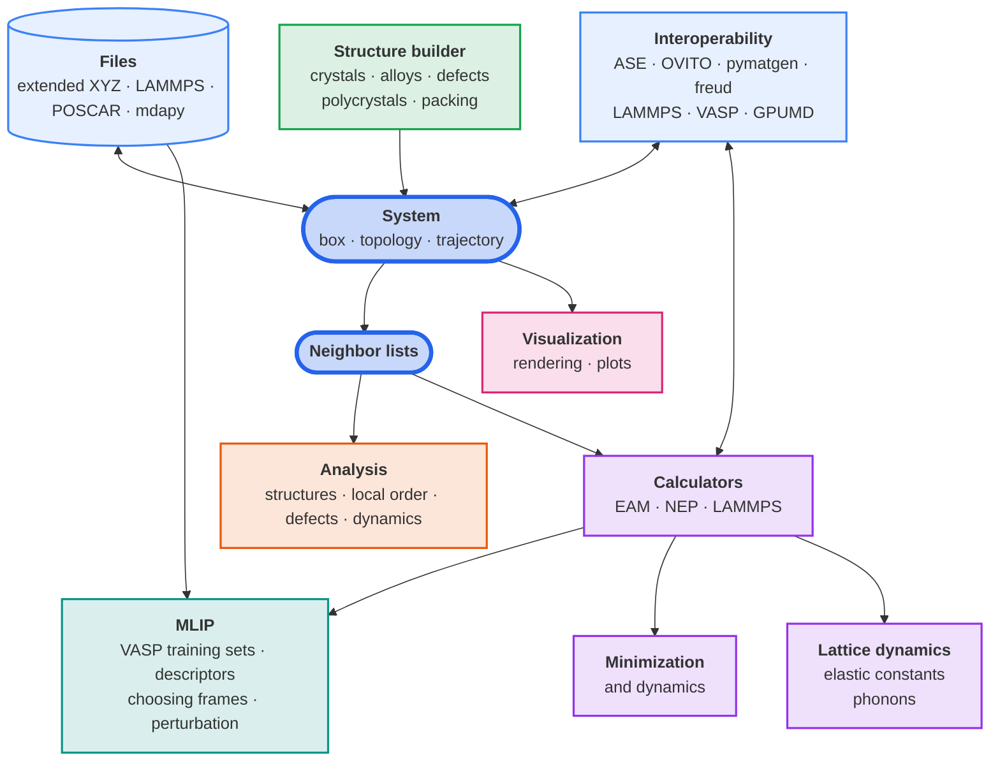

# { width="420" } { width="420" } { .logo }

**mdapy**, short for *Molecular Dynamics Analysis in Python*, analyses and
builds atomistic systems. It reads and writes structures and trajectories in
the common formats, finds neighbors, identifies crystal structures and
defects and measures their properties, builds crystals and polycrystals, and
computes energies, forces, relaxed structures and elastic constants with
interatomic potentials. The heavy work runs in compiled C++ on all cores of
the machine.

!!! warning "mdapy 2.0 is under development"
    This site documents mdapy 2.0, a complete rewrite on the `v2` branch that is
    not compatible with mdapy 1.x. Features are added one at a time, each with
    its own tests and documentation page. For the stable release use
    [mdapy 1.0.8](https://pypi.org/project/mdapy/1.0.8/).

## What mdapy does

Structures come from files or are built, live in a `System`, and its
neighbors feed the analyses and the calculators. Dashed parts are planned.

## Design

- **Easy to use.** A structure is one `System`, built, read from the files
  of common programs or converted from another package. Every analysis is a
  class whose `compute(system)` returns plain NumPy arrays, ready to attach
  to the system as columns. **NumPy and polars are the only requirements.**
- **High performance.** The heavy work runs in compiled C++ on every core.
  Analyses of the nearest neighbors find them as they go, without a list of
  pairs, and one list of pairs serves every analysis it is given. On 40
  cores, from 256 000 to 2 million atoms, mdapy is faster than
  [OVITO](https://www.ovito.org) in every analysis they share, and below
  that in all but atomic strain; it is faster than
  [freud](https://freud.readthedocs.io) in every one at every size; see
  [Performance](performance/comparison.md).
- **Predictable API.** One unit system: Å, eV, ps, amu, K, and GPa for
  stress ([Units and conventions](reference/units.md)). One name for each
  concept in every module ([Glossary](reference/glossary.md)). A `System`
  never changes in place, every analysis takes the same arguments, and the
  results are the same for any number of threads.
- **Easy to integrate.** mdapy runs its own thread pool instead of OpenMP,
  so it shares a process with [PyTorch](https://pytorch.org) and
  [LAMMPS](https://www.lammps.org)
  ([Parallelism](getting-started/parallelism.md)). It converts systems to
  and from [ASE](https://wiki.fysik.dtu.dk/ase/),
  [OVITO](https://www.ovito.org), [pymatgen](https://pymatgen.org) and
  [freud](https://freud.readthedocs.io), reads and writes the files of
  [LAMMPS](https://www.lammps.org), [VASP](https://www.vasp.at) and
  [GPUMD](https://gpumd.org), and takes any ASE calculator or LAMMPS
  interaction as a calculator ([Interoperability](interop/ase.md)).
- **Verified.** Each feature is tested against analytic results,
  independent implementations and, where they compute the same, live runs
  of [LAMMPS](https://www.lammps.org), [OVITO](https://www.ovito.org) and
  [freud](https://freud.readthedocs.io), and has its own page on how to use
  it and, for analyses, what it computes and which papers it follows.

## Features

-   :material-rocket-launch-outline:{ .lg .middle } **Getting started**

    ---

    Install mdapy, take the quick tour, learn the basics and work through
    the tutorials.

    [Installation](getting-started/installation.md) ·
    [Quick tour](getting-started/quick-tour.md)

    System: [Systems](getting-started/system.md) ·
    [selecting and ordering atoms](getting-started/selecting.md) ·
    [expanding a selection](getting-started/expand-selection.md) ·
    [changing a system](getting-started/changing.md) ·
    [topology](getting-started/topology.md) ·
    [simulation box](getting-started/box.md)

    [Reading and writing files](getting-started/io.md) ·
    [Trajectories](getting-started/trajectory.md) ·
    [Neighbor lists](getting-started/neighbor.md) ·
    [Parallelism](getting-started/parallelism.md)

    Tutorials: [fcc and bcc grains](getting-started/tutorials/two-phase-polycrystal.md) ·
    [columnar grains](getting-started/tutorials/columnar-polycrystal.md) ·
    [defect energies of copper](getting-started/tutorials/defect-energies.md) ·
    [sharing neighbor lists](getting-started/tutorials/neighbor-lists.md)

-   :material-chart-bell-curve-cumulative:{ .lg .middle } **Analysis**

    ---

    Identify structures and measure order, defects and dynamics.

    [Overview](analysis/overview.md)

    Structure identification: [common neighbor analysis](analysis/cna.md) ·
    [Ackland–Jones](analysis/ackland-jones.md) ·
    [polyhedral template matching](analysis/ptm.md) ·
    [planar faults](analysis/planar-faults.md) ·
    [grain segmentation](analysis/grain-segmentation.md) ·
    [diamond](analysis/diamond.md) · [CHILL+](analysis/chill-plus.md) ·
    [centro-symmetry](analysis/csp.md) ·
    [common neighbor parameter](analysis/cnp.md) ·
    [space group](analysis/space-group.md)

    Local order and distributions: [radial distribution](analysis/rdf.md) ·
    [coordination](analysis/coordination.md) ·
    [structure factor](analysis/structure-factor.md) ·
    [bond angles](analysis/bond-angles.md) ·
    [Warren–Cowley](analysis/warren-cowley.md) ·
    [Steinhardt](analysis/steinhardt.md) ·
    [entropy fingerprint](analysis/entropy.md) ·
    [Voronoi](analysis/voronoi.md) ·
    [spatial binning](analysis/spatial-binning.md)

    Defects and deformation: [clusters](analysis/clusters.md) ·
    [surface mesh](analysis/surface-mesh.md) ·
    [dislocations](analysis/dislocations.md) (experimental) ·
    [chemical species](analysis/species.md) ·
    [Wigner–Seitz](analysis/wigner-seitz.md) ·
    [atomic displacement](analysis/displacement.md) ·
    [atomic strain](analysis/atomic-strain.md)

    Dynamics: [mean squared displacement](analysis/msd.md) ·
    [Lindemann index](analysis/lindemann.md) ·
    [Time averages](analysis/time-average.md) ·
    [Trajectory lines](analysis/trajectory-lines.md) ·
    [atomic temperature](analysis/temperature.md)

-   :material-cube-outline:{ .lg .middle } **Structure builder**

    ---

    Build crystals, alloys, defects and polycrystals; packed molecules are
    planned.

    [Crystals](build/crystals.md) · [random alloys](build/alloys.md) ·
    [SQS](build/sqs.md) · [point defects and faults](build/defects.md) ·
    [surfaces and slip systems](build/slip-systems.md) ·
    [dislocations](build/dislocations.md) ·
    [polycrystals](build/polycrystals.md) ·
    [graphene on grain boundaries](build/graphene.md) ·
    [periodic copies and images](build/transform.md) ·
    [slices](build/slice.md) ·
    [affine transformation](build/affine.md)

-   :mdapy-simulation:{ .lg .middle } **Simulation**

    ---

    Energies and forces from potentials, minimization and lattice dynamics.

    Calculators: [the interface](simulation/calculators.md) ·
    [EAM](simulation/eam.md) · [NEP](simulation/nep.md) ·
    [LAMMPS](simulation/lammps.md) · [VASP](simulation/vasp.md)

    Minimization and dynamics: [energy minimization](simulation/minimize.md) ·
    [molecular dynamics](simulation/dynamics.md) ·
    [defect energies](simulation/defect-energies.md)

    Lattice dynamics: [elastic constants](simulation/elastic-constants.md) ·
    [phonons](simulation/phonons.md) ·
    [quasi-harmonic approximation](simulation/quasi-harmonic.md) ·
    [elastic constants at finite temperature](simulation/thermal-elastic.md) ·
    [from molecular dynamics](simulation/md-elastic.md)

-   :material-sine-wave:{ .lg .middle } **MLIP**

    ---

    Training data for machine-learned potentials.

    [Training sets from VASP](mlip/vasp.md) ·
    [choosing frames](mlip/selection.md) ·
    [perturbed structures](mlip/perturbation.md)

-   :material-palette-outline:{ .lg .middle } **Visualization**

    ---

    Images of systems, colored by any property, and plots of results.

    [Rendering](visualization/rendering.md) ·
    [coordination polyhedra](visualization/polyhedra.md) · [plots](visualization/plots.md)

-   :material-puzzle-outline:{ .lg .middle } **Interoperability**

    ---

    Systems and calculators shared with other packages, and the files of
    simulation programs.

    Packages: [ASE](interop/ase.md) ·
    [ASE calculators](interop/ase-calculators.md) ·
    [OVITO](interop/ovito.md) · [pymatgen](interop/pymatgen.md) ·
    [freud](interop/freud.md)

    Programs: [LAMMPS](interop/lammps.md) · [VASP](interop/vasp.md) ·
    [GPUMD](interop/gpumd.md)

-   :material-speedometer:{ .lg .middle } **Performance**

    ---

    Timings of mdapy and of other programs, from thousands to millions of
    atoms.

    [Analyses: OVITO and freud](performance/comparison.md) ·
    [reading and writing files: OVITO and ASE](performance/files.md) ·
    [building structures: Atomsk](performance/builders.md)

-   :material-book-open-variant:{ .lg .middle } **Reference**

    ---

    File formats, units, the glossary, the papers and the Python API.

    [CIF](reference/formats/cif.md) ·
    [Extended XYZ](reference/formats/extxyz.md) ·
    [LAMMPS data](reference/formats/lammps-data.md) ·
    [LAMMPS dump](reference/formats/lammps-dump.md) ·
    [PDB](reference/formats/pdb.md) ·
    [VASP OUTCAR](reference/formats/outcar.md) ·
    [VASP POSCAR](reference/formats/poscar.md) ·
    [mdapy files](reference/formats/mdapy.md)

    [Units and conventions](reference/units.md) ·
    [Elements](reference/elements.md) · [Glossary](reference/glossary.md) ·
    [References](reference/references.md) · [Python API](reference/api.md)

See the [release notes](development/release-notes.md) for what each
development version contains.

## Citing mdapy

If mdapy contributes to a publication, please cite
[Wu and Shao (2023)](reference/references.md#wu2023), and the papers that
the pages of the features you use ask to cite.
