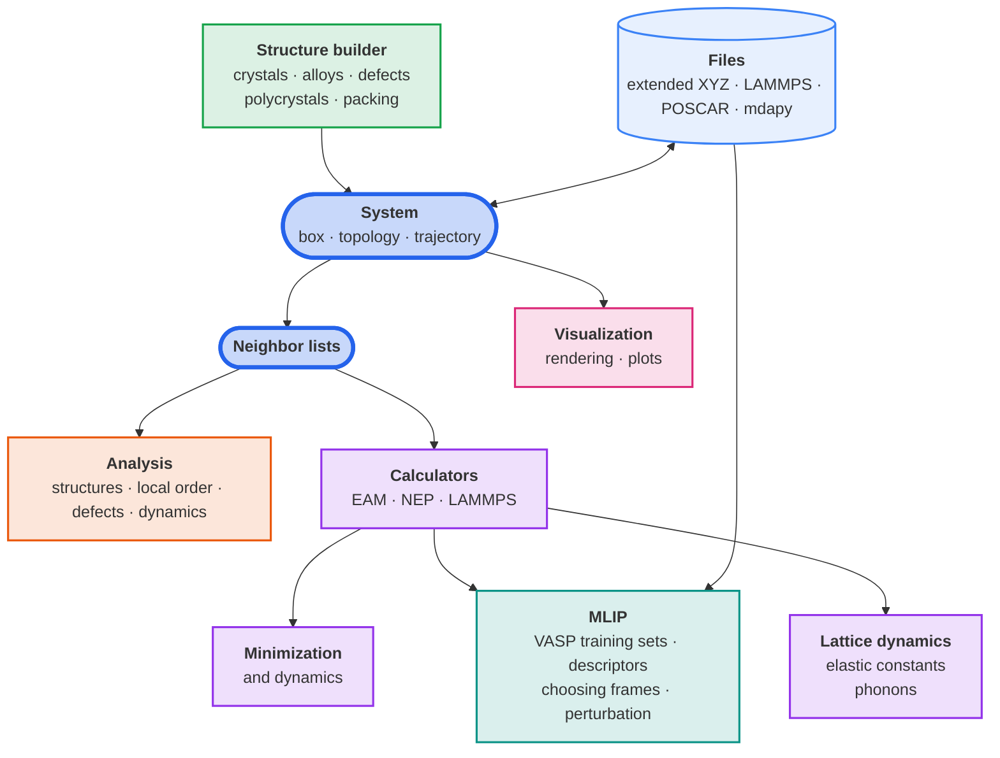

# { width="420" } { width="420" } { .logo }

**mdapy**, short for *Molecular Dynamics Analysis in Python*, analyses and
builds atomistic systems. It reads and writes structures and trajectories in
the common formats, finds neighbors, identifies crystal structures and
defects and measures their properties, builds crystals and polycrystals, and
computes energies, forces, relaxed structures and elastic constants with
interatomic potentials. The heavy work runs in compiled C++ on all cores of
the machine.

!!! warning "mdapy 2.0 is under development"
    This site documents mdapy 2.0, a complete rewrite on the `v2` branch that is
    not compatible with mdapy 1.x. Features are added one at a time, each with
    its own tests and documentation page. For the stable release use
    [mdapy 1.0.8](https://pypi.org/project/mdapy/1.0.8/).

## What mdapy does

Structures come from files or are built, live in a `System`, and its
neighbors feed the analyses and the calculators. Dashed parts are planned.

## Design in brief

- **Two dependencies.** NumPy and polars. Everything else is optional.
- **One unit system.** Å, eV, ps, amu, K, and GPa for stress. See
  [Units and conventions](reference/units.md).
- **Consistent names.** Every parameter and property follows the
  [Glossary](reference/glossary.md).
- **Runs next to PyTorch and LAMMPS.** The compiled kernels use a thread
  pool of mdapy's own instead of OpenMP, so mdapy shares a process with
  PyTorch and LAMMPS without clashing OpenMP runtimes, and its results are
  the same for any number of threads. See
  [Parallelism](getting-started/parallelism.md).
- **Tested and documented feature by feature.** Each feature is tested
  against independent references, analytic results and NumPy
  implementations, and against LAMMPS and OVITO where they compute the same,
  and has its own page describing how to use it and, for analyses, what it
  computes and which papers it follows.

## Features

-   :material-rocket-launch-outline:{ .lg .middle } **Getting started**

    ---

    Install mdapy, take the quick tour and learn the basics.

    [Installation](getting-started/installation.md) ·
    [Quick tour](getting-started/quick-tour.md)

    [Systems and topology](getting-started/system.md) ·
    [Simulation box](getting-started/box.md) ·
    [Reading and writing files](getting-started/io.md) ·
    [Trajectories](getting-started/trajectory.md) ·
    [Neighbor lists](getting-started/neighbor.md) ·
    [Parallelism](getting-started/parallelism.md)

-   :material-chart-bell-curve-cumulative:{ .lg .middle } **Analysis**

    ---

    Identify structures and measure order, defects and dynamics.

    [Overview](analysis/overview.md)

    Structure identification: [common neighbor analysis](analysis/cna.md) ·
    [Ackland–Jones](analysis/ackland-jones.md) ·
    [diamond](analysis/diamond.md) · [CHILL+](analysis/chill-plus.md) ·
    [centro-symmetry](analysis/csp.md) ·
    [common neighbor parameter](analysis/cnp.md)

    Local order and distributions: [radial distribution](analysis/rdf.md) ·
    [coordination](analysis/coordination.md) ·
    [structure factor](analysis/structure-factor.md) ·
    [bond angles](analysis/bond-angles.md) ·
    [Warren–Cowley](analysis/warren-cowley.md) ·
    [Steinhardt](analysis/steinhardt.md) ·
    [entropy fingerprint](analysis/entropy.md) ·
    [Voronoi](analysis/voronoi.md)

    Defects and deformation: [clusters](analysis/clusters.md) ·
    [Wigner–Seitz](analysis/wigner-seitz.md) ·
    [atomic strain](analysis/atomic-strain.md)

    Dynamics: [mean squared displacement](analysis/msd.md) ·
    [Lindemann index](analysis/lindemann.md) ·
    [atomic temperature](analysis/temperature.md)

-   :material-cube-outline:{ .lg .middle } **Structure builder**

    ---

    Build crystals, alloys, defects and polycrystals; packed molecules are
    planned.

    [Crystals](build/crystals.md) · [random alloys](build/alloys.md) ·
    [SQS](build/sqs.md) · [point defects and faults](build/defects.md) ·
    [dislocations](build/dislocations.md) ·
    [polycrystals](build/polycrystals.md)

-   :mdapy-simulation:{ .lg .middle } **Simulation**

    ---

    Energies and forces from potentials, minimization and lattice dynamics.

    Calculators: [the interface](simulation/calculators.md) ·
    [EAM](simulation/eam.md) · [NEP](simulation/nep.md) ·
    [LAMMPS](simulation/lammps.md)

    Minimization and dynamics: [energy minimization](simulation/minimize.md) ·
    [defect energies](simulation/defect-energies.md)

    Lattice dynamics: [elastic constants](simulation/elastic-constants.md)

-   :material-sine-wave:{ .lg .middle } **MLIP**

    ---

    Training data for machine-learned potentials.

    [Training sets from VASP](mlip/vasp.md) ·
    [choosing frames](mlip/selection.md) ·
    [perturbed structures](mlip/perturbation.md)

-   :material-palette-outline:{ .lg .middle } **Visualization**

    ---

    Images of systems, colored by any property, and plots of results.

    [Rendering](visualization/rendering.md) · [plots](visualization/plots.md)

-   :material-speedometer:{ .lg .middle } **Performance**

    ---

    Timings of mdapy and of other programs, from thousands to millions of
    atoms.

    Planned.

-   :material-book-open-variant:{ .lg .middle } **Reference**

    ---

    File formats, units, the glossary, the papers and the Python API.

    [Extended XYZ](reference/formats/extxyz.md) ·
    [LAMMPS data](reference/formats/lammps-data.md) ·
    [LAMMPS dump](reference/formats/lammps-dump.md) ·
    [VASP POSCAR](reference/formats/poscar.md) ·
    [mdapy files](reference/formats/mdapy.md)

    [Units and conventions](reference/units.md) ·
    [Elements](reference/elements.md) · [Glossary](reference/glossary.md) ·
    [References](reference/references.md) · [Python API](reference/api.md)

See the [release notes](development/release-notes.md) for what each
development version contains.

## Citing mdapy

If mdapy contributes to a publication, please cite
[Wu and Shao (2023)](reference/references.md#wu2023), and the papers that
the pages of the features you use ask to cite.
