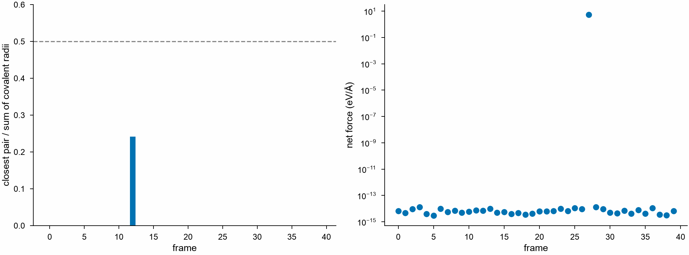

# Checking frames

A training set gathered from many calculations often holds a few frames
that would spoil a model: atoms that overlap, as after a wrong wrap or a
failed relaxation; forces that do not sum to zero, as of a calculation that
did not converge; and labels left out. `check_frames` finds them before
training, frame by frame.

<!-- files: ../getting-started/tutorials/crconi -->
```python
import numpy as np
import polars as pl

import mdapy as mp
from mdapy.calculators import EAM
from mdapy.mlip import check_frames
from mdapy.visualization import plot

# forty frames of the CrCoNi alloy, shaken and labeled by an EAM
eam = EAM.zhou(["Cr", "Co", "Ni"])
sqs = mp.read("SQS.xyz")  # 108 atoms
rng = np.random.default_rng(2)
frames = []
for k in range(40):
    x = sqs["positions"] + rng.normal(0, 0.1, (len(sqs), 3))
    if k == 12:
        x[0] = x[1] + [0.6, 0, 0]  # an atom on top of another
    shaken = sqs.with_columns(positions=x)
    label = eam.compute(shaken, ("energy", "forces", "virial"))
    forces = label.forces + ([0.05, 0, 0] if k == 27 else 0)  # not converged
    virial = None if k == 33 else label.virial  # left out
    frames.append(
        shaken.with_columns(forces=forces).with_info(energy=label.energy, virial=virial)
    )

table = check_frames(frames)  # close=0.5 of the sum of the covalent radii
bad = table.filter(
    pl.col("too_close")
    | (pl.col("net_force") > 1e-3)
    | ~(pl.col("has_energy") & pl.col("has_forces") & pl.col("has_virial"))
)
bad["frame"].to_list()  # [12, 27, 33]
mp.write("clean.xyz", [f for k, f in enumerate(frames) if k not in bad["frame"]])

with plot.style():
    fig, (left, right) = plot.figure("double", ncols=2)
    near = table["closest"].to_numpy()
    left.bar(table["frame"], np.where(np.isfinite(near), near, 0))
    left.axhline(0.5, color="0.5", ls="--", lw=0.8)
    left.set_ylim(0, 0.6)
    left.set_xlabel("frame")
    left.set_ylabel("closest pair / sum of covalent radii")
    right.semilogy(table["frame"], table["net_force"], "o")
    right.set_xlabel("frame")
    right.set_ylabel("net force (eV/Å)")
    plot.save(fig, "images/checks", formats=("png",))
```



*Left: the one frame with two atoms nearer than half the sum of their
covalent radii; the others have no pair that near. Right: the net force of
each frame, near the rounding of the forces in all but the one whose forces
were shifted by 0.05 eV/Å along x, 5.4 eV/Å over its 108 atoms.*

## Parameters

| Name | Type | Default | Meaning |
|---|---|---|---|
| `frames` | sequence of `System` | | the frames, with an `element` column; their labels the info `energy` and `virial` and the column `forces`, as extended XYZ training sets hold them |
| `close` | float | 0.5 | two atoms closer than this fraction of the sum of their covalent radii are too close |

## Results

A [polars](https://pola.rs) DataFrame of one row per frame:

| Column | Type | Unit | Meaning |
|---|---|---|---|
| `frame` | int | | the index of the frame |
| `atoms` | int | | its number of atoms |
| `closest` | float | | the smallest distance of two atoms over the sum of their covalent radii, where it is below `close`; inf otherwise |
| `too_close` | bool | | whether `closest` is below `close` |
| `net_force` | float | eV/Å | the length of the sum of the forces; NaN without forces |
| `has_energy`, `has_forces`, `has_virial` | bool | | whether the frame has these labels |

The covalent radii are those of
[Cordero et al. (2008)](../reference/references.md#cordero2008). The net
force of a crystal or a cluster in vacuum is zero: a frame whose net force
is far above the rounding of its forces holds forces of a calculation that
did not converge, or of another frame.

## Errors

`check_frames` raises `InvalidParameter` for a `close` that is not
positive and for frames without an `element` column.

## See also

- [Errors of a model](errors.md).
- [Uncertainty and novelty](uncertainty.md).
