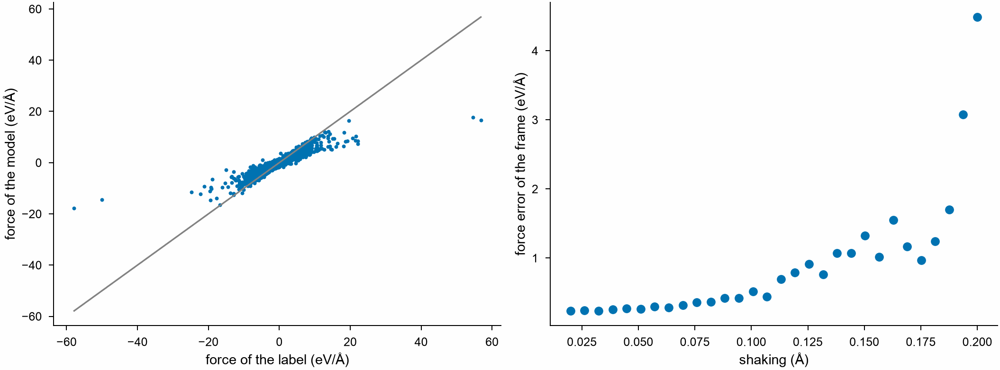

# Errors of a model

`predict` compares the energies, forces and virials a model predicts with
the labels of frames, such as those of a training set from DFT: the root
mean square errors, a table of the errors of each frame and the frames
that err most, to look at first. Any mdapy calculator is a model, as a
[NEP](../simulation/nep.md) or an [EAM](../simulation/eam.md), and so is
any ASE calculator through
[`from_ase_calculator`](../interop/ase-calculators.md). `read_gpumd` reads
the same from the files GPUMD writes when it trains a NEP model, and
torchnep when it trains or predicts, without computing anything.

<!-- files: ../getting-started/tutorials/crconi -->
```python
import numpy as np

import mdapy as mp
from mdapy.calculators import EAM, NEP
from mdapy.mlip import predict
from mdapy.visualization import plot

# thirty frames of the CrCoNi alloy, shaken more and more, labeled by the
# EAM of Zhou as a training set would be by DFT
eam = EAM.zhou(["Cr", "Co", "Ni"])
sqs = mp.read("SQS.xyz")  # 108 atoms
rng = np.random.default_rng(0)
shaking = np.linspace(0.02, 0.2, 30)
frames = []
for amplitude in shaking:
    shaken = sqs.with_columns(
        positions=sqs["positions"] + rng.normal(0, amplitude, (len(sqs), 3))
    )
    label = eam.compute(shaken, ("energy", "forces", "virial"))
    frames.append(
        shaken.with_columns(forces=label.forces).with_info(
            energy=label.energy, virial=label.virial
        )
    )

# a NEP model of CrCoNi, trained on DFT, against those labels
result = predict(frames, NEP("nep.txt"))
result.rmse()  # {"energy": eV/atom, "forces": eV/Å, "virial": eV/atom}
table = result.table()  # the errors of each frame
worst = result.worst(5)  # the five frames of the largest force errors
mp.write("worst.xyz", [frames[k] for k in worst])

with plot.style():
    fig, (left, right) = plot.figure("double", ncols=2)
    label, model = result.forces[:, 0].ravel(), result.forces[:, 1].ravel()
    left.scatter(label, model, s=2)
    low, high = result.forces.min(), result.forces.max()
    left.plot([low, high], [low, high], color="0.5", lw=0.8)
    left.set_xlabel("force of the label (eV/Å)")
    left.set_ylabel("force of the model (eV/Å)")
    right.plot(shaking, table["force_rmse"], "o")
    right.set_xlabel("shaking (Å)")
    right.set_ylabel("force error of the frame (eV/Å)")
    plot.save(fig, "images/errors", formats=("png",))
```



*Left: each force component of the NEP model against the label of the
EAM, over all atoms of the thirty frames. Right: the root mean square
force error of each frame grows with how far its atoms are shaken, as
the two potentials part further from the crystal; `worst` picks the
frames at the right end.*

The files of a NEP model of GPUMD trained on `train.xyz`, in the folder it
ran in, or of the predictions of torchnep, whose frames may lie elsewhere:

<!-- skip-test -->
```python
from mdapy.mlip import read_gpumd

result = read_gpumd("nep_folder")  # energy_train.out, force_train.out, ...
result.rmse()
test = read_gpumd("nep_folder", "test")  # with test.xyz

# torchnep: predict_dataset("nep.txt", "data/all.xyz", "predicted")
other = read_gpumd("predicted", xyz="data/all.xyz")
```

## Parameters

| Function | Parameters |
|---|---|
| `predict(frames, calculator)` | the frames, their labels the info `energy` and `virial` (eV) and the column `forces` (eV/Å) as extended XYZ training sets hold them; and the model |
| `read_gpumd(folder, kind="train", *, xyz=None)` | the folder of `energy_train.out`, `force_train.out` and `virial_train.out`, as GPUMD writes them when it trains a NEP model and torchnep when it trains or predicts; `kind="test"` for those of the test set; and the extended XYZ file of the frames, for their numbers of atoms, by default `train.xyz` (or `test.xyz`) in the folder |
| `Predictions.worst(count, by="force_rmse")` | how many frames, and the column of `table()` to rank them by: `energy_error` (by its size), `force_rmse`, `force_max_error` or `virial_rmse` |

## Results

A `Predictions`:

| Attribute | Type | Unit | Meaning |
|---|---|---|---|
| `atoms` | (F,) int64 | | the number of atoms of each frame |
| `energy` | (F, 2) float64 | eV/atom | the label and the prediction of each frame; NaN for a frame without a label |
| `forces` | (A, 2, 3) float64 | eV/Å | the label and the prediction of the force on each atom of all frames one after the other |
| `virial` | (F, 2, 3, 3) float64 | eV/atom | the label and the prediction of the virial of each frame, NaN where either is missing, as for a model that does not compute virials |
| `frame_of_atom` | (A,) int64 | | the frame of each atom of `forces` |

`rmse()` gives the root mean square errors over the frames with labels:
`energy` in eV/atom, `forces` in eV/Å over the force components, `virial`
in eV/atom over its components. `table()` gives a
[polars](https://pola.rs) DataFrame of one row per frame: `frame`,
`atoms`, `energy` (the label per atom), `energy_error`, `force_rmse`,
`force_max_error` (of a component) and `virial_rmse`. The energies of two
potentials, or of DFT codes with other references, differ by a constant
per atom of each element; the errors of the forces and the spread of the
energy errors are what compare them.

## Errors

`predict` raises `InvalidParameter` for no frames, and what the model
raises for frames it cannot compute; `read_gpumd` raises it for files it
cannot read, files of other numbers of columns, and files that do not hold
the frames of the XYZ file; `worst` raises it for another column.

## See also

- [Uncertainty and novelty](uncertainty.md): where a model has not seen
  enough.
- [Checking frames](checks.md): frames that look wrong before training.
- [Choosing frames](selection.md).
