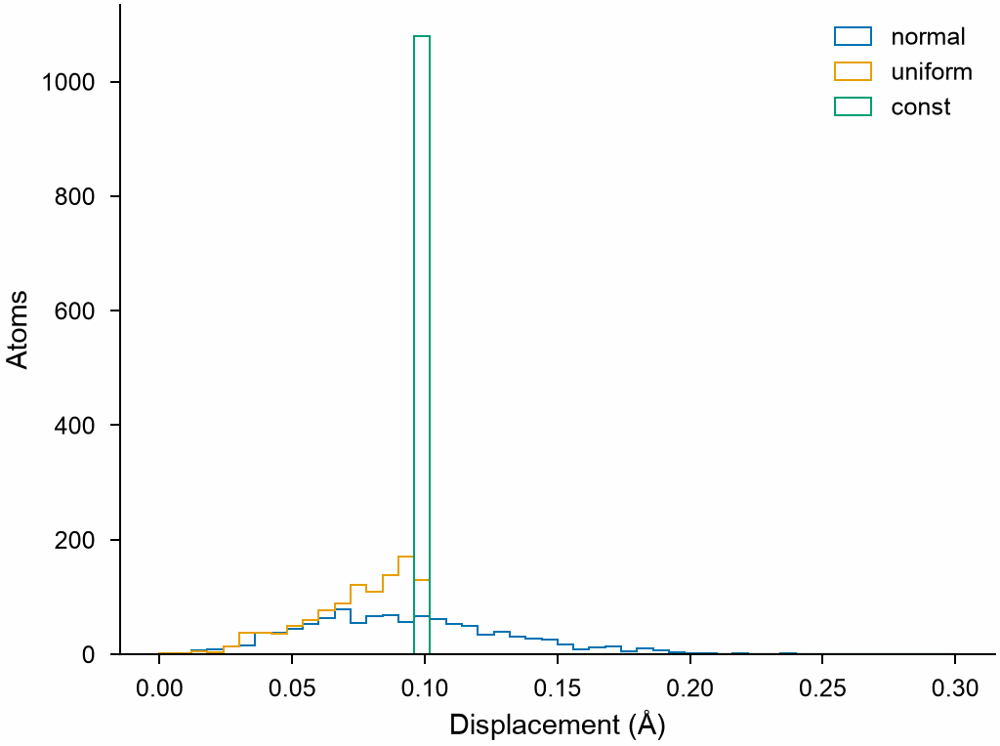

# Perturbed structures

`perturb` makes copies of a system with its atoms displaced and its box
strained at random: the first frames of a training set, to be computed by
DFT, around a crystal or any other structure.

```python
import mdapy as mp
from mdapy.build import build_crystal
from mdapy.mlip import perturb

crystal = build_crystal("bcc", 3.165, elements="W", repeat=(3, 3, 3))
copies = perturb(crystal, 20, displacement=0.1, strain=0.03, seed=1)
mp.write("perturbed.xyz", copies)

# displacements of exactly 0.05 Å, without strain
small = perturb(crystal, 5, displacement=0.05, strain=0.0, style="const", seed=2)
```

The lengths of the displacements of the three styles, without strain:

```python
import numpy as np

from mdapy.visualization import plot

with plot.style():
    fig, ax = plot.figure("single")
    for style in ("normal", "uniform", "const"):
        frames = perturb(crystal, 20, displacement=0.1, strain=0.0, style=style, seed=3)
        moved = np.concatenate([f["positions"] - crystal["positions"] for f in frames])
        length = np.linalg.norm(moved, axis=1)
        ax.hist(length, bins=50, range=(0, 0.3), histtype="step", label=style)
    ax.set_xlabel("Displacement (Å)")
    ax.set_ylabel("Atoms")
    ax.legend()
    plot.save(fig, "images/perturbation", formats=("png",))
```



*`displacement=0.1`: Gaussian displacements of root mean square length
0.1 Å, with a tail beyond it; uniform ones in a ball of radius 0.1 Å, most
near its surface; and all exactly 0.1 Å long.*

## Parameters

| Name | Type | Default | Unit | Meaning |
|---|---|---|---|---|
| `system` | `System` | | | the structure perturbed |
| `count` | int | | | number of copies |
| `displacement` | float | 0.05 | Å | size of the displacement of each atom |
| `strain` | float | 0.03 | | largest component of the strain of the box |
| `style` | str | `"normal"` | | `"normal"`: Gaussian, `displacement` the root mean square length; `"uniform"`: uniform in a ball of radius `displacement`; `"const"`: exactly `displacement` long, in a random direction |
| `seed` | int or `numpy.random.Generator` | `None` | | seed of the random numbers |

## Results

A list of `count` systems. Each box is deformed by
$\mathbf{F} = \mathbf{I} + (\mathbf{e} + \mathbf{e}^\mathsf{T})/2$, the
components of $\mathbf{e}$ uniform in ±`strain`; the atoms move with the box
and are then displaced. The copies keep every column and value of `info`
except `forces`, `velocities`, `energy`, `virial` and `stress`, which belong
to the system before the perturbation.

## Errors

`perturb` raises `InvalidParameter` for a negative or non-integer count, a
negative displacement or strain, and an unknown style.
