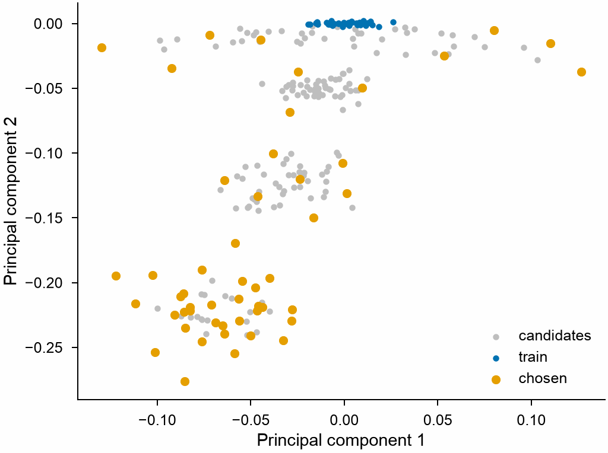

# Choosing frames

A training set grows best with frames unlike those it has.
`structure_descriptors` gives each frame the mean of the descriptors of its
atoms, of a NEP model or [SOAP](soap.md) of any structures,
`farthest_point_sampling` chooses the frames that cover the space of
descriptors, and `principal_components` projects them onto a plane to look
at.

<!-- skip-test -->
```python
import mdapy as mp
from mdapy.calculators import NEP
from mdapy.mlip import (
    farthest_point_sampling,
    principal_components,
    structure_descriptors,
)
from mdapy.visualization import plot

potential = NEP("nep.txt")
train = mp.read_trajectory("train.xyz")
candidates = mp.read_trajectory("md.xyz")

old = structure_descriptors(train, potential)  # (F, D)
new = structure_descriptors(candidates, potential)

# 50 candidates far from the training set and from each other
chosen = farthest_point_sampling(new, 50, start=None, selected=old)
mp.write("add.xyz", [candidates[i] for i in chosen])

pca = principal_components(old, n=2)
pca.ratio  # fraction of the variance on each component
with plot.style():
    fig, ax = plot.figure()
    ax.scatter(*pca.transform(new).T, s=4, color="0.75", label="candidates")
    ax.scatter(*pca.projection.T, s=4, label="train")
    ax.scatter(*pca.transform(new[chosen]).T, s=10, label="chosen")
    ax.set_xlabel("Principal component 1")
    ax.set_ylabel("Principal component 2")
    ax.legend()
    plot.save(fig, "images/selection", formats=("png",))
```



*Silicon with a NEP model of GPUMD: a training set of slightly perturbed
diamond crystals (blue) and 200 candidates in four groups, their atoms
displaced by 0.05 to 0.4 Å (grey, from the top down; the strains of the
first group spread it sideways). Farthest point sampling takes most of the
50 from the group displaced most, farthest from the training set and from
one another, and a few from each of the others.*

The descriptors of a NEP model and SOAP are computed for many frames at a
time, a frame on each of the threads of
[`set_num_threads`](../getting-started/parallelism.md), each as it would be
alone; those of other models frame by frame.

## Parameters

| Function | Parameters |
|---|---|
| `structure_descriptors(frames, calculator)` | the frames, and anything with `descriptors(system)`, such as [NEP](../simulation/nep.md) or [SOAP](soap.md) |
| `farthest_point_sampling(points, count, *, start=0, selected=None)` | (M, D) candidates, the number chosen, the first one chosen (`None`: the farthest from `selected`), and (K, D) points chosen before |
| `principal_components(points, n=2)` | (M, D) points, two or more, and the number of components kept, at most D |

The points may be descriptors of frames or of atoms, or any other features.

## Results

`structure_descriptors` returns an (F, D) array.
`farthest_point_sampling` returns the int64 indices of the chosen points, in
the order chosen. `principal_components` returns a `PrincipalComponents`:

| Attribute | Meaning |
|---|---|
| `projection` | (M, n) coordinates of the points along the components |
| `components` | (n, D) unit vectors by decreasing variance, each with its largest entry positive |
| `variance` | (n,) variance along each component |
| `ratio` | (n,) fraction of the total variance |
| `mean` | (D,) mean of the points |
| `transform(points)` | coordinates of other points along the same components |

## Errors

`farthest_point_sampling` raises `InvalidParameter` for points that are not
(M, D), a count outside 0 to M, a start outside the points, and
`start=None` without `selected`. `principal_components` raises it for fewer
than two points and an `n` outside 1 to D.

## Definition

Farthest point sampling chooses, after the first, the point whose distance
to the nearest point already chosen (or in `selected`) is largest:

$$
i_{k+1} = \arg\max_i \min_{j \in S_k} \lVert \mathbf{x}_i - \mathbf{x}_j \rVert ,
$$

so that the chosen points spread over the whole set. The principal
components are the eigenvectors of the covariance of the points,
$\frac{1}{M-1} \sum_i (\mathbf{x}_i - \bar{\mathbf{x}})(\mathbf{x}_i - \bar{\mathbf{x}})^\mathsf{T}$,
by decreasing eigenvalue, the variance along each.
