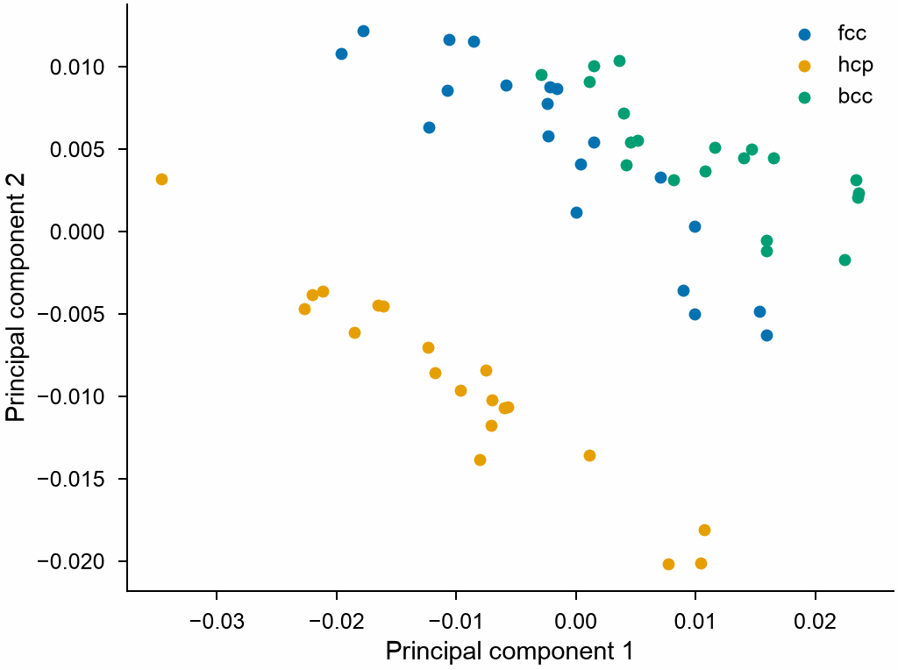

# SOAP descriptors

`SOAP` gives the smooth overlap of atomic positions of each atom: a vector
that describes its neighborhood, the same for rotated, moved or reordered
copies of it, whatever potential the structures were made with. It is the
default descriptor of mdapy's tools for training sets: the
[choice of frames](selection.md) and the maps of their structures work
with it as with the descriptors of a NEP model. The values are those of
DScribe's SOAP with its default Gaussian radial functions.

```python
import numpy as np

import mdapy as mp
from mdapy.build import build_crystal
from mdapy.mlip import SOAP, principal_components, structure_descriptors
from mdapy.visualization import plot

soap = SOAP(["Cu"], r_cut=5.0, n_max=8, l_max=6, sigma=0.5)
copper = build_crystal("fcc", 3.615, elements="Cu", repeat=(3, 3, 3))
soap.descriptors(copper).shape  # (108, 252): one row per atom
soap.dimension  # 252

# twenty frames each of fcc, hcp and bcc copper, shaken and strained
rng = np.random.default_rng(0)
cells = {
    "fcc": build_crystal("fcc", 3.615, elements="Cu", repeat=(3, 3, 3)),
    "hcp": build_crystal("hcp", 2.556, elements="Cu", repeat=(4, 3, 3)),
    "bcc": build_crystal("bcc", 2.87, elements="Cu", repeat=(4, 4, 4)),
}
frames, names = [], []
for name, cell in cells.items():
    for _ in range(20):
        strain = np.eye(3) + rng.normal(0, 0.01, (3, 3))
        box = mp.Box(cell.box.matrix @ strain)
        shaken = cell.with_box(box, scale_positions=True)
        noise = rng.normal(0, rng.uniform(0.05, 0.1), (len(cell), 3))
        frames.append(shaken.with_columns(positions=shaken["positions"] + noise))
        names.append(name)

points = structure_descriptors(frames, soap)  # the mean of the atoms of each frame
# the length of SOAP grows with the density; unit vectors compare the shapes
points /= np.linalg.norm(points, axis=1, keepdims=True)
pca = principal_components(points, n=2)
with plot.style():
    fig, ax = plot.figure()
    for name in cells:
        mine = np.array(names) == name
        ax.scatter(*pca.projection[mine].T, s=8, label=name)
    ax.set_xlabel("Principal component 1")
    ax.set_ylabel("Principal component 2")
    ax.legend()
    plot.save(fig, "images/soap", formats=("png",))
```



*Sixty frames of copper in three structures, each shaken by 0.05 to 0.1 Å
and strained by about 1 %, by the first two principal components of the
mean SOAP of their atoms as unit vectors: hcp lies apart, fcc and bcc
side by side, each spread by its strains and shaking.*

## Parameters

`SOAP(species, r_cut=5.0, n_max=8, l_max=6, sigma=0.5, *, crossover=True)`

| Name | Type | Default | Unit | Meaning |
|---|---|---|---|---|
| `species` | sequence of str | | | the elements; every atom must be one of them, so that systems of other compositions share one layout |
| `r_cut` | float | 5.0 | Å | the cutoff of the radial functions, above 1 Å |
| `n_max` | int | 8 | | the number of radial functions |
| `l_max` | int | 6 | | the highest degree of the spherical harmonics, at most 20 |
| `sigma` | float | 0.5 | Å | the width of the Gaussian on each neighbor |
| `crossover` | bool | `True` | | keep the products of the densities of two different elements; without them the descriptor grows with the number of elements, not its square |

`descriptors(system, *, neighbors=None, progress=None, cancel=None)` takes
a system with an `element` column of the species, and optionally a
[neighbor list](../getting-started/neighbor.md) reaching `cutoff`. The
property `cutoff` is the reach of the neighbors: `r_cut` and the distance
over which the Gaussian of a neighbor decays to a thousandth, 1.86 `sigma`.
`dimension` is the number of values per atom.

## Results

A (N, `dimension`) float64 array: for each atom, for each pair of species
(in the order of their atomic numbers, each pair once), for each degree l,
for each pair of radial functions (within one species the second from the
first on), the power spectrum. A neighborhood of one element has
(n_max (n_max + 1) / 2) (l_max + 1) values; S elements have
(S n_max)(S n_max + 1) / 2 (l_max + 1), or S times the first without
`crossover`. These are the values and the order of DScribe's
`SOAP(species, r_cut, n_max, l_max, sigma)`, with `compression={"mode":
"crossover"}` for `crossover=False`.

The values grow with the number of neighbors within the cutoff, so that a
denser or strained structure has a longer vector; divided by their
lengths, as above, the vectors compare the shapes of the neighborhoods,
and their dot product is the usual SOAP kernel of two atoms or frames.

## Errors

`SOAP` raises `InvalidParameter` for no species, an unknown or repeated
element, `r_cut` not above 1 Å, `n_max` below 1, `l_max` not from 0 to 20,
`sigma` not positive, and radial functions so many in so short a cutoff
that they are linearly dependent. `descriptors` raises `MissingProperty`
without an element column and `InvalidParameter` for an atom of an element
not among the species.

## Definition

The density of the neighbors of element Z about atom i is a Gaussian of
width σ on each, the atom itself included:

$$
\rho^Z_i(\mathbf r) = \sum_{j \in Z,\; r_{ij} < r_\text{cut} + 1.86\sigma} e^{-|\mathbf r - \mathbf r_{ij}|^2 / 2\sigma^2}.
$$

Its coefficients in radial functions $g_{nl}$ and real spherical harmonics
$Y_{lm}$ are $c^Z_{nlm} = \int g_{nl}(r)\, Y_{lm}(\hat{\mathbf r})\, \rho^Z_i(\mathbf r)\, d\mathbf r$,
and the power spectrum is

$$
p^{Z_1 Z_2}_{n n' l} = \pi \sqrt{\frac{8}{2l + 1}} \sum_{m=-l}^{l} c^{Z_1}_{nlm}\, c^{Z_2}_{n'lm}.
$$

The radial functions of each l are Gaussians $r^l e^{-\alpha_k r^2}$ that
decay to a thousandth at n_max lengths from 1 Å to `r_cut`, made
orthonormal by Löwdin's symmetric orthonormalization; with them the
integrals over r have a closed form, so that no integral is approximated.

## See also

- [Choosing frames](selection.md), with `structure_descriptors`,
  `farthest_point_sampling` and `principal_components`.
- [NEP](../simulation/nep.md), whose `descriptors` work the same way.

!!! quote "Please cite"
    [Bartók, Kondor and Csányi (2013)](../reference/references.md#bartok2013); for these conventions, [Himanen et al. (2020)](../reference/references.md#himanen2020).
