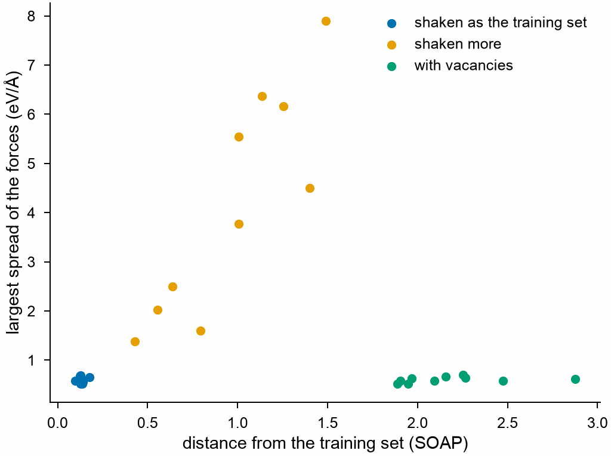

# Uncertainty and novelty

A model is unsure where it has not been trained. Two measures find such
frames without labels, to choose the ones worth a DFT calculation:
`committee` gives how much the predictions of several models differ, such
as NEP models trained with other seeds, or models of other kinds; and
`novelty` how far a frame lies from all frames of the training set in the
space of descriptors, such as [SOAP](soap.md). Neither depends on the
kind of model.

<!-- files: ../getting-started/tutorials/crconi -->
```python
import numpy as np

import mdapy as mp
from mdapy.calculators import EAM, NEP
from mdapy.mlip import SOAP, committee, novelty, structure_descriptors
from mdapy.visualization import plot

sqs = mp.read("SQS.xyz")  # 108 atoms of CrCoNi
rng = np.random.default_rng(1)


def shaken(amplitude, missing=0):
    """The alloy with its atoms shaken, and some atoms taken away."""
    moved = sqs.with_columns(
        positions=sqs["positions"] + rng.normal(0, amplitude, (len(sqs), 3))
    )
    keep = np.ones(len(sqs), dtype=bool)
    keep[rng.choice(len(sqs), missing, replace=False)] = False
    return moved.filter(keep)


train = [shaken(a) for a in np.linspace(0.02, 0.08, 20)]
candidates = {
    "shaken as the training set": [shaken(0.05) for _ in range(10)],
    "shaken more": [shaken(a) for a in np.linspace(0.12, 0.2, 10)],
    "with vacancies": [shaken(0.05, missing=4) for _ in range(10)],
}

soap = SOAP(["Cr", "Co", "Ni"], r_cut=5.0, n_max=6, l_max=4)
known = structure_descriptors(train, soap)
models = [NEP("nep.txt"), EAM.zhou(["Cr", "Co", "Ni"])]
with plot.style():
    fig, ax = plot.figure()
    for name, frames in candidates.items():
        distance = novelty(structure_descriptors(frames, soap), known)
        spread = committee(frames, models).max_force  # eV/Å, the largest of each frame
        ax.scatter(distance, spread, s=10, label=name)
    ax.set_xlabel("distance from the training set (SOAP)")
    ax.set_ylabel("largest spread of the forces (eV/Å)")
    ax.legend()
    plot.save(fig, "images/uncertainty", formats=("png",))
```



*Thirty candidate frames of CrCoNi against a training set of the alloy
shaken by 0.02 to 0.08 Å, with a committee of two models, a NEP and an
EAM. Frames like the training set lie close to it, and the models agree
on them; frames shaken more lie farther, and the models differ the more
the farther they lie; frames with vacancies lie far from it, yet the
models agree on them. Each measure finds frames the other misses.*

With the descriptors of the training set and of the candidates,
[farthest point sampling](selection.md) then chooses among the frames far
from it.

## Parameters

| Function | Parameters |
|---|---|
| `committee(frames, calculators)` | the frames, and two or more models, any mdapy calculators |
| `novelty(points, reference=None)` | (M, D) points, such as the descriptors of frames, and (K, D) points to measure from, such as those of a training set; without them, each point is measured from the other points, and repeated frames are those at zero; computed on `get_num_threads()` threads |

## Results

`committee` gives a `CommitteeResult`:

| Attribute | Type | Unit | Meaning |
|---|---|---|---|
| `atoms` | (F,) int64 | | the number of atoms of each frame |
| `energy` | (F,) float64 | eV/atom | the standard deviation of the energy per atom over the models |
| `forces` | (A,) float64 | eV/Å | of each atom of all frames one after the other, the root mean square over the models of the distance of its force from their mean force |
| `max_force` | (F,) float64 | eV/Å | the largest of `forces` in each frame, the model deviation of DP-GEN |

`novelty` gives a (M,) float64 array: the Euclidean distance of each point
from the nearest point of the reference.

## Errors

`committee` raises `InvalidParameter` for fewer than two models or no
frames; `novelty` raises it for arrays that are not (M, D) and (K, D) of
one D, and for no point to measure from.

## See also

- [Errors of a model](errors.md), where labels exist.
- [Choosing frames](selection.md).
