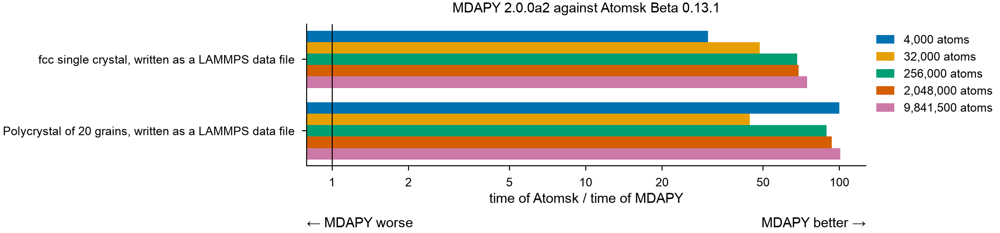

# Building structures

MDAPY and [Atomsk](https://atomsk.univ-lille.fr) build fcc copper as a
single crystal and as a polycrystal of 20 grains, and write it as a LAMMPS
data file, from 4 000 to nearly 10 million atoms. A program is timed only where it
builds the structure MDAPY builds.

## Results

An Apple M5 (10 cores: 4 performance, 6 efficiency), 24 GB, macOS 27, with an
editor and a browser open. Python 3.13, MDAPY 2.0.0a2 in development built with
Apple clang 21, and Atomsk Beta 0.13.1 built with GFortran and OpenMP. The
[analyses](comparison.md) run on another machine, so their times do not compare
with these.



### What they show

- **Single crystal**: MDAPY builds and writes it 32 to 54 times faster
  than Atomsk, 0.14 s against 7.5 s at nearly 10 million atoms; building it is
  a repetition of the cell, and most of the time is writing the file.
- **Polycrystal**: MDAPY is 24 to 94 times faster, 0.22 s against 19.1 s at
  nearly 10 million atoms; most of the time is writing the file here too.

### Times and memory

Every case at every size: the shortest of three times, and the memory each
build took, the peak resident memory of the process minus its peak before
the timings; that of Atomsk, a process of its own, is not counted.

#### Atomsk

| Case | Atoms | MDAPY 2.0.0a2 (s) | Atomsk Beta 0.13.1 (s) | Atomsk / MDAPY | MDAPY (MB) | Atomsk (MB) |
|---|---:|---:|---:|---:|---:|---:|
| fcc single crystal, written as a LAMMPS data file | 4,000 | 0.0005 | 0.016 | 31.96 | 0 | 0 |
| fcc single crystal, written as a LAMMPS data file | 32,000 | 0.0013 | 0.045 | 35.74 | 5 | 0 |
| fcc single crystal, written as a LAMMPS data file | 256,000 | 0.0062 | 0.209 | 33.67 | 45 | 0 |
| fcc single crystal, written as a LAMMPS data file | 2,048,000 | 0.032 | 1.540 | 47.72 | 135 | 0 |
| fcc single crystal, written as a LAMMPS data file | 9,841,500 | 0.139 | 7.519 | 54.13 | 443 | 0 |
| Polycrystal of 20 grains, written as a LAMMPS data file | 3,981 | 0.0013 | 0.032 | 23.89 | 0 | 0 |
| Polycrystal of 20 grains, written as a LAMMPS data file | 31,995 | 0.0020 | 0.100 | 50.67 | 9 | 0 |
| Polycrystal of 20 grains, written as a LAMMPS data file | 255,941 | 0.0088 | 0.555 | 63.27 | 78 | 0 |
| Polycrystal of 20 grains, written as a LAMMPS data file | 2,047,788 | 0.042 | 3.998 | 94.16 | 104 | 0 |
| Polycrystal of 20 grains, written as a LAMMPS data file | 9,841,309 | 0.222 | 19.148 | 86.42 | 455 | 0 |

## Cases

| Case | MDAPY | Atomsk |
|---|---|---|
| Single crystal | `mdapy.io.write(path, build_crystal("fcc", 3.615, elements="Cu", repeat=(n, n, n)))` | `atomsk --create fcc 3.615 Cu -duplicate n n n path.lmp` |
| Polycrystal | `mdapy.io.write(path, build_polycrystal(unit, box, seeds, orientations=rotations, min_distance=0.01))` | `atomsk --polycrystal unit.xsf parameters.txt path.lmp` |

Atomsk writes every structure it builds to a file, so both programs are
timed building the structure and writing it as a LAMMPS data file.

The polycrystal fills a cubic periodic box with 20 grains, the Voronoi cells
of 20 seeds at random places, each of fcc copper in a random orientation.
Both programs have the same seeds and orientations: Atomsk as a node line
with three angles of rotation, about x, then y, then z, and MDAPY as the
rotation matrices of those angles. Atomsk removes no atom where grains meet,
so MDAPY is asked to remove only atoms at the same place (`min_distance`
0.01 Å) rather than those closer than 0.7 times the nearest distance, as it
does by default.

## How it is measured

- MDAPY runs in a process of its own with 10 threads. Atomsk runs as a
  command from that process, with `OMP_NUM_THREADS` 10; the time of a build
  by Atomsk includes starting the program.
- Before the timings, a separate process builds the structure with both
  programs and reads both files with mdapy. Single crystal: the same box and
  the same atoms, in any order, within 1e-9 Å (Atomsk writes 12 decimals).
  Polycrystal: the same box, as many atoms within 0.5 %, and in each grain
  the same lattice. The atoms differ: each program places the lattice of a
  grain in its own way, MDAPY with a lattice site at the seed, Atomsk with
  the center of a block of lattice at a center of the cell, so that in a
  grain the atoms of Atomsk are those of MDAPY moved by one vector, a
  different one for each grain. The check finds that vector the same for
  every atom of a grain away from its faces, within 1e-6 Å.
- Each process first builds a structure of 500 atoms, then three times the
  structure; the shortest time counts.

## Running it

The comparison is `benchmarks/comparison.py` in the source repository, the
group `builders` of its cases. It runs the command `atomsk`, or the program
the environment variable `ATOMSK` names.

```bash
ATOMSK=/path/to/atomsk python benchmarks/comparison.py run --group builders \
    --sizes 4000 32000 256000 2048000 9841500 --threads 10 --memory 8 --timeout 1800 \
    --output builders.json   # as above
python benchmarks/comparison.py table builders.json
python benchmarks/comparison.py plot builders.json builders.png
```
