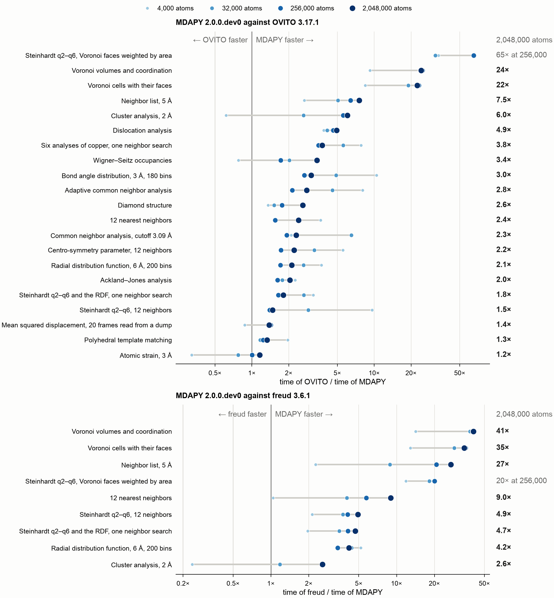

# MDAPY, OVITO and freud

The analyses that MDAPY shares with [OVITO](https://www.ovito.org) and
[freud](https://freud.readthedocs.io), computed on the same systems with
the same parameters, from 4 000 to 2 million atoms. A program is timed only
where it gives the result of MDAPY, atom by atom.

## Results

A node of the Triton cluster of Aalto University, alone for the run: two
Intel Xeon Gold 6230 (40 cores, two hardware threads each, two NUMA nodes),
191 GB, Linux. Python 3.13, MDAPY 2.0.0b1 built with GCC 12.3, OVITO 3.17.1
and freud 3.6.1 from pip, each with 40 threads. [Reading and writing
files](files.md) and [building structures](builders.md) ran on another
node, with Intel Xeon Gold 6148, so their times do not compare with these.



*How many times faster MDAPY is: a row for each case, the largest gain on
top, and a point for each size, larger and darker for more atoms; the number
on the right is the speed-up at the largest size. Left of 1×, the other program
is faster.*

### What they show

- **OVITO**: at 2 million atoms MDAPY is faster in every analysis they
  share. It builds neighbor lists 6.4 times faster in a quarter of the
  memory, Voronoi cells 20 to 21 times faster, computes Steinhardt
  parameters over Voronoi faces 472 times faster (1.5 s against 11
  minutes) and finds clusters 5.8 times faster; the other analyses take 1.3
  to 3.5 times less time. From 32 000 atoms on, only atomic strain is not
  faster: OVITO is faster below some 250 000 atoms (3 times at 4 000 and 2
  times at 32 000), the two are on par at 256 000, and MDAPY is 1.3 times
  faster at 2 million.
- **freud**: from 256 000 atoms on, MDAPY is faster in every analysis:
  neighbor lists 20 to 23 times, in a seventh of the memory; the 12 nearest
  neighbors 6 to 8 times; Voronoi cells 28 to 34 times; Steinhardt
  parameters over Voronoi faces 37 times; Steinhardt parameters and the
  radial distribution function 3.2 to 5.5 times; cluster analysis 1.8 to
  2.6 times. At 32 000 atoms the two are on par in cluster analysis.
- **One neighbor search for several analyses**: the six analyses of copper
  from one list take 0.89 s at 2 million atoms, against 1.55 s for the six
  cases timed apart (0.12 s against 0.23 s at 256 000; the radial
  distribution function apart reaches 6 Å instead of 5 Å). OVITO's pipeline
  of the six takes about the sum of its cases (3.15 s against 3.32 s).
- **Voronoi faces on demand**: the volumes and coordination of 2 million
  cells take MDAPY 1.10 s and 205 MB; with every face, its neighbor, area
  and edges, 1.27 s and 1.7 GB.
- **A trajectory**: the mean squared displacement of 20 frames read from a
  dump, most of the time spent reading, takes 1.6 to 1.7 times less time
  than with OVITO from 32 000 atoms on.
- **4 000 atoms** take a few milliseconds; MDAPY is faster there in every
  analysis but cluster analysis, Wigner–Seitz occupancies and atomic
  strain against OVITO, and cluster analysis against freud (0.006 s
  against 0.001 s).

### Times and memory

Every case at every size: the shortest of three times, and the memory each
computation took beyond the system, the peak resident memory of the
process minus its peak before the timings.

#### OVITO

| Case | Atoms | MDAPY 2.0.0b1 (s) | OVITO 3.17.1 (s) | OVITO / MDAPY | MDAPY (MB) | OVITO (MB) |
|---|---:|---:|---:|---:|---:|---:|
| Neighbor list, 5 Å | 4,000 | 0.0038 | 0.0086 | 2.2 | 0 | 13 |
| Neighbor list, 5 Å | 32,000 | 0.0082 | 0.035 | 4.3 | 17 | 133 |
| Neighbor list, 5 Å | 256,000 | 0.028 | 0.184 | 6.5 | 178 | 726 |
| Neighbor list, 5 Å | 2,048,000 | 0.218 | 1.386 | 6.4 | 1432 | 5417 |
| 12 nearest neighbors | 4,000 | 0.0024 | 0.0083 | 3.4 | 0 | 1 |
| 12 nearest neighbors | 32,000 | 0.0059 | 0.014 | 2.3 | 1 | 12 |
| 12 nearest neighbors | 256,000 | 0.033 | 0.054 | 1.7 | 53 | 111 |
| 12 nearest neighbors | 2,048,000 | 0.201 | 0.474 | 2.4 | 412 | 828 |
| Adaptive common neighbor analysis | 4,000 | 0.0019 | 0.016 | 8.1 | 0 | 0 |
| Adaptive common neighbor analysis | 32,000 | 0.0055 | 0.021 | 3.8 | 0 | 8 |
| Adaptive common neighbor analysis | 256,000 | 0.038 | 0.080 | 2.1 | 10 | 47 |
| Adaptive common neighbor analysis | 2,048,000 | 0.262 | 0.636 | 2.4 | 128 | 193 |
| Common neighbor analysis, cutoff 3.09 Å | 4,000 | 0.0034 | 0.0064 | 1.9 | 0 | 0 |
| Common neighbor analysis, cutoff 3.09 Å | 32,000 | 0.0042 | 0.0086 | 2.1 | 0 | 4 |
| Common neighbor analysis, cutoff 3.09 Å | 256,000 | 0.010 | 0.024 | 2.4 | 33 | 25 |
| Common neighbor analysis, cutoff 3.09 Å | 2,048,000 | 0.079 | 0.167 | 2.1 | 209 | 90 |
| Ackland–Jones analysis | 4,000 | 0.0021 | 0.0046 | 2.2 | 0 | 0 |
| Ackland–Jones analysis | 32,000 | 0.0070 | 0.012 | 1.8 | 0 | 8 |
| Ackland–Jones analysis | 256,000 | 0.043 | 0.073 | 1.7 | 11 | 47 |
| Ackland–Jones analysis | 2,048,000 | 0.303 | 0.609 | 2.0 | 128 | 194 |
| Polyhedral template matching | 4,000 | 0.015 | 0.027 | 1.8 | 0 | 1 |
| Polyhedral template matching | 32,000 | 0.043 | 0.045 | 1.1 | 5 | 9 |
| Polyhedral template matching | 256,000 | 0.260 | 0.312 | 1.2 | 77 | 37 |
| Polyhedral template matching | 2,048,000 | 1.967 | 2.512 | 1.3 | 591 | 245 |
| Centro-symmetry parameter, 12 neighbors | 4,000 | 0.0019 | 0.010 | 5.5 | 0 | 0 |
| Centro-symmetry parameter, 12 neighbors | 32,000 | 0.0060 | 0.016 | 2.6 | 0 | 8 |
| Centro-symmetry parameter, 12 neighbors | 256,000 | 0.037 | 0.062 | 1.7 | 11 | 39 |
| Centro-symmetry parameter, 12 neighbors | 2,048,000 | 0.233 | 0.516 | 2.2 | 140 | 185 |
| Diamond structure | 4,096 | 0.0028 | 0.0035 | 1.3 | 0 | 2 |
| Diamond structure | 32,768 | 0.0051 | 0.0092 | 1.8 | 0 | 20 |
| Diamond structure | 262,144 | 0.034 | 0.066 | 1.9 | 14 | 78 |
| Diamond structure | 2,000,376 | 0.216 | 0.542 | 2.5 | 171 | 354 |
| Steinhardt q2–q6, 12 neighbors | 4,000 | 0.0023 | 0.014 | 6.2 | 0 | 0 |
| Steinhardt q2–q6, 12 neighbors | 32,000 | 0.0081 | 0.017 | 2.2 | 0 | 8 |
| Steinhardt q2–q6, 12 neighbors | 256,000 | 0.053 | 0.068 | 1.3 | 18 | 54 |
| Steinhardt q2–q6, 12 neighbors | 2,048,000 | 0.347 | 0.557 | 1.6 | 141 | 156 |
| Steinhardt q2–q6, Voronoi faces weighted by area | 4,000 | 0.0038 | 0.296 | 77.6 | 1 | 1 |
| Steinhardt q2–q6, Voronoi faces weighted by area | 32,000 | 0.024 | 1.413 | 60.0 | 26 | 11 |
| Steinhardt q2–q6, Voronoi faces weighted by area | 256,000 | 0.180 | 23.417 | 130.1 | 226 | 43 |
| Steinhardt q2–q6, Voronoi faces weighted by area | 2,048,000 | 1.451 | 684.316 | 471.7 | 1744 | 141 |
| Radial distribution function, 6 Å, 200 bins | 4,000 | 0.0045 | 0.0059 | 1.3 | 0 | 0 |
| Radial distribution function, 6 Å, 200 bins | 32,000 | 0.0071 | 0.011 | 1.5 | 2 | 4 |
| Radial distribution function, 6 Å, 200 bins | 256,000 | 0.025 | 0.049 | 2.0 | 9 | 16 |
| Radial distribution function, 6 Å, 200 bins | 2,048,000 | 0.190 | 0.391 | 2.1 | 143 | 64 |
| Bond angle distribution, 3 Å, 180 bins | 4,000 | 0.0038 | 0.013 | 3.5 | 0 | 1 |
| Bond angle distribution, 3 Å, 180 bins | 32,000 | 0.0082 | 0.020 | 2.4 | 0 | 33 |
| Bond angle distribution, 3 Å, 180 bins | 256,000 | 0.030 | 0.083 | 2.8 | 38 | 268 |
| Bond angle distribution, 3 Å, 180 bins | 2,048,000 | 0.216 | 0.612 | 2.8 | 235 | 1412 |
| Voronoi volumes and coordination | 4,000 | 0.0058 | 0.045 | 7.7 | 0 | 0 |
| Voronoi volumes and coordination | 32,000 | 0.022 | 0.358 | 16.2 | 0 | 2 |
| Voronoi volumes and coordination | 256,000 | 0.139 | 2.905 | 20.9 | 20 | 10 |
| Voronoi volumes and coordination | 2,048,000 | 1.100 | 23.019 | 20.9 | 205 | 91 |
| Voronoi cells with their faces | 4,000 | 0.0069 | 0.047 | 6.8 | 0 | 2 |
| Voronoi cells with their faces | 32,000 | 0.022 | 0.391 | 17.4 | 23 | 17 |
| Voronoi cells with their faces | 256,000 | 0.170 | 3.149 | 18.6 | 208 | 129 |
| Voronoi cells with their faces | 2,048,000 | 1.274 | 25.218 | 19.8 | 1715 | 989 |
| Cluster analysis, 2 Å | 3,998 | 0.0062 | 0.0023 | 0.4 | 0 | 0 |
| Cluster analysis, 2 Å | 31,966 | 0.0092 | 0.019 | 2.1 | 1 | 6 |
| Cluster analysis, 2 Å | 255,756 | 0.041 | 0.154 | 3.8 | 32 | 24 |
| Cluster analysis, 2 Å | 2,046,192 | 0.352 | 2.035 | 5.8 | 218 | 0 |
| Wigner–Seitz occupancies | 3,974 | 0.0020 | 0.0010 | 0.5 | 0 | 0 |
| Wigner–Seitz occupancies | 31,811 | 0.0036 | 0.0061 | 1.7 | 0 | 8 |
| Wigner–Seitz occupancies | 254,734 | 0.024 | 0.036 | 1.5 | 10 | 44 |
| Wigner–Seitz occupancies | 2,037,841 | 0.102 | 0.320 | 3.1 | 124 | 262 |
| Mean squared displacement, 20 frames read from a dump | 4,000 | 0.040 | 0.043 | 1.1 | 22 | 8 |
| Mean squared displacement, 20 frames read from a dump | 32,000 | 0.163 | 0.257 | 1.6 | 179 | 48 |
| Mean squared displacement, 20 frames read from a dump | 256,000 | 1.154 | 1.881 | 1.6 | 569 | 318 |
| Mean squared displacement, 20 frames read from a dump | 2,048,000 | 8.917 | 14.884 | 1.7 | 2435 | 963 |
| Six analyses of copper, one neighbor search | 4,000 | 0.012 | 0.064 | 5.6 | 0 | 7 |
| Six analyses of copper, one neighbor search | 32,000 | 0.023 | 0.105 | 4.5 | 20 | 76 |
| Six analyses of copper, one neighbor search | 256,000 | 0.122 | 0.397 | 3.3 | 195 | 508 |
| Six analyses of copper, one neighbor search | 2,048,000 | 0.889 | 3.148 | 3.5 | 1432 | 1808 |
| Steinhardt q2–q6 and the RDF, one neighbor search | 4,000 | 0.0032 | 0.019 | 6.0 | 0 | 1 |
| Steinhardt q2–q6 and the RDF, one neighbor search | 32,000 | 0.012 | 0.028 | 2.4 | 19 | 9 |
| Steinhardt q2–q6 and the RDF, one neighbor search | 256,000 | 0.079 | 0.100 | 1.3 | 180 | 44 |
| Steinhardt q2–q6 and the RDF, one neighbor search | 2,048,000 | 0.469 | 0.793 | 1.7 | 1431 | 177 |
| Atomic strain, 3 Å | 4,000 | 0.0036 | 0.0011 | 0.3 | 0 | 0 |
| Atomic strain, 3 Å | 32,000 | 0.0065 | 0.0033 | 0.5 | 1 | 6 |
| Atomic strain, 3 Å | 256,000 | 0.015 | 0.014 | 0.9 | 28 | 43 |
| Atomic strain, 3 Å | 2,048,000 | 0.069 | 0.092 | 1.3 | 241 | 247 |

#### freud

| Case | Atoms | MDAPY 2.0.0b1 (s) | freud 3.6.1 (s) | freud / MDAPY | MDAPY (MB) | freud (MB) |
|---|---:|---:|---:|---:|---:|---:|
| Neighbor list, 5 Å | 4,000 | 0.0038 | 0.0073 | 1.9 | 0 | 12 |
| Neighbor list, 5 Å | 32,000 | 0.0082 | 0.062 | 7.6 | 17 | 195 |
| Neighbor list, 5 Å | 256,000 | 0.028 | 0.581 | 20.5 | 178 | 1584 |
| Neighbor list, 5 Å | 2,048,000 | 0.218 | 4.946 | 22.7 | 1432 | 9711 |
| 12 nearest neighbors | 4,000 | 0.0024 | 0.0027 | 1.1 | 0 | 3 |
| 12 nearest neighbors | 32,000 | 0.0059 | 0.023 | 3.8 | 1 | 53 |
| 12 nearest neighbors | 256,000 | 0.033 | 0.202 | 6.1 | 53 | 423 |
| 12 nearest neighbors | 2,048,000 | 0.201 | 1.657 | 8.2 | 412 | 3307 |
| Steinhardt q2–q6, 12 neighbors | 4,000 | 0.0023 | 0.0037 | 1.6 | 0 | 1 |
| Steinhardt q2–q6, 12 neighbors | 32,000 | 0.0081 | 0.026 | 3.3 | 0 | 16 |
| Steinhardt q2–q6, 12 neighbors | 256,000 | 0.053 | 0.218 | 4.1 | 18 | 126 |
| Steinhardt q2–q6, 12 neighbors | 2,048,000 | 0.347 | 1.902 | 5.5 | 141 | 954 |
| Steinhardt q2–q6, Voronoi faces weighted by area | 4,000 | 0.0038 | 0.107 | 28.1 | 1 | 6 |
| Steinhardt q2–q6, Voronoi faces weighted by area | 32,000 | 0.024 | 0.816 | 34.6 | 26 | 62 |
| Steinhardt q2–q6, Voronoi faces weighted by area | 256,000 | 0.180 | 6.613 | 36.7 | 226 | 465 |
| Steinhardt q2–q6, Voronoi faces weighted by area | 2,048,000 | 1.451 | 53.477 | 36.9 | 1744 | 3714 |
| Radial distribution function, 6 Å, 200 bins | 4,000 | 0.0045 | 0.0081 | 1.8 | 0 | 0 |
| Radial distribution function, 6 Å, 200 bins | 32,000 | 0.0071 | 0.018 | 2.6 | 2 | 34 |
| Radial distribution function, 6 Å, 200 bins | 256,000 | 0.025 | 0.090 | 3.6 | 9 | 62 |
| Radial distribution function, 6 Å, 200 bins | 2,048,000 | 0.190 | 0.770 | 4.1 | 143 | 229 |
| Voronoi volumes and coordination | 4,000 | 0.0058 | 0.072 | 12.5 | 0 | 6 |
| Voronoi volumes and coordination | 32,000 | 0.022 | 0.611 | 27.7 | 0 | 61 |
| Voronoi volumes and coordination | 256,000 | 0.139 | 4.671 | 33.6 | 20 | 465 |
| Voronoi volumes and coordination | 2,048,000 | 1.100 | 37.732 | 34.3 | 205 | 3690 |
| Voronoi cells with their faces | 4,000 | 0.0069 | 0.076 | 10.9 | 0 | 6 |
| Voronoi cells with their faces | 32,000 | 0.022 | 0.603 | 26.9 | 23 | 61 |
| Voronoi cells with their faces | 256,000 | 0.170 | 4.826 | 28.4 | 208 | 466 |
| Voronoi cells with their faces | 2,048,000 | 1.274 | 38.844 | 30.5 | 1715 | 3692 |
| Cluster analysis, 2 Å | 3,998 | 0.0062 | 0.0009 | 0.1 | 0 | 0 |
| Cluster analysis, 2 Å | 31,966 | 0.0092 | 0.0082 | 0.9 | 1 | 0 |
| Cluster analysis, 2 Å | 255,756 | 0.041 | 0.074 | 1.8 | 32 | 26 |
| Cluster analysis, 2 Å | 2,046,192 | 0.352 | 0.901 | 2.6 | 218 | 248 |
| Steinhardt q2–q6 and the RDF, one neighbor search | 4,000 | 0.0032 | 0.014 | 4.3 | 0 | 2 |
| Steinhardt q2–q6 and the RDF, one neighbor search | 32,000 | 0.012 | 0.042 | 3.6 | 19 | 14 |
| Steinhardt q2–q6 and the RDF, one neighbor search | 256,000 | 0.079 | 0.254 | 3.2 | 180 | 148 |
| Steinhardt q2–q6 and the RDF, one neighbor search | 2,048,000 | 0.469 | 2.105 | 4.5 | 1431 | 872 |

## Cases

| Case | System | MDAPY | OVITO | freud |
|---|---|---|---|---|
| Neighbor list, 5 Å | fcc Cu | `NeighborList.build(system, 5.0)` | `CutoffNeighborFinder(5.0, data).find_all()` | `AABBQuery(box, points).query(points, {"r_max": 5.0, "exclude_ii": True}).toNeighborList()` |
| 12 nearest neighbors | fcc Cu | `NeighborList.build(system, num_neighbors=12)` | `NearestNeighborFinder(12, data).find_all()` | the same query with `{"num_neighbors": 12, "exclude_ii": True}` |
| Adaptive common neighbor analysis | fcc Cu | `CommonNeighborAnalysis()` | `CommonNeighborAnalysisModifier()` | |
| Common neighbor analysis, cutoff 3.09 Å | fcc Cu | `CommonNeighborAnalysis(3.086)` | `CommonNeighborAnalysisModifier(mode=FixedCutoff, cutoff=3.086)` | |
| Ackland–Jones analysis | fcc Cu | `AcklandJonesAnalysis()` | `AcklandJonesModifier()` | |
| Polyhedral template matching | fcc Cu | `PolyhedralTemplateMatching()` | `PolyhedralTemplateMatchingModifier()` | |
| Centro-symmetry parameter | fcc Cu | `CentroSymmetryParameter(12)` | `CentroSymmetryModifier(num_neighbors=12)` | |
| Diamond structure | diamond Si | `DiamondStructure()` | `IdentifyDiamondModifier()` | |
| Steinhardt q2–q6, 12 neighbors | fcc Cu | `SteinhardtParameters((2, 3, 4, 5, 6), num_neighbors=12)` | `SteinhardtParametersModifier(neighbor_mode=NearestNeighbors, num_neighbors=12, max_l=6)` | `Steinhardt([2, 3, 4, 5, 6])` with `{"num_neighbors": 12, "exclude_ii": True}` |
| Steinhardt q2–q6, Voronoi | fcc Cu | `SteinhardtParameters((2, 3, 4, 5, 6), voronoi=True, weighted=True)` | `SteinhardtParametersModifier(neighbor_mode=Voronoi, max_l=6)` | `Voronoi()`, then `Steinhardt([2, 3, 4, 5, 6], weighted=True)` on its neighbors |
| Radial distribution function | fcc Cu | `RadialDistributionFunction(6.0, bins=200)` | `CoordinationAnalysisModifier(cutoff=6.0, number_of_bins=200)` | `RDF(bins=200, r_max=6.0)` |
| Bond angle distribution | fcc Cu | `BondAngleDistribution(cutoff=3.0, bins=180)` | `CreateBondsModifier(cutoff=3.0)`, `BondAngleDistributionModifier(bins=180)` | |
| Voronoi volumes and coordination | fcc Cu | `VoronoiAnalysis()` | `VoronoiAnalysisModifier()` | `Voronoi()` |
| Voronoi cells with their faces | fcc Cu | `VoronoiAnalysis(faces=True)` | `VoronoiAnalysisModifier(generate_bonds=True)` | `Voronoi()` |
| Cluster analysis, 2 Å | random points | `ClusterAnalysis(cutoff=2.0)` | `ClusterAnalysisModifier(cutoff=2.0, sort_by_size=True)` | `Cluster()` with `{"r_max": 2.0}` |
| Wigner–Seitz occupancies | fcc Cu, 0.5 % vacancies | `WignerSeitz(reference)` | `WignerSeitzAnalysisModifier()` | |
| Atomic strain, 3 Å | strained fcc Cu | `AtomicStrain(reference, 3.0)` | `AtomicStrainModifier(cutoff=3.0)` | |
| Mean squared displacement, 20 frames | fcc Cu walking at random, read from a dump | `MeanSquaredDisplacement(unwrap=False).compute(read_trajectory(path))` | `DiffusionModifier()` over the frames of the file | |
| Six analyses of copper, one neighbor search | fcc Cu | `NeighborList.build(system, 5.0)` given to the analyses of adaptive common neighbors, Ackland–Jones, centro-symmetry, Steinhardt (12 neighbors), the radial distribution function within 5 Å and bond angles within 3 Å | one pipeline of the six modifiers | |
| Steinhardt q2–q6 and the RDF, one neighbor search | fcc Cu | `NeighborList.build(system, 5.0)` given to both | one pipeline of the two modifiers | one `AABBQuery` for both |

The fcc copper has its atoms displaced at random by 0.1 Å along each axis,
as at room temperature; the silicon by 0.05 Å. The random points have the
density of copper and, with a cutoff of 2 Å, are close to percolation, so
that clusters of every size form; points with a neighbor within 1e-4 Å of
2 Å are left out, so that single precision gives the same bonds. OVITO's
coordination analysis also counts the neighbors of each atom along with the
radial distribution function.

## How it is measured

- Each program runs in a process of its own, with the same number of
  threads (`MDAPY_NUM_THREADS`, `OVITO_THREAD_COUNT` and
  `freud.parallel.set_num_threads`).
- Before the timings, a separate process computes the case with MDAPY and
  with the other program and compares the results. With OVITO, which
  computes in double precision as MDAPY does: the same structure types,
  cluster sizes, occupancies and bins, floating-point values within 1e-10
  (1e-8 for Steinhardt parameters weighted by Voronoi faces, whose areas
  come from two tessellations), for neighbor lists the same number of
  neighbors of each atom and the same sum of their distances, and for
  Voronoi cells the same volumes and numbers of faces, and with the faces
  as many of OVITO's bonds at each atom, but for faces of no area that one
  tessellation of millions of atoms finds and the other not (at most one
  atom in 100 000). freud computes in single precision, which
  rounds positions in a box of 600 Å by some 3e-5 Å: values agree within
  1e-4; the numbers of neighbors and the bins of the radial distribution
  function within the pairs closer than 1e-4 Å to a cutoff or the edge of a
  bin; Steinhardt parameters of the 12 nearest agree with those MDAPY
  computes from the positions freud has, within 3e-4, for the atoms whose
  12th and 13th neighbors are farther apart than 1e-4 Å, nearly all (freud's
  harmonics in single precision differ by 2e-5 for all but a few atoms in a
  million, by up to 2e-4 for those); every Voronoi face of freud above
  0.01 Ų is one of MDAPY, and the faces freud leaves out, of distant
  neighbors, are all below 0.02 Ų, so its Steinhardt parameters over Voronoi faces agree within 1e-3.
  The mean squared displacements agree within 1e-10. A program that
  differs is not timed.
- Each process first computes the case for 500 atoms, so that loading
  libraries and starting threads are not timed, then three times for the
  system; the shortest time counts.
- The time runs from the call to the result, with every neighbor search.
  Making the system and converting it into OVITO's data collection or
  freud's box and points are not timed. OVITO computes a new pipeline each
  time, so nothing is cached.
- A process that grows beyond 170 GB or runs for more than 15 minutes is
  stopped (80 minutes for Steinhardt parameters over Voronoi faces at 2
  million atoms, which take OVITO 11 minutes each time), and a size is
  skipped where the previous one predicts more memory.

## Running it

The comparison is `benchmarks/comparison.py` in the source repository. It
needs OVITO (`pip install ovito`), freud (`pip install freud-analysis`)
and, for the figure, matplotlib.

```bash
python benchmarks/comparison.py run                     # every case
python benchmarks/comparison.py run cna voronoi --sizes 4000 32000 --threads 1
python benchmarks/comparison.py run --sizes 4000 32000 256000 2048000 \
    --threads 40 --memory 170 --timeout 900                # as above
python benchmarks/comparison.py table results.json      # Markdown tables
python benchmarks/comparison.py plot results.json ratio.png
```

`run` appends one line of JSON per case and size to `results.json` (the
option `--output`): the machine, the versions, the agreement of each
program, and the times and peak memory of each. A new case is a `Case` in
`_cases()`: how to make its system, the MDAPY call, and for each other
program its call and how to compare its result with that of MDAPY.
