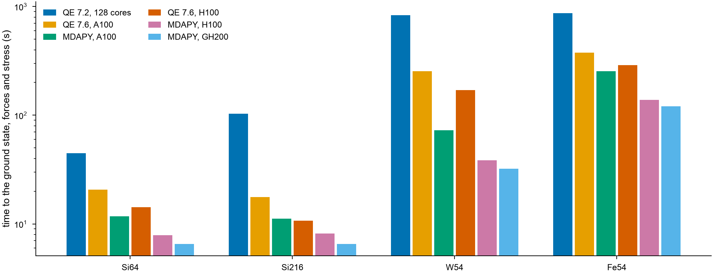

# Plane-wave DFT

MDAPY's [plane-wave DFT](../user-guide/potentials/dft.md) and Quantum ESPRESSO's
`pw.x` compute the same four configurations to their ground state, with the forces and
the stress: MDAPY on one GPU, `pw.x` on the same GPUs and on a whole node of processors.
Both take the same cells, pseudopotentials, cutoffs, meshes of k-points, smearing,
numbers of bands, first magnetic moments and functional, the PBE of Quantum ESPRESSO
(`"pbe_pw"`).

| Case | Atoms | Pseudopotentials | Cutoff (Ha) | Density cutoff (Ha) | k-points | Bands | Smearing, spin |
|---|---:|---|---:|---:|---|---:|---|
| Si64 | 64 | PseudoDojo 0.4, norm-conserving | 18 | 72 | 2 × 2 × 2, 8 | 141 | none |
| Si216 | 216 | PseudoDojo 0.4, norm-conserving | 18 | 72 | Γ | 476 | none |
| W54 | 54 | PseudoDojo 0.4, norm-conserving, 5s and 5p in the valence | 37 | 148 | 2 × 2 × 2, 8 | 454 | Marzari–Vanderbilt, 0.01 Ha |
| Fe54 | 54 | pslibrary 1.0.0, PAW, 3s and 3p in the valence | 35.5 | 248 | 2 × 2 × 2, 8 | 519 | Gaussian, 0.01 Ha; 2.5 μB per atom |

The cutoffs are the "normal" hints of PseudoDojo and the suggested minimum of the
pslibrary file; the numbers of bands are MDAPY's defaults, given to `pw.x` too.

## Results

Nodes of the Triton cluster of Aalto University: an NVIDIA A100-SXM4-80GB, an NVIDIA H100
80GB HBM3 and an NVIDIA GH200 144G HBM3e (a Grace processor, aarch64), and two AMD EPYC
7713 of 64 cores each.

- MDAPY: branch `dft`, built with CUDA 12.6.2 and GCC 13.3.0 (CUDA 12.9 and GCC 14 of
  conda-forge on the GH200).
- Quantum ESPRESSO 7.6 on the GPUs, built for this comparison with the NVIDIA HPC SDK
  23.9: CUDA Fortran and OpenACC, cuFFT, cuBLAS and cuSOLVER, one MPI process on one GPU.
- Quantum ESPRESSO 7.2 of the cluster on the processors (OpenBLAS, FFTW and ScaLAPACK),
  128 MPI processes, as many pools of k-points as k-points.



*The time of a whole run, from the start to the forces and the stress: lower is faster.
Si216 runs at Γ alone, where both codes use real wavefunctions. Quantum ESPRESSO's
Fe54 mixes with its local Thomas–Fermi screening, the only one of its mixings that
converged.*

### Times

The time of a run in seconds, its steps of the self-consistent field, the time of a
step, and the free energy against that of MDAPY on the H100.

| Case | Run | Steps | Time (s) | Per step (s) | ΔE (meV/atom) |
|---|---|---:|---:|---:|---:|
| Si64 | Quantum ESPRESSO 7.2, 128 cores | 13 | 44.6 | 3.43 | -0.001 |
| Si64 | Quantum ESPRESSO 7.6, A100 | 13 | 20.6 | 1.58 | 0.000 |
| Si64 | MDAPY, A100 | 9 | 11.8 | 1.31 | 0.000 |
| Si64 | Quantum ESPRESSO 7.6, H100 | 13 | 14.3 | 1.10 | 0.000 |
| Si64 | MDAPY, H100 | 9 | 7.9 | 0.87 | 0.000 |
| Si64 | MDAPY, GH200 | 9 | 6.5 | 0.73 | 0.000 |
| Si216 | Quantum ESPRESSO 7.2, 128 cores | 18 | 103.5 | 5.75 | -0.001 |
| Si216 | Quantum ESPRESSO 7.6, A100 | 18 | 17.7 | 0.98 | 0.000 |
| Si216 | MDAPY, A100 | 12 | 11.1 | 0.93 | 0.000 |
| Si216 | Quantum ESPRESSO 7.6, H100 | 18 | 10.7 | 0.59 | 0.000 |
| Si216 | MDAPY, H100 | 12 | 8.2 | 0.68 | 0.000 |
| Si216 | MDAPY, GH200 | 12 | 6.5 | 0.54 | 0.000 |
| W54 | Quantum ESPRESSO 7.2, 128 cores | 34 | 833.2 | 24.51 | -0.003 |
| W54 | Quantum ESPRESSO 7.6, A100 | 34 | 254.0 | 7.47 | 0.000 |
| W54 | MDAPY, A100 | 10 | 72.7 | 7.27 | 0.000 |
| W54 | Quantum ESPRESSO 7.6, H100 | 34 | 170.5 | 5.02 | 0.000 |
| W54 | MDAPY, H100 | 10 | 38.6 | 3.86 | 0.000 |
| W54 | MDAPY, GH200 | 10 | 32.2 | 3.22 | 0.000 |
| Fe54 | Quantum ESPRESSO 7.2, 128 cores | 30 | 867.5 | 28.92 | +0.220 |
| Fe54 | Quantum ESPRESSO 7.6, A100 | 31 | 376.4 | 12.14 | +0.112 |
| Fe54 | MDAPY, A100 | 31 | 254.2 | 8.20 | 0.000 |
| Fe54 | Quantum ESPRESSO 7.6, H100 | 31 | 288.8 | 9.32 | +0.112 |
| Fe54 | MDAPY, H100 | 31 | 138.0 | 4.45 | 0.000 |
| Fe54 | MDAPY, GH200 | 31 | 120.9 | 3.90 | 0.000 |

### What they show

- **On the same GPU** MDAPY reaches the ground state 1.3 to 4.4 times as fast as
  Quantum ESPRESSO 7.6: 1.8 times for Si64 on the A100 and on the H100, 1.6 and 1.3 for
  Si216, 3.5 and 4.4 for W54, 1.5 and 2.1 for Fe54.
- **A step** of `pw.x` takes 0.9 to 1.3 times as long as one of MDAPY for silicon and
  tungsten, 1.5 to 2.1 times as long for the PAW iron with spin.
- **Fewer steps**: MDAPY mixes the densities by Pulay's method in the metric of Kresse
  and Furthmüller with Kerker's preconditioner, and converges W54 in 10 steps where
  `pw.x` takes 34 with its defaults, Si64 in 9 against 13, Si216 in 12 against 18. For
  Fe54 both take 31 steps, `pw.x` once given its local Thomas–Fermi screening: its plain
  mixing of 0.7 diverges and that of 0.3 is not converged after 100 steps.
- **Against a node of processors**, 128 cores running Quantum ESPRESSO 7.2, one A100
  runs MDAPY 3.4 to 11 times as fast, one H100 6 to 22 times.
- The GH200 runs MDAPY 1.1 to 1.3 times as fast as the H100, the H100 1.4 to 1.9 times as
  fast as the A100.
- **The energies** agree with Quantum ESPRESSO 7.6 to 1e-3 meV per atom for silicon,
  also where both take real wavefunctions at Γ, and for tungsten. For iron they differ by
  0.11 meV per atom: Quantum ESPRESSO's PBE with spin takes the γ of its correlation as
  0.031091 where PBE has (1 − ln 2)/π², which moves its energy by 4e-6 Ha per atom of
  iron; the [comparisons of the tests](../user-guide/potentials/dft.md#how-the-results-compare-with-quantum-espresso) take that difference
  into account and then agree to 1e-7 Ha. Quantum ESPRESSO 7.2 differs from 7.6 by
  another 0.1 meV per atom for this PAW iron. With `"pbe"`, the constants of libxc,
  MDAPY's energies would move by 0.01 to 0.25 meV per atom.

## On several GPUs

With `comm`, the processes of one configuration share its pairs of spin and k-point,
one GPU each ([Many GPUs](../user-guide/potentials/dft.md#many-gpus)). On a node of four
NVIDIA Tesla V100-PCIE-32GB, the processes started by the `mpiexec` of MPICH 5.0.2 from
PyPI:

| Case | Pairs of spin and k-point | 1 GPU (s) | 2 GPUs (s) | 4 GPUs (s) | Speedup on 4 |
|---|---:|---:|---:|---:|---:|
| W54 | 8 | 155.3 | 81.4 | 43.8 | 3.5 |
| Fe54 | 16 | 548.8 | 295.8 | 171.4 | 3.2 |

The energies are the same to the last digit printed, 1e-6 eV. What the processes do not
share, the density on the grid, the mixing and, for PAW, the one-center terms of every
atom, every process does in full; it takes the rest of the time.

## How it was measured

- The cells are perfect crystals, 2 × 2 × 2 and 3 × 3 × 3 cubic cells of silicon
  (a = 5.431 Å), 3 × 3 × 3 of bcc tungsten (3.17 Å) and of bcc iron (2.83 Å), every
  fractional coordinate moved by a normal draw of 0.003 (seed 0), so that neither code
  finds a symmetry beyond time reversal.
- MDAPY stops when the energy changes by less than 1e-6 eV and the Hartree energy of the
  change of the density is below 1e-7 Ha; `pw.x` when its estimated error of the energy
  is below 1e-8 Ry.
- MDAPY mixes with its defaults: 0.7 of the residual, Kerker's preconditioner of
  1.5 1/Å, 1.6 of the residual of the magnetization. `pw.x` mixes with 0.7 of the residual,
  its default, and for Fe54 0.3 with `mixing_mode = 'local-TF'`.
- Si216: `pw.x` with `K_POINTS gamma`, its real wavefunctions; with complex ones it took
  39.7 s on the A100, 23.0 s on the H100 and 240 s on the processors. MDAPY's bands are
  real at Γ by default.
- The time of MDAPY is that of the whole call of the self-consistent field, from the
  pseudopotentials read to the forces and the stress; that of `pw.x`, its wall time.
- Quantum ESPRESSO runs 7.6 on the GPUs and 7.2 on the processors: its GPU build needs
  the NVIDIA HPC SDK and was made for this comparison, while 7.2 is the build of the
  cluster, tuned for its processors.

## Running it

The comparison is `benchmarks/dft_performance.py` in the source repository. It downloads
the pseudopotentials, writes the inputs of `pw.x`, runs MDAPY, reads the outputs of
`pw.x` and draws the figure:

```bash
python benchmarks/dft_performance.py prepare perf
python benchmarks/dft_performance.py mdapy perf Fe54 a100      # one case on the GPU
cd perf/qe && mpirun -np 1 pw.x -in Fe54-tf.in > Fe54-tf-a100.out && cd ../..
python benchmarks/dft_performance.py qe perf Fe54 perf/qe/Fe54-tf-a100.out qe-a100
python benchmarks/dft_performance.py report perf
python benchmarks/dft_performance.py figure perf dft.png "qe-a100=QE, A100" "a100=MDAPY, A100"
```

On several GPUs, one process each:

```bash
mpiexec -n 4 python benchmarks/dft_performance.py mdapy perf Fe54 v100-x4 --mpi
```
