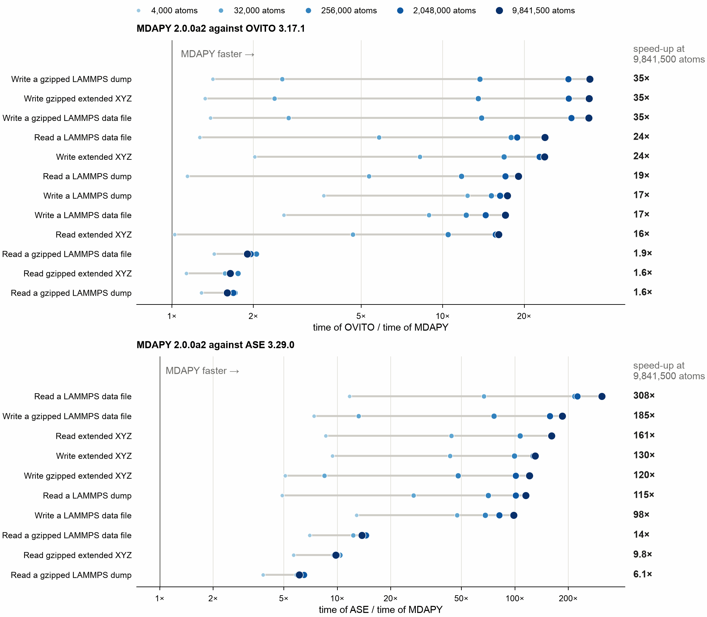

# Reading and writing files

MDAPY, [OVITO](https://www.ovito.org) and [ASE](https://wiki.fysik.dtu.dk/ase/)
read and write LAMMPS dumps, LAMMPS data files and extended XYZ of the same
systems, plain and gzipped, from 4 000 to nearly 10 million atoms. A program is timed only where it
reads the positions that MDAPY wrote, or writes a file that MDAPY reads back
as the system.

## Results

A node of the Triton cluster of Aalto University, alone for the run: two
Intel Xeon Gold 6148 (40 cores, two NUMA nodes), 191 GB, Linux. Python 3.13,
MDAPY 2.0.0a2 in development built with GCC 12.3, OVITO 3.17.1 and ASE 3.29.0
from pip. The [analyses](comparison.md) ran on another node, with Intel Xeon Gold
6248, so their times do not compare with these.



### What they show

- **OVITO**: from 32 000 atoms on, MDAPY reads the three formats 3.9 to
  19 times faster and writes them 4.3 to 24 times faster. At 4 000 atoms
  MDAPY reads 1.0 to 1.1 times faster and writes 1.0 to 3.6 times faster.
- **ASE**: from 32 000 atoms on, MDAPY reads 27 to 161 times faster and writes
  23 to 130 times faster; at 4 000 atoms, 4.9 to 10 and 5.0 to 9.4 times. ASE
  reads a data file of nearly 10 million atoms in 45 s and 18 GB of memory.
- **Gzip**: MDAPY compresses on all threads. From 256 000 atoms on it writes
  gzipped files 13 to 35 times faster than OVITO and 48 to 165 times faster
  than ASE. It reads them 1.1 to 1.8 times faster than OVITO and 3.8 to 13 times
  faster than ASE: most of that time is decompressing.
- **Nearly 10 million atoms** take MDAPY 0.12 to 0.62 s to read in each format,
  and 0.26 to 0.52 s to write with every digit; gzipped, 3.2 to 4.1 s to read and
  1.8 to 2.3 s to write.

### Times and memory

Every case at every size: the shortest of three times, and the memory each
call took beyond the system, the peak resident memory of the process minus
its peak before the timings.

#### OVITO

| Case | Atoms | MDAPY 2.0.0a2 (s) | OVITO 3.17.1 (s) | OVITO / MDAPY | MDAPY (MB) | OVITO (MB) |
|---|---:|---:|---:|---:|---:|---:|
| Read a LAMMPS dump | 4,000 | 0.0011 | 0.0013 | 1.14 | 0 | 1 |
| Read a LAMMPS dump | 32,000 | 0.0015 | 0.0082 | 5.34 | 1 | 5 |
| Read a LAMMPS dump | 256,000 | 0.0049 | 0.057 | 11.73 | 0 | 0 |
| Read a LAMMPS dump | 2,048,000 | 0.028 | 0.482 | 17.02 | 122 | 110 |
| Read a LAMMPS dump | 9,841,500 | 0.122 | 2.327 | 19.03 | 770 | 573 |
| Write a LAMMPS dump | 4,000 | 0.0007 | 0.0027 | 3.64 | 0 | 0 |
| Write a LAMMPS dump | 32,000 | 0.0015 | 0.019 | 12.33 | 2 | 0 |
| Write a LAMMPS dump | 256,000 | 0.010 | 0.151 | 15.09 | 30 | 0 |
| Write a LAMMPS dump | 2,048,000 | 0.073 | 1.195 | 16.27 | 54 | 0 |
| Write a LAMMPS dump | 9,841,500 | 0.334 | 5.772 | 17.30 | 39 | 0 |
| Read a LAMMPS data file | 4,000 | 0.0014 | 0.0015 | 1.09 | 0 | 0 |
| Read a LAMMPS data file | 32,000 | 0.0028 | 0.011 | 3.91 | 1 | 5 |
| Read a LAMMPS data file | 256,000 | 0.015 | 0.083 | 5.59 | 0 | 0 |
| Read a LAMMPS data file | 2,048,000 | 0.131 | 0.687 | 5.24 | 230 | 47 |
| Read a LAMMPS data file | 9,841,500 | 0.623 | 3.459 | 5.55 | 1196 | 125 |
| Write a LAMMPS data file | 4,000 | 0.0027 | 0.0027 | 1.01 | 0 | 0 |
| Write a LAMMPS data file | 32,000 | 0.0046 | 0.020 | 4.25 | 0 | 0 |
| Write a LAMMPS data file | 256,000 | 0.017 | 0.154 | 9.19 | 33 | 0 |
| Write a LAMMPS data file | 2,048,000 | 0.121 | 1.254 | 10.39 | 155 | 0 |
| Write a LAMMPS data file | 9,841,500 | 0.519 | 5.907 | 11.37 | 395 | 0 |
| Read extended XYZ | 4,000 | 0.0010 | 0.0011 | 1.02 | 0 | 0 |
| Read extended XYZ | 32,000 | 0.0016 | 0.0074 | 4.65 | 1 | 3 |
| Read extended XYZ | 256,000 | 0.0056 | 0.059 | 10.46 | 0 | 0 |
| Read extended XYZ | 2,048,000 | 0.031 | 0.484 | 15.68 | 111 | 0 |
| Read extended XYZ | 9,841,500 | 0.145 | 2.339 | 16.10 | 568 | 11 |
| Write extended XYZ | 4,000 | 0.0015 | 0.0031 | 2.02 | 0 | 0 |
| Write extended XYZ | 32,000 | 0.0025 | 0.021 | 8.24 | 1 | 0 |
| Write extended XYZ | 256,000 | 0.0096 | 0.162 | 16.81 | 20 | 0 |
| Write extended XYZ | 2,048,000 | 0.057 | 1.292 | 22.76 | 14 | 0 |
| Write extended XYZ | 9,841,500 | 0.262 | 6.226 | 23.78 | 0 | 0 |
| Read a gzipped LAMMPS dump | 4,000 | 0.0023 | 0.0030 | 1.28 | 0 | 0 |
| Read a gzipped LAMMPS dump | 32,000 | 0.012 | 0.019 | 1.62 | 0 | 1 |
| Read a gzipped LAMMPS dump | 256,000 | 0.086 | 0.147 | 1.71 | 0 | 0 |
| Read a gzipped LAMMPS dump | 2,048,000 | 0.718 | 1.210 | 1.69 | 142 | 32 |
| Read a gzipped LAMMPS dump | 9,841,500 | 3.663 | 5.854 | 1.60 | 830 | 0 |
| Write a gzipped LAMMPS dump | 4,000 | 0.019 | 0.026 | 1.41 | 0 | 0 |
| Write a gzipped LAMMPS dump | 32,000 | 0.084 | 0.214 | 2.55 | 8 | 0 |
| Write a gzipped LAMMPS dump | 256,000 | 0.131 | 1.794 | 13.70 | 62 | 0 |
| Write a gzipped LAMMPS dump | 2,048,000 | 0.508 | 14.797 | 29.11 | 106 | 0 |
| Write a gzipped LAMMPS dump | 9,841,500 | 2.008 | 69.989 | 34.86 | 85 | 0 |
| Read a gzipped LAMMPS data file | 4,000 | 0.0025 | 0.0033 | 1.35 | 0 | 1 |
| Read a gzipped LAMMPS data file | 32,000 | 0.012 | 0.022 | 1.78 | 0 | 3 |
| Read a gzipped LAMMPS data file | 256,000 | 0.092 | 0.168 | 1.82 | 0 | 0 |
| Read a gzipped LAMMPS data file | 2,048,000 | 0.809 | 1.380 | 1.70 | 140 | 13 |
| Read a gzipped LAMMPS data file | 9,841,500 | 4.127 | 6.684 | 1.62 | 752 | 48 |
| Write a gzipped LAMMPS data file | 4,000 | 0.021 | 0.026 | 1.27 | 0 | 0 |
| Write a gzipped LAMMPS data file | 32,000 | 0.086 | 0.216 | 2.50 | 8 | 0 |
| Write a gzipped LAMMPS data file | 256,000 | 0.138 | 1.787 | 12.95 | 68 | 0 |
| Write a gzipped LAMMPS data file | 2,048,000 | 0.542 | 14.858 | 27.39 | 204 | 0 |
| Write a gzipped LAMMPS data file | 9,841,500 | 2.259 | 69.931 | 30.96 | 426 | 0 |
| Read gzipped extended XYZ | 4,000 | 0.0021 | 0.0024 | 1.13 | 0 | 0 |
| Read gzipped extended XYZ | 32,000 | 0.011 | 0.017 | 1.57 | 0 | 1 |
| Read gzipped extended XYZ | 256,000 | 0.077 | 0.134 | 1.75 | 0 | 0 |
| Read gzipped extended XYZ | 2,048,000 | 0.659 | 1.089 | 1.65 | 139 | 39 |
| Read gzipped extended XYZ | 9,841,500 | 3.188 | 5.236 | 1.64 | 671 | 0 |
| Write gzipped extended XYZ | 4,000 | 0.019 | 0.025 | 1.33 | 0 | 0 |
| Write gzipped extended XYZ | 32,000 | 0.083 | 0.198 | 2.39 | 7 | 0 |
| Write gzipped extended XYZ | 256,000 | 0.120 | 1.626 | 13.51 | 54 | 0 |
| Write gzipped extended XYZ | 2,048,000 | 0.457 | 13.309 | 29.15 | 65 | 0 |
| Write gzipped extended XYZ | 9,841,500 | 1.843 | 63.886 | 34.67 | 0 | 0 |

#### ASE

| Case | Atoms | MDAPY 2.0.0a2 (s) | ASE 3.29.0 (s) | ASE / MDAPY | MDAPY (MB) | ASE (MB) |
|---|---:|---:|---:|---:|---:|---:|
| Read a LAMMPS dump | 4,000 | 0.0011 | 0.0054 | 4.89 | 0 | 1 |
| Read a LAMMPS dump | 32,000 | 0.0015 | 0.041 | 26.79 | 1 | 5 |
| Read a LAMMPS dump | 256,000 | 0.0049 | 0.345 | 70.69 | 0 | 34 |
| Read a LAMMPS dump | 2,048,000 | 0.028 | 2.863 | 101.18 | 122 | 412 |
| Read a LAMMPS dump | 9,841,500 | 0.122 | 14.035 | 114.81 | 770 | 2208 |
| Read a LAMMPS data file | 4,000 | 0.0014 | 0.014 | 10.07 | 0 | 7 |
| Read a LAMMPS data file | 32,000 | 0.0028 | 0.124 | 44.82 | 1 | 59 |
| Read a LAMMPS data file | 256,000 | 0.015 | 1.012 | 67.98 | 0 | 510 |
| Read a LAMMPS data file | 2,048,000 | 0.131 | 8.181 | 62.35 | 230 | 4009 |
| Read a LAMMPS data file | 9,841,500 | 0.623 | 44.730 | 71.82 | 1196 | 18392 |
| Write a LAMMPS data file | 4,000 | 0.0027 | 0.014 | 5.00 | 0 | 0 |
| Write a LAMMPS data file | 32,000 | 0.0046 | 0.104 | 22.58 | 0 | 2 |
| Write a LAMMPS data file | 256,000 | 0.017 | 0.861 | 51.25 | 33 | 32 |
| Write a LAMMPS data file | 2,048,000 | 0.121 | 7.123 | 59.02 | 155 | 234 |
| Write a LAMMPS data file | 9,841,500 | 0.519 | 34.116 | 65.69 | 395 | 120 |
| Read extended XYZ | 4,000 | 0.0010 | 0.0089 | 8.60 | 0 | 1 |
| Read extended XYZ | 32,000 | 0.0016 | 0.070 | 43.88 | 1 | 8 |
| Read extended XYZ | 256,000 | 0.0056 | 0.602 | 106.70 | 0 | 52 |
| Read extended XYZ | 2,048,000 | 0.031 | 4.943 | 160.18 | 111 | 531 |
| Read extended XYZ | 9,841,500 | 0.145 | 23.354 | 160.76 | 568 | 2667 |
| Write extended XYZ | 4,000 | 0.0015 | 0.014 | 9.39 | 0 | 0 |
| Write extended XYZ | 32,000 | 0.0025 | 0.108 | 43.09 | 1 | 2 |
| Write extended XYZ | 256,000 | 0.0096 | 0.957 | 99.32 | 20 | 7 |
| Write extended XYZ | 2,048,000 | 0.057 | 7.232 | 127.40 | 14 | 16 |
| Write extended XYZ | 9,841,500 | 0.262 | 34.089 | 130.18 | 0 | 150 |
| Read a gzipped LAMMPS dump | 4,000 | 0.0023 | 0.0088 | 3.81 | 0 | 0 |
| Read a gzipped LAMMPS dump | 32,000 | 0.012 | 0.069 | 5.89 | 0 | 4 |
| Read a gzipped LAMMPS dump | 256,000 | 0.086 | 0.562 | 6.52 | 0 | 28 |
| Read a gzipped LAMMPS dump | 2,048,000 | 0.718 | 4.653 | 6.48 | 142 | 411 |
| Read a gzipped LAMMPS dump | 9,841,500 | 3.663 | 22.356 | 6.10 | 830 | 2259 |
| Read a gzipped LAMMPS data file | 4,000 | 0.0025 | 0.016 | 6.57 | 0 | 7 |
| Read a gzipped LAMMPS data file | 32,000 | 0.012 | 0.139 | 11.49 | 0 | 58 |
| Read a gzipped LAMMPS data file | 256,000 | 0.092 | 1.176 | 12.77 | 0 | 465 |
| Read a gzipped LAMMPS data file | 2,048,000 | 0.809 | 10.221 | 12.63 | 140 | 4006 |
| Read a gzipped LAMMPS data file | 9,841,500 | 4.127 | 48.558 | 11.77 | 752 | 18460 |
| Write a gzipped LAMMPS data file | 4,000 | 0.021 | 0.140 | 6.77 | 0 | 0 |
| Write a gzipped LAMMPS data file | 32,000 | 0.086 | 1.057 | 12.27 | 8 | 2 |
| Write a gzipped LAMMPS data file | 256,000 | 0.138 | 9.782 | 70.90 | 68 | 33 |
| Write a gzipped LAMMPS data file | 2,048,000 | 0.542 | 78.245 | 144.26 | 204 | 242 |
| Write a gzipped LAMMPS data file | 9,841,500 | 2.259 | 373.525 | 165.39 | 426 | 120 |
| Read gzipped extended XYZ | 4,000 | 0.0021 | 0.012 | 5.67 | 0 | 1 |
| Read gzipped extended XYZ | 32,000 | 0.011 | 0.101 | 9.51 | 0 | 7 |
| Read gzipped extended XYZ | 256,000 | 0.077 | 0.791 | 10.32 | 0 | 38 |
| Read gzipped extended XYZ | 2,048,000 | 0.659 | 6.576 | 9.98 | 139 | 550 |
| Read gzipped extended XYZ | 9,841,500 | 3.188 | 31.244 | 9.80 | 671 | 2742 |
| Write gzipped extended XYZ | 4,000 | 0.019 | 0.094 | 5.09 | 0 | 0 |
| Write gzipped extended XYZ | 32,000 | 0.083 | 0.699 | 8.44 | 7 | 2 |
| Write gzipped extended XYZ | 256,000 | 0.120 | 5.750 | 47.78 | 54 | 7 |
| Write gzipped extended XYZ | 2,048,000 | 0.457 | 46.186 | 101.15 | 65 | 2 |
| Write gzipped extended XYZ | 9,841,500 | 1.843 | 222.012 | 120.49 | 0 | 149 |

## Cases

| Case | MDAPY | OVITO | ASE |
|---|---|---|---|
| Read a LAMMPS dump | `mdapy.io.read(path)` | `import_file(path).compute()` | `ase.io.read(path, format="lammps-dump-text")` |
| Write a LAMMPS dump | `mdapy.io.write(path, system)` | `export_file(data, path, "lammps/dump", columns=[...], precision=17)` | ASE writes no dumps |
| Read a LAMMPS data file | `mdapy.io.read(path)` | `import_file(path, atom_style="atomic").compute()` | `ase.io.read(path, format="lammps-data", atom_style="atomic", units="metal")` |
| Write a LAMMPS data file | `mdapy.io.write(path, system)` | `export_file(data, path, "lammps/data", atom_style="atomic", precision=17)` | `ase.io.write(path, atoms, format="lammps-data", atom_style="atomic", masses=True)` |
| Read extended XYZ | `mdapy.io.read(path)` | `import_file(path).compute()` | `ase.io.read(path, format="extxyz")` |
| Write extended XYZ | `mdapy.io.write(path, system)` | `export_file(data, path, "xyz", columns=[...], precision=17)` | `ase.io.write(path, atoms, format="extxyz")` |

The gzipped cases are the same calls with a path that ends in `.gz`.

The system is fcc copper with its atoms displaced at random by 0.1 Å along
each axis. The dump holds the columns `id type x y z`; the data file the
atom style atomic, with the mass of copper; extended XYZ the species and the
positions.

MDAPY writes every number with as many digits as it takes to read it back
exactly, at most 17. OVITO is asked for 17 significant digits. ASE writes
the positions of a data file in full and those of extended XYZ with 8
decimals, so its extended XYZ is about a third smaller.

## How it is measured

- Each program runs in a process of its own. MDAPY and OVITO have 40
  threads (`MDAPY_NUM_THREADS`, `OVITO_THREAD_COUNT`); ASE reads and writes
  in Python on one.
- Before the timings, a separate process checks each program. Reading: the
  positions it reads are those MDAPY reads within 1e-12 Å, and the types and
  elements are the same. Writing: MDAPY reads back the file the program
  wrote, and finds the positions within 1e-12 Å (1e-8 Å for the extended
  XYZ of ASE) and the same types and elements. A program that differs is
  not timed.
- The file to read is written by MDAPY before the timings, so it is in the
  file cache of the operating system: the times are those of reading and
  parsing, not of the disk. Writing goes to the local disk of the node as
  the operating system takes it.
- Each process first reads or writes a system of 500 atoms, so that loading
  libraries and starting threads are not timed, then three times the
  system; the shortest time counts.
- Making the system, and converting it into OVITO's data collection or
  ASE's atoms for writing, are not timed.

## Running it

The comparison is `benchmarks/comparison.py` in the source repository, the
group `files` of its cases. It needs OVITO (`pip install ovito`) and ASE
(`pip install ase`).

```bash
python benchmarks/comparison.py run --group files \
    --sizes 4000 32000 256000 2048000 9841500 \
    --threads 40 --memory 170 --timeout 1800 --output files.json   # as above
python benchmarks/comparison.py table files.json
python benchmarks/comparison.py plot files.json files.png
```
